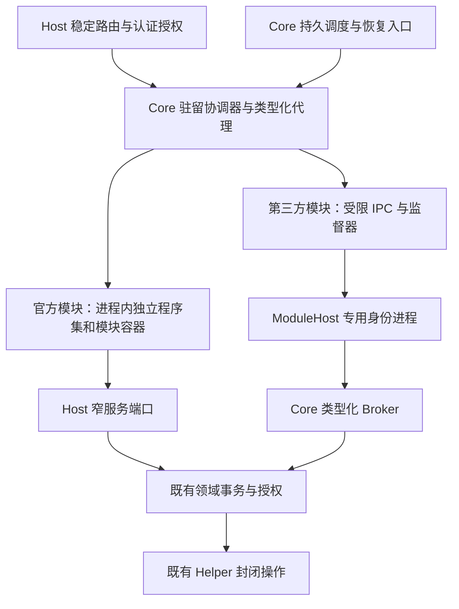

# Server 模块边界与内存回收设计

> 状态：分阶段实施，2026-11-03。已落地 MB-02/03 的 Git 仓库、CLI 与构建实现独立程序集及真实 ALC 回收，初始执行切片见 §10，仓库后续见 §11；MB-04 的 Proxy 共享读取、到期实例、guard/TUN 与发布恢复作用域边界已拆出，见 §12～19。完整安装包 ABI、Proxy 动态休眠、其余领域拆分与第三方 ModuleHost 闲时退出仍未实现。当前对象回收修复与测试证据由[驻留设计 §13](RelaxKonOS.ServerModuleResidency.Design.md#13-休眠内存引用审计与首批修复2026-11-03)拥有，不能作为本文整体完成的证明。
>
> 本文拥有为内存回收调整模块边界的目标、程序集依赖、资源所有权和迁移验收。[模块总设计](RelaxKonOS.ModulesAndExtensions.Design.md)拥有总体架构；[驻留设计](RelaxKonOS.ServerModuleResidency.Design.md)拥有状态机、租约与测量证据；[分发设计](RelaxKonOS.ServerModuleDistribution.Design.md)拥有安装和版本事务；[模块管理设计](RelaxKonOS.ServerModuleManagement.Design.md)拥有跨端产品和操作协议。Android 细节只在 Android 工程文档维护。

## 1. 目标与确定的决策

目标是使不使用的管理功能真正失去对业务对象、缓存、连接以及可选实现程序集的强引用，需要时按当前已安装的有效版本恢复。衡量对象是整个 Server 及其模块进程树，不能通过把内存移入另一个常驻进程声称节省。

1. 按持久职责、调用关系和资源所有权拆分，不按页面或现有文件夹机械拆分。Core 只保留必要的宿主基础设施和轻量调度；多个调用方使用同一实现不自动构成迁入 Core 的理由。
2. 官方模块继续遵循分发设计的进程内模型。实现移入独立程序集，经过对象生命周期迁移后再使用可回收加载上下文；不因本设计自动迁到第三方 ModuleHost。
3. 第三方代码继续只在 ModuleHost 执行，复用当前专用身份、IPC、代码信任和 Broker。为其增加闲时退出与按需启动，不开放第三方进程内执行。
4. 稳定路由、鉴权、模块目录、状态、调度和代理由 Host 持有；可回收实现不能直接注册进根 DI、Endpoint 或根 HostedService。
5. 安装、启停集合、更新、回退和移除继续遵循现有计划、重启和核实规则。内存唤醒固定使用当前生效版本；休眠不是版本切换或热更新入口。
6. 休眠不卸载磁盘文件、不丢失配置或操作台账，也不停止 Mihomo、sing-box、Squid、Docker、Nginx、Tailscale 等外部服务。外部资源变化仍由原领域事务与 Helper 决定。

不承诺固定节省量；不以强制 GC、裁剪工作集、缩短宽限期或中止用户工作代替边界调整。

## 2. 当前事实与结构性限制

| 当前入口 | 实际边界 | 调整要求 |
| --- | --- | --- |
| `Startup/Modules/`、`ServerModules.Catalog.cs` | Git 仓库/CLI/构建实现已拆出；Firewall、Tailscale 仍是 Host 内可销毁对象，其余领域仍有根服务 | 先消除根容器对重实现的持有，再独立项目 |
| `Residency/` | 协调器、依赖租约、后台工作、流所有权已存在 | 继续作为唯一准入和排空协调者，补充代码/进程释放观察 |
| `InstalledModuleStore.cs` 中的 `InstalledServerModule` | 官方包使用非 collectible ALC，启动阶段直接注册服务和路由 | 升级当前 ABI；仅打开 collectible 标志不足以回收 |
| `ModuleHostSupervisor.cs` | 已有第三方进程、信任和健康监督，生命周期随 Server | 把启动/退出接入驻留准入，保留原权限和故障隔离 |
| `ProxyModule.cs`、`ProxyRuntimeRegistration.cs` | 管理、引擎、恢复、安全、共享代理设置和运行时发布存在跨职责引用 | 为每种职责指定唯一所有者，不把整个 Proxy 搬入 Core |

对象回收、程序集卸载、磁盘占用及进程内存下降分别验收。对象释放成功只证明对象边界；调用 `AssemblyLoadContext.Unload()` 只表示请求卸载，仍需确认上下文与私有实现可回收。运行时依据见 [.NET 卸载文档](https://learn.microsoft.com/en-us/dotnet/standard/assembly/unloadability)。

## 3. 目标层次与依赖方向

图中的 Core 是职责边界，不要求立即把整个宿主基础设施移成一个新项目。项目拆分遵守以下方向：

| 层 | 放置内容 | 不得引用或持有 |
| --- | --- | --- |
| 共享 Protocol / `ServerModule.Abstractions` 及按领域的契约项目 | 稳定 DTO、租约/生命周期接口、类型化调用端口；直接演进现有抽象项目 | Server 实现、领域仓储实现、私有第三方依赖、模块实例或静态缓存 |
| Host 目录和入口 | 已安装身份、有效版本、静态路由、鉴权和合同校验、模块工厂描述 | 实现 Type、MethodInfo、已加载 Assembly、模块委托和私有 DTO 的永久缓存 |
| Core 基础设施 | 身份/会话、宿主限制、配置与秘密保护、基础存储工厂、审计、调度、Helper/Broker 通道、共享锁与通用恢复索引 | 完整订阅解析器、引擎注册表、应用级配置生成器或业务缓存 |
| 官方模块实现项目 | 每代独立容器、领域服务、配置生成器、业务缓存、任务与事件订阅 | 对其他模块实现项目或 Server 主程序集的引用；借用根容器注册自身 |
| 第三方 ModuleHost | 本模块执行器、私有依赖和工作数据 | Server 数据库/配置/Helper 秘密、其他模块数据或直接 Helper 连接 |

实现项目按 `ServerModules/RelaxKonOS.ServerModule.<Domain>/` 组织，首个 Git 执行项目及 `Shared/RelaxKonOS.ServerModule.Git.Contracts/` 已建立，其余名称在对应实施项中确定。Host 不通过对实现项目的静态引用、`typeof(Implementation)` 或启动期类型扫描加载它。发布和安装读取当前受信清单定位程序集，读取元数据不执行模块代码。共享契约只加载一次；模块包不能自带另一份契约造成类型身份分裂。

现有根服务按实际职责分配窄端口，而非把 `IServiceProvider`、`WebApplicationBuilder`、整个配置或任意 Helper 动作交给新模块。官方代码仍是受信代码；这些端口用于资源所有权和依赖控制，不被宣称为进程内安全沙箱。

## 4. Core、调度和可回收执行器

Core 保留稳定能力入口、存储和锁的基础设施；具体领域的配置格式、业务决策与执行仍属于相应模块。已发布状态、来源身份、业务配置、操作回执和恢复证明保存在原领域的持久存储，不能只存在于可休眠实例中。

Core 的轻量调度索引只存模块/实例/操作身份、工作类别、到期时间、修订、状态和恢复引用，不缓存完整订阅、证书挑战、引擎对象或领域实现委托。业务提交与调度登记须在可证明的一致性边界内完成：可共用事务时原子提交，否则使用持久 outbox 并在启动时对账；不能先返回成功再仅靠内存登记到期任务。

调度以至少一次唤醒设计，执行器用原领域 operationId、幂等键、修订和共享锁避免重复副作用，不宣称跨进程“恰好一次执行”。Core 和模块不能同时拥有同一恢复执行循环；迁移时先停止旧责任方，再以持久状态、代次和操作修订隔离确认新责任方接管。

有 TUN/系统代理承诺、证书挑战、到期授权或未完成安装/发布事务时，允许专用小型系统执行器保持保护租约。轻量化调度尚未完成前，原实现继续受保护，不能为了休眠先关闭安全职责。缺失、禁用、撤销或加载失败不能悄悄丢弃任务：保留故障和人工恢复入口，拒绝与未解决责任冲突的新操作。Core 只执行已经明确实现并授权的紧急恢复动作，不以模块不可用为理由新增通用命令或自行扩大 Helper 权限。

## 5. 各领域的目标边界

以下名称描述目标职责，不自动成为新的模块 ID、公开路由或可安装组件。ID、能力和包依赖只有随具体实施项同步更新全部调用方后才生效。

| 领域 | 常驻的最小部分 | 可休眠/可回收部分 | 阻止休眠的条件 |
| --- | --- | --- | --- |
| Git | 稳定仓库/构建端口、持久操作索引、共享文件/部署端口 | CLI 封装、仓库服务与写锁、构建执行器和内存日志 | 活动构建、CLI/镜像清理、未提交终态或待恢复操作 |
| Firewall | 固定路由、授权和 Helper 传输 | 平台查询/编辑 facade 与私有解析状态 | 请求或传输未结束；系统规则不随休眠删除 |
| Tailscale | 固定路由、身份/计划/持久回执端口 | 查询、登录与控制协调器、请求缓存 | 登录流、控制任务、未核实回执；外部 tailscaled 不受休眠控制 |
| Mihomo 管理 | 共享代理设置端口、任务/安全责任索引 | profile/订阅解析和编辑、诊断、管理缓存 | 发布/下载/订阅任务、流式诊断、安全租约 |
| Mihomo 运行与安全 | 按需的控制端口；有系统代理/TUN 承诺时受保护的安全执行器 | 引擎控制客户端、平台适配器及非必要缓存 | 运行时事务、TUN/系统代理恢复、仍依赖实例的消费者 |
| sing-box 入站管理 | 持久授权到期索引、现有安装/配置发布与恢复端口 | 入站配置生成、管理查询和编辑服务 | 发布/恢复事务、活动连接、到期执行尚未交接 |
| Squid 网关管理 | 安装/配置发布与操作索引端口 | 管理与配置生成、查询缓存 | 领域事务或待恢复操作；网关外部服务持续运行 |
| Docker 管理 | 被安装/部署使用的 Engine/出站代理窄端口、栈操作索引 | Compose 管理、代理编辑、镜像/容器等管理缓存和操作执行器 | 活动栈/构建/部署或清理、Engine 会话、未完成对账 |
| Certificate | 续期计划、挑战与操作索引、明确存续的挑战服务 | ACME 客户端、证书管理和续期执行器 | 有效挑战、签发/续期/发布或恢复尚未完成 |
| WebServer | 发布索引、稳定挑战/服务端口、恢复调度 | 网站管理、配置生成和发布执行器 | 进行中的发布、挑战引用、待恢复事务 |
| SystemPerformance | 订阅/权限入口和有界轻量状态 | 采样器、进程快照、图标解码/缓存、原生性能句柄 | 活动订阅、采样或输出未完成 |
| Terminal | 会话身份/目录、连接所有权和断线规则 | 无会话时的管理实现、平台 PTY 工厂与私有依赖 | 任一 PTY、可重连会话、Hub/输出流或未确认的子进程清理 |

### 5.1 Proxy 首先按四种职责拆开

将当前聚合 Proxy 边界拆为共享出站设置、Mihomo 管理与控制、sing-box 入站管理、Squid 网关管理；安全/恢复作为明确的专用职责，不挂在任一管理页面的生命周期上。管理与控制可在第一个切片中共用模块，前提是内部生命周期和依赖已经分离；不能把尚未拆开的代码宣称为四个可独立回收模块。

Docker 与运行时下载只依赖结构化的出站路由结果和必要的运行能力租约，不依赖订阅服务或整个 Proxy 模块。读取已保存的地址、旁路和认证引用不应唤醒管理模块；真正需要其控制客户端或持续安全承诺时才持有相应租约。不得把“代理流量正在经过外部 Mihomo”直接当作整个管理模块永久常驻的理由，也不得在未知所有权时撤下保护。

`ProxyRuntimeRegistration` 已在 Core 注册的运行时安装/发布骨干继续遵循原领域权威；后续分离时先提供契约端口，保留冻结计划、台账、锁、Helper 复核及原操作成功证明，不在驻留协调器重写安装器。遵循[受管运行时设计](../platform/RelaxKonOS.ManagedRuntimes.Design.md)，本设计不关闭 MR/CC 的宿主生命周期验收。

### 5.2 缓存、会话与存储

缓存需要有所有者、字节/条目上限、闲置释放时点和失效规则。现有性能历史与图标已有条目限制，但静态缓存不会随模块容器销毁；迁移时将可选重缓存变为每代所有，必要的小型共享缓存单独计量。权限隔离的进程快照不能为了省内存合并；授权信息不通过缓存继续授予旧权限。

Terminal 断连不等于会话结束，不能将客户端退出直接变成 PTY 关闭。若重型原生资源无法可靠从进程内回收，该模块暂时报告代码不可回收并保留原因；是否采用新的官方执行进程另立决策，不擅自改成第三方 ModuleHost 模型。

DB 工厂和存储模式可由 Host 提供，每次工作创建并及时释放上下文；模块不得长期持有 scoped DbContext、HttpContext、借用连接或别的模块裸服务。业务历史、构建日志和配置应持久化/分页读取，不能在每次唤醒时把全部历史加载到内存。

## 6. 官方模块运行 ABI 与程序集回收

### 6.1 从启动注册转为按代次激活

当前 `ConfigureServices(IServiceCollection, ...)` / `MapEndpoints(...)` 把包代码挂到根容器，不适合作为可回收实现的运行 ABI。目标是由 Host 映射其支持的固定路由，并通过共享领域契约调用每代模块运行时；模块激活只接收窄 Host 端口和本模块上下文，创建自己的服务容器。模块可以注册服务到自己的容器，但不能修改根 DI、Host 中间件或永久路由。

生命周期在现有运行时抽象上演进，覆盖创建/初始化、类型化服务解析、释放预检、后台工作排空和异步销毁。初始化恢复完成后才发布 Active；加载中不暴露半成品服务。激活后新增后台任务必须先取得代次租约；运行时主动报告待恢复职责，不能只以请求数为 0 判断安全释放。

ABI 变更时直接更新唯一当前契约、Host API 范围、官方模块实现、安装清单、签名样例、SDK、打包工具、测试与文档，重新构建受影响包；不保留旧入口桥接、双 ABI 解析或失败后退回启动注册。执行模式由明确的当前契约确定，不根据卸载失败静默切到另一种宿主。

### 6.2 强引用清理规则

Host 保存工厂元数据和共享契约代理，不保存模块实现的 Type/委托/MethodInfo。模块私有 DTO、异常对象、流、异步枚举器和反射元数据不得作为根缓存内容；错误转成有界的共享问题快照，详细日志的提供程序也不得持久保留原模块对象。序列化元数据、DI 激活缓存、事件订阅和诊断钩子必须在真实卸载测试中审计。

每代拥有的 HttpClient/handler、计时器、CancellationTokenSource、注册回调、事件处理器、文件监视、DbContext、原生句柄及连接均有销毁清单。借用的 Host 资源只释放本代引用/租约，不被模块销毁。跨模块只保存稳定端口，调用/实例依赖通过协调器取租约；环依赖拒绝，不能通过全局 service locator 绕过。

程序集回收按“停止准入 → 排空现有租约和后台工作 → 检查/交接持久责任 → 销毁资源 → 断开所有引用 → 请求 ALC 卸载 → 观察弱引用回收”执行。请求在卸载阶段等待受限的新代次；未确认旧副作用执行者已结束时禁止创建第二代。原生库、终结器或框架缓存阻止回收时记录阻止原因，不吞掉异常后伪报成功。

对象运行时 Dormant 与代码释放结果分开：目标诊断记录释放层级（对象/程序集/进程）、请求时刻、观察时刻、代次和未完成原因；具体 DTO 由管理协议实施项统一定义，不在本文新增公共字段。ALC GC 尚未发生时可报告“对象已释放、代码回收待观察”；不能报告“DLL 已卸载”。设定有限观察预算，超时保留弱引用诊断并阻止代次无限积累，按管理流程安排受控重启，不在每次业务请求上强制 GC。

## 7. 第三方 ModuleHost 按需运行

监督器保持身份/信任/有效版本等轻量元数据，Dormant 时不保留 ModuleHost 进程和其 IPC 连接。业务调用仍先做 Host 认证、模块访问授权和能力检查，再以同一准入锁取得代次租约，并发调用共享一次启动。每次启动重新核对当前代码信任、撤销状态、有效版本、制品摘要和专用身份，建立新的 IPC 会话和服务令牌；旧代次回调不能作用于新代次。

IPC 请求、响应流、模块回调、批准中的 Broker 操作和持久后台任务全部纳入工作保护。普通业务流量不自动重放；IPC 断开时，Broker 继续按原持久 operationId 记录真实结果，模块重开查询，不以连接死亡推导安装或配置成功。常设许可仍重新核对范围、期限与撤销，不因自动唤醒而重新授信。

闲时先请求合作排空，确认无子任务、回调和待提交回执后关闭连接并等待进程/属于该模块的子进程树结束，再进入 Dormant。不能只证明父进程退出。排空超时不能默认杀进程并报告成功；进入故障/待恢复，管理员的明确终止操作遵循已有授权与后果展示。若故障需要强制隔离，只处理可证明属于本代的进程资源，领域事务继续按持久回执核实，不以强杀充当成功补偿。

未知后台工作责任、还不能提供完整租约的模块保持加载并说明原因。模块缺失、禁用、过期或未确认信任时不能被调度器自动下载、安装、启用或提权。

## 8. 实施顺序与跟踪项

以下 MB 条目按依赖依次推进；MB-02/03 已完成 §10/11 的 Git 有限切片，MB-04 已完成 §12～18 的共享读取、到期实例、guard/TUN、发布恢复、订阅任务与任务责任门禁切片，整体仍开放，其余待实施。独立验证完成后才更新状态。可实施的对象回收不必等待代码卸载，但不能据此关闭整个条目。

| 编号 | 交付范围 | 前置与完成条件 |
| --- | --- | --- |
| MB-01 | 当前构建的真实业务与引用基线 | 固定构建/RID/模块/数据；列出每种根引用、后台职责、缓存字节和私有依赖；关联 RES-01/03 |
| MB-02 | 官方共享契约、窄 Host 端口和独立项目规则 | 契约不依赖 Server/实现；构建检查禁止 Host 静态引用实现和模块互引；形成唯一目标 ABI |
| MB-03 | Git 官方程序集回收试点 | 完成 MB-02；先只读查询，再构建/清理/恢复；验证真 ALC 弱引用消失、并发单次加载、流和故障责任；关联 RES-03 |
| MB-04 | Proxy 依赖拆分与安全职责交接 | 依赖图和每项责任签明所有者；共享出站设置不加载管理域；恢复、TUN/系统代理及到期处置单一执行且真实故障验收；关联 RES-05 |
| MB-05 | Docker、Certificate、WebServer 执行器边界 | 采用已验证契约/调度模式；证明栈恢复、证书挑战/续期、网站发布在休眠和 Server 重启后连续可靠 |
| MB-06 | 第三方 ModuleHost 驻留接入 | 复用现有监督/身份/Broker；完整任务/IPC 租约、信任重验、进程树退出及两平台崩溃/回调测试 |
| MB-07 | SystemPerformance、Terminal 及剩余模块 | 真实缓存预算、原生资源和长连接所有权；Firewall/Tailscale 独立程序集收益实测后再决定推进顺序 |
| MB-08 | 发布、管理诊断及整体内存验收 | 打包当前 ABI 与私有依赖；同步公共 DTO/各端调用者；Linux/Windows 实测资源和冷启动门槛；关联 RES-06/07 |

首个官方代码卸载试点采用 Git，不直接从 Proxy 全量拆分开始。MB-04 的依赖审计可与 MB-01 期间推进，但安全执行器迁移必须依赖已验证的持久调度与租约；不能先删旧 worker 再补恢复。MB-06 可在官方 ALC 试点之外独立推进，其结果不改变官方宿主选择。

每个实施项提交必须同步模块、应用和追踪文档；涉及受管软件安装/更新/恢复时，先遵循受管运行时设计并更新相应 MR/CC 状态。包维护继续固定当前有效制品，睡眠和唤醒期间不得换成 latest。模块 ID 或配置键拆分直接更新所有内仓调用、测试和示例，不添加旧 `proxy` 别名或并存配置解析。

## 9. 验收与决策门槛

### 9.1 正确性与回收

| 场景 | 必须证明 |
| --- | --- |
| 未认证/无权限、禁用、缺包或未信任请求 | 不加载代码、不启动进程、不授予新权限；状态查询不唤醒 |
| 并发首次访问、取消、唤醒超时、过载 | 单次加载、有界等待；单个调用取消不破坏其他调用；副作用不自动重放 |
| HTTP 流、枚举、Hub/PTY、后台任务和依赖 | 完成清理前租约不结束，旧代次不能取得新代次保护，未完成责任阻止释放 |
| 释放异常、未提交终态、进程/Server 中断 | 原执行者和操作身份保持；不产生第二个执行者；重开观察真实回执 |
| 真程序集卸载 | 真实独立实现与私有依赖的 ALC/对象弱引用消失；根 DI、路由、反射/序列化缓存不保留实现；不能只测合成 buffer |
| 真进程释放 | 父进程、所有自有子进程及 IPC 消失；外部受管软件继续提供原业务；新会话拒绝旧 token/回调 |
| 安全/到期/续期职责 | 管理模块休眠后，既有承诺仍执行；模拟错过唤醒、撤销、过期、恢复失败并展示可操作故障 |
| 多轮循环 | 建议至少 100 轮并包含保留完成 Task/包装流等引用的调用方；存活代次和资源不会持续累积 |

测试允许在专门的可回收验证步骤触发 GC 来排除观察时机；生产运行不得依赖强制 GC。实测报告必须区分这两种环境。

### 9.2 资源与用户体验

同一 Release、同一 .NET/RID、相同有效模块、真实业务数据及连接集合，交错重复测量冷启动、首次请求、持续访问、无租约后的宽限期、再次唤醒及长循环。先预热，再至少 3 次独立运行，保留原始时间序列与范围。记录 Server 和 ModuleHost 整个进程树的存活托管堆、GC 提交空间、private bytes、RSS/可取得的 PSS、代码/私有依赖映射、线程、句柄、CPU/IO 和唤醒请求 p50/p95；不把共享映射简单相加当作系统物理内存节省。

每个试点在实施前从 MB-01 基线写明可接受的冷启动 p95、闲时总内存目标和错误率，结果必须超过重复测量噪声；未达到目标则保留已验证的对象释放边界，重新评估程序集拆分或该模块的默认驻留策略，不宣传未测收益。本文不凭合成测试指定统一 MB 或百分比，也不修改当前 300 秒宽限期、30 秒唤醒时限。

交付报告分别写明“实例释放”“代码回收”“进程退出”“生产资源下降”的实测范围。只有相应事实已验证才显示成功；休眠故障仍保留入口与原因，客户端请求不需要先手动唤醒。

## 10. Git 执行切片实施（2026-11-03，MB-02/03 部分）

本节保留首次 CLI/构建切片的证据；仓库实现迁移及当前扩大后的边界以 §11 为准。

### 已落地边界

- `Shared/RelaxKonOS.ServerModule.Git.Contracts/` 持有 Git 构建/CLI 接口、选项、共享问题类型及稳定台账模型。只读 `GitBuildLedger.InspectLedger` 不加载执行程序集，停用门禁仍可检查持久责任。Host 与模块共享 JSON 类型，私有实现类型不会进入持久台账的序列化元数据缓存。
- `ServerModules/RelaxKonOS.ServerModule.Git/` 持有 `HostGitCli`、`GitBuildCommandRunner`、`GitBuildService` 和按代次的 `GitExecutionModule`。该切片无 Server 实现引用；项目构建守卫只允许共享契约依赖，另有测试检查 Host 实际程序集引用。
- Host 的 `GitModuleRuntime` 继续作为原协调器唯一生命周期入口。`CollectibleGitExecution` 从部署目录 `Modules/Git/RelaxKonOS.ServerModule.Git.dll` 加载执行代码，使用 collectible ALC；缺失/链接载荷拒绝，不回退到旧内置实现。当前没有私有托管或原生依赖，不提供任意动态依赖扫描。
- `IGitExecutionModule` 是当前随产品发布的执行切片 ABI；上下文只有内容根路径、构建选项、数据保护、日志和工作租约端口，不传根 DI、完整配置或 Host 环境对象。该入口没有注册路由/根服务的能力。官方进程内代码仍是完整受信代码，这不是安全沙箱。
- 构建服务按线程安全 Lazy 每代创建一次；业务仍通过原类型化代理和后台租约执行。销毁失败保留隔离责任；成功销毁先清空实现引用，再请求 ALC 卸载。工厂仅保存弱引用，最多容纳 4 个尚未回收上下文，超过时拒绝再次加载并由原故障路径报告，避免无限代次累积；生产不强制 GC。
- Server 项目对实现项目仅有构建顺序引用（`ReferenceOutputAssembly=false`），编译时只依赖共享契约；构建/发布将执行 DLL 放入 `Modules/Git/` 并传播到引用 Server 的产物。测试工程可直接引用实现用于受控命令故障注入，不能据测试依赖误判 Host 静态依赖。

### 验证与限制

验证命令仍为 `--module-residency-checks`，已加入默认模块测试入口。真实 `GitBuildService` 在 collectible ALC 执行、凭据写入后休眠、重开原台账、100 轮上下文弱引用回收，以及刻意保留旧实现元数据时第 5 代拒绝均通过；测试 GC 仅用于观察。原有请求/流、依赖、构建取消、清理、宿主关闭及持久回执故障专项继续运行。凭据使用隔离的测试保护器与临时数据，不接触现有仓库或生产凭据。

Windows 最终驻留专项 **203 项**（`residency-windows-final.log`）、Linux 最终驻留专项 **210 项**及模块包 **141 项**（合计 351 条 PASS，`linux-final.log`）通过；原始构建/发布及基线复现证据均位于 `.artifacts/module-boundaries-20261103/`。Windows 的 Git 工作区 64 项及账户隔离/注册身份检查通过；Server.Tests 构建通过；framework-dependent .NET 10 Linux 发布已核对包含模块 DLL。完整 Linux 默认回归在第三方 ModuleHost 进程夹具报 `module-host-package-invalid`，变更前保留产物以同一命令也能复现；此前跨 Windows 打包的 apphost 还需补执行位。未修改生产 RID/包校验或安全环境清理来绕过失败，不宣称完整回归已通过。

这是随 Server 发布的官方执行程序集，**不是新增独立包安装器**。现有官方安装包的 `IInstalledServerModule` 启动注册 ABI 尚未迁移，未增加新旧 ABI 双解析。`IProblemException` 与后台租约接口已直接移到共享 Abstractions，Git 构建/CLI 接口和选项已移到 Git.Contracts；命名空间保持当前源码调用一致，不保留旧程序集类型转发。引用这些类型的内仓调用者和测试已同步构建，旧外部二进制应按当前依赖重新构建，不承诺二进制兼容。首次执行切片尚未迁移 `LocalGitRepositoryService`；这一限制已由 §11 的后续实施解除。静态路由、登记持久化和部署端口仍保持 Host 所有。

MB-01 的当前真实业务内存基线、MB-02 的全模块/安装包 ABI 和 MB-03 的真实构建引擎生命周期仍开放；仓库代码边界的后续进展见 §11。受控构建执行器测试不是实际 Docker/BuildKit 执行中的 collectible ALC 验收；弱引用收集也不证明生产 RSS 已下降。MB-04～MB-08 本轮未实施，未部署这批改动到生产 Server。

## 11. Git 仓库实现与 Host 端口（2026-11-03，MB-02/03 后续）

### 当前边界

`LocalGitRepositoryService` 的全部 partial 实现已移入 `ServerModules/RelaxKonOS.ServerModule.Git/`，覆盖仓库登记业务、分支/提交/历史/图、工作区/冲突/同步、凭据选择与控制台记录。`IGitRepositoryService` 直接移入共享 Git.Contracts，没有旧构造入口或 Host 内实现回退。Host `GitModuleRuntime` 只按共享接口转发；模块内仓库服务与构建服务分别用线程安全 Lazy 激活，共享同一可回收执行程序集。

Host 新增两种窄端口：

| 端口 | Host 拥有 | 模块接收 |
| --- | --- | --- |
| `IGitRepositoryStorage` / `HostGitRepositoryStorage` | EF DbContext 工厂、登记 CRUD、固定应用/用户/作用域下的受保护凭据 JSON 存储及短写入互斥 | 实体化 `GitRepositoryRecord` / `GitCredentialSetting`；无 DbContext、实体跟踪或 IQueryable |
| `IGitRepositoryHost` / `HostGitRepositoryAccess` | 每次调用解析当前身份、固定 Git Helper 操作、路径包含规则、三种冲突文件操作 | 当前模式/用户/家目录、结构化命令结果与共享文件 DTO；无 HttpContext、根 DI、任意 Helper 动作或任意可执行路径 |

上下文增加延迟激活的类型化端口，不把整个根服务容器传入模块。构建与模块状态查询不激活仓库存储；只有真实仓库调用才解析这些依赖。正常元数据查询返回前销毁 DbContext，Git 网络/进程操作不再持有数据库上下文。Host 依然负责普通用户/Helper 身份及底层文件访问，Git 参数策略、权限和租约不因模块迁出而放宽；现有数据库表、凭据保护 purpose 与 JSON 字段保持当前结构。

凭据更新只在短存储编辑期持有 Host 的固定写锁，不执行网络或 Git；替代原来跨服务实例保留的静态逐用户锁字典，避免持续积累用户 ID。读取/编辑单个 host 时按其精确 key 查询，列举/删除才读取该用户的相关集合。编辑口只能写 `accounts-` 命名空间内的固定应用设置，取消和异常通过异步销毁释放上下文与写锁。受保护凭据的持久模型移到共享契约，模块私有类型不会进入 Host 持有的默认序列化元数据缓存；模型本身不改变信任或授权。

仓库写锁与最多 500 条控制台记录仍按代次归模块；销毁时释放信号量、清空缓存，再由 Host 清除整个模块引用并请求卸载。静态路由、无状态编辑器桥、用户权限、元数据存储与外部 Git 工作树仍归原所有者；移除仓库登记不删除实际工作树。

### 验证

新增 `GitRepositoryAssemblyChecks`，接入 `--module-residency-checks` 和默认模块测试入口。真实 Git 初始化/登记、add/status、SQLite 元数据、并发账户保存、用户隔离与控制台记录后能回收真实 ALC；100 轮重开保持同一仓库与受保护账户，并执行真实 `git status`。调用方故意保留完成的凭据请求 Task，旧上下文仍全部可回收。

测试还在实际 Git 执行检查模式时断言最近使用的元数据 DbContext 已销毁，并验证凭据写锁的取消、越界 key 拒绝及后续正常获取。回收观察先退出模块 async continuation 的调用栈，再进行有界的测试 GC；不能在模块方法尚在栈上时把暂时未收集误判为永久泄漏。生产流程不增加等待 GC、反射清空框架缓存或强制回收。

- Windows 最终驻留专项 **217 项**通过；Linux 最终驻留专项 **224 项**及模块包 **141 项**通过（`linux-final.log` 合计 365 条 PASS）。
- Windows/Linux Git 工作区各 **64 项**通过，均包含账户持久化/凭据隔离及 Helper 注册身份检查。
- Windows 冲突处理 **89 项**、推送预览 **13 项**通过；Server.Tests 构建通过。
- framework-dependent .NET 10 Linux Server 发布成功，仍把当前执行 DLL 放在 `Modules/Git/`。本轮独立测试目录未覆盖生产 Server，未操作已有仓库、组件数据或生产凭据。

证据目录为 `.artifacts/git-repository-boundary-20261103/`：`residency-windows-final.log`、`linux-final.log`、`workspace-{windows-final,linux}.log`、`conflicts-windows.log`、`server-tests-build.log` 及 publish 日志。Linux 独立目录为 `/home/nanami/component-catalog-20261102/phase23/git-{repository,workspace}-tests/`。§10 中完整默认模块回归的既有 ModuleHost 夹具失败及基线复现仍是已知限制，本轮不宣称该整套回归通过。

### 仍然开放

本轮实现和实测范围是 Git 业务实现的程序集边界；未改变独立官方安装包的启动 ABI、公开模块诊断 DTO、模块集合启停/版本变更的重启规则。真实 Docker/BuildKit 的执行中取消/清理/恢复与 ALC 联合验收、业务压力下生产内存/延迟基线、其他领域拆分及第三方宿主闲时退出仍待实施。未根据测试 GC 的结果宣称生产 RSS 或整个进程树下降，MB-01/02/03 仍按各自完整完成条件追踪。

## 12. Proxy 共享读取与写入/安全边界（2026-11-03，MB-04 部分）

### 已实现

原 `IProxySettingsService` 将读取、修改设置和系统代理对账组合在同一接口中；`DockerProxyResolver`、订阅下载策略、安装材料选择等只读调用因而依赖 `MihomoSettingsService`，构造时连带控制器与发布执行图。现已直接拆成 `IProxySettingsReader`、`IProxySettingsWriter`、`IProxySystemProxyReconciler`，同步所有内仓调用、测试和验收工具，不保留旧接口、旧 Get 入口或类型转发。公开 HTTP 路由/DTO 和权限保持当前契约；GET 使用 reader，PUT 使用 writer。

Core 的 `ProxySettingsReader` 只依赖 `IProxyPlatformPaths`，读取 `mihomo-settings.json`，不构造引擎、控制器、安装/发布执行器，也不改设置、系统代理或 TUN。Docker 与宿主下载路由、订阅下载策略、配置事务的设置观察以及安装引导均改用该端口。该切片中配置写入、系统代理对账和 TUN 运行控制映射到同一个 `MihomoSettingsService`；§14 随后拆出对账实现，仍保持同一发布锁和副作用执行权威。

读取采用 64 KiB 上限和有界、固定文件共享语义；拒绝路径链接、空文件、目录替代、无效 JSON、重复属性、未知字段和无效端口/日志级别/宿主地址。只有文件或父目录确实缺失才返回产品默认值，损坏/不可读不能回落为默认监听端口。默认值、可选设置规范化及严格解析由 reader 统一拥有，冻结设置意图也复用该解析；不改变设置文件的有效字段、凭据保护或冻结身份。

受管代理被选中但设置不可读时，Docker/运行时出站解析返回原 `ManagedProxyUnavailable`，不继续默认端口或直连；独立的自定义代理选择仍按原作用域/旁路规则解析。保存地址必须为字面 IP；出站可用性还核对该地址属于本机，显式监听器匹配保存地址，不能凭其他本地监听器把远端地址标成受管可用。修复元数据并按原规则刷新解析后可以恢复。首次安装的只读材料选择遇到损坏设置映射为 `runtime.settings_drift`，在创建控制器凭据、原生工作或发布意图之前拒绝；已受理安装重放继续只使用原冻结材料，不额外读取当前设置。

Windows 用户态系统代理的 HKCU 原语及 bypass 拼接从管理类移至 `HostSystemProxyService`，消除 Host 平台适配器对 `MihomoSettingsService` 的静态引用。执行条件和行为沿用原实现：服务账户/非交互会话不得借此改用户代理，Linux 仍走原 Helper 的封闭操作。本轮没有实改 Windows 注册表或宿主系统代理的验收，不扩展原平台支持范围。

### 当前所有权与尚未交接的职责

以下记录为共享读取切片时的所有权；guard 对账的后续独立实现及当前引用图见 §14。

| 职责 | 当前所有者 | 本轮结果与限制 |
| --- | --- | --- |
| 已保存代理设置观察 | Core `ProxySettingsReader` | 已与写入/控制器构造图分离；读不唤醒管理对象 |
| 设置写入、系统代理对账、TUN 运行控制 | Core 同一 `MihomoSettingsService` 的三个类型化接口 | 保留单例/发布锁；尚未拆成可回收执行器 |
| 持久配置/安装/移除发布恢复 | Core `MihomoPublicationRecoveryService` 与原领域台账 | 未迁移执行权威；冻结、撤销、补偿和原操作回执仍由原实现复核 |
| 系统代理 guard / TUN 标记恢复 | `ProxyModule` 注册的 `SystemProxyGuardHostedService` / `ProxyRecoveryHostedService` | 原注册时机/循环保持；guard 分别持有 reader 和 reconciler，没有提前停止或新增第二个执行者 |
| sing-box 授权到期执行 | `ProxyModule` 的 `ProxyServerExpiryService` | 每轮临时解析执行实例，见 §13；未交接到 Core 调度，仍不能随模块停机丢弃责任 |
| OS 系统代理写入 | Core `HostSystemProxyService` / 既有 Helper | 平台原语归属已纠正，权限未扩大 |
| profile/订阅、Squid、入站业务管理 | 现有聚合 `ProxyModule` 服务图 | 仍有根服务/Scoped 服务和背景责任，未实施新模块 ID 或代码回收 |

Proxy **仍为 resident**，未新增可释放标记、休眠工厂或“已释放整个 Proxy”的状态。默认启用 Proxy 时，guard/恢复职责仍可能构造并保留管理图；本轮证明的是只读消费者不再引入该图，不证明默认 Server 常驻内存已下降。MB-04 的持久调度索引、职责交接、动态执行器及真实故障矩阵继续开放，不能用读端拆分跳过这些条件。

### 验证证据

- Windows 设置边界 **31 项**、Linux **32 项**（增加真实 symlink 拒绝）通过。测试把管理 writer 的构造器替换成会失败的计数器，验证未注册 Proxy 模块时的真实监听器/出站查询不会构造它；也覆盖损坏、重复/未知字段、超限、取消、目录替代与修复后恢复。
- 两平台系统代理能力/PAC 准入、apply/persist 失败补偿、guard 与禁用竞争、待发布拒绝检查通过；受控真实 HTTP 代理请求、旁路、各作用域和停止监听器拒绝直连通过。
- 配置发布专项 Windows **84** / Linux **85** 项；默认注册 **8** 项验证三类写入/安全接口为同一单例、guard 仅注册一次；安装发布 **88**、卸载发布 **92** 项通过（Linux 全部，Windows 安装/卸载亦通过）。未调用真实宿主安装或服务变化来冒充这些台账/传输夹具的范围。
- Server、Server.Tests、ManagedRuntimes.Tests 和 ServerModules.Tests 已构建；framework-dependent .NET 10 Linux 发布通过。未重新部署生产 Server，没有改 appsettings 或组件数据。

证据位于 `.artifacts/proxy-boundaries-20261103/`，Linux 最终合并记录为 `linux-final.log`；独立远端目录为 `/home/nanami/component-catalog-20261102/phase23/proxy-boundary-{server,runtimes}/`。Windows 首次受限沙箱运行安装夹具遇到文件替换权限错误，允许沙箱外文件操作后最终 88 项通过；出站测试夹具的 Accept/Dispose 停机竞态亦已修正为仅在取消后接纳 ObjectDisposedException。不把这些失败运行作为通过证据。物理内存/长期 CPU 与整个 Proxy 生命周期仍须由 MB-01/04/08 后续实测。

## 13. sing-box 到期调度与执行实例分离（2026-11-03，MB-04 部分）

`ProxyServerExpiryService` 不再在构造时持有 `ProxyServerService`，只持有作用域工厂与日志。启动立即检查、此后每 30 秒检查；每轮在独立异步作用域解析 `IProxyServerExpiryExecutor`，等待完成并释放作用域后才等待下一轮。作用域局部变量位于独立异步方法，不留在长期计时器状态机上。领域失败记录后继续下一轮；停机同时覆盖正在执行和等待计时器两种取消路径。

`ProxyServerService` 与到期执行接口改为 transient：HTTP 请求或已排队的领域操作持有自己的实例直至完成，后台计时器不再给管理实例增加单例根引用。`ProxyServerStore` 仍是 Core 单例，所有实例共用原状态锁；到期继续读取受保护材料、仅剔除已发布授权中的失效凭据，不发布未应用草稿，保留原发布/对账/补偿实现。没有新增第二个到期循环，也没有转移 Helper 权限或改变运行时安装生命周期。

这只是对象持有边界：引擎注册表等依赖仍有独立常驻引用，Proxy 仍为 resident；调度器仍由 `ProxyModule` 注册，尚无跨禁用的持久调度索引、租约交接或 collectible Proxy 实现。不能据此宣称程序集卸载或生产 RSS 降低，MB-04 继续开放。

Windows / Linux 验证使用生产 30 秒周期，覆盖懒构造、失败后释放、下一轮新实例、成功后释放、等待期间弱引用回收、执行中取消并等待异步释放；同时运行原 Proxy Server 配置、加密、凭据、订阅、发布、回滚、到期、导出与幂等回归。Windows 默认注册专项由 8 增至 **10** 项，新增非单例执行器与单一到期调度器检查。证据保存在 `.artifacts/proxy-expiry-boundary-20261103/` 的 `windows-final.log`、`linux-final.log` 和 `registration-final.log`，本轮未部署生产。

一次使用错误参数的 Windows 注册运行实际进入 ManagedRuntimes 全套，并在 `LifecycleChecks` 的伪造制品布局授权断言失败（`registration-windows.log`）；未诊断或修复此全套失败，不将它作为通过证据。改用当前无前导横线参数后，独立注册专项 10 项通过；本节只宣称上述专项及 Proxy Server 两平台回归通过。

续核（2026-11-03）：确认上述实现、测试与日志均已落地，保留全部未提交实现。补强执行中取消测试：执行器的 `DisposeAsync` 在测试闸门上真正异步等待，断言 `StopAsync` 在闸门释放前不能完成，释放后才确认作用域销毁和停机完成。当前 Windows Release Proxy Server 全回归及注册专项 10 项再次通过，记录为 `windows-disposal-recheck-final.log`、`registration-recheck.log`；新增闸门检查尚未重跑 Linux，前述 Linux 记录对应补强前测试。默认并行构建无诊断失败，改用 `--no-restore -m:1` 构建成功；沙箱内回归在临时状态文件原子替换时被拒绝，批准沙箱外运行后通过，失败记录 `windows-disposal-recheck.log` 不作成功证据。

下一切片先审计系统代理 guard、TUN 恢复与发布补偿的根引用、共享锁和持久责任，再确定窄执行端口；在持久调度交接及故障验收完成前继续保留现有 worker。此次不扩大为 Proxy 休眠、不移交安全责任，也不关闭 MB-04。

## 14. 系统代理 guard 窄执行边界与安全责任审计（2026-11-03，MB-04 部分）

### 根引用、锁与持久责任

本表记录 guard 切片完成时的引用图；TUN 与 writer 的后续分离见 §15。

| 职责 | 根引用及当前锁 | 持久责任与本轮处理 |
| --- | --- | --- |
| 系统代理 guard | 根 HostedService → reader + `IProxySystemProxyReconciler`；原接口映射到设置单例，从而带入控制器客户端和配置发布图 | 拆为 Core 单例 `MihomoSystemProxyReconciler`，仍取得唯一 `MihomoPublicationStore.Gate` 后读取设置及执行。启动失败继续保留 startup 标志，原间隔与重试规则不变 |
| TUN 启停及启动恢复 | `ProxyRecoveryHostedService`、生命周期 recovery 接口及管理调用 → 同一 `ProxyTunSafetyService` → `IProxyTunRuntimeController` → 设置单例；安全服务私有 `_gate`，随后取得发布 gate | `proxy-tun-recovery.json` 先于网络变更落盘，区分未完成转换与已激活会话；先停引擎 TUN 再恢复/核实管理路径，失败保留 marker。未移动、改锁或停止此责任，仍会构造管理图 |
| 配置、安装、移除发布补偿 | Core `MihomoPublicationRecoveryService` 长期持有三个发布协调器；各协调器共用 publication gate，授权回调在持锁期间不重入 | `mihomo-publication.protected` 保存已确认身份、Pending 冻结计划、设置/档案意图与完成回执；按原 operationId 观察 Helper、确认或补偿。busy/helper 不可用继续原操作重试，不能重新准备或以当前健康推导成功。此次不改注册时机、执行器或恢复循环 |
| OS 系统代理 | Core `HostSystemProxyService` → 既有特权传输；Linux Helper 使用环境 provider 的同一命名 mutex | Linux `/var/lib/relaxkonos-system-proxy/recovery.json` 与所有权快照仍由 Helper 事务拥有；Windows 仍为交互用户 HKCU 原语，不宣称具备同等持久 journal。无新增 OS 权限或真实系统代理写入验收 |

TUN 的安全锁不能简单改成每请求对象锁；发布 gate 也不能按新执行实例复制。恢复 worker 根引用不是全部可删除的缓存：在持久责任、执行租约和禁用交接得到验证前必须保留。当前锁顺序和责任单一性保持原实现，本次不宣称全部跨域锁竞态已验收。

### 已实现的窄边界

系统代理对账从 `MihomoSettingsService` 直接迁至 `MihomoSystemProxyReconciler`，旧类不再实现 reconciler 或保留转发方法。writer 与 TUN 控制仍是同一设置单例；guard 不再引用该单例、直接控制器客户端或配置发布执行器。所有调用方与注册测试同步使用当前接口，没有兼容别名。

已发布状态的检查提取为无缓存的 `MihomoManagedPublicationVerification.VerifyAsync`，供 writer 与 guard 在原发布 gate 内复用：只读取现有控制器秘密，核对 active YAML 身份，查询真实 Helper 的受管归属、活动修订、pending/recovery 和配置身份。撤销不生成凭据；不明或漂移时返回原 recovery-required，不能写 OS。guard 仍依赖运行时只读观察、授权和传输图，并未使整个 Proxy 脱离根 DI。

### 验证与范围

新增注册构造陷阱：替换设置管理单例和控制器客户端为抛异常工厂后，生产 guard 与 reconciler 仍能构造。系统代理夹具用独立 reconciler 与 writer 验证共锁、禁用后不复活、startup 清理、pending 拒绝，并增加等待锁取消及后续可用检查。发布夹具增加凭据撤销、YAML 漂移、设置损坏、pending、Helper recovery 与外部所有权六种 guard 拒绝场景，各自核对无宿主写入、无原生配置执行且锁可再获取。

Linux 在用户指定的 `192.168.1.9` 测试机独立目录 `/home/nanami/component-catalog-20261102/phase23/proxy-guard-boundary-20261103/expiry/` 已补跑 §13 新增的真实异步释放闸门检查与完整 Proxy Server 回归，通过；首次旧地址超时和 SSH 历史密钥不匹配均未作为成功。用户确认密钥变更后固定核对观察到的测试机密钥，未修改本机 known_hosts。产物和日志仅用于测试，没有替换运行中的 Server/Helper。

Windows/Linux 默认注册各 **11 项**、配置发布事务分别 **96/97 项**、系统代理共锁/取消与 TUN 专项均通过。Release Server.Tests 构建及 Linux framework-dependent 发布通过；runtimes Linux 发布首次缺少 RID 还原目标，完成正常 restore 后成功。证据统一保存于 `.artifacts/proxy-guard-boundary-20261103/`：`expiry-linux-final.log`、`system-proxy-{windows-final,linux}.log`、`registration-{windows-final,linux}.log`、`publication-{windows-final,linux}.log`、`tun-{windows,linux}.log` 以及构建/发布日志；复跑命令见同目录 `verification.txt`。测试使用隔离状态、伪造 Helper/系统代理后端和受控网络，不证明真实 OS 代理、TUN 或安装故障的端到端验收。

Proxy 继续 **resident**，MB-04/RES-05 保持开放。下一边界需先为 TUN 运行控制与配置写入明确当前意图核验端口，再验证完整启停/恢复/补偿和锁竞争；不能先把安全服务改为 transient 或移除恢复 worker。Core 持久调度、跨禁用安全责任交接、collectible Proxy 与生产内存测量仍未实现。

## 15. TUN 运行控制与设置写入执行边界（2026-11-03，MB-04 部分）

### 本轮实现

`MihomoSettingsService` 只实现 `IProxySettingsWriter`，不再实现或转发 `IProxyTunRuntimeController`。TUN 的设置读取、实时配置改写、路由排除、controller 可达性/重载、回滚及 live flag 观察直接迁到 `MihomoTunRuntimeController`。没有保留旧方法或双入口，公开 HTTP/配置契约不变。

Core 保留单例 TUN 控制器，依赖 paths、reader、controller、publication store 与设备观察端口；它不依赖 settings writer、配置发布执行器、系统代理 writer 或安装器。原 Windows 适配器确认移到 `IProxyTunDeviceObserver` / `HostProxyTunDeviceObserver`：同名活动网卡、10 秒等待与取消规则保持原实现，Linux 仍无该 Windows 专项等待；测试注入受控观察器，不创建真实 TUN。TUN 重载成功不等于 Windows 适配器已激活的门禁仍然存在。

设置 writer 的具体类与接口改为 transient。当前内仓产品调用者只有设置 PUT 入口；每次调用持有自己的 writer，完成后根 DI 不再保留该管理实例。writer 本身没有计时器、私有锁或需迁移的实例缓存，controller/运行时/发布依赖仍按原所有者驻留，不宣称这一步释放这些依赖或已测得堆/RSS 收益。

### 锁、恢复与补偿

`ProxyTunSafetyService`、`IProxyRecoveryService` 映射及启动恢复 worker 保持原单例/注册，不把安全锁改为每调用私有锁。顺序仍为 safety gate → publication gate；writer、guard、TUN 控制与发布事务共用同一个 `MihomoPublicationStore.Gate`。writer 不在持有 publication gate 时反向获取 safety gate。新 DI 构造陷阱验证 TUN startup recovery 在 settings writer 构造即抛异常时仍可解析。

TUN marker 仍在接触引擎前落盘。reload、设备确认或管理路由核验失败继续由原安全服务驱动停 TUN 与管理路径恢复；恢复失败保留同一 marker。reload 中取消可能已替换 YAML，不推断已经回滚；marker 保留，随后启动恢复重新取得两把锁完成 teardown。controller 原先不可达时不发 reload，恢复未核实不清 marker。设置写入继续保留 live TUN flag 与精确 exclusions，不把普通设置更新当成 TUN 转换。

**没有新增受管发布下的 TUN 支持**：存在 confirmed publication 或 pending 时，直接 TUN 启用和停用仍走原 `UncoordinatedWriteProblemAsync` 拒绝，不能绕过授权、发布或网络事务门禁。若因此不能完成安全恢复，仍保留恢复阻止与 marker，不能伪报已清理。Core 三个发布协调器及恢复 worker、冻结计划、Helper 回执、settings/profile 补偿意图均未迁移或削减。

### 验证与未完成边界

新增 `ProxyTunBoundaryChecks`，接入 `--proxy-tun-boundary-only`、`--proxy-tun-only` 与默认 Server.Tests 入口。24 项覆盖真实 TUN 执行器与安全服务组合：启停、marker-before-engine、路由排除、writer 保留 live TUN、reload/设备/管理路径失败补偿、不可达恢复、未知观察、pending/confirmed 拒绝、平台补偿失败重试、reload 中取消及恢复、writer/TUN/安全停机竞争和等待锁取消。这里的“真实执行器”指生产 C# 实现；controller、设备与网络平台是受控夹具，不代表实机 TUN 或 Windows Wintun 验收。

Windows/Linux Release 新边界各 **24 项**、完整 TUN 与系统代理专项、默认注册各 **13 项**、配置发布事务分别 **96/97 项**通过。Server.Tests/ManagedRuntimes.Tests 构建和 framework-dependent Linux 发布成功；存在既有 nullable/未使用参数/平台分析警告，Helper 构建另有无法取得 NuGet 漏洞数据的 NU1900 警告，不宣称完成漏洞检查。Linux 在已确认测试机的 `/home/nanami/component-catalog-20261102/phase23/proxy-tun-boundary-20261103/` 独立目录执行。证据目录 `.artifacts/proxy-tun-boundary-20261103/`：`tun-windows-final.log`、`tun-linux.log`、`system-proxy-{windows,linux}.log`、`registration-{windows,linux}.log`、`publication-{windows,linux}.log` 以及构建/发布日志；复跑命令见 `verification.txt`，源码与 Linux 产物摘要见 `provenance.json`。本轮保留全部未提交实现，未提交、推送或部署，也未更改生产配置/组件数据。

Proxy 仍为 **resident**，MB-04/RES-05 保持开放。配置档案事务、引擎注册表、controller、TUN 安全 owner 与 Core 发布恢复仍有独立根引用；还没有按需执行租约、持久调度和跨禁用安全责任交接，也没有 collectible Proxy 或生产内存基线。下个切片须先审计发布协调器与 profile 执行图的持久意图和请求/后台所有权，不能因为 writer 已 transient 就移除补偿 worker 或给整个 Proxy 添加可释放标记。

## 16. 发布恢复临时作用域与 profile 执行图审计（2026-11-03，MB-04 部分）

本轮开始按用户要求将 §12～15 当前实现提交并推送到 `origin/master`，提交 `5bae1c72`。以下新增实现与文档保留未提交，没有继续推送或部署。

### 持久意图与执行所有权

| 入口/对象 | 持久意图和根引用 | 请求/后台所有权及本轮边界 |
| --- | --- | --- |
| 配置发布 | publication store 保存 candidate、冻结 configuration plan、settings/profile selection 与 completion；配置协调器引用授权、runtime、settings files 和可选 profile repository | 在原 gate 内验证，再持久 Begin；受理前可取消，受理后使用原不随请求取消的执行路径，最终按 Helper 同操作回执/身份确认或补偿。本轮不改事务实现 |
| profile 管理/激活 | Core SQLite profile repository 为单例，仅保留连接字符串，每次访问自行创建/关闭连接；模块 profile facade 为单例，配置事务/订阅服务为 scoped | 直接 profile 激活/apply 随 HTTP Task 等待；激活时读取持久 YAML，冻结 profile ID/revision、旧 active ID/revision 与 createdAt，不把请求服务或 YAML 委托写进恢复索引 |
| profile selection 提交 | `MihomoProfilePublication` 与 publication pending 对应，SQLite `proxy_profile_publication` 保存同 operationId 的选择 hash、配置身份及提交修订 | 选择切换与 SQLite 操作标记在同一事务内；恢复校验精确选择，成功重放不再增加修订。发布确认前复核 Helper 事实；冲突、撤销或未知状态保持 pending，不能从当前 active 推导原任务成功 |
| 订阅后台操作 | 单例 `ProxyOperationStore` 保存受理/阶段/终态台账；内存执行委托捕获 scoped subscription → configuration → publication 图 | 请求取消不取消已排队委托，Task 完成前仍由委托持有实例；尚未迁为独立后台作用域/模块工作租约，不能随请求结束释放或宣称可休眠。重启后的操作 interrupted 记录不是发布成功证明，已有 publication pending 另由 Core 恢复 |
| Core 安装/人工恢复 | 单例 `MihomoInstallationBootstrapService`、安装台账适配器和 `MihomoRuntimeRecoveryService` 仍分别持有部分发布协调器 | 这些是独立根引用，本轮未全部消除；安装、移除、手动重试的冻结计划、共享锁和授权 callback 生命周期不改 |
| Core startup recovery | 原 worker 构造持有三个协调器，配置分支连带 profile repository；现只保留 scope factory 与 logger | 每轮独立异步 scope，先读 pending，仅解析对应类型的协调器；无 pending 或无可恢复计划不构造任何协调器。选型读取只是提示，协调器仍在 gate 内重读/核对原 operationId，竞争变化不能执行旧意图 |

### 已实现的窄边界

`MihomoPublicationRecoveryService` 不再构造注入 store 和三个协调器；每轮使用私有 async 方法拥有 scope、pending 快照和选中执行器，完成后异步释放，再按原规则等待 5 秒重试。仅 busy/helper 不可用自动重试同一持久操作；operator-required、未知或不完整的恢复状态继续保留 pending 与日志，未新增 prepare/install/configure 重放或第二个恢复循环。旧构造入口直接删除并更新所有内仓测试及验收工具，没有兼容重载。

三个发布协调器改为 transient。它们不拥有独立实例锁、后台循环或未落盘的事务权威；所有实例仍共用 Core 单例 `MihomoPublicationStore.Gate` 和原持久状态。临时恢复实例不再被 worker 在重试等待或完成后持有，但安装/人工恢复等单例消费者仍可长期持有自己的实例，因此不能据此宣称整个发布/profile 图已释放。

scope 覆盖 `RecoverAsync` 完整 Task 和异步清理，作用域销毁完成前不启动下一轮。取消等锁仍只撤销当前等待，不能释放别人持有的 gate；已经进入原领域不可取消受理段的工作继续按原规则收尾。宿主全流程关闭上限、真实 Helper 中断及独立后台任务租约仍不在本轮证明范围。

### 验证与边界

新增检查覆盖无 pending 不构造任何协调器、创建 worker 懒构造、busy 失败后的真实异步 scope disposal、重试计时器等待中旧配置协调器弱引用回收、下一轮新实例、停机取消等待锁时保持 pending 与原锁所有权；配置、安装、移除三类选择均通过将未选类型工厂替换为抛异常来验证。测试 GC 只用于弱引用观察，生产路径不增加强制 GC。原配置/安装/移除发布回归继续验证同操作确认、补偿、消息丢失与重开；SQLite profile 专项继续覆盖原子选择与幂等。

Windows/Linux 最终注册各 **14**、配置发布事务 **102/103**、安装发布各 **88**、移除发布各 **92**、SQLite profile 各 **19** 项通过。ManagedRuntimes.Tests/Server 构建与 framework-dependent Linux 发布成功；Linux 测试目录为 `/home/nanami/component-catalog-20261102/phase23/proxy-publication-boundary-20261103/`。构建、发布与日志统一保存在 `.artifacts/proxy-publication-boundary-20261103/`，最终各专项为 `mihomo-*-only-windows-final.log`、`mihomo-*-only-linux.log`；复跑命令及产物摘要分别为 `verification.txt`、`provenance.json`。夹具使用隔离状态与伪造 Helper，未执行真实安装或改动生产服务。首轮沙箱内构建缓慢未完成并已中止，批准沙箱外构建后成功；既有编译/平台与 NuGet 漏洞元数据网络警告不作为已解决。

Proxy 仍为 **resident**，MB-04/RES-05 继续开放：独立安装/人工恢复根引用、订阅任务作用域与工作租约、持久调度/跨禁用责任交接、受管 TUN 网络事务、collectible Proxy 和生产内存测量仍缺。下一切片优先处理排队订阅工作的独立作用域及完整寿命，保留原受理、审计、发布补偿和中断记录，不先把模块标成可释放。

## 17. 订阅后台任务独立作用域与完整寿命（2026-11-03，MB-04 部分）

### 实现与所有权

三个排队订阅路由（refresh_all、refresh、activate）不再注入并捕获请求 scoped 的 `IProxySubscriptionService`。它们在原权限和幂等键检查下，只向单例 `ProxySubscriptionOperations` 传入固定操作枚举、订阅 ID、操作者字符串；HTTP 路由、202 与 operationId 契约不变，不把 HttpContext、请求令牌、用户 principal、服务实例或任意执行命令带入后台。

受理仍通过 `ProxyOperationStore` 原台账先持久保存 queued，幂等重放返回原 operationId，不创建第二个执行 scope。成功受理后执行使用独立 async scope，在其中解析 subscription → configuration → publication 图与原审计端口；scope 覆盖业务 Task、结果/异常失败审计和异步清理。清理完成后才由台账持久化最终状态，不把一个已完成业务审计事件等同于 scope 清理或整个操作成功。请求结束/取消不撤销已受理工作；原发布的冻结、受理后执行、恢复与补偿规则不变。

`ProxyOperationStore` 以同一个实例注册为 HostedService，按原准入 gate 跟踪所有已受理 Proxy 委托到业务、审计、scope 清理和终态写入完成；停机先关闭新键准入再等待完整任务。已知幂等键仍可重开查询；停机等待令牌只取消等待，不取消业务或抢先销毁资源。此跟踪也覆盖原 lifecycle/TUN 委托，不给它们新增取消语义。Host 关闭预算耗尽不能被解释为任务完成，进程中断后仍按原台账规则显示 Interrupted，不自动重放订阅或从当前发布状态推导原任务成功。

台账首次受理落盘失败会撤掉尚未执行的内存条目，不留下可幂等返回的假受理。终态无法持久确认时保留失败跟踪、阻止新操作并使排空报告失败。scope DisposeAsync 失败可能只完成部分释放：保留失败 scope 与异常，不自动重试 Dispose，不把它当成普通任务失败后清除恢复责任；即使随后失败终态落盘也失败，独立保留的 cleanup scope 引用仍在，后续操作被阻止。业务问题/抛异常、审计故障而清理成功时，仍按原失败终态落盘，不伪报成功；业务异常额外记录固定 OperationInterrupted 失败审计，不泄露异常正文。

### 验证

新增 `ProxySubscriptionBoundaryChecks`，接入 `--proxy-subscription-boundary-only` 和默认 Server.Tests 入口。Windows/Linux 各 **36 项**通过，包含生产三类分派、独立 scope、请求 scope 关闭/取消、幂等重放、真实异步释放、等待期间不写成功、正常停机排空/拒绝新键、scope 成功后弱引用回收、领域/异常/审计/释放失败、停机等待取消、终态落盘故障与重开 Interrupted。释放失败及释放/终态落盘双重失败均确认会保留 owner 并阻止新任务。

真实回环 HTTP 使用生产路由注册，验证未认证 401、缺幂等键 400 均不创建订阅实例，202/幂等重放仅创建一个 scope，HTTP 完成后操作者审计仍正确，实际 Host.StopAsync 等待异步释放。测试替换 subscription 实现和网络工作，不访问真实订阅源或安装软件。默认注册夹具已收窄为仅检查 Proxy 注册的 HostedService 工厂，避免构造缺失 SignalR/组件依赖的无关部署图；初次失败不作为通过证据。

Windows/Linux 注册各 **15**、配置发布 **102/103**、profile 各 **19**、安装发布各 **88**、移除发布各 **92** 项通过。两个测试工程 Release 构建与 framework-dependent Linux 发布成功；Linux 在已确认测试机的 `/home/nanami/component-catalog-20261102/phase23/proxy-subscription-boundary-20261103/` 独立目录执行。证据目录为 `.artifacts/proxy-subscription-boundary-20261103/`，构建、发布、复跑命令与产物摘要随日志保存。本轮保留 §16 及全部其他未提交实现，没有提交、推送或部署。

### 剩余边界

Proxy 仍为 **resident**，MB-04/RES-05 不关闭。独立后台 scope 和任务排空不是模块工作租约：尚未接入驻留协调器、持久调度与跨禁用责任交接；安装/人工恢复、引擎与平台服务仍有根引用。既有 operation 台账损坏处理/保留预算、故障诊断的独立管理入口、真实进程中断/发布补偿联合验收仍须后续处理。未证明 collectible Proxy、生产内存下降或真实网络事务。下一切片需把后台工作准入/停止与模块禁用检查的持久、内存责任统一审计，再决定租约端口；不能在任务未确认或清理失败时宣称休眠成功。

## 18. Proxy 任务准入、停机与禁用责任门禁（2026-11-03，MB-04 部分）

本轮开始按用户要求将 §16/17 已验证实现提交并推送到 `origin/master`，提交 `4dbb89d1`；以下新增改动保持未提交，不再推送或部署。

### 当前门禁

`ProxyModule.InspectOrphanedWorkAsync` 现在汇总两类事实：原 Mihomo publication authority，以及 Proxy operation 的内存/磁盘责任。启用宿主可从同一 `ProxyOperationStore` 的 admission gate 下观察活动执行、异步清理、终态确认与隔离资源；禁用启动不构造订阅/配置服务，而通过 Core paths 只读检查持久 ledger。publication pending 和不可读的原阻止规则继续保留，任何一个领域不确定都不能报可禁用。

Queued、Running、Interrupted，以及 Failed + OperationInterrupted 代表仍有未知执行责任，均阻止禁用；已确认 Succeeded、Cancelled 和已知领域问题 Failed 不因历史存在就永久阻止。live scope 清理失败即使已有 Failed 终态也有独立内存恢复 owner，继续阻止。成功清理、终态持久化并归还跟踪后解除活动阻止；stopping 本身不是持久未完成任务。故障不会通过重写历史、自动重放或从当前引擎状态推断成功来消除。

禁用检查只读，不执行 `LoadAsync` 的显示用 Interrupted 规范化，也不写台账、启动工作或创建状态目录。它同时重读磁盘，不让已加载缓存掩盖损坏；读取使用最多 32 MiB 的固定 ledger 文件，拒绝链接、目录替代、空/null/损坏 JSON、重复字段、未知字段、无效 state、重复 operationId/幂等键和缺少有效条目身份。只有实际文件/父目录缺失才当作无历史。该大小是拒绝未知历史的读取上限，不是已实现的历史裁剪/保留预算。

新键受理复用同一严格读取，在原 admission gate 内核对磁盘与内存已知条目；不一致或重启后仍有未知执行责任时拒绝新工作，避免覆盖旧责任。原幂等重开与只读查询保留，不以新键绕过中断。首次读取失败不再把 `_loaded` 提前设为 true 或忽略损坏 JSON，因此修复未知文件前不能悄悄以空历史受理。本轮没有新增强制关账/删除历史入口；需要未来可证明的操作恢复流程解除未知责任。

### 验证与范围

新增 `ProxyOperationResponsibilityChecks`，接入 `--proxy-subscription-boundary-only` 和默认 Server.Tests，Windows/Linux **37/38** 项通过；原订阅全寿命各 **36** 项继续通过。覆盖所有持久状态的禁用规则、字节不变、无文件不建目录、损坏/重复/未知字段、目录替代、已加载后磁盘损坏、重启未知责任拒绝新键、大小上限和取消传播；同一门禁生产方法用于禁用启动/组件目录事实。live 活动任务与成功排空后解除也已验证，原清理失败专项新增检查 live 责任仍被保留。Linux 另包含真实 symlink 拒绝。

Windows/Linux 默认注册各 **15**、配置发布 **102/103**、SQLite profile 各 **19** 项通过，原发布恢复和补偿代码未修改。两个测试工程 Release 构建及 Linux framework-dependent 发布成功，既有编译/平台及 NuGet 元数据网络警告未解决。Linux 独立目录为 `/home/nanami/component-catalog-20261102/phase23/proxy-task-responsibility-20261103/`。证据统一位于 `.artifacts/proxy-task-responsibility-20261103/`；复跑命令/源码产物摘要随日志保存。所有数据为隔离临时文件和伪造订阅/Helper，未改变生产配置或服务。

### 未完成

Proxy 仍 **resident**，MB-04/RES-05 不关闭。本切片只是任务责任观察和准入拒绝，不是休眠租约、持久任务调度、强制关闭或跨进程原子禁用。检查返回后的新工作仍由原管理重核、停机准入关闭/排空及重启门禁处理；不能将只读快照当作永久授权。TUN/系统代理/授权到期的跨禁用交接、安装/人工恢复的独立根引用、故障关账产品流程、真实宿主中断与补偿联合验收仍开放。下一步须统一审计这些持续安全责任的禁用门槛与任务租约所有权，不能仅凭任务 ledger 干净就宣布整个 Proxy 可禁用或释放。未验证代码卸载或生产内存收益。

## 19. Proxy 常驻责任与完整执行寿命收尾（2026-11-03）

本节为当前实现事实；§12～18 保留各阶段审计记录，其中“下一切片”和尚未交接的责任描述以本节为准。开始时已按用户要求提交并推送 `36e8ba25`；本节新增实现保留工作区，未提交、推送或部署。

### 所有权与根引用

| 责任 | 当前 owner、寿命与共享权威 |
| --- | --- |
| 系统代理 guard | Core 唯一 `SystemProxyGuardHostedService`；每轮 async scope 解析 transient reconciler，不持有 settings writer/引擎注册表；沿用 publication gate、原保存意图和原系统代理身份核验 |
| TUN 安全与启动恢复 | Core 单例 `ProxyTunSafetyService` 及唯一启动恢复 worker；安全平台、原安全 gate 与 publication gate 保持共享。启动只捕获一次 operationId/createdAt，失败每 30 秒重试同一代 marker；旧引用不能撤销随后建立的新会话。未知/损坏 marker 保留阻止与人工恢复，不尝试网络修改 |
| sing-box 到期与发布对账 | Core 唯一 expiry worker，每轮独立 scope 解析 `ProxyServerPublicationService`；执行器仅依赖 protected store、Helper 与模式，不依赖引擎注册表、证书加载或管理 facade。与管理共用 store gate、pending、原候选/前态摘要证明及补偿 |
| Mihomo 持久发布恢复 | Core 唯一 `MihomoPublicationRecoveryScheduler` 即时及每 30 秒扫描原 pending；每次选择原配置/安装/移除协调器，busy/helper unavailable 每 5 秒独立 scope 重试。等待仅保留操作身份，人工阻塞身份不自动重放；新身份重新处理，旧 scope 清理期间新建的 pending 不会被标成已尝试 |
| 管理请求与排队工作 | 引擎/registry/lifecycle/subscription 为 scoped，profile、配置 writer、入站与 Squid facade 按需创建。订阅、lifecycle、TUN、入站、Squid 排队工作全部在独立 async scope 内完成执行、审计及清理；受理不捕获请求 facade、HttpContext 或请求令牌 |
| 安装、原生运行时与组件 | 人工发布恢复端点按调用解析 transient recovery/coordinator；既有 Core installation/runtime authority 保持单例；其共享 gate、原生执行取消与恢复所有权仍必要，不以 transient 注册制造第二个 authority。组件和 Docker 共享读取端口不引入管理解析图 |

持久调度直接使用原领域 marker、protected published state 和 publication pending 作为意图来源，不另建可能与业务提交脱节的内存索引。跨管理禁用时 Core 仍执行原有授权的安全、到期和补偿责任，没有第二个 owner，也不扩展 Helper 权限。Squid 不新增自动发布重放；原未确认/恢复故障继续保留并阻止不安全禁用。

### 完整寿命与内存边界

所有排队工作沿用先持久 queued 再执行、幂等回执、稳定审计及非请求取消的受理规则。共享 `ProxyOperationScope` 覆盖业务、审计和 `DisposeAsync`，之后才能写最终状态；清理失败保留失败 scope，即使终态落盘再次失败也不能丢失 owner。停机在等待 admission gate 前关闭新键准入，即使等待令牌已经取消；取消只终止等待，不撤销已受理任务。未知重启责任仍显示 Interrupted 并阻止新任务，不从当前运行状态推断成功。

根 `ProxyOperationStore` 不再缓存全部历史 DTO/索引；历史查询及更新严格按需读取原 ledger，仅活动任务、失败清理和未确认终态保留根引用。更新重读并核对原条目，禁止陈旧快照覆盖持久责任；32 MiB 上限同时约束读取与替换，没有自动裁剪或强制关账。测试以根 store 存活时历史 DTO 的弱引用回收验证引用边界，不能据此给出生产 RSS/GC 堆节省数字；全量 JSON 读取的成本仍存在。

禁用门禁合并任务内存/磁盘责任、Mihomo pending、未知 TUN marker、不可读系统代理意图、入站 pending 和 Squid 未确认补偿。只读检查不启动管理图、网络动作或清理历史；共用已有 store gate。健康且已交接的 Core 安全责任继续运行，不因关闭管理功能被撤销；未知责任保守阻止。此快照不是跨进程原子禁用授权。

### 验证与交付范围

证据保存在 `.artifacts/proxy-completion-20261103/`，复跑命令、平台结果和摘要由 `verification.txt` 与 `provenance.json` 记录。Windows/Linux 使用隔离状态、伪造 Helper 和生产注册/路由，覆盖管理启用/禁用时 Core 唯一 owner、guard 故障重试、TUN 恢复失败保留、旧代恢复隔离、到期响应丢失对账不重发、真实异步 scope 清理、HTTP 幂等回执及 Host 排空、发布选择/补偿/锁竞争和新 pending 竞争。原安装/移除/profile、系统代理、Squid、共享 settings/出站代理回归同步执行。归档验收使用两版经 SHA256 核验的官方 Mihomo 二进制与模拟运行服务宿主，原生配置检查由 root 在既有隔离、无网络临时 systemd 进程中执行，不冒充固定服务的真实 systemd 生命周期事务。普通用户首跑缺少该检查权限失败，root 复跑通过。

Windows/Linux 专项结果：Core 安全所有权各 **17**、lifecycle/TUN scope 各 **31**、任务责任 **45/46**、订阅寿命各 **37**、TUN 执行各 **30**、settings 边界 **31/32**、注册各 **15**、配置发布 **107/108**、安装发布各 **88**、移除发布各 **92**、profile 各 **19**、runtime HTTP 各 **46**。入站原回归及新增生产 HTTP 队列、guard、Squid 和出站代理均通过。原生归档 Linux **65** 项通过。构建沿用既有编译/平台告警，未将其算作已解决；Windows 模块默认全量回归通过。额外 Linux 模块默认全量回归未通过：上传 apphost 执行位修正后，父测试进程的 `DOTNET_RUNTIME_ID=linux-x64` 与清理环境后的子进程实际 `ubuntu.26.04-x64` 不一致，ModuleHost 夹具报 package-invalid；不将该额外全量套件计为通过，不修改生产启动器来绕过包 RID 核验。Proxy 各 Linux 专项独立执行并通过，完整日志见证据清单。

当前常驻 Proxy 的管理执行作用域、安全责任交接、持久发布扫描及根历史缓存边界已实现。Proxy 仍为 **resident**；MB-04/RES-05 的完整目标不因此关闭：独立可回收程序集、驻留协调器工作租约、collectible ALC、原生系统代理/TUN/SCM/systemd 真实进程中断联合验收、生产内存/延迟测量仍未交付。Linux 测试机已有固定 Mihomo unit，真实 systemd 验收的空白机前提不满足；本轮未停止或覆盖该服务。未知任务的人工核实/关账产品流程与历史保留维护仍需独立设计，不通过删除记录或自动重放实现“完成”。后续验收分别跟踪上述独立事项，不能将本节表述为整个 Proxy 已可休眠或 DLL 已卸载。
