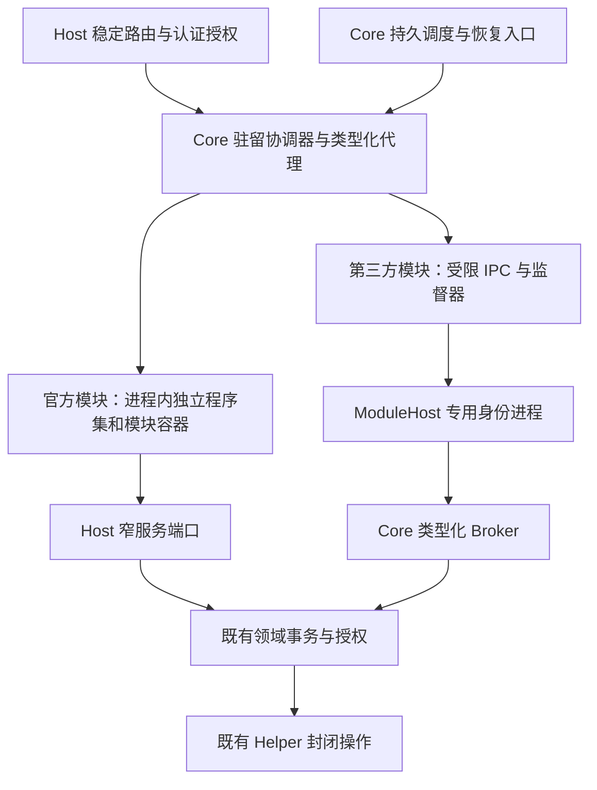

# Server 模块边界与内存回收设计

> 状态：分阶段实施，2026-11-05。已落地 MB-02/03 的 Git 仓库、CLI 与构建实现独立程序集及真实 ALC 回收，初始执行切片见 §10，仓库后续见 §11；MB-04 的 Proxy 共享读取、到期实例、guard/TUN 与发布恢复作用域边界已拆出，见 §12～22（含订阅代码预算、依赖守卫与 Linux 续核）。SystemPerformance S1 已冻结；MB-05A 三域后台工作、MB-06A 代次 owner 与 Terminal-T1 会话/PTY 排空阶段验收见 §38/39，后续 MB-06B/Terminal-T2 原生树实机验收见 §40，Firewall-F1 独立代码与 Tailscale TS-01 对象/持久责任验收见 §41；MB-01～08 实际状态见 §8。完整安装包 ABI、动态休眠、其余领域代码拆分与第三方 ModuleHost 闲时退出仍未实现。当前对象回收修复与测试证据由[驻留设计 §13](RelaxKonOS.ServerModuleResidency.Design.md#13-休眠内存引用审计与首批修复2026-11-03)拥有，不能作为本文整体完成的证明。
>
> 本文拥有为内存回收调整模块边界的目标、程序集依赖、资源所有权和迁移验收。[模块总设计](RelaxKonOS.ModulesAndExtensions.Design.md)拥有总体架构；[驻留设计](RelaxKonOS.ServerModuleResidency.Design.md)拥有状态机、租约与测量证据；[分发设计](RelaxKonOS.ServerModuleDistribution.Design.md)拥有安装和版本事务；[模块管理设计](RelaxKonOS.ServerModuleManagement.Design.md)拥有跨端产品和操作协议。Android 细节只在 Android 工程文档维护。

## 1. 目标与确定的决策

目标是使不使用的管理功能真正失去对业务对象、缓存、连接以及可选实现程序集的强引用，需要时按当前已安装的有效版本恢复。衡量对象是整个 Server 及其模块进程树，不能通过把内存移入另一个常驻进程声称节省。

1. 按持久职责、调用关系和资源所有权拆分，不按页面或现有文件夹机械拆分。Core 只保留必要的宿主基础设施和轻量调度；多个调用方使用同一实现不自动构成迁入 Core 的理由。
2. 官方模块继续遵循分发设计的进程内模型。实现移入独立程序集，经过对象生命周期迁移后再使用可回收加载上下文；不因本设计自动迁到第三方 ModuleHost。
3. 第三方代码继续只在 ModuleHost 执行，复用当前专用身份、IPC、代码信任和 Broker。为其增加闲时退出与按需启动，不开放第三方进程内执行。
4. 稳定路由、鉴权、模块目录、状态、调度和代理由 Host 持有；可回收实现不能直接注册进根 DI、Endpoint 或根 HostedService。
5. 安装、启停集合、更新、回退和移除继续遵循现有计划、重启和核实规则。内存唤醒固定使用当前生效版本；休眠不是版本切换或热更新入口。
6. 休眠不卸载磁盘文件、不丢失配置或操作台账，也不停止 Mihomo、sing-box、Squid、Docker、Nginx、Tailscale 等外部服务。外部资源变化仍由原领域事务与 Helper 决定。

不承诺固定节省量；不以强制 GC、裁剪工作集、缩短宽限期或中止用户工作代替边界调整。

## 2. 当前事实与结构性限制

| 当前入口 | 实际边界 | 调整要求 |
| --- | --- | --- |
| `Startup/Modules/`、`ServerModules.Catalog.cs` | Git 仓库/CLI/构建实现已拆出；Firewall、Tailscale 仍是 Host 内可销毁对象，其余领域仍有根服务 | 先消除根容器对重实现的持有，再独立项目 |
| `Residency/` | 协调器、依赖租约、后台工作、流所有权已存在 | 继续作为唯一准入和排空协调者，补充代码/进程释放观察 |
| `InstalledModuleStore.cs` 中的 `InstalledServerModule` | 官方包使用非 collectible ALC，启动阶段直接注册服务和路由 | 升级当前 ABI；仅打开 collectible 标志不足以回收 |
| `ModuleHostSupervisor.cs` | 已有第三方进程、信任和健康监督，生命周期随 Server | 把启动/退出接入驻留准入，保留原权限和故障隔离 |
| `ProxyModule.cs`、`ProxyRuntimeRegistration.cs` | 管理、引擎、恢复、安全、共享代理设置和运行时发布存在跨职责引用 | 为每种职责指定唯一所有者，不把整个 Proxy 搬入 Core |

对象回收、程序集卸载、磁盘占用及进程内存下降分别验收。对象释放成功只证明对象边界；调用 `AssemblyLoadContext.Unload()` 只表示请求卸载，仍需确认上下文与私有实现可回收。运行时依据见 [.NET 卸载文档](https://learn.microsoft.com/en-us/dotnet/standard/assembly/unloadability)。

## 3. 目标层次与依赖方向

图中的 Core 是职责边界，不要求立即把整个宿主基础设施移成一个新项目。项目拆分遵守以下方向：

| 层 | 放置内容 | 不得引用或持有 |
| --- | --- | --- |
| 共享 Protocol / `ServerModule.Abstractions` 及按领域的契约项目 | 稳定 DTO、租约/生命周期接口、类型化调用端口；直接演进现有抽象项目 | Server 实现、领域仓储实现、私有第三方依赖、模块实例或静态缓存 |
| Host 目录和入口 | 已安装身份、有效版本、静态路由、鉴权和合同校验、模块工厂描述 | 实现 Type、MethodInfo、已加载 Assembly、模块委托和私有 DTO 的永久缓存 |
| Core 基础设施 | 身份/会话、宿主限制、配置与秘密保护、基础存储工厂、审计、调度、Helper/Broker 通道、共享锁与通用恢复索引 | 完整订阅解析器、引擎注册表、应用级配置生成器或业务缓存 |
| 官方模块实现项目 | 每代独立容器、领域服务、配置生成器、业务缓存、任务与事件订阅 | 对其他模块实现项目或 Server 主程序集的引用；借用根容器注册自身 |
| 第三方 ModuleHost | 本模块执行器、私有依赖和工作数据 | Server 数据库/配置/Helper 秘密、其他模块数据或直接 Helper 连接 |

实现项目按 `ServerModules/RelaxKonOS.ServerModule.<Domain>/` 组织，首个 Git 执行项目及 `Shared/RelaxKonOS.ServerModule.Git.Contracts/` 已建立，其余名称在对应实施项中确定。Host 不通过对实现项目的静态引用、`typeof(Implementation)` 或启动期类型扫描加载它。发布和安装读取当前受信清单定位程序集，读取元数据不执行模块代码。共享契约只加载一次；模块包不能自带另一份契约造成类型身份分裂。

现有根服务按实际职责分配窄端口，而非把 `IServiceProvider`、`WebApplicationBuilder`、整个配置或任意 Helper 动作交给新模块。官方代码仍是受信代码；这些端口用于资源所有权和依赖控制，不被宣称为进程内安全沙箱。

## 4. Core、调度和可回收执行器

Core 保留稳定能力入口、存储和锁的基础设施；具体领域的配置格式、业务决策与执行仍属于相应模块。已发布状态、来源身份、业务配置、操作回执和恢复证明保存在原领域的持久存储，不能只存在于可休眠实例中。

Core 的轻量调度索引只存模块/实例/操作身份、工作类别、到期时间、修订、状态和恢复引用，不缓存完整订阅、证书挑战、引擎对象或领域实现委托。业务提交与调度登记须在可证明的一致性边界内完成：可共用事务时原子提交，否则使用持久 outbox 并在启动时对账；不能先返回成功再仅靠内存登记到期任务。

调度以至少一次唤醒设计，执行器用原领域 operationId、幂等键、修订和共享锁避免重复副作用，不宣称跨进程“恰好一次执行”。Core 和模块不能同时拥有同一恢复执行循环；迁移时先停止旧责任方，再以持久状态、代次和操作修订隔离确认新责任方接管。

有 TUN/系统代理承诺、证书挑战、到期授权或未完成安装/发布事务时，允许专用小型系统执行器保持保护租约。轻量化调度尚未完成前，原实现继续受保护，不能为了休眠先关闭安全职责。缺失、禁用、撤销或加载失败不能悄悄丢弃任务：保留故障和人工恢复入口，拒绝与未解决责任冲突的新操作。Core 只执行已经明确实现并授权的紧急恢复动作，不以模块不可用为理由新增通用命令或自行扩大 Helper 权限。

## 5. 各领域的目标边界

以下名称描述目标职责，不自动成为新的模块 ID、公开路由或可安装组件。ID、能力和包依赖只有随具体实施项同步更新全部调用方后才生效。

| 领域 | 常驻的最小部分 | 可休眠/可回收部分 | 阻止休眠的条件 |
| --- | --- | --- | --- |
| Git | 稳定仓库/构建端口、持久操作索引、共享文件/部署端口 | CLI 封装、仓库服务与写锁、构建执行器和内存日志 | 活动构建、CLI/镜像清理、未提交终态或待恢复操作 |
| Firewall | 固定路由、授权和 Helper 传输 | 平台查询/编辑 facade 与私有解析状态 | 请求或传输未结束；系统规则不随休眠删除 |
| Tailscale | 固定路由、身份/计划/持久回执端口 | 查询、登录与控制协调器、请求缓存 | 登录流、控制任务、未核实回执；外部 tailscaled 不受休眠控制 |
| Mihomo 管理 | 共享代理设置端口、任务/安全责任索引 | profile/订阅解析和编辑、诊断、管理缓存 | 发布/下载/订阅任务、流式诊断、安全租约 |
| Mihomo 运行与安全 | 按需的控制端口；有系统代理/TUN 承诺时受保护的安全执行器 | 引擎控制客户端、平台适配器及非必要缓存 | 运行时事务、TUN/系统代理恢复、仍依赖实例的消费者 |
| sing-box 入站管理 | 持久授权到期索引、现有安装/配置发布与恢复端口 | 入站配置生成、管理查询和编辑服务 | 发布/恢复事务、活动连接、到期执行尚未交接 |
| Squid 网关管理 | 安装/配置发布与操作索引端口 | 管理与配置生成、查询缓存 | 领域事务或待恢复操作；网关外部服务持续运行 |
| Docker 管理 | 被安装/部署使用的 Engine/出站代理窄端口、栈操作索引 | Compose 管理、代理编辑、镜像/容器等管理缓存和操作执行器 | 活动栈/构建/部署或清理、Engine 会话、未完成对账 |
| Certificate | 续期计划、挑战与操作索引、明确存续的挑战服务 | ACME 客户端、证书管理和续期执行器 | 有效挑战、签发/续期/发布或恢复尚未完成 |
| WebServer | 发布索引、稳定挑战/服务端口、恢复调度 | 网站管理、配置生成和发布执行器 | 进行中的发布、挑战引用、待恢复事务 |
| SystemPerformance | 订阅/权限入口和有界轻量状态 | 采样器、进程快照、图标解码/缓存、原生性能句柄 | 活动订阅、采样或输出未完成 |
| Terminal | 会话身份/目录、连接所有权和断线规则 | 无会话时的管理实现、平台 PTY 工厂与私有依赖 | 任一 PTY、可重连会话、Hub/输出流或未确认的子进程清理 |

### 5.1 Proxy 首先按四种职责拆开

将当前聚合 Proxy 边界拆为共享出站设置、Mihomo 管理与控制、sing-box 入站管理、Squid 网关管理；安全/恢复作为明确的专用职责，不挂在任一管理页面的生命周期上。管理与控制可在第一个切片中共用模块，前提是内部生命周期和依赖已经分离；不能把尚未拆开的代码宣称为四个可独立回收模块。

Docker 与运行时下载只依赖结构化的出站路由结果和必要的运行能力租约，不依赖订阅服务或整个 Proxy 模块。读取已保存的地址、旁路和认证引用不应唤醒管理模块；真正需要其控制客户端或持续安全承诺时才持有相应租约。不得把“代理流量正在经过外部 Mihomo”直接当作整个管理模块永久常驻的理由，也不得在未知所有权时撤下保护。

`ProxyRuntimeRegistration` 已在 Core 注册的运行时安装/发布骨干继续遵循原领域权威；后续分离时先提供契约端口，保留冻结计划、台账、锁、Helper 复核及原操作成功证明，不在驻留协调器重写安装器。遵循[受管运行时设计](../platform/RelaxKonOS.ManagedRuntimes.Design.md)，本设计不关闭 MR/CC 的宿主生命周期验收。

### 5.2 缓存、会话与存储

缓存需要有所有者、字节/条目上限、闲置释放时点和失效规则。现有性能历史与图标已有条目限制，但静态缓存不会随模块容器销毁；迁移时将可选重缓存变为每代所有，必要的小型共享缓存单独计量。权限隔离的进程快照不能为了省内存合并；授权信息不通过缓存继续授予旧权限。

Terminal 断连不等于会话结束，不能将客户端退出直接变成 PTY 关闭。若重型原生资源无法可靠从进程内回收，该模块暂时报告代码不可回收并保留原因；是否采用新的官方执行进程另立决策，不擅自改成第三方 ModuleHost 模型。

DB 工厂和存储模式可由 Host 提供，每次工作创建并及时释放上下文；模块不得长期持有 scoped DbContext、HttpContext、借用连接或别的模块裸服务。业务历史、构建日志和配置应持久化/分页读取，不能在每次唤醒时把全部历史加载到内存。

## 6. 官方模块运行 ABI 与程序集回收

### 6.1 从启动注册转为按代次激活

当前 `ConfigureServices(IServiceCollection, ...)` / `MapEndpoints(...)` 把包代码挂到根容器，不适合作为可回收实现的运行 ABI。目标是由 Host 映射其支持的固定路由，并通过共享领域契约调用每代模块运行时；模块激活只接收窄 Host 端口和本模块上下文，创建自己的服务容器。模块可以注册服务到自己的容器，但不能修改根 DI、Host 中间件或永久路由。

生命周期在现有运行时抽象上演进，覆盖创建/初始化、类型化服务解析、释放预检、后台工作排空和异步销毁。初始化恢复完成后才发布 Active；加载中不暴露半成品服务。激活后新增后台任务必须先取得代次租约；运行时主动报告待恢复职责，不能只以请求数为 0 判断安全释放。

ABI 变更时直接更新唯一当前契约、Host API 范围、官方模块实现、安装清单、签名样例、SDK、打包工具、测试与文档，重新构建受影响包；不保留旧入口桥接、双 ABI 解析或失败后退回启动注册。执行模式由明确的当前契约确定，不根据卸载失败静默切到另一种宿主。

### 6.2 强引用清理规则

Host 保存工厂元数据和共享契约代理，不保存模块实现的 Type/委托/MethodInfo。模块私有 DTO、异常对象、流、异步枚举器和反射元数据不得作为根缓存内容；错误转成有界的共享问题快照，详细日志的提供程序也不得持久保留原模块对象。序列化元数据、DI 激活缓存、事件订阅和诊断钩子必须在真实卸载测试中审计。

每代拥有的 HttpClient/handler、计时器、CancellationTokenSource、注册回调、事件处理器、文件监视、DbContext、原生句柄及连接均有销毁清单。借用的 Host 资源只释放本代引用/租约，不被模块销毁。跨模块只保存稳定端口，调用/实例依赖通过协调器取租约；环依赖拒绝，不能通过全局 service locator 绕过。

程序集回收按“停止准入 → 排空现有租约和后台工作 → 检查/交接持久责任 → 销毁资源 → 断开所有引用 → 请求 ALC 卸载 → 观察弱引用回收”执行。请求在卸载阶段等待受限的新代次；未确认旧副作用执行者已结束时禁止创建第二代。原生库、终结器或框架缓存阻止回收时记录阻止原因，不吞掉异常后伪报成功。

对象运行时 Dormant 与代码释放结果分开：目标诊断记录释放层级（对象/程序集/进程）、请求时刻、观察时刻、代次和未完成原因；具体 DTO 由管理协议实施项统一定义，不在本文新增公共字段。ALC GC 尚未发生时可报告“对象已释放、代码回收待观察”；不能报告“DLL 已卸载”。设定有限观察预算，超时保留弱引用诊断并阻止代次无限积累，按管理流程安排受控重启，不在每次业务请求上强制 GC。

## 7. 第三方 ModuleHost 按需运行

监督器保持身份/信任/有效版本等轻量元数据，Dormant 时不保留 ModuleHost 进程和其 IPC 连接。业务调用仍先做 Host 认证、模块访问授权和能力检查，再以同一准入锁取得代次租约，并发调用共享一次启动。每次启动重新核对当前代码信任、撤销状态、有效版本、制品摘要和专用身份，建立新的 IPC 会话和服务令牌；旧代次回调不能作用于新代次。

IPC 请求、响应流、模块回调、批准中的 Broker 操作和持久后台任务全部纳入工作保护。普通业务流量不自动重放；IPC 断开时，Broker 继续按原持久 operationId 记录真实结果，模块重开查询，不以连接死亡推导安装或配置成功。常设许可仍重新核对范围、期限与撤销，不因自动唤醒而重新授信。

闲时先请求合作排空，确认无子任务、回调和待提交回执后关闭连接并等待进程/属于该模块的子进程树结束，再进入 Dormant。不能只证明父进程退出。排空超时不能默认杀进程并报告成功；进入故障/待恢复，管理员的明确终止操作遵循已有授权与后果展示。若故障需要强制隔离，只处理可证明属于本代的进程资源，领域事务继续按持久回执核实，不以强杀充当成功补偿。

未知后台工作责任、还不能提供完整租约的模块保持加载并说明原因。模块缺失、禁用、过期或未确认信任时不能被调度器自动下载、安装、启用或提权。

## 8. 实施顺序与跟踪项

以下为 2026-11-05 的实际状态，区分阶段性交付和整个 MB 完成。历史实施证据见后续章节；通过小项测试不自动关闭整个 MB。当前推进以模块里程碑为单位，执行台账见 §38。

| 编号 | 实际完成与证据 | 剩余阻塞 | 整项验收条件 |
| --- | --- | --- | --- |
| MB-01 | **部分完成，整项开放**。MB-01A 资源清单与分层基线见 §42。[MB-01B](RelaxKonOS.ServerModuleBaseline.20261106.md) 验证双平台启动期采树、交错认证 Git、自然释放和 Terminal Hub，Windows 另完成真实 Firewall 三轮 | Linux 同制品的真实 Helper 联合矩阵仍缺，System 模式探索中终端退出证明缺失且共享 Helper 触发宿主代理恢复。外部共享服务归属、长时间与非空仓库负载继续开放 | 隔离 Helper 和宿主持久恢复责任后补 Linux 全量联合矩阵，保留缺失与原始证据，关联 RES-01/03 |
| MB-02 | **部分交付**。Git Contracts/独立实现和窄 Host 端口，Proxy 订阅转换契约/私有实现，Firewall-F1 独立契约/执行代码及构建门禁；回收验证见 §10/11/20～22/41 | 全官方包仍非唯一 collectible ABI；其他模块尚有根服务和实现依赖 | 全契约不引用 Server/实现；Host/模块互引构建门禁；发布包与私有依赖按唯一当前 ABI 验证 |
| MB-03 | **Git 有限切片交付**。真实仓库/CLI/凭据/控制台与构建执行项目，100轮 ALC 和保留完成请求验证（§10/11）；镜像清理责任修复与真实 Engine 标签检查见 §43，离线 BuildKit 续核见 §44 | 真实 Docker/BuildKit 执行中取消、清理、恢复与 ALC 联合矩阵未完成；生产内存/冷启动缺失 | 真实任务/流/持久故障责任结束才回收；两平台循环不累积句柄/代码代次；实际引擎恢复与资源目标达到门槛 |
| MB-04 | **常驻边界阶段交付**。共享读取、guard/TUN、到期与发布恢复单一 owner，后台工作租约、订阅转换预算及独立代码（§12～22） | Proxy 整体仍 resident；安全职责持久调度交接、真实网络故障和动态休眠未完成 | 系统代理/TUN/到期责任在重启及休眠后连续可靠；未知结果不重放；正式包/代码释放与生产收益分别验证 |
| MB-05 | **MB-05A 常驻后台责任阶段交付**（§39）。三域真实工作租约、准入/Stop 同锁、实际任务及清理排空；证书取消只记录请求，真实任务决定终态。Docker 在途停止与原回执恢复见 §45，独立 Pebble、Nginx、Engine 实测见 §52～54，证书续期跨日接续见文末 | 三域仍根执行图；持久轻调度、独立执行器和完整联合矩阵开放；跨文件事务和远端 CA 未知状态仍须恢复规则 | MB-05A 后台 owner/终态/禁用门槛已通过，保持 resident；整项还须验证持久调度、独立执行器、真实 Engine/CA/Nginx 重启连续性与休眠 |
| MB-06 | **MB-06A/06B 阶段交付**（§39/40），Windows LocalSystem/S4U 安装夹具及 Core／Helper 崩溃恢复实测通过（§48） | 正式发行服务全链、Linux 固定启动器跨代故障、SDK 合作 drain/后台任务申报仍开放 | 整项仍须合作 drain/后台申报、正式安装多代信任/撤销/崩溃矩阵与旧回调隔离，验收后才启用闲时退出/重启 |
| MB-07 | **SystemPerformance S1 已交付并冻结范围**（§23～37）；Firewall-F1 代码回收与 Tailscale TS-01 持久责任跨对象代次验收交付（§41）；Terminal-T1/T2 阶段交付（§39/40） | SystemPerformance 与 Terminal 仍 resident，生产收益/完整原生压力未测；Terminal 当前账号 Windows 树与 Linux 本地/永久降权 Helper 树已实测，Windows 安装 Helper/S4U、宿主崩溃/孤儿恢复矩阵仍开放；其余模块代码边界未验证 | Terminal-T1/T2 会话/当前原生树阶段已验收，断线不杀会话；整项还须安装/崩溃/压力矩阵及收益证据，再决定独立程序集，不能将 S1/T2 当作整项关闭 |
| MB-08 | **未完成**。已有当前诊断 DTO/跨端管理契约及局部打包/ModuleHost 验证 | 安装包非完整目标 ABI；真实业务同构建内存/冷启动门槛、完整平台故障矩阵未有 | 发布包/私有依赖/各端调用一致；Windows/Linux 整个进程树与冷启动 p50/p95、错误率达到预先记录门槛，关联 RES-06/07 |

首个官方代码卸载试点采用 Git，不直接从 Proxy 全量拆分开始。MB-04 的依赖审计可与 MB-01 期间推进，但安全执行器迁移必须依赖已验证的持久调度与租约；不能先删旧 worker 再补恢复。MB-06 可在官方 ALC 试点之外独立推进，其结果不改变官方宿主选择。

每个实施项提交必须同步模块、应用和追踪文档；涉及受管软件安装/更新/恢复时，先遵循受管运行时设计并更新相应 MR/CC 状态。包维护继续固定当前有效制品，睡眠和唤醒期间不得换成 latest。模块 ID 或配置键拆分直接更新所有内仓调用、测试和示例，不添加旧 `proxy` 别名或并存配置解析。

## 9. 验收与决策门槛

### 9.1 正确性与回收

| 场景 | 必须证明 |
| --- | --- |
| 未认证/无权限、禁用、缺包或未信任请求 | 不加载代码、不启动进程、不授予新权限；状态查询不唤醒 |
| 并发首次访问、取消、唤醒超时、过载 | 单次加载、有界等待；单个调用取消不破坏其他调用；副作用不自动重放 |
| HTTP 流、枚举、Hub/PTY、后台任务和依赖 | 完成清理前租约不结束，旧代次不能取得新代次保护，未完成责任阻止释放 |
| 释放异常、未提交终态、进程/Server 中断 | 原执行者和操作身份保持；不产生第二个执行者；重开观察真实回执 |
| 真程序集卸载 | 真实独立实现与私有依赖的 ALC/对象弱引用消失；根 DI、路由、反射/序列化缓存不保留实现；不能只测合成 buffer |
| 真进程释放 | 父进程、所有自有子进程及 IPC 消失；外部受管软件继续提供原业务；新会话拒绝旧 token/回调 |
| 安全/到期/续期职责 | 管理模块休眠后，既有承诺仍执行；模拟错过唤醒、撤销、过期、恢复失败并展示可操作故障 |
| 多轮循环 | 建议至少 100 轮并包含保留完成 Task/包装流等引用的调用方；存活代次和资源不会持续累积 |

测试允许在专门的可回收验证步骤触发 GC 来排除观察时机；生产运行不得依赖强制 GC。实测报告必须区分这两种环境。

### 9.2 资源与用户体验

同一 Release、同一 .NET/RID、相同有效模块、真实业务数据及连接集合，交错重复测量冷启动、首次请求、持续访问、无租约后的宽限期、再次唤醒及长循环。先预热，再至少 3 次独立运行，保留原始时间序列与范围。记录 Server 和 ModuleHost 整个进程树的存活托管堆、GC 提交空间、private bytes、RSS/可取得的 PSS、代码/私有依赖映射、线程、句柄、CPU/IO 和唤醒请求 p50/p95；不把共享映射简单相加当作系统物理内存节省。

每个试点在实施前从 MB-01 基线写明可接受的冷启动 p95、闲时总内存目标和错误率，结果必须超过重复测量噪声；未达到目标则保留已验证的对象释放边界，重新评估程序集拆分或该模块的默认驻留策略，不宣传未测收益。本文不凭合成测试指定统一 MB 或百分比，也不修改当前 300 秒宽限期、30 秒唤醒时限。

交付报告分别写明“实例释放”“代码回收”“进程退出”“生产资源下降”的实测范围。只有相应事实已验证才显示成功；休眠故障仍保留入口与原因，客户端请求不需要先手动唤醒。

## 10. Git 执行切片实施（2026-11-03，MB-02/03 部分）

本节保留首次 CLI/构建切片的证据；仓库实现迁移及当前扩大后的边界以 §11 为准。

### 已落地边界

- `Shared/RelaxKonOS.ServerModule.Git.Contracts/` 持有 Git 构建/CLI 接口、选项、共享问题类型及稳定台账模型。只读 `GitBuildLedger.InspectLedger` 不加载执行程序集，停用门禁仍可检查持久责任。Host 与模块共享 JSON 类型，私有实现类型不会进入持久台账的序列化元数据缓存。
- `ServerModules/RelaxKonOS.ServerModule.Git/` 持有 `HostGitCli`、`GitBuildCommandRunner`、`GitBuildService` 和按代次的 `GitExecutionModule`。该切片无 Server 实现引用；项目构建守卫只允许共享契约依赖，另有测试检查 Host 实际程序集引用。
- Host 的 `GitModuleRuntime` 继续作为原协调器唯一生命周期入口。`CollectibleGitExecution` 从部署目录 `Modules/Git/RelaxKonOS.ServerModule.Git.dll` 加载执行代码，使用 collectible ALC；缺失/链接载荷拒绝，不回退到旧内置实现。当前没有私有托管或原生依赖，不提供任意动态依赖扫描。
- `IGitExecutionModule` 是当前随产品发布的执行切片 ABI；上下文只有内容根路径、构建选项、数据保护、日志和工作租约端口，不传根 DI、完整配置或 Host 环境对象。该入口没有注册路由/根服务的能力。官方进程内代码仍是完整受信代码，这不是安全沙箱。
- 构建服务按线程安全 Lazy 每代创建一次；业务仍通过原类型化代理和后台租约执行。销毁失败保留隔离责任；成功销毁先清空实现引用，再请求 ALC 卸载。工厂仅保存弱引用，最多容纳 4 个尚未回收上下文，超过时拒绝再次加载并由原故障路径报告，避免无限代次累积；生产不强制 GC。
- Server 项目对实现项目仅有构建顺序引用（`ReferenceOutputAssembly=false`），编译时只依赖共享契约；构建/发布将执行 DLL 放入 `Modules/Git/` 并传播到引用 Server 的产物。测试工程可直接引用实现用于受控命令故障注入，不能据测试依赖误判 Host 静态依赖。

### 验证与限制

验证命令仍为 `--module-residency-checks`，已加入默认模块测试入口。真实 `GitBuildService` 在 collectible ALC 执行、凭据写入后休眠、重开原台账、100 轮上下文弱引用回收，以及刻意保留旧实现元数据时第 5 代拒绝均通过；测试 GC 仅用于观察。原有请求/流、依赖、构建取消、清理、宿主关闭及持久回执故障专项继续运行。凭据使用隔离的测试保护器与临时数据，不接触现有仓库或生产凭据。

Windows 最终驻留专项 **203 项**（`residency-windows-final.log`）、Linux 最终驻留专项 **210 项**及模块包 **141 项**（合计 351 条 PASS，`linux-final.log`）通过；原始构建/发布及基线复现证据均位于 `.artifacts/module-boundaries-20261103/`。Windows 的 Git 工作区 64 项及账户隔离/注册身份检查通过；Server.Tests 构建通过；framework-dependent .NET 10 Linux 发布已核对包含模块 DLL。完整 Linux 默认回归在第三方 ModuleHost 进程夹具报 `module-host-package-invalid`，变更前保留产物以同一命令也能复现；此前跨 Windows 打包的 apphost 还需补执行位。未修改生产 RID/包校验或安全环境清理来绕过失败，不宣称完整回归已通过。

这是随 Server 发布的官方执行程序集，**不是新增独立包安装器**。现有官方安装包的 `IInstalledServerModule` 启动注册 ABI 尚未迁移，未增加新旧 ABI 双解析。`IProblemException` 与后台租约接口已直接移到共享 Abstractions，Git 构建/CLI 接口和选项已移到 Git.Contracts；命名空间保持当前源码调用一致，不保留旧程序集类型转发。引用这些类型的内仓调用者和测试已同步构建，旧外部二进制应按当前依赖重新构建，不承诺二进制兼容。首次执行切片尚未迁移 `LocalGitRepositoryService`；这一限制已由 §11 的后续实施解除。静态路由、登记持久化和部署端口仍保持 Host 所有。

MB-01 的当前真实业务内存基线、MB-02 的全模块/安装包 ABI 和 MB-03 的真实构建引擎生命周期仍开放；仓库代码边界的后续进展见 §11。受控构建执行器测试不是实际 Docker/BuildKit 执行中的 collectible ALC 验收；弱引用收集也不证明生产 RSS 已下降。MB-04～MB-08 本轮未实施，未部署这批改动到生产 Server。

## 11. Git 仓库实现与 Host 端口（2026-11-03，MB-02/03 后续）

### 当前边界

`LocalGitRepositoryService` 的全部 partial 实现已移入 `ServerModules/RelaxKonOS.ServerModule.Git/`，覆盖仓库登记业务、分支/提交/历史/图、工作区/冲突/同步、凭据选择与控制台记录。`IGitRepositoryService` 直接移入共享 Git.Contracts，没有旧构造入口或 Host 内实现回退。Host `GitModuleRuntime` 只按共享接口转发；模块内仓库服务与构建服务分别用线程安全 Lazy 激活，共享同一可回收执行程序集。

Host 新增两种窄端口：

| 端口 | Host 拥有 | 模块接收 |
| --- | --- | --- |
| `IGitRepositoryStorage` / `HostGitRepositoryStorage` | EF DbContext 工厂、登记 CRUD、固定应用/用户/作用域下的受保护凭据 JSON 存储及短写入互斥 | 实体化 `GitRepositoryRecord` / `GitCredentialSetting`；无 DbContext、实体跟踪或 IQueryable |
| `IGitRepositoryHost` / `HostGitRepositoryAccess` | 每次调用解析当前身份、固定 Git Helper 操作、路径包含规则、三种冲突文件操作 | 当前模式/用户/家目录、结构化命令结果与共享文件 DTO；无 HttpContext、根 DI、任意 Helper 动作或任意可执行路径 |

上下文增加延迟激活的类型化端口，不把整个根服务容器传入模块。构建与模块状态查询不激活仓库存储；只有真实仓库调用才解析这些依赖。正常元数据查询返回前销毁 DbContext，Git 网络/进程操作不再持有数据库上下文。Host 依然负责普通用户/Helper 身份及底层文件访问，Git 参数策略、权限和租约不因模块迁出而放宽；现有数据库表、凭据保护 purpose 与 JSON 字段保持当前结构。

凭据更新只在短存储编辑期持有 Host 的固定写锁，不执行网络或 Git；替代原来跨服务实例保留的静态逐用户锁字典，避免持续积累用户 ID。读取/编辑单个 host 时按其精确 key 查询，列举/删除才读取该用户的相关集合。编辑口只能写 `accounts-` 命名空间内的固定应用设置，取消和异常通过异步销毁释放上下文与写锁。受保护凭据的持久模型移到共享契约，模块私有类型不会进入 Host 持有的默认序列化元数据缓存；模型本身不改变信任或授权。

仓库写锁与最多 500 条控制台记录仍按代次归模块；销毁时释放信号量、清空缓存，再由 Host 清除整个模块引用并请求卸载。静态路由、无状态编辑器桥、用户权限、元数据存储与外部 Git 工作树仍归原所有者；移除仓库登记不删除实际工作树。

### 验证

新增 `GitRepositoryAssemblyChecks`，接入 `--module-residency-checks` 和默认模块测试入口。真实 Git 初始化/登记、add/status、SQLite 元数据、并发账户保存、用户隔离与控制台记录后能回收真实 ALC；100 轮重开保持同一仓库与受保护账户，并执行真实 `git status`。调用方故意保留完成的凭据请求 Task，旧上下文仍全部可回收。

测试还在实际 Git 执行检查模式时断言最近使用的元数据 DbContext 已销毁，并验证凭据写锁的取消、越界 key 拒绝及后续正常获取。回收观察先退出模块 async continuation 的调用栈，再进行有界的测试 GC；不能在模块方法尚在栈上时把暂时未收集误判为永久泄漏。生产流程不增加等待 GC、反射清空框架缓存或强制回收。

- Windows 最终驻留专项 **217 项**通过；Linux 最终驻留专项 **224 项**及模块包 **141 项**通过（`linux-final.log` 合计 365 条 PASS）。
- Windows/Linux Git 工作区各 **64 项**通过，均包含账户持久化/凭据隔离及 Helper 注册身份检查。
- Windows 冲突处理 **89 项**、推送预览 **13 项**通过；Server.Tests 构建通过。
- framework-dependent .NET 10 Linux Server 发布成功，仍把当前执行 DLL 放在 `Modules/Git/`。本轮独立测试目录未覆盖生产 Server，未操作已有仓库、组件数据或生产凭据。

证据目录为 `.artifacts/git-repository-boundary-20261103/`：`residency-windows-final.log`、`linux-final.log`、`workspace-{windows-final,linux}.log`、`conflicts-windows.log`、`server-tests-build.log` 及 publish 日志。Linux 独立目录为 `/home/nanami/component-catalog-20261102/phase23/git-{repository,workspace}-tests/`。§10 中完整默认模块回归的既有 ModuleHost 夹具失败及基线复现仍是已知限制，本轮不宣称该整套回归通过。

### 仍然开放

本轮实现和实测范围是 Git 业务实现的程序集边界；未改变独立官方安装包的启动 ABI、公开模块诊断 DTO、模块集合启停/版本变更的重启规则。真实 Docker/BuildKit 的执行中取消/清理/恢复与 ALC 联合验收、业务压力下生产内存/延迟基线、其他领域拆分及第三方宿主闲时退出仍待实施。未根据测试 GC 的结果宣称生产 RSS 或整个进程树下降，MB-01/02/03 仍按各自完整完成条件追踪。

## 12. Proxy 共享读取与写入/安全边界（2026-11-03，MB-04 部分）

### 已实现

原 `IProxySettingsService` 将读取、修改设置和系统代理对账组合在同一接口中；`DockerProxyResolver`、订阅下载策略、安装材料选择等只读调用因而依赖 `MihomoSettingsService`，构造时连带控制器与发布执行图。现已直接拆成 `IProxySettingsReader`、`IProxySettingsWriter`、`IProxySystemProxyReconciler`，同步所有内仓调用、测试和验收工具，不保留旧接口、旧 Get 入口或类型转发。公开 HTTP 路由/DTO 和权限保持当前契约；GET 使用 reader，PUT 使用 writer。

Core 的 `ProxySettingsReader` 只依赖 `IProxyPlatformPaths`，读取 `mihomo-settings.json`，不构造引擎、控制器、安装/发布执行器，也不改设置、系统代理或 TUN。Docker 与宿主下载路由、订阅下载策略、配置事务的设置观察以及安装引导均改用该端口。该切片中配置写入、系统代理对账和 TUN 运行控制映射到同一个 `MihomoSettingsService`；§14 随后拆出对账实现，仍保持同一发布锁和副作用执行权威。

读取采用 64 KiB 上限和有界、固定文件共享语义；拒绝路径链接、空文件、目录替代、无效 JSON、重复属性、未知字段和无效端口/日志级别/宿主地址。只有文件或父目录确实缺失才返回产品默认值，损坏/不可读不能回落为默认监听端口。默认值、可选设置规范化及严格解析由 reader 统一拥有，冻结设置意图也复用该解析；不改变设置文件的有效字段、凭据保护或冻结身份。

受管代理被选中但设置不可读时，Docker/运行时出站解析返回原 `ManagedProxyUnavailable`，不继续默认端口或直连；独立的自定义代理选择仍按原作用域/旁路规则解析。保存地址必须为字面 IP；出站可用性还核对该地址属于本机，显式监听器匹配保存地址，不能凭其他本地监听器把远端地址标成受管可用。修复元数据并按原规则刷新解析后可以恢复。首次安装的只读材料选择遇到损坏设置映射为 `runtime.settings_drift`，在创建控制器凭据、原生工作或发布意图之前拒绝；已受理安装重放继续只使用原冻结材料，不额外读取当前设置。

Windows 用户态系统代理的 HKCU 原语及 bypass 拼接从管理类移至 `HostSystemProxyService`，消除 Host 平台适配器对 `MihomoSettingsService` 的静态引用。执行条件和行为沿用原实现：服务账户/非交互会话不得借此改用户代理，Linux 仍走原 Helper 的封闭操作。本轮没有实改 Windows 注册表或宿主系统代理的验收，不扩展原平台支持范围。

### 当前所有权与尚未交接的职责

以下记录为共享读取切片时的所有权；guard 对账的后续独立实现及当前引用图见 §14。

| 职责 | 当前所有者 | 本轮结果与限制 |
| --- | --- | --- |
| 已保存代理设置观察 | Core `ProxySettingsReader` | 已与写入/控制器构造图分离；读不唤醒管理对象 |
| 设置写入、系统代理对账、TUN 运行控制 | Core 同一 `MihomoSettingsService` 的三个类型化接口 | 保留单例/发布锁；尚未拆成可回收执行器 |
| 持久配置/安装/移除发布恢复 | Core `MihomoPublicationRecoveryService` 与原领域台账 | 未迁移执行权威；冻结、撤销、补偿和原操作回执仍由原实现复核 |
| 系统代理 guard / TUN 标记恢复 | `ProxyModule` 注册的 `SystemProxyGuardHostedService` / `ProxyRecoveryHostedService` | 原注册时机/循环保持；guard 分别持有 reader 和 reconciler，没有提前停止或新增第二个执行者 |
| sing-box 授权到期执行 | `ProxyModule` 的 `ProxyServerExpiryService` | 每轮临时解析执行实例，见 §13；未交接到 Core 调度，仍不能随模块停机丢弃责任 |
| OS 系统代理写入 | Core `HostSystemProxyService` / 既有 Helper | 平台原语归属已纠正，权限未扩大 |
| profile/订阅、Squid、入站业务管理 | 现有聚合 `ProxyModule` 服务图 | 仍有根服务/Scoped 服务和背景责任，未实施新模块 ID 或代码回收 |

Proxy **仍为 resident**，未新增可释放标记、休眠工厂或“已释放整个 Proxy”的状态。默认启用 Proxy 时，guard/恢复职责仍可能构造并保留管理图；本轮证明的是只读消费者不再引入该图，不证明默认 Server 常驻内存已下降。MB-04 的持久调度索引、职责交接、动态执行器及真实故障矩阵继续开放，不能用读端拆分跳过这些条件。

### 验证证据

- Windows 设置边界 **31 项**、Linux **32 项**（增加真实 symlink 拒绝）通过。测试把管理 writer 的构造器替换成会失败的计数器，验证未注册 Proxy 模块时的真实监听器/出站查询不会构造它；也覆盖损坏、重复/未知字段、超限、取消、目录替代与修复后恢复。
- 两平台系统代理能力/PAC 准入、apply/persist 失败补偿、guard 与禁用竞争、待发布拒绝检查通过；受控真实 HTTP 代理请求、旁路、各作用域和停止监听器拒绝直连通过。
- 配置发布专项 Windows **84** / Linux **85** 项；默认注册 **8** 项验证三类写入/安全接口为同一单例、guard 仅注册一次；安装发布 **88**、卸载发布 **92** 项通过（Linux 全部，Windows 安装/卸载亦通过）。未调用真实宿主安装或服务变化来冒充这些台账/传输夹具的范围。
- Server、Server.Tests、ManagedRuntimes.Tests 和 ServerModules.Tests 已构建；framework-dependent .NET 10 Linux 发布通过。未重新部署生产 Server，没有改 appsettings 或组件数据。

证据位于 `.artifacts/proxy-boundaries-20261103/`，Linux 最终合并记录为 `linux-final.log`；独立远端目录为 `/home/nanami/component-catalog-20261102/phase23/proxy-boundary-{server,runtimes}/`。Windows 首次受限沙箱运行安装夹具遇到文件替换权限错误，允许沙箱外文件操作后最终 88 项通过；出站测试夹具的 Accept/Dispose 停机竞态亦已修正为仅在取消后接纳 ObjectDisposedException。不把这些失败运行作为通过证据。物理内存/长期 CPU 与整个 Proxy 生命周期仍须由 MB-01/04/08 后续实测。

## 13. sing-box 到期调度与执行实例分离（2026-11-03，MB-04 部分）

`ProxyServerExpiryService` 不再在构造时持有 `ProxyServerService`，只持有作用域工厂与日志。启动立即检查、此后每 30 秒检查；每轮在独立异步作用域解析 `IProxyServerExpiryExecutor`，等待完成并释放作用域后才等待下一轮。作用域局部变量位于独立异步方法，不留在长期计时器状态机上。领域失败记录后继续下一轮；停机同时覆盖正在执行和等待计时器两种取消路径。

`ProxyServerService` 与到期执行接口改为 transient：HTTP 请求或已排队的领域操作持有自己的实例直至完成，后台计时器不再给管理实例增加单例根引用。`ProxyServerStore` 仍是 Core 单例，所有实例共用原状态锁；到期继续读取受保护材料、仅剔除已发布授权中的失效凭据，不发布未应用草稿，保留原发布/对账/补偿实现。没有新增第二个到期循环，也没有转移 Helper 权限或改变运行时安装生命周期。

这只是对象持有边界：引擎注册表等依赖仍有独立常驻引用，Proxy 仍为 resident；调度器仍由 `ProxyModule` 注册，尚无跨禁用的持久调度索引、租约交接或 collectible Proxy 实现。不能据此宣称程序集卸载或生产 RSS 降低，MB-04 继续开放。

Windows / Linux 验证使用生产 30 秒周期，覆盖懒构造、失败后释放、下一轮新实例、成功后释放、等待期间弱引用回收、执行中取消并等待异步释放；同时运行原 Proxy Server 配置、加密、凭据、订阅、发布、回滚、到期、导出与幂等回归。Windows 默认注册专项由 8 增至 **10** 项，新增非单例执行器与单一到期调度器检查。证据保存在 `.artifacts/proxy-expiry-boundary-20261103/` 的 `windows-final.log`、`linux-final.log` 和 `registration-final.log`，本轮未部署生产。

一次使用错误参数的 Windows 注册运行实际进入 ManagedRuntimes 全套，并在 `LifecycleChecks` 的伪造制品布局授权断言失败（`registration-windows.log`）；未诊断或修复此全套失败，不将它作为通过证据。改用当前无前导横线参数后，独立注册专项 10 项通过；本节只宣称上述专项及 Proxy Server 两平台回归通过。

续核（2026-11-03）：确认上述实现、测试与日志均已落地，保留全部未提交实现。补强执行中取消测试：执行器的 `DisposeAsync` 在测试闸门上真正异步等待，断言 `StopAsync` 在闸门释放前不能完成，释放后才确认作用域销毁和停机完成。当前 Windows Release Proxy Server 全回归及注册专项 10 项再次通过，记录为 `windows-disposal-recheck-final.log`、`registration-recheck.log`；新增闸门检查尚未重跑 Linux，前述 Linux 记录对应补强前测试。默认并行构建无诊断失败，改用 `--no-restore -m:1` 构建成功；沙箱内回归在临时状态文件原子替换时被拒绝，批准沙箱外运行后通过，失败记录 `windows-disposal-recheck.log` 不作成功证据。

下一切片先审计系统代理 guard、TUN 恢复与发布补偿的根引用、共享锁和持久责任，再确定窄执行端口；在持久调度交接及故障验收完成前继续保留现有 worker。此次不扩大为 Proxy 休眠、不移交安全责任，也不关闭 MB-04。

## 14. 系统代理 guard 窄执行边界与安全责任审计（2026-11-03，MB-04 部分）

### 根引用、锁与持久责任

本表记录 guard 切片完成时的引用图；TUN 与 writer 的后续分离见 §15。

| 职责 | 根引用及当前锁 | 持久责任与本轮处理 |
| --- | --- | --- |
| 系统代理 guard | 根 HostedService → reader + `IProxySystemProxyReconciler`；原接口映射到设置单例，从而带入控制器客户端和配置发布图 | 拆为 Core 单例 `MihomoSystemProxyReconciler`，仍取得唯一 `MihomoPublicationStore.Gate` 后读取设置及执行。启动失败继续保留 startup 标志，原间隔与重试规则不变 |
| TUN 启停及启动恢复 | `ProxyRecoveryHostedService`、生命周期 recovery 接口及管理调用 → 同一 `ProxyTunSafetyService` → `IProxyTunRuntimeController` → 设置单例；安全服务私有 `_gate`，随后取得发布 gate | `proxy-tun-recovery.json` 先于网络变更落盘，区分未完成转换与已激活会话；先停引擎 TUN 再恢复/核实管理路径，失败保留 marker。未移动、改锁或停止此责任，仍会构造管理图 |
| 配置、安装、移除发布补偿 | Core `MihomoPublicationRecoveryService` 长期持有三个发布协调器；各协调器共用 publication gate，授权回调在持锁期间不重入 | `mihomo-publication.protected` 保存已确认身份、Pending 冻结计划、设置/档案意图与完成回执；按原 operationId 观察 Helper、确认或补偿。busy/helper 不可用继续原操作重试，不能重新准备或以当前健康推导成功。此次不改注册时机、执行器或恢复循环 |
| OS 系统代理 | Core `HostSystemProxyService` → 既有特权传输；Linux Helper 使用环境 provider 的同一命名 mutex | Linux `/var/lib/relaxkonos-system-proxy/recovery.json` 与所有权快照仍由 Helper 事务拥有；Windows 仍为交互用户 HKCU 原语，不宣称具备同等持久 journal。无新增 OS 权限或真实系统代理写入验收 |

TUN 的安全锁不能简单改成每请求对象锁；发布 gate 也不能按新执行实例复制。恢复 worker 根引用不是全部可删除的缓存：在持久责任、执行租约和禁用交接得到验证前必须保留。当前锁顺序和责任单一性保持原实现，本次不宣称全部跨域锁竞态已验收。

### 已实现的窄边界

系统代理对账从 `MihomoSettingsService` 直接迁至 `MihomoSystemProxyReconciler`，旧类不再实现 reconciler 或保留转发方法。writer 与 TUN 控制仍是同一设置单例；guard 不再引用该单例、直接控制器客户端或配置发布执行器。所有调用方与注册测试同步使用当前接口，没有兼容别名。

已发布状态的检查提取为无缓存的 `MihomoManagedPublicationVerification.VerifyAsync`，供 writer 与 guard 在原发布 gate 内复用：只读取现有控制器秘密，核对 active YAML 身份，查询真实 Helper 的受管归属、活动修订、pending/recovery 和配置身份。撤销不生成凭据；不明或漂移时返回原 recovery-required，不能写 OS。guard 仍依赖运行时只读观察、授权和传输图，并未使整个 Proxy 脱离根 DI。

### 验证与范围

新增注册构造陷阱：替换设置管理单例和控制器客户端为抛异常工厂后，生产 guard 与 reconciler 仍能构造。系统代理夹具用独立 reconciler 与 writer 验证共锁、禁用后不复活、startup 清理、pending 拒绝，并增加等待锁取消及后续可用检查。发布夹具增加凭据撤销、YAML 漂移、设置损坏、pending、Helper recovery 与外部所有权六种 guard 拒绝场景，各自核对无宿主写入、无原生配置执行且锁可再获取。

Linux 在用户指定的 `192.168.1.9` 测试机独立目录 `/home/nanami/component-catalog-20261102/phase23/proxy-guard-boundary-20261103/expiry/` 已补跑 §13 新增的真实异步释放闸门检查与完整 Proxy Server 回归，通过；首次旧地址超时和 SSH 历史密钥不匹配均未作为成功。用户确认密钥变更后固定核对观察到的测试机密钥，未修改本机 known_hosts。产物和日志仅用于测试，没有替换运行中的 Server/Helper。

Windows/Linux 默认注册各 **11 项**、配置发布事务分别 **96/97 项**、系统代理共锁/取消与 TUN 专项均通过。Release Server.Tests 构建及 Linux framework-dependent 发布通过；runtimes Linux 发布首次缺少 RID 还原目标，完成正常 restore 后成功。证据统一保存于 `.artifacts/proxy-guard-boundary-20261103/`：`expiry-linux-final.log`、`system-proxy-{windows-final,linux}.log`、`registration-{windows-final,linux}.log`、`publication-{windows-final,linux}.log`、`tun-{windows,linux}.log` 以及构建/发布日志；复跑命令见同目录 `verification.txt`。测试使用隔离状态、伪造 Helper/系统代理后端和受控网络，不证明真实 OS 代理、TUN 或安装故障的端到端验收。

Proxy 继续 **resident**，MB-04/RES-05 保持开放。下一边界需先为 TUN 运行控制与配置写入明确当前意图核验端口，再验证完整启停/恢复/补偿和锁竞争；不能先把安全服务改为 transient 或移除恢复 worker。Core 持久调度、跨禁用安全责任交接、collectible Proxy 与生产内存测量仍未实现。

## 15. TUN 运行控制与设置写入执行边界（2026-11-03，MB-04 部分）

### 本轮实现

`MihomoSettingsService` 只实现 `IProxySettingsWriter`，不再实现或转发 `IProxyTunRuntimeController`。TUN 的设置读取、实时配置改写、路由排除、controller 可达性/重载、回滚及 live flag 观察直接迁到 `MihomoTunRuntimeController`。没有保留旧方法或双入口，公开 HTTP/配置契约不变。

Core 保留单例 TUN 控制器，依赖 paths、reader、controller、publication store 与设备观察端口；它不依赖 settings writer、配置发布执行器、系统代理 writer 或安装器。原 Windows 适配器确认移到 `IProxyTunDeviceObserver` / `HostProxyTunDeviceObserver`：同名活动网卡、10 秒等待与取消规则保持原实现，Linux 仍无该 Windows 专项等待；测试注入受控观察器，不创建真实 TUN。TUN 重载成功不等于 Windows 适配器已激活的门禁仍然存在。

设置 writer 的具体类与接口改为 transient。当前内仓产品调用者只有设置 PUT 入口；每次调用持有自己的 writer，完成后根 DI 不再保留该管理实例。writer 本身没有计时器、私有锁或需迁移的实例缓存，controller/运行时/发布依赖仍按原所有者驻留，不宣称这一步释放这些依赖或已测得堆/RSS 收益。

### 锁、恢复与补偿

`ProxyTunSafetyService`、`IProxyRecoveryService` 映射及启动恢复 worker 保持原单例/注册，不把安全锁改为每调用私有锁。顺序仍为 safety gate → publication gate；writer、guard、TUN 控制与发布事务共用同一个 `MihomoPublicationStore.Gate`。writer 不在持有 publication gate 时反向获取 safety gate。新 DI 构造陷阱验证 TUN startup recovery 在 settings writer 构造即抛异常时仍可解析。

TUN marker 仍在接触引擎前落盘。reload、设备确认或管理路由核验失败继续由原安全服务驱动停 TUN 与管理路径恢复；恢复失败保留同一 marker。reload 中取消可能已替换 YAML，不推断已经回滚；marker 保留，随后启动恢复重新取得两把锁完成 teardown。controller 原先不可达时不发 reload，恢复未核实不清 marker。设置写入继续保留 live TUN flag 与精确 exclusions，不把普通设置更新当成 TUN 转换。

**没有新增受管发布下的 TUN 支持**：存在 confirmed publication 或 pending 时，直接 TUN 启用和停用仍走原 `UncoordinatedWriteProblemAsync` 拒绝，不能绕过授权、发布或网络事务门禁。若因此不能完成安全恢复，仍保留恢复阻止与 marker，不能伪报已清理。Core 三个发布协调器及恢复 worker、冻结计划、Helper 回执、settings/profile 补偿意图均未迁移或削减。

### 验证与未完成边界

新增 `ProxyTunBoundaryChecks`，接入 `--proxy-tun-boundary-only`、`--proxy-tun-only` 与默认 Server.Tests 入口。24 项覆盖真实 TUN 执行器与安全服务组合：启停、marker-before-engine、路由排除、writer 保留 live TUN、reload/设备/管理路径失败补偿、不可达恢复、未知观察、pending/confirmed 拒绝、平台补偿失败重试、reload 中取消及恢复、writer/TUN/安全停机竞争和等待锁取消。这里的“真实执行器”指生产 C# 实现；controller、设备与网络平台是受控夹具，不代表实机 TUN 或 Windows Wintun 验收。

Windows/Linux Release 新边界各 **24 项**、完整 TUN 与系统代理专项、默认注册各 **13 项**、配置发布事务分别 **96/97 项**通过。Server.Tests/ManagedRuntimes.Tests 构建和 framework-dependent Linux 发布成功；存在既有 nullable/未使用参数/平台分析警告，Helper 构建另有无法取得 NuGet 漏洞数据的 NU1900 警告，不宣称完成漏洞检查。Linux 在已确认测试机的 `/home/nanami/component-catalog-20261102/phase23/proxy-tun-boundary-20261103/` 独立目录执行。证据目录 `.artifacts/proxy-tun-boundary-20261103/`：`tun-windows-final.log`、`tun-linux.log`、`system-proxy-{windows,linux}.log`、`registration-{windows,linux}.log`、`publication-{windows,linux}.log` 以及构建/发布日志；复跑命令见 `verification.txt`，源码与 Linux 产物摘要见 `provenance.json`。本轮保留全部未提交实现，未提交、推送或部署，也未更改生产配置/组件数据。

最终结果：完整 solution Release 构建通过（0 错误、2 个既有 Server 告警）。Windows 模块默认全量及最终 ModuleHost 定向检查通过；Linux 模块默认全量在已补齐 Git 的隔离镜像通过，包含真实子进程和异架构包拒绝。最小 ASP.NET 镜像首轮缺少 Git 的失败保留，不作为产品回归失败或通过证据。新增工作租约/独立代码专项 Windows/Linux 各 **23** 项；原 Core 安全所有权各 **17**、lifecycle/TUN scope 各 **31**、责任 **45/46**、订阅各 **37**、TUN 执行各 **30**、settings **31/32**、Mihomo 注册各 **15**、配置发布 **107/108**、安装发布各 **88**、移除发布各 **92**、profile 各 **19**、runtime HTTP 各 **46** 项通过，Squid、出站代理、入站原回归与到期/HTTP 队列专项均通过。本轮不重复原生归档/固定系统服务验收；保留 §19 已有证据的原范围。

Proxy 仍为 **resident**，MB-04/RES-05 保持开放。配置档案事务、引擎注册表、controller、TUN 安全 owner 与 Core 发布恢复仍有独立根引用；还没有按需执行租约、持久调度和跨禁用安全责任交接，也没有 collectible Proxy 或生产内存基线。下个切片须先审计发布协调器与 profile 执行图的持久意图和请求/后台所有权，不能因为 writer 已 transient 就移除补偿 worker 或给整个 Proxy 添加可释放标记。

## 16. 发布恢复临时作用域与 profile 执行图审计（2026-11-03，MB-04 部分）

本轮开始按用户要求将 §12～15 当前实现提交并推送到 `origin/master`，提交 `5bae1c72`。以下新增实现与文档保留未提交，没有继续推送或部署。

### 持久意图与执行所有权

| 入口/对象 | 持久意图和根引用 | 请求/后台所有权及本轮边界 |
| --- | --- | --- |
| 配置发布 | publication store 保存 candidate、冻结 configuration plan、settings/profile selection 与 completion；配置协调器引用授权、runtime、settings files 和可选 profile repository | 在原 gate 内验证，再持久 Begin；受理前可取消，受理后使用原不随请求取消的执行路径，最终按 Helper 同操作回执/身份确认或补偿。本轮不改事务实现 |
| profile 管理/激活 | Core SQLite profile repository 为单例，仅保留连接字符串，每次访问自行创建/关闭连接；模块 profile facade 为单例，配置事务/订阅服务为 scoped | 直接 profile 激活/apply 随 HTTP Task 等待；激活时读取持久 YAML，冻结 profile ID/revision、旧 active ID/revision 与 createdAt，不把请求服务或 YAML 委托写进恢复索引 |
| profile selection 提交 | `MihomoProfilePublication` 与 publication pending 对应，SQLite `proxy_profile_publication` 保存同 operationId 的选择 hash、配置身份及提交修订 | 选择切换与 SQLite 操作标记在同一事务内；恢复校验精确选择，成功重放不再增加修订。发布确认前复核 Helper 事实；冲突、撤销或未知状态保持 pending，不能从当前 active 推导原任务成功 |
| 订阅后台操作 | 单例 `ProxyOperationStore` 保存受理/阶段/终态台账；内存执行委托捕获 scoped subscription → configuration → publication 图 | 请求取消不取消已排队委托，Task 完成前仍由委托持有实例；尚未迁为独立后台作用域/模块工作租约，不能随请求结束释放或宣称可休眠。重启后的操作 interrupted 记录不是发布成功证明，已有 publication pending 另由 Core 恢复 |
| Core 安装/人工恢复 | 单例 `MihomoInstallationBootstrapService`、安装台账适配器和 `MihomoRuntimeRecoveryService` 仍分别持有部分发布协调器 | 这些是独立根引用，本轮未全部消除；安装、移除、手动重试的冻结计划、共享锁和授权 callback 生命周期不改 |
| Core startup recovery | 原 worker 构造持有三个协调器，配置分支连带 profile repository；现只保留 scope factory 与 logger | 每轮独立异步 scope，先读 pending，仅解析对应类型的协调器；无 pending 或无可恢复计划不构造任何协调器。选型读取只是提示，协调器仍在 gate 内重读/核对原 operationId，竞争变化不能执行旧意图 |

### 已实现的窄边界

`MihomoPublicationRecoveryService` 不再构造注入 store 和三个协调器；每轮使用私有 async 方法拥有 scope、pending 快照和选中执行器，完成后异步释放，再按原规则等待 5 秒重试。仅 busy/helper 不可用自动重试同一持久操作；operator-required、未知或不完整的恢复状态继续保留 pending 与日志，未新增 prepare/install/configure 重放或第二个恢复循环。旧构造入口直接删除并更新所有内仓测试及验收工具，没有兼容重载。

三个发布协调器改为 transient。它们不拥有独立实例锁、后台循环或未落盘的事务权威；所有实例仍共用 Core 单例 `MihomoPublicationStore.Gate` 和原持久状态。临时恢复实例不再被 worker 在重试等待或完成后持有，但安装/人工恢复等单例消费者仍可长期持有自己的实例，因此不能据此宣称整个发布/profile 图已释放。

scope 覆盖 `RecoverAsync` 完整 Task 和异步清理，作用域销毁完成前不启动下一轮。取消等锁仍只撤销当前等待，不能释放别人持有的 gate；已经进入原领域不可取消受理段的工作继续按原规则收尾。宿主全流程关闭上限、真实 Helper 中断及独立后台任务租约仍不在本轮证明范围。

### 验证与边界

新增检查覆盖无 pending 不构造任何协调器、创建 worker 懒构造、busy 失败后的真实异步 scope disposal、重试计时器等待中旧配置协调器弱引用回收、下一轮新实例、停机取消等待锁时保持 pending 与原锁所有权；配置、安装、移除三类选择均通过将未选类型工厂替换为抛异常来验证。测试 GC 只用于弱引用观察，生产路径不增加强制 GC。原配置/安装/移除发布回归继续验证同操作确认、补偿、消息丢失与重开；SQLite profile 专项继续覆盖原子选择与幂等。

Windows/Linux 最终注册各 **14**、配置发布事务 **102/103**、安装发布各 **88**、移除发布各 **92**、SQLite profile 各 **19** 项通过。ManagedRuntimes.Tests/Server 构建与 framework-dependent Linux 发布成功；Linux 测试目录为 `/home/nanami/component-catalog-20261102/phase23/proxy-publication-boundary-20261103/`。构建、发布与日志统一保存在 `.artifacts/proxy-publication-boundary-20261103/`，最终各专项为 `mihomo-*-only-windows-final.log`、`mihomo-*-only-linux.log`；复跑命令及产物摘要分别为 `verification.txt`、`provenance.json`。夹具使用隔离状态与伪造 Helper，未执行真实安装或改动生产服务。首轮沙箱内构建缓慢未完成并已中止，批准沙箱外构建后成功；既有编译/平台与 NuGet 漏洞元数据网络警告不作为已解决。

Proxy 仍为 **resident**，MB-04/RES-05 继续开放：独立安装/人工恢复根引用、订阅任务作用域与工作租约、持久调度/跨禁用责任交接、受管 TUN 网络事务、collectible Proxy 和生产内存测量仍缺。下一切片优先处理排队订阅工作的独立作用域及完整寿命，保留原受理、审计、发布补偿和中断记录，不先把模块标成可释放。

## 17. 订阅后台任务独立作用域与完整寿命（2026-11-03，MB-04 部分）

### 实现与所有权

三个排队订阅路由（refresh_all、refresh、activate）不再注入并捕获请求 scoped 的 `IProxySubscriptionService`。它们在原权限和幂等键检查下，只向单例 `ProxySubscriptionOperations` 传入固定操作枚举、订阅 ID、操作者字符串；HTTP 路由、202 与 operationId 契约不变，不把 HttpContext、请求令牌、用户 principal、服务实例或任意执行命令带入后台。

受理仍通过 `ProxyOperationStore` 原台账先持久保存 queued，幂等重放返回原 operationId，不创建第二个执行 scope。成功受理后执行使用独立 async scope，在其中解析 subscription → configuration → publication 图与原审计端口；scope 覆盖业务 Task、结果/异常失败审计和异步清理。清理完成后才由台账持久化最终状态，不把一个已完成业务审计事件等同于 scope 清理或整个操作成功。请求结束/取消不撤销已受理工作；原发布的冻结、受理后执行、恢复与补偿规则不变。

`ProxyOperationStore` 以同一个实例注册为 HostedService，按原准入 gate 跟踪所有已受理 Proxy 委托到业务、审计、scope 清理和终态写入完成；停机先关闭新键准入再等待完整任务。已知幂等键仍可重开查询；停机等待令牌只取消等待，不取消业务或抢先销毁资源。此跟踪也覆盖原 lifecycle/TUN 委托，不给它们新增取消语义。Host 关闭预算耗尽不能被解释为任务完成，进程中断后仍按原台账规则显示 Interrupted，不自动重放订阅或从当前发布状态推导原任务成功。

台账首次受理落盘失败会撤掉尚未执行的内存条目，不留下可幂等返回的假受理。终态无法持久确认时保留失败跟踪、阻止新操作并使排空报告失败。scope DisposeAsync 失败可能只完成部分释放：保留失败 scope 与异常，不自动重试 Dispose，不把它当成普通任务失败后清除恢复责任；即使随后失败终态落盘也失败，独立保留的 cleanup scope 引用仍在，后续操作被阻止。业务问题/抛异常、审计故障而清理成功时，仍按原失败终态落盘，不伪报成功；业务异常额外记录固定 OperationInterrupted 失败审计，不泄露异常正文。

### 验证

新增 `ProxySubscriptionBoundaryChecks`，接入 `--proxy-subscription-boundary-only` 和默认 Server.Tests 入口。Windows/Linux 各 **36 项**通过，包含生产三类分派、独立 scope、请求 scope 关闭/取消、幂等重放、真实异步释放、等待期间不写成功、正常停机排空/拒绝新键、scope 成功后弱引用回收、领域/异常/审计/释放失败、停机等待取消、终态落盘故障与重开 Interrupted。释放失败及释放/终态落盘双重失败均确认会保留 owner 并阻止新任务。

真实回环 HTTP 使用生产路由注册，验证未认证 401、缺幂等键 400 均不创建订阅实例，202/幂等重放仅创建一个 scope，HTTP 完成后操作者审计仍正确，实际 Host.StopAsync 等待异步释放。测试替换 subscription 实现和网络工作，不访问真实订阅源或安装软件。默认注册夹具已收窄为仅检查 Proxy 注册的 HostedService 工厂，避免构造缺失 SignalR/组件依赖的无关部署图；初次失败不作为通过证据。

Windows/Linux 注册各 **15**、配置发布 **102/103**、profile 各 **19**、安装发布各 **88**、移除发布各 **92** 项通过。两个测试工程 Release 构建与 framework-dependent Linux 发布成功；Linux 在已确认测试机的 `/home/nanami/component-catalog-20261102/phase23/proxy-subscription-boundary-20261103/` 独立目录执行。证据目录为 `.artifacts/proxy-subscription-boundary-20261103/`，构建、发布、复跑命令与产物摘要随日志保存。本轮保留 §16 及全部其他未提交实现，没有提交、推送或部署。

### 剩余边界

Proxy 仍为 **resident**，MB-04/RES-05 不关闭。独立后台 scope 和任务排空不是模块工作租约：尚未接入驻留协调器、持久调度与跨禁用责任交接；安装/人工恢复、引擎与平台服务仍有根引用。既有 operation 台账损坏处理/保留预算、故障诊断的独立管理入口、真实进程中断/发布补偿联合验收仍须后续处理。未证明 collectible Proxy、生产内存下降或真实网络事务。下一切片需把后台工作准入/停止与模块禁用检查的持久、内存责任统一审计，再决定租约端口；不能在任务未确认或清理失败时宣称休眠成功。

## 18. Proxy 任务准入、停机与禁用责任门禁（2026-11-03，MB-04 部分）

本轮开始按用户要求将 §16/17 已验证实现提交并推送到 `origin/master`，提交 `4dbb89d1`；以下新增改动保持未提交，不再推送或部署。

### 当前门禁

`ProxyModule.InspectOrphanedWorkAsync` 现在汇总两类事实：原 Mihomo publication authority，以及 Proxy operation 的内存/磁盘责任。启用宿主可从同一 `ProxyOperationStore` 的 admission gate 下观察活动执行、异步清理、终态确认与隔离资源；禁用启动不构造订阅/配置服务，而通过 Core paths 只读检查持久 ledger。publication pending 和不可读的原阻止规则继续保留，任何一个领域不确定都不能报可禁用。

Queued、Running、Interrupted，以及 Failed + OperationInterrupted 代表仍有未知执行责任，均阻止禁用；已确认 Succeeded、Cancelled 和已知领域问题 Failed 不因历史存在就永久阻止。live scope 清理失败即使已有 Failed 终态也有独立内存恢复 owner，继续阻止。成功清理、终态持久化并归还跟踪后解除活动阻止；stopping 本身不是持久未完成任务。故障不会通过重写历史、自动重放或从当前引擎状态推断成功来消除。

禁用检查只读，不执行 `LoadAsync` 的显示用 Interrupted 规范化，也不写台账、启动工作或创建状态目录。它同时重读磁盘，不让已加载缓存掩盖损坏；读取使用最多 32 MiB 的固定 ledger 文件，拒绝链接、目录替代、空/null/损坏 JSON、重复字段、未知字段、无效 state、重复 operationId/幂等键和缺少有效条目身份。只有实际文件/父目录缺失才当作无历史。该大小是拒绝未知历史的读取上限，不是已实现的历史裁剪/保留预算。

新键受理复用同一严格读取，在原 admission gate 内核对磁盘与内存已知条目；不一致或重启后仍有未知执行责任时拒绝新工作，避免覆盖旧责任。原幂等重开与只读查询保留，不以新键绕过中断。首次读取失败不再把 `_loaded` 提前设为 true 或忽略损坏 JSON，因此修复未知文件前不能悄悄以空历史受理。本轮没有新增强制关账/删除历史入口；需要未来可证明的操作恢复流程解除未知责任。

### 验证与范围

新增 `ProxyOperationResponsibilityChecks`，接入 `--proxy-subscription-boundary-only` 和默认 Server.Tests，Windows/Linux **37/38** 项通过；原订阅全寿命各 **36** 项继续通过。覆盖所有持久状态的禁用规则、字节不变、无文件不建目录、损坏/重复/未知字段、目录替代、已加载后磁盘损坏、重启未知责任拒绝新键、大小上限和取消传播；同一门禁生产方法用于禁用启动/组件目录事实。live 活动任务与成功排空后解除也已验证，原清理失败专项新增检查 live 责任仍被保留。Linux 另包含真实 symlink 拒绝。

Windows/Linux 默认注册各 **15**、配置发布 **102/103**、SQLite profile 各 **19** 项通过，原发布恢复和补偿代码未修改。两个测试工程 Release 构建及 Linux framework-dependent 发布成功，既有编译/平台及 NuGet 元数据网络警告未解决。Linux 独立目录为 `/home/nanami/component-catalog-20261102/phase23/proxy-task-responsibility-20261103/`。证据统一位于 `.artifacts/proxy-task-responsibility-20261103/`；复跑命令/源码产物摘要随日志保存。所有数据为隔离临时文件和伪造订阅/Helper，未改变生产配置或服务。

### 未完成

Proxy 仍 **resident**，MB-04/RES-05 不关闭。本切片只是任务责任观察和准入拒绝，不是休眠租约、持久任务调度、强制关闭或跨进程原子禁用。检查返回后的新工作仍由原管理重核、停机准入关闭/排空及重启门禁处理；不能将只读快照当作永久授权。TUN/系统代理/授权到期的跨禁用交接、安装/人工恢复的独立根引用、故障关账产品流程、真实宿主中断与补偿联合验收仍开放。下一步须统一审计这些持续安全责任的禁用门槛与任务租约所有权，不能仅凭任务 ledger 干净就宣布整个 Proxy 可禁用或释放。未验证代码卸载或生产内存收益。

## 19. Proxy 常驻责任与完整执行寿命收尾（2026-11-03）

本节为当前实现事实；§12～18 保留各阶段审计记录，其中“下一切片”和尚未交接的责任描述以本节为准。开始时已按用户要求提交并推送 `36e8ba25`；本节新增实现保留工作区，未提交、推送或部署。

### 所有权与根引用

| 责任 | 当前 owner、寿命与共享权威 |
| --- | --- |
| 系统代理 guard | Core 唯一 `SystemProxyGuardHostedService`；每轮 async scope 解析 transient reconciler，不持有 settings writer/引擎注册表；沿用 publication gate、原保存意图和原系统代理身份核验 |
| TUN 安全与启动恢复 | Core 单例 `ProxyTunSafetyService` 及唯一启动恢复 worker；安全平台、原安全 gate 与 publication gate 保持共享。启动只捕获一次 operationId/createdAt，失败每 30 秒重试同一代 marker；旧引用不能撤销随后建立的新会话。未知/损坏 marker 保留阻止与人工恢复，不尝试网络修改 |
| sing-box 到期与发布对账 | Core 唯一 expiry worker，每轮独立 scope 解析 `ProxyServerPublicationService`；执行器仅依赖 protected store、Helper 与模式，不依赖引擎注册表、证书加载或管理 facade。与管理共用 store gate、pending、原候选/前态摘要证明及补偿 |
| Mihomo 持久发布恢复 | Core 唯一 `MihomoPublicationRecoveryScheduler` 即时及每 30 秒扫描原 pending；每次选择原配置/安装/移除协调器，busy/helper unavailable 每 5 秒独立 scope 重试。等待仅保留操作身份，人工阻塞身份不自动重放；新身份重新处理，旧 scope 清理期间新建的 pending 不会被标成已尝试 |
| 管理请求与排队工作 | 引擎/registry/lifecycle/subscription 为 scoped，profile、配置 writer、入站与 Squid facade 按需创建。订阅、lifecycle、TUN、入站、Squid 排队工作全部在独立 async scope 内完成执行、审计及清理；受理不捕获请求 facade、HttpContext 或请求令牌 |
| 安装、原生运行时与组件 | 人工发布恢复端点按调用解析 transient recovery/coordinator；既有 Core installation/runtime authority 保持单例；其共享 gate、原生执行取消与恢复所有权仍必要，不以 transient 注册制造第二个 authority。组件和 Docker 共享读取端口不引入管理解析图 |

持久调度直接使用原领域 marker、protected published state 和 publication pending 作为意图来源，不另建可能与业务提交脱节的内存索引。跨管理禁用时 Core 仍执行原有授权的安全、到期和补偿责任，没有第二个 owner，也不扩展 Helper 权限。Squid 不新增自动发布重放；原未确认/恢复故障继续保留并阻止不安全禁用。

### 完整寿命与内存边界

所有排队工作沿用先持久 queued 再执行、幂等回执、稳定审计及非请求取消的受理规则。共享 `ProxyOperationScope` 覆盖业务、审计和 `DisposeAsync`，之后才能写最终状态；清理失败保留失败 scope，即使终态落盘再次失败也不能丢失 owner。停机在等待 admission gate 前关闭新键准入，即使等待令牌已经取消；取消只终止等待，不撤销已受理任务。未知重启责任仍显示 Interrupted 并阻止新任务，不从当前运行状态推断成功。

根 `ProxyOperationStore` 不再缓存全部历史 DTO/索引；历史查询及更新严格按需读取原 ledger，仅活动任务、失败清理和未确认终态保留根引用。更新重读并核对原条目，禁止陈旧快照覆盖持久责任；32 MiB 上限同时约束读取与替换，没有自动裁剪或强制关账。测试以根 store 存活时历史 DTO 的弱引用回收验证引用边界，不能据此给出生产 RSS/GC 堆节省数字；全量 JSON 读取的成本仍存在。

禁用门禁合并任务内存/磁盘责任、Mihomo pending、未知 TUN marker、不可读系统代理意图、入站 pending 和 Squid 未确认补偿。只读检查不启动管理图、网络动作或清理历史；共用已有 store gate。健康且已交接的 Core 安全责任继续运行，不因关闭管理功能被撤销；未知责任保守阻止。此快照不是跨进程原子禁用授权。

### 验证与交付范围

证据保存在 `.artifacts/proxy-completion-20261103/`，复跑命令、平台结果和摘要由 `verification.txt` 与 `provenance.json` 记录。Windows/Linux 使用隔离状态、伪造 Helper 和生产注册/路由，覆盖管理启用/禁用时 Core 唯一 owner、guard 故障重试、TUN 恢复失败保留、旧代恢复隔离、到期响应丢失对账不重发、真实异步 scope 清理、HTTP 幂等回执及 Host 排空、发布选择/补偿/锁竞争和新 pending 竞争。原安装/移除/profile、系统代理、Squid、共享 settings/出站代理回归同步执行。归档验收使用两版经 SHA256 核验的官方 Mihomo 二进制与模拟运行服务宿主，原生配置检查由 root 在既有隔离、无网络临时 systemd 进程中执行，不冒充固定服务的真实 systemd 生命周期事务。普通用户首跑缺少该检查权限失败，root 复跑通过。

Windows/Linux 专项结果：Core 安全所有权各 **17**、lifecycle/TUN scope 各 **31**、任务责任 **45/46**、订阅寿命各 **37**、TUN 执行各 **30**、settings 边界 **31/32**、注册各 **15**、配置发布 **107/108**、安装发布各 **88**、移除发布各 **92**、profile 各 **19**、runtime HTTP 各 **46**。入站原回归及新增生产 HTTP 队列、guard、Squid 和出站代理均通过。原生归档 Linux **65** 项通过。构建沿用既有编译/平台告警，未将其算作已解决；Windows 模块默认全量回归通过。额外 Linux 模块默认全量回归未通过：上传 apphost 执行位修正后，父测试进程的 `DOTNET_RUNTIME_ID=linux-x64` 与清理环境后的子进程实际 `ubuntu.26.04-x64` 不一致，ModuleHost 夹具报 package-invalid；不将该额外全量套件计为通过，不修改生产启动器来绕过包 RID 核验。Proxy 各 Linux 专项独立执行并通过，完整日志见证据清单。

当前常驻 Proxy 的管理执行作用域、安全责任交接、持久发布扫描及根历史缓存边界已实现。Proxy 仍为 **resident**；MB-04/RES-05 的完整目标不因此关闭：独立可回收程序集、驻留协调器工作租约、collectible ALC、原生系统代理/TUN/SCM/systemd 真实进程中断联合验收、生产内存/延迟测量仍未交付。Linux 测试机已有固定 Mihomo unit，真实 systemd 验收的空白机前提不满足；本轮未停止或覆盖该服务。未知任务的人工核实/关账产品流程与历史保留维护仍需独立设计，不通过删除记录或自动重放实现“完成”。后续验收分别跟踪上述独立事项，不能将本节表述为整个 Proxy 已可休眠或 DLL 已卸载。

## 20. Linux ModuleHost 目标修复、Proxy 工作租约与订阅独立代码（2026-11-04）

基于已提交并推送的 `c7c02ea5` 继续，§19 为上一阶段记录；当前事实以本节为准。保留原安全恢复、到期与发布补偿 owner，未新增原生权限或自动重放。

### ModuleHost 的严格目标身份

模块包目标不再使用发行版相关、可受父进程环境影响的 `RuntimeInformation.RuntimeIdentifier`。新增共享 `ModulePackagePlatform.CurrentRid`，Host 候选上下文/目录、ModuleHost、Windows Helper 和所有内仓夹具统一从实际 OS、进程架构及 libc 计算目标。Linux glibc 返回 `linux-x64/arm64`；musl 保持独立目标，当前六种候选列表仍不支持 musl，不能当成 glibc 接受。Windows/macOS 仍按原可移植目标；不支持的 OS/架构明确拒绝。

原候选清单、签名、逐文件证明、入口、版本和 RID 精确相等规则保留；没有发行版别名、双格式解析或向子进程传递父进程 RID 覆盖。测试核对环境覆盖不影响目标、完整异架构包仍被拒绝、真实清理环境子进程的启动/认证/健康/退出。此修复只统一目标判定，不扩大平台验收声明。

### 常驻工作租约

`ProxyModule` 通过 `IServerModuleWorkResidency` 加入原唯一 `ModuleResidencyCoordinator`，与可释放图的 `IServerModuleResidency` 分开。该 owner 不创建第二个管理容器，不解析业务服务或持有解析器；目录仍报告 **resident**、KeepLoaded、不可释放，休眠入口拒绝，配置不能据此打开 Proxy idle release。原其他模块的依赖与排空行为保持原规则。

`ProxyOperationStore` 在新键持久 queued 之前取得真实 coordinator work lease；取得失败不写假受理，首次落盘失败释放未转交租约，幂等重放不创建第二份租约。所有排队订阅、运行启停、TUN、入站与 Squid 共用该台账，因此租约覆盖独立 scope 的业务、审计、异步释放及终态持久确认。受理后仍不继承请求取消或改成宿主取消撤销；停机等待取消不终止已受理领域事务。ledger 和 coordinator 都等待完整工作，原宿主等待预算不扩大为无限完成承诺。

scope 清理或终态落盘失败时，原失败 scope/未确认记录继续由台账保留，同时将同一 coordinator owner 隔离为 recovery-blocked，再结束计数租约；不把“计数归零”解释为资源已确认或可重新加载。后续新键拒绝，原键仍可查询。持久未知责任继续由原只读禁用门禁核实，不自动关账。Core 的 guard、同代 TUN 启动恢复、sing-box 到期和 Mihomo 持久发布恢复继续独立运行，不因为管理 owner 停止准入而失去安全责任。

### 独立程序集边界

新增 `Shared/RelaxKonOS.ServerModule.Proxy.Contracts` 与 `ServerModules/RelaxKonOS.ServerModule.Proxy`；先将完整订阅文本转换实现从 Server 移出。唯一 ABI 是 `IProxySubscriptionNormalizer.Normalize(string)`，仅文本进出，无 Server 项目引用、服务容器、数据库、Helper、网络或锁权限。原 YAML、通用 Base64 和 vmess/vless/trojan/ss/hysteria2/tuic 转换逻辑原样迁移，没有新协议别名或旧实现回退。

Server 仅静态引用共享契约，使用固定 bundled `Modules/Proxy/RelaxKonOS.ServerModule.Proxy.dll`，拒绝链接/缺失文件；项目已加入 solution 与 build/publish 内容，不从任意路径或类型配置加载。每次转换在独立 collectible ALC 中同步执行，完成后卸载请求并丢弃私有对象；私有异常不通过根日志/操作台账保留实现栈，Host 返回固定中性失败。这里是订阅转换代码边界，并非整个 Proxy 管理图、独立安装包 ABI 或整个模块的 collectible 验收。

### 验证与范围

新增 `ProxyResidencyChecks` 使用真实模块注册、coordinator 与原台账，验证 resident 目录、休眠拒绝、请求取消后的独立租约、回执重放、ledger/coordinator 双排空、scope 清理/终态落盘故障隔离与租约受理失败。独立程序集检查验证 Server 无实现静态引用、各订阅格式、原 YAML/无效输入行为及根 Host 存活时 ALC 弱引用回收；强制 GC 仅用于测试观察，生产不增加 GC 调用。

构建、Windows/Linux 日志、镜像身份、复跑命令与源文件/产物摘要统一保存 `.artifacts/proxy-residency-20261104/`，最终平台结果以 `verification.txt` 和 `provenance.json` 为准。远端 `192.168.1.9:22` 经重试仍超时，Linux 改用本机 Docker 隔离容器，产物只读挂载并复制到临时目录，运行结束删除容器。此环境不代替原 Ubuntu 26.04 测试机或真实 systemd/Windows OS 故障验收。

最终结果：完整 solution Release 构建通过（0 错误、2 个既有 Server 告警）。Windows 模块默认全量及最终 ModuleHost 定向检查通过；Linux 模块默认全量在已补齐 Git 的隔离镜像通过，包含真实子进程和异架构包拒绝。最小 ASP.NET 镜像首轮缺少 Git 的失败保留，不作为产品回归失败或通过证据。新增工作租约/独立代码专项 Windows/Linux 各 **23** 项；原 Core 安全所有权各 **17**、lifecycle/TUN scope 各 **31**、责任 **45/46**、订阅各 **37**、TUN 执行各 **30**、settings **31/32**、Mihomo 注册各 **15**、配置发布 **107/108**、安装发布各 **88**、移除发布各 **92**、profile 各 **19**、runtime HTTP 各 **46** 项通过，Squid、出站代理、入站原回归与到期/HTTP 队列专项均通过。本轮不重复原生归档/固定系统服务验收；保留 §19 已有证据的原范围。

Proxy 仍为 **resident**，MB-04/RES-05 保持开放。已实现真实管理后台工作租约及订阅转换代码回收；其余管理、引擎、profile/发布和原生 authority 尚未作为整体独立可回收程序集。未宣称生产内存收益、全模块休眠或真实 TUN/系统代理/SCM/systemd 联合故障矩阵完成。未知历史的人工核实/关账与保留维护仍没有自动绕过入口。

## 21. 订阅转换待回收代码预算（2026-11-04，MB-04 部分）

§20 的每次转换独立 ALC 原来只请求 Unload，没有限制自然 GC 尚未回收的上下文数量。Host 现在通过同一同步准入边界记录弱引用，合计最多允许 16 个活动或待回收上下文；扫描时移除已死亡引用，达到上限则在加载实现代码前返回固定 Host 异常，不创建更多代次、不回退内置实现、不强制 GC。转换完成仍立即请求卸载，根预算不持有实现对象、类型、异常或强上下文引用。

自然 GC 延迟也可能暂时耗尽预算，之后的新转换会失败，待回收后才可重新准入；长期无法回收时需安排宿主恢复。16 是代码代次的防积累上限，不是字节预算、吞吐承诺或已验证的最优值。它不改变 queued 工作租约、原领域失败回执或 Core 安全责任，也不使整个 Proxy 可休眠。MB-04/RES-05 继续开放，生产内存与延迟测量仍待完成。

Windows Release Server.Tests 构建通过（0 错误、3 个既有告警），驻留/独立代码专项 **26 项**通过。新增检查主动保留真实转换上下文，验证预算饱和时 32 个并发调用全部拒绝；释放测试强引用后上下文可回收，同一个准入 gate 再执行 100 轮真实转换并逐轮确认旧 ALC 消失。GC 只用于测试观察。原订阅完整寿命及任务责任专项同时通过。证据位于 `.artifacts/proxy-code-budget-20261104/`；首次沙箱内测试在临时 ledger 文件原子替换处被拒绝，最终同一隔离测试在沙箱外通过，首次失败不计作成功。此续核尚未执行 Linux、新测试机、生产资源或真实网络故障验收，未提交、推送或部署。

## 22. Proxy 依赖守卫与测试机回收续核（2026-11-04，MB-02/04 部分）

保留 §21 及其余全部未提交实现。Proxy 转换实现项目现在在构建准备阶段只允许引用仓库内精确路径的共享 Proxy.Contracts 项目；契约项目只允许 SDK 隐式 .NET 框架依赖。两个项目均拒绝额外项目、显式二进制、包、框架和 COM 引用。当前转换器没有私有依赖；未来增加依赖须先设计其共享类型身份、加载与释放规则，再更新守卫，不能由默认上下文隐式托管新的私有实现。此约束是开发期防回归规则，不是受信官方代码的安全沙箱，也不是所有模块的完整 ABI 验收。

新增 `Tests/ServerModules/Check-ProxyModuleBoundary.ps1`：两个当前项目正向通过，分别注入 Server、Git 实现、其他目录同名契约项目、二进制、包、ASP.NET 框架和 COM 引用，全部在预期守卫失败，共 **16 项**。夹具通过临时导入注入依赖，不修改实际工程或还原不存在的包；可用 `pwsh -NoProfile -File Tests/ServerModules/Check-ProxyModuleBoundary.ps1` 复跑。首次守卫未排除 SDK 隐式框架、随后路径条件引用错误的失败已修正，最终正常构建和 Linux 发布通过，不把调试失败计作通过。

驻留专项增加真实转换失败路径：主动使私有实现抛异常，保留返回的 Host 中性异常和堆栈后观察代码回收，确认无 InnerException 泄漏或异常强引用残留。Windows 与 Ubuntu 26.04 x64 测试机最终各 **28 项**通过，包含 §21 的预算饱和、32 个并发拒绝、回收后重新准入及 100 轮真实 ALC 回收。测试机 SSH 公钥与此前已验证机器一致，产物上传到新建独立目录并核对 SHA256；使用 framework-dependent linux-x64 产物、远端 .NET/ASP.NET 10.0.14。Linux 任务责任 **46**、订阅全寿命 **37**、Core 安全所有权 **17**、lifecycle/TUN scope **31**、settings **32** 与原系统代理回归同时通过。

证据和复跑命令在 `.artifacts/proxy-boundary-verification-20261104/`，远端目录及上传摘要见 `remote-provenance.json`，环境见 `remote-environment.log`，最终驻留日志为 `proxy-residency-{windows,linux}-final.log`。连接凭据只在 Git 忽略的本地文件保存，不进入实现或共享文档。测试使用隔离状态与受控后端，未改动生产 Server/Helper、系统代理、TUN 或固定服务；未提交、推送或部署。MB-02/04、RES-05/07 的整体范围继续开放，Proxy 仍 resident，生产进程树内存与延迟收益尚无验收结论。

## 23. 进程图标缓存实例所有权与载荷预算（2026-11-04，MB-07 部分）

### 边界与预算

原 `ProcessIconProvider` 的缓存、淘汰队列和 Linux desktop 索引均为静态根引用；载荷仅按 512 条限制，单个 SVG 可达 256 KiB。并发 `ConcurrentDictionary.GetOrAdd` 工厂还可能多次入淘汰队列，命中期间不触发条目淘汰，重复队列项没有独立上限。现将图标缓存及索引移为 provider 实例所有，使用单锁维护唯一 FIFO 节点、条目与已完成载荷字节；昂贵加载在锁外执行，同键由 Lazy 合并。

| 所有者 | 当前寿命及限制 |
| --- | --- |
| Server 普通进程图标 | `ProcessSampler` 私有持有 provider，DI 销毁 sampler 时清空 provider 缓存并断开 desktop 索引引用 |
| Helper 管理员图标 | Helper 显式持有自己的进程寿命 provider，复用同一有界实现；Linux 一次性 Helper 的缓存随进程退出消失，不与 Server 普通缓存合并 |
| 每个 provider 的图标缓存 | 最多 512 条（含缺失图标的负缓存），且完成载荷合计最多 8 MiB；队列节点与条目一一对应，FIFO 淘汰；超过单缓存字节预算的单个结果只返回当前调用，不保留 |

身份与授权仍先于图标缓存：每次确认 PID/完整启动时间，Windows 使用同一进程句柄读取身份与可执行路径，管理员请求仍走原 Helper 固定操作。缓存键仍是可执行路径、文件长度和修改时间；文件元数据变化创建新键，旧键按预算淘汰。普通/管理员快照与 CPU 基线不合并，公开路由、DTO 与权限不变。

销毁清空字典、节点和计数，拒绝新缓存加载；已经开始的加载可为原调用完成，但不能重新写回已销毁的缓存。被淘汰旧条目的延迟完成也不能覆盖同键新条目或重复计量。加载异常移除失败 Lazy 与节点，允许后续重试。成功清理只释放本 owner 的引用，不清除其他 provider 的缓存。

### 验证与未完成

新增 `ProcessIconCacheChecks` 接入默认 Server.Tests 及 `--process-termination-only`、`--performance-only`，Windows/Ubuntu 26.04 各 **15 项**通过：并发同键单次加载、负缓存条目限制、40 份 256 KiB 合成 SVG 载荷只保留 32 份/8 MiB、FIFO 重载、超大结果不保留、异常重试、并发淘汰、独立 owner、销毁/淘汰与在途完成竞争、保留已销毁 cache 的弱引用回收。测试 GC 仅用于最后的引用观察。

Windows 原进程回归及新增真实 PNG provider 销毁检查 **37 项**、Linux 原进程身份与 pidfd 子进程回归 **12 项**通过；两平台性能采样专项通过，Linux 既有 Proxy 驻留 **28 项**通过。Server.Tests 与 Helper Release 构建、两者 framework-dependent linux-x64 发布通过，既有编译/平台告警保留。测试机使用 Ubuntu 26.04 x64/.NET 10.0.14，上传产物摘要已核对；日志、源码/产物摘要及复跑命令保存在 `.artifacts/process-icon-boundary-20261104/`，远端目录由 `remote-provenance.json` 记录，未替换生产 Server/Helper 或修改固定服务。

这是**缓存保留载荷**预算与对象所有权，不是整个模块的内存上限：字典/路径字符串、desktop 索引、Lazy、在途读取、调用者保留的图像及原生解码峰值另计；Linux desktop 扫描/图像解码输入预算仍需后续处理。未增加闲时计时器或清理扫描，Helper 常驻 owner 也未新增闲时释放。SystemPerformance 仍 resident，Hub/采样/原生句柄完整租约与 collectible ALC 尚未实施；8 MiB 不是整个进程树的上限，也不证明生产 RSS 降低。MB-07、RES-01/03/04/07 继续开放，全部改动保留未提交，未推送或部署。

## 24. desktop 图像输入与目标位图分配预算（2026-11-04，MB-07 部分）

在 §23 的实例缓存上继续，Linux desktop 图标原来对 SVG 先读文件长度再 `ReadAllBytes`，文件增长可绕过实际读取预算；PNG 使用 `SKBitmap.Decode(path)`，会在缩小到 32px 前按源图像尺寸分配完整位图。现在先读取有界文件快照，SVG 最多 **256 KiB**、PNG 最多 **1 MiB**，按实际字节计数，超限最多消费预算加一个字节即拒绝。文件长度只是提前拒绝与缓冲起步的提示，长度变化不会绕过限制；缓冲按需增长，普通小图标不分配整个最大输入预算。

PNG 使用快照创建 `SKCodec`，先核对真实 PNG 编码及两个维度均在 **1～1024** 内，再以固定 BGRA8888/Premul 格式分配目标位图，目标像素缓冲最多 **4 MiB**。解码必须完整成功，截断输入不作为部分成功图标。原 32×32 输出、保留宽高比和透明边距规则不变；SVG 仍返回原始字节，不在 Server 栅格化。其他编码伪装 `.png`、空文件、格式损坏或超限均按现有可选图标失败回退，不增加客户端协议或授权入口。Linux 图标主题符号链接仍可用，同样经过实际字节和解码尺寸限制。

新增 `ProcessIconInputChecks` 接入默认 Server.Tests 与原两个进程/性能专项。Windows **17 项**、Ubuntu 26.04 **18 项**通过（Linux 增加真实主题符号链接），涵盖实际 Skia PNG 生成/解码、1024px 边界、超宽/超高、编码与尺寸限制、错误编码/截断/空文件、SVG 原文、短读、旧长度提示下增长与超限、消费字节上限，以及 128 字节输入的读取分配低于 64 KiB。该分配检查只计同步托管读取路径，不是原生或整个 Server 的内存基准。

原缓存各 **15 项**、Windows/Linux 原进程回归分别 **37/12 项**、两平台性能采样及 Linux Proxy 驻留 **28 项**通过；Server.Tests/Helper Release 构建及 linux-x64 发布通过。测试机环境及产物摘要沿用核对过的 SSH 身份与新建隔离目录，证据在 `.artifacts/process-icon-input-20261104/`；保留既有告警，未修改生产配置、服务或数据，未提交、推送或部署。

这只是图像编码输入和目标像素分配的单调用预算，不能视为所有原生编解码内部内存、并发调用、路径字符串或进程树峰值的完整上限。desktop 目录遍历、索引、主题扫描及其工作预算仍开放；Windows 原生 shell 图标提取沿用既有实现，SystemPerformance 闲时释放、完整 Hub/采样租约和代码回收尚未接入。MB-07、RES-01/03/04/07 继续开放，不宣称生产内存或冷启动收益。

## 25. desktop 流式扫描与索引工作预算（2026-11-04，MB-07 部分）

在 §23/24 之上，desktop 发现从 `SearchOption.AllDirectories` 加 `ToArray()` 改为有限深度的流式遍历；预算耗尽后不再推进枚举器。目录、普通文件和链接均消耗遍历条目预算，目录链接不递归，避免循环；普通 `.desktop` 文件链接仍可使用，但目标内容必须经过实际读取限额。扫描实现移到同一 provider 的 `ProcessIconProvider.Desktop.cs` partial，Server/Helper 共用源码，没有新增公开协议或绕过权限的路径。

| 单次索引构建的预算 | 当前上限 |
| --- | --- |
| 用于扫描的根目录候选 | 64；XDG 与 home 发现也采用有限枚举，不先收集所有用户目录 |
| 遍历条目与子目录深度 | 8192 条、根目录下最多 8 层；非 desktop 条目也计入 |
| desktop 输入 | 每文件 64 KiB、合计 8 MiB；文件增长的额外超限检测字节计入实际读取量，最多多消费一个字节 |
| 持有的映射与文本 | 2048 项；键与图标路径 UTF-16 文本合计最多 512 KiB；单路径/字段最多 4096 字符 |
| 图标路径探测 | 整次构建最多 32768 次 `File.Exists` 候选探测，不是逐 desktop 文件重新分配预算 |
| 主题目录发现 | 每个主题根最多检查 128 个条目、最多保留 64 个主题（优先 hicolor）；两个主题根各取一次快照，所有记录复用 |

达到预算只保留已经找到的图标映射，其余按原可选图标语义回退；不写配置或持久数据，不把部分图标索引当成进程列表失败。根目录与文件系统返回顺序参与选择，不承诺超限后的全量图标覆盖。BOM、quoted/env command、Hidden/NoDisplay 和首次有效同名项的既有解析行为保留；本轮不是完整 desktop 规范解析升级。索引仍每 provider 惰性构建一次，随 owner 释放引用，不新增闲时扫描、TTL 或热刷新循环。

新增 `ProcessDesktopIndexChecks`，接入默认 Server.Tests 及原进程/性能专项。Windows **11 项**、Ubuntu 26.04 **12 项**通过，覆盖真实文件和根/深度/非 desktop 遍历上限、每文件/总读取预算、2048 项和字符串预算、共享路径探测、主题快照、BOM/env/隐藏项，Linux 另验证真实目录符号链接环不递归而 desktop 文件链接可有界读取。原输入检查 **17/18**、缓存各 **15**、进程 **37/12**、性能采样以及 Linux Proxy 驻留 **28** 项通过。

Server.Tests/Helper Release 构建与 linux-x64 发布通过，既有告警保留。测试机使用已核对 SSH 公钥的新建隔离目录，上传 SHA256 核验后执行；证据、环境、远端路径和复跑命令位于 `.artifacts/process-desktop-index-20261104/`。未替换生产 Server/Helper、改动服务或生产数据，全部未提交实现保留，未提交、推送或部署。

这些是逻辑工作量、输入和保留文本预算，不是慢文件系统 I/O 的严格时间界限，也不包含字典/节点等全部托管开销、原生解码内部内存或所有并发请求的峰值。SystemPerformance 仍 resident；完整 Hub/采样/图标工作租约、并发准入与在途原生工作的停机排空、闲时对象/代码回收以及生产进程树内存与延迟测量仍待实施。MB-07、RES-01/03/04/07 不因此关闭。

## 26. 图标并发准入、取消与 owner 停机排空（2026-11-04，MB-07 部分）

### 当前执行边界

原 provider 对每次请求直接 `Task.Run`，没有全 owner 并发/等待上限，销毁也不等待已开始的同步文件/原生工作。新增同源 `ProcessIconWorkQueue`，Server 的 `ProcessSampler` 对普通及管理员图标请求共享 **4 个执行名额、32 个额外等待名额**；底层 provider（包括 Helper 自己的 provider）也使用同样的独立预算。Server facade 排队时不调用普通 provider 或 Helper，provider 排队时不创建新的 `Task.Run`。名额是每个 owner 的限制，不是整机所有 Server/Helper 的全局总上限。

超出等待上限或已关闭准入时返回原可选图标空结果，HTTP 继续走既有默认图标回退，不新增公开问题码、路由或强制重试。请求在排队期间取消会移除等待并传播取消，不启动实际工作；名额取得后才启动已受理工作。已经启动的同步读取/扫描/解码或管理员传输不能因调用者取消而脱离 owner，仍等待真实 Task 完成，之后才传播请求取消、归还名额；不强杀原生工作、不重放 Helper 请求。

管理员图标受理后使用独立于请求的传输等待，沿用传输自身的故障/超时规则；原权限与 PID/启动时间核验仍在实际读取前执行。进程查询与终止没有改动取消语义，图标队列也不获得终止权限。跨等待的普通/管理员请求没有合并快照、缓存或授权身份。

### 资源与停机责任

`ProcessSampler` 以原同一单例增加 `IHostedService`，其 Stop 阶段先关闭图标准入并唤醒排队请求，再按 Host 传入的关闭令牌等待在途普通/管理员工作完成。等待取消只结束停机等待，不能显示实际工作完成或清空仍在使用的资源。本轮不增加或延长宿主关闭预算，也不宣称覆盖 Kestrel/Hub 与整个 Server 的全部关闭顺序。

同步 Dispose 只发起关闭；如果仍有在途工作，由原 owner 在最后工作完成后清理 provider 图标缓存与 desktop 索引，没有丢弃在途 Task 或另建不受跟踪的清理任务。清理成功只执行一次；故障保留 owner/故障并使后续 Stop 继续失败，不重复部分清理或重新开放准入。成功清理后清空持有的释放委托；保留完成请求 Task 的调用者不会因此保留已完成工作闭包的合成载荷。

Helper 的独立 provider 取得执行预算，但本轮没有新增 Helper 进程树的空闲退出协议或证明所有真实 Helper IPC 关闭事务。队列的等待/计数及 drain Task 属于当前 owner；它们**尚不是 `ModuleResidencyCoordinator` 的工作租约**，不改变目录 `resident`、不可释放或现有策略校验。采样器/Hub/进程查询/终止的完整驻留租约仍需后续接入。

### 验证与范围

新增 `ProcessIconWorkChecks` 接入默认 Server.Tests 与原进程/性能专项，Windows/Ubuntu 26.04 最终各 **19 项**通过：4+32 饱和及过载不执行、排队取消、停机取消等待者、已开始的受控同步 worker 不被取消脱离、停机等待取消保留执行与资源、失败返回名额、清理故障不重放、保留完成 Task/owner 的闭包弱引用回收，以及真实 Host.StopAsync 等待管理员图标传输。实际 `ProcessSampler` 同时发起 4 个受控管理员请求、1 个普通与 31 个管理员等待，验证共享预算、第五个 Helper 调用拒绝、停机后排队请求不执行与接受请求不重放。

原 Windows/Linux desktop **11/12**、输入 **17/18**、缓存各 **15**、进程 **37/12**、性能采样与 Linux Proxy 驻留 **28** 项通过。Server.Tests/Helper Release 构建和 linux-x64 发布通过，既有告警保留；证据、测试机环境、上传摘要和最终补强测试程序集摘要位于 `.artifacts/process-icon-work-20261104/`。Linux 最终工作/进程日志为 `process-linux-final.log`，其余原专项及首轮 17 项记录分别保留。

受控 worker/Helper 传输夹具不等于实机原生阻塞或真实 Helper 进程树关闭验收。此处约束图标工作的数量与所有权，未证明所有原生内部内存、慢 I/O 时间或生产进程树内存/延迟上限；SystemPerformance 整体仍 resident，MB-07、RES-01/03/04/07 继续开放。全部既有未提交实现保留，未修改生产配置或服务，未提交、推送或部署。

## 27. 图标工作接入常驻协调器租约（2026-11-04，MB-07 部分）

### 唯一 owner 与准入

`SystemPerformanceModule` 现在通过现有 `IServerModuleWorkResidency` 注册到同一个 `ModuleResidencyCoordinator`，复用 Proxy 已验证的常驻工作 owner 模型。新增 factory 仅创建工作身份/代次元数据，不解析管理服务、不创建第二个采样器、缓存或 HostedService；其 Resolve 明确拒绝管理解析。目录仍报告 **resident、KeepLoaded、不可释放**，TrySleep 和针对该模块的 idle-release 配置仍拒绝，不增加模块 ID、公共 DTO、旧构造入口或无租约回退。

Server `ProcessSampler` 在同一 4+32 图标队列准入后、等待执行名额前通过固定模块 ID 的 `ISystemPerformanceWorkLeaseSource` 取得真实工作租约。等待协调器本身仍受原容量、取消和关闭规则约束；完成协调器准入的排队项才持有工作租约，失败时不会调用 provider 或 Helper。超出图标本地准入上限的请求不取得租约；正常权限、PID/启动时间核验、读取/解码和管理员传输仍按 §26 的业务路径执行。

### 取消与结束责任

队列等待同时观察请求、owner 停止及工作租约的协调器停止令牌，取消仍在等待的项并归还其保护；即使 ProcessSampler.Stop 尚未调用，协调器关闭也能撤销这些等待。执行名额取得并通过最后停止核验后的读取不因请求或宿主取消而脱离 owner，继续等待真实业务/原生 worker/传输 Task 完成，之后归还工作租约并结束本请求的队列跟踪。接受的 Helper 读取不重放，停机等待取消不把在途租约清零。

目录的 `activeLeases` 因此包含图标排队保护，不是正在进行 OS 读取的并发数量。工作租约保护请求执行寿命；缓存和 desktop 索引仍归常驻 Host owner，按 §26 在其排空/销毁阶段清理，不能把空元数据 runtime 的释放当成整个采样器或缓存已回收。Helper 内部 provider 保持自己的有界执行 owner，不建立第二套 Server 协调器，也不直接访问 Server 的租约或 DI。

`ProcessSampler` 构造契约已直接增加必需的租约源，所有内仓直接调用和测试同步更新；只在隔离测试中使用计数租约夹具，生产没有空实现、缺源直读或失败后绕过协调器。读取失败但 Task 已完成不自动作为持久事务恢复；未知原生资源/真实传输关闭故障仍需后续专门验收，不能据本轮关闭完整故障矩阵。

### 验证与限制

新增 `ProcessIconResidencyChecks` 使用生产模块注册、真实 coordinator 与生产租约源，受控 Helper 传输只替换实际外部动作。Windows/Ubuntu 26.04 各 **14 项**通过：resident 目录、休眠与 idle 配置拒绝、预取消不取租约、4 个执行及 32 个等待项的真实保护、过载不取第 37 份租约、排队取消归还、在途请求取消保留、协调器停止撤销排队项、两条关闭路径共同等待实际读取、等待超时保留保护、完成后零租约及准入失败不执行。原工作队列各 **19**、desktop **11/12**、输入 **17/18**、缓存各 **15**、进程 **37/12**、两平台性能采样及 Linux Proxy 驻留 **28** 项通过。

Windows 默认模块全量回归最终通过。首跑在合成路由宿主缺失 `IServerModeResolver` 时失败：§26 增加 HostedService 后该宿主会构造 ProcessSampler。夹具现补齐 Host mode 和明确拒绝实际操作的 Helper 端口，并断言模块启停、未认证路由不执行 Helper；未改动生产注册来绕过失败。首轮失败与最终通过日志均保留，不把首轮计作通过。

Server.Tests、ServerModules.Tests、Helper Release 构建和 Server.Tests/Helper linux-x64 发布通过，既有告警保留。证据位于 `.artifacts/process-icon-residency-20261104/`，包括 `process-windows.log`、`process-termination-only-linux.log`、`modules-windows{,-final}.log`、环境和上传 SHA256 核验记录；Linux 在已核对 SSH 身份的新建隔离目录运行，未替换生产 Server/Helper 或操作真实受管服务。

本轮只接入图标工作；采样、Hub 长连接、进程查询/终止及其完整资源生命周期尚未全部获得协调器保护。SystemPerformance 仍常驻，MB-07、RES-01/03/04/07 继续开放；未证明 collectible ALC、整个 Helper 进程树退出或生产内存/延迟收益。全部既有未提交实现保留，未提交、推送或部署。

## 28. 进程查询/终止工作保护与快照 owner 排空（2026-11-04，MB-07 部分）

### 当前接口与保护范围

租约源直接统一为 `ISystemPerformanceWorkLeaseSource` / `SystemPerformanceWorkLeaseSource`，覆盖图标、进程查询和有效终止请求，仍使用同一协调器、固定模块 ID 及 §27 的常驻元数据 runtime。生产注册、构造参数、全部内仓直接调用与测试同步采用当前接口，不保留旧端口、类型别名、兼容构造或准入失败后的直读/直控路径。Helper 图标队列和公开 HTTP/DTO 没有改变。

`QueryAsync` 在读取或命中缓存前取得工作租约，覆盖快照 gate 等待、原平台/Helper 采集、权限可见性过滤、CPU 差分和分页物化；命中 5 秒缓存不会再次访问 Helper，但也不能绕过协调器准入。`KillAsync` 先按原规则拒绝无效 PID/启动时间，再取得租约，覆盖普通控制/Helper Task、原回执处理及两个快照的失效标记。未添加业务重放、自动 Helper 提升、通用命令或新的终止权限。

查询与终止继续传递原请求取消令牌，不套用图标“受理后独立传输等待”的取消规则；原实现何时完成/取消 Task、如何核验 PID/完整启动时间和返回 `requiresElevation` 或未确认回执均保留。租约在既有业务 Task 结束及后续处理完成后归还，不从取消请求推导终止成功。真实 Helper 进程树与传输取消后的物理收尾仍由原端口负责，不能仅凭 Task 夹具据此关闭实机故障验收。

### Host owner 与缓存引用

新增 `ProcessRequestLifetime` 跟踪已准入查询/终止调用，不创建第二个执行队列或自动重试。ProcessSampler.Stop/Dispose 先关闭查询/终止与图标两类准入，再共同等待各自排空；Stop 令牌只取消等待，不清空在途工作或租约。原快照 gate 等待项也在请求寿命内，按原请求取消/完成规则收尾。本轮不为查询/终止新增并发或等待数量上限，不将跟踪计数误报成总内存预算。

最后一个查询/终止调用结束后，owner 在关闭路径清空普通和管理员两套最新快照及 Previous CPU 差分字典，并拒绝新调用。清理只执行一次，故障在 Stop 可见且不自动重放部分清理。释放的是 owner 对物化 DTO 的引用；已返回给客户端或仍被调用方 Task 持有的结果继续有效，不承诺这些外部引用立即消失或 RSS 立即降低。图标缓存仍按 §26 的独立寿命排空，不与进程快照合并。

### 验证与未完成

新增 `ProcessRequestResidencyChecks`，使用真实模块/协调器/生产租约源和只观察取得次数的测试包装；普通控制与 Helper 终止均由受控端口替换，新增终止夹具不操作用户进程。Windows/Ubuntu 26.04 各 **19 项**通过：实际查询与缓存命中的保护、缓存不能绕过关闭准入、cache-gate 等待/取消、保留原传输令牌、owner 与协调器同时排空、取消 Stop 保留在途保护、取消快照不写缓存、清理后旧物化结果有效、精确 PID/时间、终止未确认回执保留、一次执行不重放、普通权限失败不暗中提升、无效/准入失败不执行。

原图标协调器各 **14**、图标工作各 **19**、desktop **11/12**、图像输入 **17/18**、缓存各 **15**、进程 **37/12**、两平台性能采样及 Linux Proxy 驻留 **28** 项通过；Windows 默认模块全量回归通过。Server.Tests/ServerModules.Tests Release 构建及 Server.Tests linux-x64 发布通过，既有告警保留。初次新增夹具的类型/成员重名编译错误已修正，失败日志不计作通过。证据保存在 `.artifacts/process-request-residency-20261104/`，包含最终构建、平台专项、默认模块回归、SSH 身份核对后的隔离目录、环境与上传 SHA256 记录。

SystemPerformance 仍 resident/不可释放。采样和 Hub 长连接的完整租约、整个组件资源清单、并发压力、真实终止/传输中断与未知结果恢复、程序集回收及生产进程树内存/延迟仍待验收；MB-07、RES-01/03/04/07 保持开放。全部既有未提交实现保留，未提交、推送或部署，也未改动生产配置或服务。

## 29. 实际采样工作租约与需求代次（2026-11-04，MB-07 部分）

`PerformanceSampler` 直接要求当前 `ISystemPerformanceWorkLeaseSource`，每次实际原始读取前取得同一协调器的工作租约，覆盖 source Task、差分/历史提交与同步事件分发。没有消费者时不取得租约、不读取 OS；协调器关闭拒绝读取并结束循环，没有失败后绕过保护的路径。源读取同时观察宿主和协调器停止令牌；不合作的 source Task 未结束时继续保留租约，Stop 等待预算耗尽不能提前清理资源。实际循环结束才清空原始基线、历史与健康状态。

修复订阅集合的短路错误：此前已有消费者时，后续连接没有执行 Add；现在每个连接都加入集合，最后一个连接或 REST demand 离开才进入空闲。无效 demand 窗口在增加计数前拒绝，创建 demand 失败会归还计数。注册表为需求从无到有/从有到无维护内部代次，不新增公开协议。旧代次读取晚到时不提交为新代次基线；首次新读取仅建立基线，随后才发布差分。状态事件按当前注册表状态协调，迟到事件不能回退已观察的代次；同步事件调用前再次核对代次与停止状态，外部回调在采样状态锁外执行。

新增 `PerformanceResidencyChecks`，使用真实模块注册、协调器与生产租约源，受控 source 只替换外部采集。Windows 新增 **18 项**通过，覆盖多连接、重复订阅、demand 交接、并发成员、失败 demand 计数归还、空闲零读取/租约、旧读取晚到、新基线、同步发布期间保护、非合作读取的关闭及等待超时、关闭拒绝、读取失败归还与后续新租约。原 Windows 性能专项通过。Server.Tests Release 构建与 linux-x64 发布通过，既有告警保留；证据位于 `.artifacts/performance-sampling-residency-20261104/`。本轮远程上传与执行被自动审批拒绝，Linux 测试尚未运行，不能沿用上一轮结果声称本轮跨平台通过。

Windows 默认模块全量回归通过，ServerModules.Tests Release 构建通过；`git diff --check` 通过，本地测试机配置仍在 Git 追踪之外。

本轮保护实际采样 tick，不包含 `GetInfoAsync` 的独立读取、REST 等待者整个寿命、连续 Hub 订阅或广播服务后续网络发送；已进入的同步回调也不能通过代次核验撤销。持续订阅的两次 tick 之间不连续持有工作租约。SystemPerformance 继续 resident/KeepLoaded/不可释放，MB-07、RES-01/03/04/07 保持开放，未证明完整模块回收或生产进程树内存/延迟收益。此前成果已提交为 `49faa84a`，本节实现随后提交并推送为 `f469c08a`，未部署。

## 30. 性能静态信息读取的工作保护（2026-11-04，MB-07 部分）

`PerformanceSampler.GetInfoAsync` 现在在实际 source 调用前取得同一协调器工作租约，覆盖完整源 Task 和取消后的结果核验。预取消、owner 关闭或协调器拒绝时不访问 source；请求与协调器停止令牌传入源读取。源忽略取消时仍等待实际 Task，完成后取消不能返回成功 DTO，异常按原调用路径传播，不重放、不缓存静态信息、不创建 realtime demand。

原请求寿命跟踪器直接更名为 `SystemPerformanceRequestLifetime`，进程查询/终止和静态信息分别持有自己的实例；没有旧类型别名或第二套协调器。PerformanceSampler.Stop/Dispose 关闭静态信息准入，Stop 同时等待原采样循环与已准入静态读取。owner Stop 不额外改变静态源的请求取消规则，协调器关闭仍会通知源；等待预算只结束等待，实际调用未完成时工作租约和 owner 跟踪继续保留。同步 Dispose 发起关闭，不将它等同于异步排空。静态信息没有新增执行/等待数量上限或总内存预算。

Windows `PerformanceResidencyChecks` 从 18 项扩至 **28 项**，新增静态信息预取消、真实租约且无采样 demand、返回原 DTO、异常归还、非合作读取取消、停机等待超时、关闭准入、实际完成后排空、协调器停止与拒绝回退检查；原性能专项通过。Server.Tests Release 构建通过，既有告警保留；证据位于 `.artifacts/performance-info-residency-20261104/`。本轮未执行 Linux 测试，先前的远程上传/执行审批拒绝仍未解除。

ServerModules.Tests Release 构建及 Windows 默认模块全量回归通过，`git diff --check` 通过，本地测试机配置继续由 Git 忽略。

本轮没有完成 REST demand 等待者、连续 Hub 订阅和广播网络发送的完整租约；整个组件资源清单、真实 I/O 中断、程序集释放与生产进程树内存/延迟验收继续开放。SystemPerformance 仍 resident/KeepLoaded/不可释放，MB-07、RES-01/03/04/07 不关闭。本节实现随后提交并推送为 `13e74655`，未部署。

## 31. REST 快照等待者的完整调用保护（2026-11-04，MB-07 部分）

`ReadSnapshotAsync` 现在先验证有界窗口，再进入与静态信息共享的请求 owner 并取得同一协调器工作租约，随后才读取缓存。缓存命中也不能绕过关闭准入；需要等待时，保护覆盖 demand、事件订阅、等待、取消核验及 finally 中的释放。每个等待者独立持有 demand 和工作租约，取消一个不会结束其他等待者的需求。订阅事件后再次读取缓存，补上首次缓存检查与订阅之间的发布窗口；返回缓存或已发布结果前核验请求、协调器和 owner 停止状态。

Stop/Dispose 在关闭请求准入后发出独立的一次性等待停止信号，唤醒没有客户端取消的 REST 等待者，不额外改变静态信息源的取消规则。协调器停止和请求取消通过每次等待自己的 linked token 唤醒等待。等待结束清理事件订阅、demand 和延时计时器后归还工作保护；关闭等待者不代表其触发的非合作采样 source Task 已结束，后者继续持有 §29 的独立 tick 租约。本轮没有新增 REST 并发数量或总内存预算，也不把调用方法结束等同 HTTP 响应传输结束。

Windows `PerformanceResidencyChecks` 从 28 项扩至 **42 项**，覆盖缓存取得租约、关闭后保留缓存仍拒绝、预取消/无效窗口不准入、多个独立等待者、单独取消、owner 停止唤醒/拒绝、超时、协调器停止/拒绝、REST 与实际 tick 各自保护，以及晚到读取不恢复已消失需求的历史。原性能专项通过；Server.Tests Release 最终构建通过，保留 3 个既有告警。ServerModules.Tests Release 构建与 Windows 默认模块全量回归通过；缓存返回核验的最终小幅补强另由最终性能专项复验。子 agent 只读审查未发现资源释放或排空问题，其建议的返回前停止核验已采用。证据位于 `.artifacts/performance-rest-residency-20261104/`，最终专项为 `performance-windows-final.log`；`git diff --check` 通过，测试机配置继续在 Git 追踪之外。

用户随后明确授权上传与远程执行，并要求不使用隔离环境；已在测试机固定目录 `/home/nanami/relaxkonos-tests` 直接运行。Ubuntu 26.04 性能驻留 **42 项**、原进程/性能/图标专项与 Proxy 驻留 **28 项**均通过，上传 SHA256 核验、环境与三项零退出码记录见同目录的 `remote-provenance.json`、`remote-environment.log` 和 Linux 日志。连续 Hub 订阅、广播网络发送和同步历史读取的完整调用保护、整体资源清单、实机故障、代码释放与生产进程树内存/延迟仍待后续验收。SystemPerformance 保持 resident/KeepLoaded/不可释放，MB-07、RES-01/03/04/07 不关闭。本节后续改动尚未提交、推送或部署，既有成果全部保留。

## 32. Hub 广播实际发送的工作寿命（2026-11-04，MB-07 部分）

`PerformanceBroadcastService` 使用当前必需的 `ISystemPerformanceWorkLeaseSource`，从队列取出快照后、实际 typed SignalR 发送前取得同一协调器工作租约。队列保持 **4 条、DropOldest、单消费者**，事件处理仅尝试入队，不在同步采样回调等待网络或取得租约。排队快照本身不持有工作租约，activeLeases 不是队列长度；队列最多另有一条正在发送的快照，载荷没有新增字节预算。

现有 typed 客户端发送方法不接受取消令牌，本轮不修改 wire 契约、不通过 WaitAsync 将发送 Task 与 owner 分离。Stop/Dispose 先停止接受新事件，实际发送未结束时保持工作租约；Stop 等待预算耗尽只结束等待。协调器关闭在发送前阻止新发送，正在发送的 Task 仍由当前循环等待；完成后归还保护并结束循环。原发送异常不自动重放，也不改成成功；业务异常仍按 BackgroundService 的既有故障路径呈现。循环实际退出时退订采样事件、完成 writer 并清空剩余队列引用。

新增 `PerformanceBroadcastResidencyChecks` 使用真实模块注册、协调器及生产租约源，受控 typed Hub 客户端仅替换外部发送。Windows/Ubuntu 26.04 各 **15 项**通过：空闲零发送/租约、发送期间真实保护、排队不取租约且不并行发送、4 条 DropOldest、Stop 后退订和拒绝事件、非合作发送的协调器排空与 Stop 超时、完成后清空队列、关闭准入无回退、同步 Dispose 保留在途保护，以及发送失败归还、不重放、退订并清空。原性能驻留各 **42 项**、进程/图标/性能专项与 Linux Proxy 驻留 **28 项**通过；Windows 默认模块全量回归通过。Server.Tests、ServerModules.Tests Release 构建与 Server.Tests linux-x64 发布通过，既有告警保留。

证据位于 `.artifacts/performance-broadcast-residency-20261104/`，包含 Windows、Linux、默认模块日志及环境/上传 SHA256/远端路径。用户明确授权后直接复用 `/home/nanami/relaxkonos-tests`，不使用隔离环境、不部署服务；凭据仅由本地脚本读取用于认证，没有输出或加入 Git。子 agent 实现测试，另一子 agent 只读复核生产寿命边界，无实质问题；`git diff --check` 通过，全部既有实现保留。

协调器单独关闭且广播空闲时，没有连续工作租约或独立停止通知；广播在下一次发送准入拒绝或 Host Stop 时退出。连续 Hub 连接/组成员、同步历史读取及 HTTP/SignalR 传输更底层的物理收尾并不因此完成保护；不将受控发送 Task 夹具当成真实慢网络故障验收。SystemPerformance 仍 resident/KeepLoaded/不可释放，MB-07、RES-01/03/04/07 继续开放，未声明代码回收或生产内存/延迟收益。§31/32 实现随后提交并推送为 `15630840`，未部署。

## 33. 连续 Hub 连接与组成员 owner（2026-11-04，MB-07 部分）

新增单例 `PerformanceHubConnections`，使用现有模块注册和同一协调器租约源，以同一实例注册 HostedService。`PerformanceHub.OnConnectedAsync` 在接受业务调用前取得连续工作租约；连接尚未订阅或已经退订但仍连接时继续持有，不因此产生采样 demand。Subscribe/Unsubscribe/OnDisconnected 均委托该 owner，Hub 方法名、认证和 wire 契约保持当前接口，不保留旧构造或无租约回退。组管理器与 Abort 委托随连接由 owner 持有，正常清理后移除条目，不另建采样器。

每个连接串行执行组操作：成功 Add 且仍开放后才登记采样需求，重复订阅不重复 Add；成功 Remove 才结束正常退订，退订后连接租约仍在。Add 开始前记录可能已入组，失败或晚到结束不能复活已关闭连接，最后清理使用独立令牌 Remove。已开始的 Remove 不传递关闭令牌，必须等待实际 Task；真实 Remove 失败不自动重放，保留该连接条目、工作租约与 Stop 可见故障。

断线、连接取消、Host Stop/Dispose 和协调器停止共用每个连接唯一的关闭任务。先关闭连接并 Abort，再等待实际组操作，撤销采样需求并清理可能的组成员，成功后才归还连续工作租约、请求跟踪和条目引用。Abort 异常仍尝试撤销需求及组清理，然后保留故障责任。Stop 先关闭新连接准入，等待所有关闭任务与已准入连接构建；等待预算耗尽不能把在途 Add/Remove 或未知清理故障视为完成。没有新增连接/组操作并发数量或字节预算。

新增 `PerformanceHubConnectionChecks` 接入默认和性能专项。Windows/Ubuntu 26.04 最终各 **25 项**通过：实际 Hub 生命周期回调、连接未订阅持租约、重复订阅/退订、多连接独立需求、清理后同 ID 重连、重复/预取消准入、晚到 Add、Stop 超时与拒绝准入、协调器关闭、进行中 Remove 使用独立令牌并等待、连接取消、Add 失败补偿、普通退订和最终断线 Remove 失败不重放且保留责任。正常路径使用真实模块注册、协调器和生产租约源，仅替换组传输与连接上下文；未知 Remove 故障夹具使用计数租约，避免将真实协调器的故障等待伪造为已恢复，不据此宣称未知结果恢复已实现。

原 Windows/Linux 广播各 **15 项**、性能驻留各 **42 项**、进程/图标/性能专项及 Linux Proxy 驻留 **28 项**通过；Windows 默认模块全量回归通过。Server/Server.Tests/ServerModules.Tests Release 构建与 Server.Tests linux-x64 发布通过，既有告警保留。首轮连接 21 项和最终补强 25 项均保留证据，最终测试仅补强夹具，生产代码未再变化。目录为 `.artifacts/performance-connections-residency-20261104/`，最终平台日志是 `performance-windows-final.log`、`performance-linux-final.log`；Linux 用户授权后直接复用 `/home/nanami/relaxkonos-tests`，环境、整包及最终测试程序集上传 SHA256 核验均记录。子 agent 实现测试，另一子 agent 只读审查并促成在途 Remove 与 Abort 异常两项修复；最终未发现进一步实质问题。`git diff --check` 通过，测试机配置仍在 Git 追踪之外。

目录 activeLeases 现在包含所有连续 Hub 连接（不只订阅者）、实际采样/广播/REST/进程工作，不等于 OS 并发读取数。此处不证明真实 SignalR 传输故障、远端组存储或 HTTP/网络底层物理清理；组任务失败的保留责任需要后续显式恢复设计，不能以 Abort 当作清理已确认。同步历史读取的完整保护、整体资源清单、连接压力及数量预算、程序集释放及生产进程树内存/延迟仍开放。SystemPerformance 保持 resident/KeepLoaded/不可释放，MB-07、RES-01/03/04/07 不关闭；本节实现随后提交并推送为 `b48f2f4b`，未部署，全部既有成果保留。

## 34. 历史与最新快照的异步读取保护（2026-11-04，MB-07 部分）

`IPerformanceSampler` 直接采用 `GetLatestAsync` / `GetHistoryAsync` 当前接口，均可传入取消令牌；不保留原同步方法或阻塞异步适配。生产实现、HTTP 历史端点、内仓调用与测试夹具同步更新；路由、JSON 与 60 点历史容量不变。历史 HTTP 端点传递请求取消令牌，不创建额外采样 demand 或 OS 读取。

公开读取在访问空缓存或非空缓存前进入现有请求 owner 并取得同一协调器工作租约，链接请求与协调器停止令牌，在状态协调/历史物化前后核验取消和 owner 关闭。已准入但尚未返回的读取由 owner Stop 跟踪；关闭后拒绝公开读缓存，不能以空结果或旧快照绕过准入。返回的 DTO/数组归调用者引用所有，不在返回后继续持有工作租约，owner 释放自身历史也不修改已物化结果。`ReadSnapshotAsync` 使用私有读取核心，复用它已持有的租约，避免额外嵌套准入。

`PerformanceResidencyChecks` 从 42 项扩至 **53 项**，Windows/Ubuntu 26.04 均通过。新增覆盖预取消不准入、历史/最新缓存命中均取得真实保护、读取不产生 demand/source 调用、原 1～60 秒窗口界限、已物化历史不持租约且不受 owner 缓存变化影响、关闭 owner/协调器拒绝旧缓存，以及取得真实租约后暂停准入返回的读取在 Stop 超时/请求取消时仍保留保护。暂停仅在测试包装端口，生产没有额外等待队列。旧停止后空缓存检查改为观察 owner 存储，公开方法则明确验证关闭拒绝。

原 Windows/Linux 连接各 **25 项**、广播各 **15 项**、进程/图标/性能专项及 Linux Proxy 驻留 **28 项**通过。Server/Server.Tests Release 构建与 Server.Tests linux-x64 发布通过，既有告警保留。证据位于 `.artifacts/performance-history-residency-20261104/`，包含平台日志、环境、上传摘要核验及远端固定目录；用户授权后直接复用 `/home/nanami/relaxkonos-tests`。子 agent 更新测试，另一子 agent 只读审查生产实现未发现实质问题；全仓旧同步调用已清除，`git diff --check` 通过，凭据继续由本地忽略文件持有。

ServerModules.Tests Release 构建及 Windows 默认模块全量回归通过。

此处保护方法执行至物化结束，不覆盖随后 HTTP JSON 序列化、响应发送或调用方持有结果的整个寿命；没有新增生产 GC、历史 TTL、采样频率或并发数量预算。整体资源清单、连接压力、真实传输和未知结果恢复、程序集释放及生产进程树内存/延迟仍待验收。SystemPerformance 保持 resident/KeepLoaded/不可释放，MB-07、RES-01/03/04/07 不关闭，本节实现随后提交并推送为 `6ff45a08`，未部署。

## 35. HTTP 性能响应执行保护（2026-11-04，MB-07 部分）

Host 内部新增 `SystemPerformanceResult`，在 `IResult.ExecuteAsync` 真正执行前通过当前必需租约源取得同一协调器工作租约，覆盖 JSON 序列化、文件字节写入以及错误结果执行的真实 Task。性能 info/snapshot/history、进程查询/图标/终止的已授权结果均使用包装；未认证仍由认证中间件提前拒绝，管理员能力不足的 `ElevationRequired` 继续在包装和业务调用前返回。info/history 显式声明原成功响应类型，避免返回类型变为 `IResult` 后丢失原推断的响应元数据；路由、JSON、状态码与终止协议不变。

响应执行暂时将 `HttpContext.RequestAborted` 扩展为原请求断连与协调器停止的 linked token，在执行前后核验停止，并在 finally 恢复原令牌。通知取消不代表底层传输已被强制中止；忽略取消的结果必须等待其真实 Task 结束才归还租约，没有 `WaitAsync` 分离、后台重放或将租约挂到可能不执行的 OnCompleted 回调。序列化/写入异常按原管线传播并归还已完成的工作保护，协调器拒绝时不执行结果，也不重放已经完成的查询/终止；终止可能已有副作用但响应不可用仍是原未知响应语义。

新增 `PerformanceHttpResidencyChecks` 接入默认与性能专项，Windows/Ubuntu 26.04 各 **15 项**通过：真实 Results.Ok JSON 与 Results.File 字节写入期间真实租约、成功/异常/取消恢复原请求令牌、请求和协调器取消不脱离非合作结果 Task、关闭及预取消不执行结果、实际 DELETE 端点能力不足时不执行业务/不取得响应租约、终止业务已执行而响应准入失败不重放，以及 info/history 原成功响应类型元数据保留。只有响应传输/进程业务的外部动作被受控夹具替换，终止测试不操作用户进程；非合作 IResult 不是实机网络阻塞证明。

原 Windows/Linux 连接各 **25 项**、广播各 **15 项**、性能驻留各 **53 项**、进程/图标/性能专项及 Linux Proxy 驻留 **28 项**通过；Windows 默认模块全量回归通过。Server/Server.Tests/ServerModules.Tests Release 构建与 Server.Tests linux-x64 发布通过，既有告警保留。证据位于 `.artifacts/performance-http-residency-20261104/`，包括平台日志、默认模块回归、环境、远端路径与上传 SHA256 核验；用户授权后直接复用 `/home/nanami/relaxkonos-tests`。子 agent 实现测试，另一子 agent 只读审查 linked token/恢复和真实任务所有权后未发现实质问题；`git diff --check` 通过，测试机凭据保持本地忽略文件。

服务方法的业务租约与响应执行租约各有独立寿命，两者之间返回的是共享 DTO 或 byte[]，不执行模块代码；本轮不声称连续保护整个 HTTP 管线、下游中间件收尾或物理网络送达。返回方法后的调用方引用不转移到模块 runtime。SystemPerformance 仍 resident/KeepLoaded/不可释放，整体资源清单、压力与总内存预算、真实网络/未知结果恢复、代码释放与生产进程树内存/延迟继续开放；本节实现随后提交并推送为 `c7b03794`，未部署。

## 36. 连续 Hub 连接的准入数量预算（2026-11-04，MB-07 部分）

§33 的连接 owner 原先没有数量上限。现增加每个 `PerformanceHubConnections` owner **128 个名额**，合计覆盖尚在协调器准入的连接、已连接/退订但未断开的连接，以及清理故障条目。名额和连接 ID 在同一 owner 锁内预留，重复 ID 或预算已满时立即通过现有 Hub 异常路径拒绝，不建立等待队列、不取得新工作租约、不创建连接条目或组操作。SignalR 按其现有 OnConnected 失败规则结束拒绝连接，原认证仍先于该入口。

取得真实工作租约后再次核验停止状态，取消或准入失败在实际 Task 收尾后归还名额；取消通知和 Stop 等待预算耗尽不能提前归还仍在准入的名额。连接发布后所有权一并转移给唯一连接关闭任务，只有组清理和工作租约释放成功才同锁移除连接及名额。未知退组/Abort 故障继续占用预算并使 Stop 可见，预算耗尽不通过丢弃旧故障或重放清理恢复准入。正常断线成功后可以立即补位。

新增 `PerformanceHubBudgetChecks` 接入默认和性能专项，Windows/Ubuntu 26.04 各 **13 项**通过：128 个存活或并发 pending 名额饱和、超限及 pending 重复 ID 不取得新租约、成功断线补位、非合作准入取消不提前归还、晚到取消不发布连接、预取消/准入异常归还、Stop 等待超时保留 pending、未知 Remove 故障占名额及健康名额独立回收、Stop 故障不重放。正常路径使用真实模块/协调器/生产租约源，暂停返回只由测试包装端口提供；未知清理夹具使用计数租约，不伪造真实协调器故障恢复。

原 Windows/Linux HTTP 各 **15 项**、连续连接各 **25 项**、广播各 **15 项**、性能驻留各 **53 项**、进程/图标/性能专项与 Linux Proxy 驻留 **28 项**通过；Windows 默认模块全量回归通过。Server/Server.Tests/ServerModules.Tests Release 构建及 Server.Tests linux-x64 发布通过，既有告警保留。证据位于 `.artifacts/performance-connection-budget-20261104/`，含平台日志、默认模块、环境与上传 SHA256 核验；用户授权后直接复用测试机 `/home/nanami/relaxkonos-tests`。子 agent 实现测试，另一子 agent 只读复核预留转移、取消和 Stop 竞态后未发现实质问题；`git diff --check` 通过，测试机凭据仍在本地忽略文件中。

128 是 owner 持有的连接数量上限，不是整个 SignalR/Kestrel 连接上限、每个连接的组操作等待数量、载荷字节预算或整个 Server 的内存峰值；超限拒绝本身也不代表握手传输已完成物理关闭。故障恢复、整体资源清单、真实压力/网络矩阵、程序集释放与生产进程树内存/延迟继续开放。SystemPerformance 仍 resident/KeepLoaded/不可释放，MB-07、RES-01/03/04/07 不关闭；本节实现随后本地提交为 `c3a38243`，尚未推送或部署。

## 37. 管理员图标 Base64 解码前预算（2026-11-04，MB-07 部分）

资源核对发现 `ProcessSampler.GetIconCoreAsync` 的管理员路径原先在 `Convert.FromBase64String` 分配完成后才检查 256 KiB 输出上限，超大 Helper 响应可以先分配不需要的解码数组。现在先检查原始编码字符串最多 **349528 个字符**（256 KiB 数据的 Base64 长度上界），再进入原解码器；空白也计入输入预算，不先扫描/复制以规避预算。保留原解码后 **256 KiB** 检查，因为同一最大编码长度也能表示多 1～2 字节的载荷。

失败响应、非 PNG/SVG 类型、无效/空编码和超预算仍返回原可选图标空结果，不重放 Helper，不放宽权限或 PID/时间核验。现有 4+32 队列、协调器工作租约、请求取消及实际 Task 排空不变。预算约束此 facade 的解码输入和解码数组，最多还会为同长度的超限编码分配两字节额外空间后拒绝；它不约束已经在传输层构造的字符串/JSON、Helper 进程树峰值、图像原生解码或全请求内存。

新增 `ProcessPrivilegedIconBudgetChecks` 接入默认、进程和性能专项，Windows/Ubuntu 26.04 各 **14 项**通过：实际 facade 与真实协调器下 PNG/SVG 精确输出边界、同编码长度的多 1～2 字节输出拒绝、超长/空白膨胀输入拒绝、预算内既有空白处理、格式错误/空输出/不支持类型/失败响应回退、每次只执行一次并归还租约、owner/协调器关闭拒绝。测试仅替换 Helper 外部传输，不访问真实管理员进程图标。

新增分配回归预先构造 **4194304 字符**有效 Base64 并热身真实准入；实际同步完成的 facade 调用拒绝输入，调用线程新增分配 **小于 256 KiB**，不创建其 3 MiB 解码数组。输入构造在测量窗口之外，不把 UTF-16 输入字符串或其他线程内存当成零成本，不使用全局 GC/工作集裁剪。这是受控解码分配回归，不是生产 RSS 或整个进程树收益测量。

原 Windows/Linux HTTP15、连接预算13、连续连接25、广播15、性能驻留53、请求19、图标租约14/工作19、desktop11/12、图像输入17/18、缓存各15及性能采样通过；Linux 原进程与 Proxy 驻留28通过。Server/Server.Tests Release 构建及 Server.Tests linux-x64 发布通过，既有告警保留。本轮没有修改默认模块注册或公开端点，未重复默认模块全量回归，不沿用上一轮结果冒充本轮执行。证据位于 `.artifacts/process-privileged-icon-budget-20261104/`，包括平台日志、环境、远端路径及上传 SHA256 核验；用户授权后直接复用 `/home/nanami/relaxkonos-tests`。子 agent 实现测试，另一子 agent 只读核对 padding、空白与分配边界后未发现实质问题；`git diff --check` 通过，凭据仍为本地忽略文件。

SystemPerformance 仍 resident/KeepLoaded/不可释放，整体资源清单、真实压力/网络故障、程序集释放与生产进程树内存/延迟继续开放，MB-07、RES-01/03/04/07 不关闭。本节实现已提交并推送为 `f16521fd`，包含此前本地提交 `c3a38243`，未部署，全部既有成果保留。

## 38. 模块里程碑与阶段性交付（2026-11-04）

### 当前执行约定

MB-01～08 的实际状态、阻塞和整项验收以 §8 为准。本节拥有下一阶段模块里程碑，旧章节保留当时证据，不再将后续小项优化当成新的默认推进方向。里程碑必须同时交付所有权边界、故障/停止行为、仓内调用、应用文档与相应验证；达到阶段门槛后继续下一模块，不等待逐个小问题确认。共享契约/根注册的变更由主执行者统一集成，独立领域实施可并行。

### SystemPerformance S1：交付并冻结

当前可交付范围是 **resident 模块的有界缓存/输入和完整实际工作 owner**：进程查询/控制、图标队列、采样、REST 等待/缓存、连续 Hub 连接/组成员及广播和 HTTP 结果执行均已取得相应真实工作保护，关闭不提前释放真实 Task；已验证的预算与完整限制见 §23～37。最后代码交付基线为 `f16521fd`。不将方法租约、队列预算或受控分配回归称为整个模块可休眠、程序集已回收或生产内存收益。

S1 之后仅接受阻塞性交付问题：权限/身份错误、丢失副作用或未知责任、在途任务脱离 owner、关闭提前释放、稳定复现的功能回归。以下进入后续待办，不抢占 MB-05/06/Terminal：整体字节峰值与压力预算、进程快照闲时清理、完整 Helper IPC 输入预算、未知组清理的显式恢复、真实网络/原生/进程树故障矩阵、独立代码与空闲释放、生产内存/冷启动测量。除非其中出现上述阻塞事实，不继续默认扩展 S1。

### 下一批模块验收门槛

| 里程碑 | 本阶段交付 | 必须通过的验收 | 保留的后续阻塞 |
| --- | --- | --- | --- |
| MB-05A：三域后台工作责任 | Docker 栈、Certificate 操作/续期与 WebServer 发布共用可跟踪准入/执行 owner，接唯一协调器 resident 工作身份；Core Engine/TLS/站点权威不搬移 | queued 前准入、幂等不新建任务；HTTP 断开不丢任务；注册与 Stop 同锁；真实执行/终态提交/清理结束才归还；快完成无残留；取消不提前终态；未知持久化/清理失败保留责任并阻止禁用；重启按原规则观察或标记 interrupted、不重放副作用 | 真实 Engine/CA/Nginx 中断联合验收、持久轻调度、独立执行程序集、动态休眠与生产收益 |
| MB-06A：ModuleHost 代次 owner | 正式 installed 身份及明确开发项使用唯一 resident 工作身份，进程与 IPC/proxy/Broker scope 归同代 owner | 权限/信任先于使用；每代 token/客户端不裸借用；代理覆盖实际流，Broker覆盖真实操作；关闭撤回准入/token后排空；超时不提前释放；旧代回调拒绝；实际自有进程退出核验、失败保留，不重放业务 | SDK 后台任务/drain 申报、合作闲时退出/重启、完整进程树/崩溃/信任撤销双平台矩阵 |
| Terminal-T1：会话与 PTY 排空 | 会话连续工作租约、异步创建/清理、输出/回放任务所有权、后端可确认完成端口及必要的窄退出确认协议 | 断线只 Detach且可重连；用户/管理员身份复核不变；并发创建/关闭不双执行；输出顺序与有界慢客户端行为；真实 PTY/输出完成前保留保护；自然退出/启动失败/Stop超时/未知清理可见；正常已确认路径零租约，不将正常关闭一律变成未知 | Helper/原生句柄与完整子进程树实机矩阵、独立代码/释放收益、长期压力与会话预算 |

共享 `ResidentModuleWorkRuntimeFactory` 仅持元数据与工作代次，不解析第二套领域服务；`IResidentModuleWorkLeaseSource` 使用同一协调器。新增此基础本身不等于领域图可回收；本批阶段验收结果见 §39。验收报告必须分别列“实现且已验证”“实现但实机未验证”“未实现/阻塞”，不能把根 resident 元数据回收当作业务图或进程回收。

### 本轮审计发现与实施状态

MB-05A 已确认的阻塞是证书操作丢弃后台 Task且取消提前终态、网站发布快完成注册残留与 Stop 竞态、三域无真实模块工作保护。MB-06A 已确认代理/Broker返回裸连接、健康故障与在途使用相撞、Kill 后未等待退出及正式 installed ID 未接协调器。Terminal-T1 已确认未跟踪的输出/退出任务、同步 Stop 无确认、先移除会话再清理及 Helper 输出无退出回执。上述阻塞已在本批阶段实现修复并完成 §39 所列验收，不扩大受管软件安装/版本事务。

## 39. MB-05A、MB-06A 与 Terminal-T1 阶段验收（2026-11-04）

本批在既有未提交成果上集成，SystemPerformance S1 保持冻结，仅运行回归。MB-01～08 的整项状态仍由 §8 拥有，以下阶段通过不关闭整项，也不宣称生产内存收益或新模块程序集回收。

### 实现且已验证

- **MB-05A**：Docker 栈、Certificate 操作/续期和 WebServer 发布采用同一协调器的 resident 工作身份。后台 owner 在 queued 前准入、注册与 Stop 同锁，覆盖实际副作用、终态提交和清理；请求断开及等待预算耗尽不丢任务。失败持久化/清理保留责任并拒绝新工作，依赖图也拒绝穿过已故障依赖的新准入。证书取消先记录 `cancel-requested`，不提前写 Cancelled；桌面与 Android 持续观察原 operationId。损坏证书台账隔离该域，不终止 Core Host。不可取消的 ACME API 等待实际 Task，HTTP-01 最后删除/Dispose 等待真实响应及 listener 代次结束。
- **MB-06A**：唯一进程代次持有连续工作租约，proxy 与 Broker 回调借用该代的范围，覆盖真实上游响应复制和结果执行。停止先撤回 token/新准入，再等实际范围与进程退出；超时、缺树退出回执及非零退出保留未知责任，关闭不重放业务。开发身份仅在明确 Development 配置且校验通过时加入元数据，不能覆盖内置/安装身份。根工厂不创建第二套业务服务图。
- **Terminal-T1**：会话连续租约覆盖 Detach/重连、串行输出/回放及实际 PTY 清理。输出待发有界为 1 MiB/128 数据项及最多一个退出控制项；慢连接溢出中断该连接，保留会话。用户执行协议直接升级至 **1.10**，Windows/Linux 统一 Output/Exited 帧，Server/Helper 必须同时更新。Linux 原生验收发现 RoyalTerminal Dispose 抑制退出事件/未确认 reap，已用绑定进程身份的 pidfd 实际退出观察和 waitid 补齐；Stop 等待读取线程及真实退出，不把等待超时当作成功。

Windows 与 Ubuntu 26.04/.NET 10.0.14：resident 元数据/依赖故障 **8**、后台 owner **32**、真实 localhost HTTP-01 **16**、终端帧 **8**、Terminal 生命周期 **15** 项均通过。Terminal Linux 项包含真实非 root PTY、阻塞实际读取、停止后退出/reap；Windows 包含真实原生后端相应检查。ModuleHost 生命周期 Windows **19** / Linux **21** 项及 **6 项生产端点范围**验收通过，使用真实 ModuleHost 进程及实际 proxy/Broker 响应写入阻塞；默认模块全量两平台通过。原 Docker 栈、证书 TLS/SNI/重放/绑定和终端身份回归随聚合执行通过；SystemPerformance 与 Proxy 原专项通过。

真实 Docker Engine/Compose 使用测试机已缓存 Alpine 3.22 的固定 image ID 验收通过：即时操作结果与保存的 Engine 快照一致，独立后续观察确认 worker 退出 7，随后修复、原键幂等、停止、占用卷拒删、移除后保留并最终释放卷，以及真实工作租约排空均通过。本次即时快照的 worker 仍 running，故 Succeeded 仅代表当次观察，不能算稳定运行或该次 partial-failure 的实机证明；partial-failure 分类由受控回归覆盖。首轮错误地要求即时已退出而失败，修正的是测试观察时序，未改生产判定。未下载镜像，随机项目的容器/网络/卷全部清理。此项不覆盖 daemon 重启/真实中断或 BuildKit/ALC 联合矩阵。

桌面证书取消视图模型及 UI review 通过；Android 生产/仪器测试 Kotlin 编译通过，完整单元 **1872 项、0 失败**。Android 仪器测试未在设备执行。首次完整单测发现两个现有 Proxy/SingBox JSON 夹具缺当前 `commitWitness`，仅补测试字段，未增加双格式解析。首次 Linux 原生退出及首次受限构建失败日志保留，不作为通过证据。

### 已实现但实机矩阵未完成

ModuleHost Linux 专用 UID 清场/树退出证明、Windows Job 树退出回执及 Helper 停止语义已实现并编译；尚未部署当前 Helper 到正式安装身份完成双平台树/信任撤销/崩溃矩阵。Broker 此次实际端点覆盖计划读取和响应范围，不冒称新增真实提权副作用中断矩阵。Terminal 验证根进程、原生读取及退出帧，不代表全部后代树、安装 Helper/S4U、长时压力或任意孤儿恢复均已验收。

### 未实现及下一阶段门槛

三域持久轻调度、CA/Nginx 联合中断恢复、跨文件证书台账事务、SDK 后台责任/drain 申报与合作闲时退出仍开放。所有新增身份保持 resident，未启用自动闲时 kill 或新可释放模块。Terminal 会话总数/Helper 字节预算、完整树压力、独立实现程序集，以及 MB-01/08 同构建业务基线、生产进程树内存和冷启动收益必须另行验收。

证据统一保留在本地忽略目录 `.artifacts/module-milestones-20261104/`：`milestones-windows-delivery.log`、`milestones-linux.log`、`modules-windows-final.log`、`modules-linux.log`、`modulehost-linux.log`、`remote-provenance.json`、`docker-live-linux.log`、`docker-live-provenance.json`、客户端日志与 Android 最终结果。Linux 直接复用 `/home/nanami/relaxkonos-tests`，上传校验 SHA256；未替换生产 Server/Helper。凭据仅在 Git 追踪之外的本地文件中。

## 40. MB-06B 与 Terminal-T2：原生进程树验收（2026-11-05）

本轮继续 §39 的进程树缺口，不扩大 SystemPerformance S1 范围。MB-06B 交付专用 ModuleHost 树退出和同源原生证明；Terminal-T2 交付会话独占树 owner，普通关闭与根先退出均必须结束后代、原生输出和工作租约后才成功。此处记录树生命周期门槛，不等于 SDK 合作闲时退出、完整安装矩阵或内存收益通过。

### ModuleHost 原生树

Linux 专用 launcher 在加载模块前启用 subreaper。原来的专用 UID 清理会把已退出僵尸仍算责任，却未负责领养/reap，因而依赖宿主 PID 1 的行为；现在在独占 launcher 内按既有专用 UID 终止，领养该 UID 的直接僵尸并真实 reap，要求该 UID 在 `/proc` 中彻底为空后才发送 `tree-stopped`。不把此 UID 清理机制应用于共享 Server 或 Terminal 用户身份。根退出码与树清理分别核验，成功清树不能把根 exit 7 改写成成功。

Windows ModuleHost 与 Terminal 使用同源 `WindowsProcessTreeJob`。根进程挂起创建，加入不允许 breakaway 的 Job 后才 resume。真实验收发现 `ActiveProcesses=0` 可能早于已知成员进程对象 signaled；新证明在终止前捕获有界成员列表、打开原生句柄并以 IsProcessInJob 再绑定，随后等待 Job 归零及已绑定句柄终态。无效句柄、权限不足和超时不伪报成功，未按裸 PID 终止复用进程。

已通过的真实验收：Windows 当前账号 Job **11 项**；Linux 独立数字 UID 原生树 **4 场景**（正常、根先被杀、根 exit 7、控制输入断开），每场景有真实 root/child/setsid/嵌套后代，忽略 TERM 的子孙结束并 reap，无关进程存活。数字 UID 仅用于该次子进程，未新增系统账号。

Linux 同时复用既有固定 `/etc/relaxkonos/module-host.json`、Server UID 999 与已有 `fixture-host` 专用账号，使用本轮 root-owned 测试产物执行真实 Prepare/包校验/永久降权，再验收 shutdown/disconnect × plain/detached **4 路径**：受保护宿主文件、不可变包、真实 Helper socket/环境隔离、私有存储、健康检查及显式树退出/reap 均通过。此夹具由 root 显式设置配置所要求的 SUDO_UID，**没有**更换生产 launcher 或 sudoers；它验证当前 Prepare 与树实现，不声称现有 sudo 固定路径已部署当前二进制。原 fixture 数据恢复，临时包和其隔离副本移除，固定配置未修改。

### Terminal 独占树与失败责任

Linux 本地终端改用同 UID 的单会话 Server `terminal-worker` 入口；Helper 仍先永久切换到既有目标 UID/GID，再进入同源 worker。每个 worker 独占 subreaper，按直接子进程前沿取得绑定实例的 pidfd、终止并 reap，重复直到内核 ECHILD；覆盖脱离 session/process group 的后代，不扫描或清场共享用户 UID，也不在共享 Server 安装全局 subreaper。Windows ConPTY 与 ModuleHost 共用上述 Job 证明。

协议直接更新至 **1.11**，新增 `TreeFaulted` 控制帧；清理未知只通知一次，父端保留同一 worker/会话故障和工作租约，worker 保持 subreaper/残存子孙所有权，不自动退出、重试或提权。正常确认仍需 Exited、worker 成功退出和实际读写排空。Server/Helper 必须同步构建更新，不提供旧版本双解析。

Windows 当前账号 ConPTY、Linux 同 UID 本地 worker、Linux 当前 Helper 永久降权路径各 **17 项**通过：显式关闭、根先退出 0/7、detach 不结束树、真实 root/child/setsid grandchild、无关同身份进程存活、完整树结束/reap 后真实协调器租约归零及重复关闭不重执行。Windows 使用真实已绑定进程句柄；Linux 在启动时绑定真实 pidfd，结束时核验退出信号与原实例已从 `/proc` 回收。首轮 `.NET Process.HasExited` 缓存与 `/proc` 消失不一致是夹具观察缺陷，替换为内核证明，未用 Refresh 或增加等待掩盖。

Linux 自然退出场景另发现生产阻塞：内核快照已显示根为 Z、pidfd signaled，但 worker 线程仍停在 `anon_pipe_read`，标准输入 ReadAsync 的取消没有排空实际同步读取。现使用独占 worker 的 O_NONBLOCK stdin + native poll/read，循环检查取消；调用方等待原生读取实际结束后才归还清零的池缓冲并恢复标志，不用 WhenAny 遗弃读 Task。真实打开管道的空头部与部分载荷取消 **2 项**通过，均保持管道未 EOF，核验实际 ReadTask 完成和 ActiveNativeReads=0。运行期独立 pidfd 只读观察根状态，WNOWAIT 保留真实退出 0/7，最终清理阶段才 reap。

真实权限故障专项通过：独占 root 夹具创建 root 后代后永久降权，实际 pidfd 信号收到 EPERM；同源生产失败保留方法发出 `TreeFaulted`，原 worker 仍活且保持树责任。随后由独立特权测试 owner 显式通过绑定句柄结束该 worker，领养并精确终止/reap 自有 root 后代，`/proc` 消失。此人工测试收尾不是生产自动恢复，也不表示普通 UID 可以清理 sudo 升权后的所有后代。

原里程碑聚合两平台通过：resident 目录8、HTTP-01 真实 listener16、三域后台 owner32、终端帧9、终端驻留15及 Docker/证书/身份回归；Linux 加上述输入2项。默认模块全量两平台、Linux ModuleHost 实际端点/生命周期通过。Helper 与 Server 同源构建、linux-x64 两套发布通过；未新增 SystemPerformance 实现，未借本轮关闭 MB-01/08。

### 保留的后续边界

当前 Windows 机器为普通 Medium token，未置备 LocalSystem/S4U 的专用账号验收服务；当前账号 Job/ConPTY 实测不代替该安装矩阵。完整信任撤销/宿主崩溃/多代重新核验、SDK 后台责任申报与合作 drain、闲时退出/唤醒仍开放。Linux 遇到由 sudo 等改变身份、当前 owner 无权信号的后代时必须保留未知责任，不能为成功清场扩大权限。

本地同 UID Terminal 新增独占 .NET worker 有额外进程/内存成本；本轮优先确立可确认树边界，不据此宣称内存节省。最终 Linux 三个本地点样中，该 worker RSS 54356～54508 KiB、PSS 30245～30407 KiB（约53 MiB RSS/29.5～29.7 MiB PSS），不含父 Server 和整棵树；它不是峰值、稳定态、前后差值或净新增成本测量。Helper 运输进程与其子进程另行逐个记录，不能把 sudo 的较小 RSS 当作 Helper 成本或重复相加成树峰值。Terminal 会话数量/进程预算、长期压力、轻量 worker 打包及真实同构建内存/冷启动收益继续由 MB-01/07/08 跟踪。

### 证据及部署边界

证据位于本地 Git 忽略目录 `.artifacts/process-tree-20261105/`：最终 `remote-run-complete.log`、`remote-provenance.json` 的7条远端命令均0；三条 Terminal 树/权限故障、`milestones-linux.log`、模块全量、`modulehost-root-provenance.json` 与4条实际隔离路径日志保留。Windows `windows-job-tree-final.log`、`terminal-tree-windows-frozen.log`、`milestones-windows-frozen.log`、`modules-windows.log` 及构建日志拥有相应最终结果。首次失败、内核现场 `terminal-live-kernel-diagnostic.json` 和修复前 Linux 发布归档保留，不把它们算作通过。

SSH 固定核验主机密钥，归档上传校验 SHA256。用户授权测试机继续复用 `/home/nanami/relaxkonos-tests`；root-owned 当前测试产物仅放在 `/opt/relaxkonos/acceptance/process-tree-20261105`，未替换运行中的 Server/Helper、sudoers 或固定配置，未新增系统账号/服务。应用候选等既有成果保留；凭据仍在 Git 追踪之外。

## 41. Firewall-F1 独立代码与 Tailscale TS-01 对象代次（2026-11-05）

本批继续更多模块，不重做已交付 ModuleHost/Terminal，也不扩展 SystemPerformance S1。两个阶段分别验证代码所有权和对象/持久责任边界，不能相互替代；MB-02/07 的剩余整项条件见 §8。

### Firewall-F1：独立契约、执行代码与窄 Host 端口

`IHostFirewallService`、共享错误及 `IFirewallHostOperations` 当前 ABI 位于独立 `RelaxKonOS.ServerModule.Firewall.Contracts`。Linux UFW、Windows facade 和不可用后端的唯一源码迁到 `RelaxKonOS.ServerModule.Firewall`；Server 不再编译这些实现，也不静态引用实现程序集。正式构建/发布把共享契约放在根目录，实现仅放 `Modules/Firewall/RelaxKonOS.ServerModule.Firewall.dll`，无旧根 DI 实现或兼容入口。项目与所有仓内直接构造测试调用同批更新。

Core 保留原认证/HostFeature/FirewallChange grant、特权传输和 Helper 业务权威。新端口只能表达 **13 类 Firewall 操作**及 Firewall 专有字段；不能接受任意 PrivilegedOperationRequest、路径、服务/安装请求或 shell。Core 映射前拒绝未知 enum 和属于其他操作的字段。模块日志只传共享 enum，不向 Root ILogger<T> 缓存交付私有 Type/Exception。Helper 的未确认结果仍按原结果返回，不因代码释放推成功或自动重放；其外部责任没有转移到管理代码。

Host 每代创建 collectible ALC。现有唯一协调器/方法租约继续覆盖实际业务 Task，包括不合作的外部等待；取消等待不脱离原任务，也不重复增加后台 owner。实际任务结束才可对象释放/请求 ALC 卸载；Root 边界重新创建已知共享错误、取消或有界未知错误，不保留原私有堆栈/Inner。激活失败也在创建 ALC 时登记弱引用并重建 Root 错误。最多 **4 个**尚未自然回收的上下文，超过时拒绝第五代，不强制生产 GC，也不回退常驻实现。

Windows 与 Ubuntu 26.04/.NET 10.0.14 各 **31 项**通过：每个进程分别运行 Linux/Windows 两套 facade 各 **100 个真实 ALC**循环，调用方保留成功/失败/取消 Task、规则 DTO 和异常后仍观察回收；覆盖真正异步 Helper 失败、构造失败、真实协调器非合作 mutation 取消保护、未知结果不重放、借用 Core transport 不销毁及4代预算。两平台 facade 的外部 Helper 结果为受控端口，未写宿主规则。测试 GC 仅为弱引用 oracle，不属于产品内存控制策略。

独立构建门禁 **18 项**通过：规范项目依赖正例及 Host/其他执行项目、伪同名路径、二进制 Reference、包、额外框架和 COM 注入拒绝。两套 linux-x64 publish 实测实现只在 Modules/Firewall、根目录无实现 DLL、Host/test deps 无静态实现依赖，契约在共享上下文。正式打包脚本原本递归收录 publish，未增加第二套发布路径。旧 Firewall HTTP/释放与读/配对规则/结构化校验回归、Windows 原生只读回归和默认模块全量通过。

### Tailscale TS-01：本地实际工作结束与外部持久责任分开

当前三代理共享同一生产 runtime/coordinator，已具备方法租约及原持久控制/登录流程，无需新设 resident actor。新增验收使用真实注册、runtime、journal、授权作用域及生产 Helper 桥，仅替换最外层 IPC transport，验证唤醒/执行/对象释放的完整服务图。Prepared/Unknown/Issued/Closure 留在原加密账本；Applying 后等待原实际任务，HTTP 取消不能提前归还租约。浏览器后续、daemon 和 Helper 原始 intent/receipt 仍由原权威负责，管理对象休眠不清账、不执行退出登录、不以后来 Running 状态推导成功。

修复两 journal 的实际资源缺口：在 `SqliteConnection.Open` 或初始化 PRAGMA 失败时，尚未发布给调用方的连接现在立即 Dispose。正常路径仍 Pooling=false、按调用作用域关闭；损坏文件报错且保留原字节，不自动重建或重放操作。

Windows/Linux 各 **27 项**通过：16轮真实 runtime/协调器/journal/Helper 桥对象图回收，保留已完成调用 Task/挑战也不根住旧图；非合作 IPC 与已受理修改取消期间拒绝释放；控制和首次登录的 Unknown 跨代只凭原回执恢复，原 session 单次挑战隔离、关闭意图跨代不重提交、授权拒绝不达 Helper。两 journal 各16次损坏数据库 Open 后，未强制 GC 即核验连接/原生文件句柄释放并保留原损坏页；Linux 另检查 `/proc/self/fd`，不以 .NET FileShare 锁替代原生 SQLite 证据。

Tailscale 仍在 Server 程序集中，本阶段只证明对象边界和持久责任连续性，不声称其 ALC 回收或真实 daemon/Helper 崩溃验收。原 Tailscale 控制、登录、回执恢复、权限及 HTTP 全专项在 Windows 通过；未运行安装或改变测试机 tailnet/防火墙配置。

### 交付证据与仍开放条件

证据统一为本地 Git 忽略目录 `.artifacts/firewall-tailscale-20261105/`：`domain-windows.log` / `domain-linux.log`、两平台 `modules-*.log`、`tailscale-windows.log`、`firewall-build-guards.log`、`publish-layout.json`、构建/发布日志与 `remote-provenance.json`。首次编译中测试 nullable operationId 的10个错误已修正并保留原日志，不作为通过证据。SSH 固定主机密钥与归档 SHA256 核验，普通 UID 1000 直接复用 `/home/nanami/relaxkonos-tests/firewall-tailscale-20261105`；未替换运行中的 Server/Helper、未修改系统网络或账号。

Firewall 真实 UFW/Windows 写入中断、并发外部规则漂移/Helper 恢复矩阵，以及当前正式官方包整体 ABI/多平台业务负载下内存与冷启动收益仍开放。Tailscale 独立代码是否值得拆分须由基线决定，本批不为改而改；其真实 daemon/Helper/浏览器断连联合恢复也未验收。默认模块对象/代码回收测试不是生产 RSS 下降证据，MB-01/02/07/08 不因此整体关闭。

## 42. MB-01A：当前资源清单与分层测量（2026-11-05）

本阶段以 `443b0b7e1143fca826a51239afd19ea17022ca6a` 为产品源码基线，开始时master工作区干净；本次不修改产品模块行为、默认宽限期或SystemPerformance S1。[资源清单](RelaxKonOS.ServerModuleResources.Inventory.md)覆盖9个内置模块、官方安装包和第三方ModuleHost的根引用、后台责任、缓存/私有依赖、外部进程、持久恢复权威与释放层级。[测量方案](RelaxKonOS.ServerModuleBaseline.Protocol.md)固定完整矩阵及工具限制，[本批报告](RelaxKonOS.ServerModuleBaseline.20261105.md)拥有逐轮数值、环境、证据、阻塞与下一阶段门槛。

当前验收严格区分完整宿主启动/闲时控制与Git/Terminal局部生产服务业务夹具。后者核验真实CLI、Dormant/新代唤醒和真实PTY输出/关闭，但没有完整Host/认证/Hub/Helper，手动TrySleep与5秒窗口不等于原300秒自然闲时与长期稳态。Linux静态全关因无法核实固定主机路径Proxy恢复责任被原门禁拒绝；未清账、改权限、改防火墙/Tailscale或移除必要责任。

MB-01A不关闭MB-01/RES-01：真实Firewall只读及回收前后指标、完整宿主认证业务、自然释放/再唤醒、Hub重连、启动峰值、外部共享服务归属和退出后全树核验仍缺。对象释放、ALC仍待自然回收、会话树关闭或静态配置差额均不解释为生产内存下降。下一步先补MB-01B正式宿主矩阵，再按证据评估Terminal容量/worker、Git/Firewall收益与常驻领域责任迁移；SystemPerformance S1继续冻结。

## 43. MB-03 构建清理责任与测试机预检（2026-11-06）

Git 构建在失败或取消后继续持有原代次工作租约，并在镜像清理结果确定后才提交终态。删除仅针对当前 operationId 的镜像标签；删除返回非零时，通过 Engine 成功列出该精确标签且结果为空确认其不存在。清理不可确认时，原回执持久化为 interrupted / git-build.image-cleanup-unverified，并保留恢复门禁。若 CLI 进程清理本身不可确认，保留 process-cleanup-failed，避免与未知执行者并发删除。相同幂等键仍读回原回执。已写入的回执继续通过原代次查询；台账写入失败仍隔离代次。该变更未提供解除恢复门禁的自动流程。

测试机以既有固定主机密钥连接。普通 SSH 身份无 Docker socket 权限，以现有 sudo 凭据做资源预检。Engine 29.8.2、Buildx 0.37.1、默认驱动内置 BuildKit 0.33.1；实际验证了缓存 Alpine 3.22 上随机操作标签的删除，以及对已不存在标签的删除失败和精确空列表。测试只添加和删除该随机标签。该检查覆盖 Engine 命令语义；完整服务的 BuildKit 构建、取消、断连、重启与 ALC 联合验收仍开放。现有节点为默认 docker 驱动，缺少 Git 门禁要求的专用受限 remote builder；测试机默认出站代理无法访问镜像仓库，清空代理环境后直连 Docker Hub 与 GitHub 均超时。仍需准备可验证的 rootless BuildKit 制品和可达的专用构建仓库，再进行执行中故障验收。

Linux Release 后台工作专项 15 项通过（--module-background-work-checks），覆盖终态前的原代次租约、不可确认清理后返回原回执且禁止休眠，以及持久化失败隔离。其中 CLI 取消使用真实子进程，构建与清理异常使用受控命令执行器。

MB-05 预检发现同一 Engine 有其他运行中的容器，且测试机存在 Nginx。后续使用独立 Engine 实例、独立 Nginx 配置与端口、可控 CA 和独立挑战域进行故障注入。共享服务重启、CA 订单未知结果、真实响应排空与三域原操作恢复本轮未验收。原 MB-05A 阶段证据见 §39。

## 44. MB-03 离线 BuildKit 与 MB-05 隔离设施续核（2026-11-06）

### MB-03 离线制品与启动阻塞

从 Docker Hub 的 Moby 仓库取得 `moby/buildkit:v0.34.1-rootless`。以 Registry 返回的内容摘要核对索引，并按摘要核对 linux/amd64 清单、镜像配置及各压缩层，同时核对解压层的有序 diffID。平台清单 SHA-256 为 `ace6811c21334fa502644b9711e0ea48e8539c5c2a843c2325dfb7b987ab260b`，配置 SHA-256 为 `9cca736f4c5c924382d15804fdd3e1702823c83ec19546e569e18ae33e700380`。通过固定 SSH 主机密钥离线传输并复核归档 SHA-256，Engine 导入后验证有序 diffID、入口、环境和 UID/GID 1000:1000。本次校验基于官方 Registry 的 HTTPS 与摘要链，未验证发布者签名。

专用 remote builder 使用随机容器和内部网络、独立 Docker CLI 配置、1 GiB 内存、1 CPU 和 128 PID 上限，未使用 privileged、宿主网络或绑定挂载。RootlessKit 在 fork/exec /proc/self/exe 时收到 permission denied，宿主 kernel.apparmor_restrict_unprivileged_userns 实测为 1。Buildx 引导等待未建立连接，按失败记录。容器、网络和本次导入的镜像标签已核对清理。共享 Engine 持续运行，宿主 AppArmor 和 sysctl 未变更。后续需要允许专用 RootlessKit 创建 user namespace 的隔离 Linux 实例或经核准的专用 AppArmor 策略，以及宿主 Git CLI 和 builder 均可达、信任其证书的 HTTPS 443 测试仓库。构建中取消、断连、原回执恢复及 ALC 联合验收仍开放。

### MB-05 外部设施隔离预检

- Engine/Compose 使用缓存 Alpine 3.22 和随机项目，无外部网络。只向测试容器注入 SIGKILL，真实 Engine 观测到 exited:137。启动后容器 ID 相同、启动时间更新、原命名卷内容可读；按项目标签确认容器和卷已清空。
- Nginx 以普通用户和独立配置在回环高端口提供 TLS，客户端用测试证书验证响应。向该实例发 TERM 后确认 PID 文件移除和 HTTPS 请求失败；使用原配置及证书启动新 PID，原 HTTPS 响应恢复。正常退出并清理临时目录。
- 两项均直接调用外部设施。RelaxKonOS 的真实管理 Task、响应及原 operationId 持久化恢复、Engine daemon 重启、真实 ACME CA 订单和挑战连续性尚未覆盖。测试证书由 OpenSSL 本地生成。下一阶段以独立 Engine 实例、独立 Nginx 执行配置、可控 CA 和专用挑战域运行应用级故障矩阵。

本机原始探测日志保存在 .artifacts/mb03-buildkit/。

## 45. MB-05 Docker 应用层在途中断与回执恢复（2026-11-06）

Compose 命令取消或超时时，生产执行器终止尚在运行的 CLI 进程树，并等待 CLI 退出和输出流排空后返回。无法核实清理时，栈协调器把异常交给工作 owner 隔离，保留原活动台账。启动对账的只读观察若无法核实 CLI 清理，同样保留责任。关闭时已取消且本地清理完成的操作保留原 Running 回执，供下次启动观察 Engine 后记录 Interrupted。

Ubuntu 测试机使用固定 SSH 主机密钥、现有 sudo 凭据、缓存 Alpine 镜像 ID 和随机专属 Compose 项目。Linux Release 的 --stack-live-only 通过真实 DockerStackOperationCoordinator、DockerComposeService、持久台账和 resident 工作租约执行。容器的 TERM 日志证明 Engine 已接受停止请求，且当时实查 Docker CLI 仍在运行、回执为 Running、代次有工作租约。调用协调器 StopAsync 后，实查原 CLI 已退出，工作租约已归还，原操作仍留待对账。新协调器重新打开同一台账，在工作租约保护下观察真实服务并以原 operationId 记录 Interrupted / docker.stack_interrupted。最终项目为 ad04live93e97f1b，恢复操作为 de667356-ceb6-4b4b-a3f6-7bae6bc610b9。

测试等待 Engine 已接受的停止动作自行结束，再用独立新操作显式启动原容器。以原停止请求的幂等键重试，返回同一 Interrupted 回执，容器继续运行且 TERM 记录只有一次。按项目标签确认容器、网络和卷已清理。共享 Engine 未重启，宿主 AppArmor 未变更。本机 --stack-operations-only 台账专项通过。

此切片验收了真实 CLI 在途保护、协调器停机排空与启动恢复。协调器在同一测试进程内重建，未注入整个 Server 进程崩溃或 Engine daemon 重启。Engine 已接受的动作可在 CLI 断开后继续完成，恢复快照不保证 Engine 已稳定。CLI 清理无法核实的保护路径已实现，未做真实进程清理失败注入。HTTP 响应排空、真实 CA/Nginx 应用层联合矩阵及生产内存仍开放。实机原始日志与制品哈希见 .artifacts/mb05-docker-live.log 和 .artifacts/mb05-docker-provenance.json。

## 46. MB-06 与 Terminal 安装、崩溃和恢复续核（2026-11-06）

当前阶段从 `b41f91ef` 继续，保留 §40 的已有实机进程树证据。安装 ModuleHost 在每次启动重新读取信任同意和验证包，并将同意绑定的版本及摘要交给隔离启动器。在途和后续准入按当前同意修订核对，撤销后重新授权也不能恢复旧令牌。Linux 由有权限的监控进程在真实树清理后发退出证明；Windows Helper 只在 Job 原生确认后发送认证树退出回执。控制断开、超时或单个父 PID 退出均不能替代该证明。

**已实现且已验证。** Windows 当前账户 Job 11 项通过，覆盖根先退、脱离后代、禁止 Job breakaway、原生活动数归零、Job 句柄关闭与同账户无关进程存续。Windows、Ubuntu 本地 Terminal 父端终止测试先执行真实 PTY 输入输出，只终止拥有 PTY 的父进程，再核对根、子、孙退出；Ubuntu 还核对 worker 退出、后代已 reap。Ubuntu 的本地树 17 项、真实控制输入取消 2 项通过。测试机沿用原有 SSH 主机密钥核验。原始日志见 `.artifacts/terminal-recovery-20261106`。

Windows 本地 Terminal 树 17 项、生命周期帧 11 项、驻留 15 项通过。帧测试覆盖实际阻塞的命名管道输出写入取消。沙箱内跨模块套件停在 MB-05 Certificate 恢复断言，普通 Windows 令牌下重跑完整 `--module-boundary-milestones-only` 通过。

Windows ModuleHost 专项 36 项通过。Ubuntu ModuleHost 专项 40 项和原生树专项 4 项通过。使用独立 root-owned 当前启动器、现有机器策略和专用模块 UID，完成合作关闭、控制断开和 SIGKILL 模块根进程各两组（普通后代及独立 session 后代）。注入前观察后代读写，注入后检查监控器树证明、根与后代 reap 以及该 UID 无存活进程。崩溃组保留实际非零监控器退出。旧代回调和信任修订检查由真实 Broker 端点及受控代次测试覆盖。正式固定 sudo 启动器未替换，临时源包已移除，原数据已还原。证据见 `.artifacts/mb06-linux-crash-20261106`。

**已实现、安装环境未实测。** Windows 安装夹具更新到 schema 3，覆盖正式运行时快照置备、已签名包启动、LocalSystem/S4U、已观测的实际后代输出、Core 崩溃、Helper 崩溃与信任撤销后树核对，以及原 Broker 回执和副作用不重放。Windows Terminal Helper 增加启动应答和输出/控制通道异常的清理保护，安装入口补启动拒绝后的复测。当前 Windows 执行令牌未提升，未置备 SCM 测试服务、S4U 账户或正式 Terminal Helper。管理员执行条件、独立制品和清理恢复见[模块安装验收](RelaxKonOS.ServerModuleV2.Progress.md)和[Terminal 应用文档](../applications/RelaxKonOS.Terminal.md)。

**仍开放。** Windows 安装后的全树崩溃和恢复矩阵、Linux 完整安装和监督器本身的故障恢复、未知责任的正式运维恢复以及跨代应用副作用矩阵。Linux Terminal 的 EPERM 实机证据沿用 §40。自动审批拒绝本轮特权复测，理由是清理失败可能留下 root 所有的测试后代。需管理员在隔离宿主运行 `--terminal-tree-privilege-checks` 并接管该夹具的清理。保留无权终止后代的未知责任，不扩大权限。SDK 后台责任申报和合作 drain 尚未验收，ModuleHost 保持 resident，未启用闲时 kill、退出或重启。Terminal 保持当前驻留策略，SystemPerformance S1 保持冻结。进程树证明、对象释放与 ALC 回收均不计为生产内存下降。

## 47. 固定启动器与跨代故障验收预检（2026-11-06）

**已验证。** 在 Ubuntu 测试机使用既有固定 SSH 主机密钥，确认正式 `relaxkonos-server` 用户的无密码 sudo 授权绑定已安装的 ModuleHost 路径和 `--isolated` 参数。以该用户通过原规则启动 0.2.7 的固定启动器，空请求返回 `module-host-isolation-failed`，退出码 77。只验证了真实安装入口与拒绝路径。共享服务和机器级策略未变更。另以普通用户创建、观察并回收实际子进程，验证新夹具在进程处于僵尸状态时保留未知责任，待原 PID/starttime 消失后才接受回收。

**夹具已实现，完整故障矩阵待执行。** `Tests/ServerModules/verify-linux-v2-response-loss.py --core-tree-crash` 在原真实 Broker 回执矩阵上加入故障前的实际后代输出、仅终止 Core 后的原 ModuleHost 树回收，以及新代次的真实输出。以原计划核对 RecoveryRequired 和禁止重放，最后用新明确批准产生一次新动作。预检要求机器级源包根和 sudo 路径都指向专用测试安装。当前 Ubuntu 的独立服务处于停止状态，机器级启动器绑定共享安装。需要已用当前制品和签名夹具置备的隔离 Linux 主机，不能在共享主机上重跑会改写固定配置的置备脚本。清理无法确认时保留证据并停止重启夹具 Core。

**Windows 待执行。** 新的按需测试机未能连接 SSH，本地 Windows 令牌未提升。LocalSystem/S4U 与正式 Terminal Helper 矩阵仍需启动测试机、核验主机密钥，并取得管理员执行条件。沿用 §46 产物和清理入口。SDK 后台申报与合作 drain 仍开放。

## 48. Windows LocalSystem/S4U 与正式 Terminal Helper 续核（2026-11-06）

使用经核验并固定 ED25519 主机密钥的 Windows 测试机。SSH Administrator 可使用已提升令牌，普通测试账户未提升。测试机无共享 .NET 10 运行时，隔离 ModuleHost 夹具使用当前源码的 Windows x64 自包含制品。验收脚本支持直接复用 SSH 的提升令牌，仍使用唯一服务、临时账户和隔离根。

正式 Terminal 使用测试机已有的 `1.0.0+c58de8e9` 安装，未替换 Server/Helper。LocalService Server 和 LocalSystem Helper 分别注入单进程终止。两轮均先经真实 Hub 与 PTY 读写取得根 shell 和实际子进程，核对父子关系及 PID/启动时刻，再分别观测旧实例消失和传输结束。恢复后通过无效目录拒绝、普通及管理员身份、真实读写、并发、退出与重连检查。最终确认 Server 停止、Helper 运行，临时 Terminal 用户无残留。验证范围为已有安装及一层后代，当前制品的正式安装与更复杂的安装后代拓扑继续开放。[Terminal 应用文档](../applications/RelaxKonOS.Terminal.md)

ModuleHost 夹具改用当前安装计划的资源声明和审计台账格式，并按系统支持选择原生管理员或工作站 owner-device 确认。Windows Server 上没有启用工作站专用能力。未改变 SystemPerformance S1 或 ModuleHost 闲时策略，未测量生产内存收益。

当前 ModuleHost Windows 安装夹具最终 **78 项**通过。生产运行时安装函数复用不可变快照并拒绝额外文件及损坏制品。实际 LocalSystem Helper 通过 S4U 启动不同的普通模块 SID，验证私有读写、跨模块和 Helper 管道拒绝。通过已签名包、实际 Core 及真实 Broker 执行，覆盖仅终止 Core、仅终止 LocalSystem Helper、信任撤销三组。每组先读到真实后代 stdout，再观察原根及后代离场。持久回执在中断后保留 RecoveryRequired，重复查询及旧确认未重放 SCM 动作，恢复动作需新明确确认。清理报告为 true，独立查询确认临时 SCM 服务、临时管理员和 Terminal 账号无残留。原服务状态已还原。Windows 当前账户原生 Job 另通过 11 项。

本轮 Core 由提升的测试调用者运行，ModuleHost 使用隔离测试服务和生产运行时安装函数。整套正式发行安装服务、Windows 工作站 owner-device 分支和 ModuleHost 根单独崩溃的 Windows 带内回执未在本机验收。Linux §47 的跨代矩阵仍待独立安装环境。实机证据保存在 `.artifacts/mb06-windows-native-remote/remote-rerun3.log`、`.artifacts/windows-terminal-Server-crash.log` 和 `.artifacts/windows-terminal-helper-crash-retry.log`。

## 49. 三层 Terminal 树、正式制品与 Linux 固定启动器（2026-11-06）

**Windows Terminal 实机通过。** 在已有正式安装 `1.0.0+c58de8e9` 上分别只终止 Server 和 Helper。实际孙进程写入 PTY 标记，故障前核对两级父子关系及根、子、孙三个进程的启动时刻，故障后确认三个原实例均消失，并分别观察传输结束。Helper 组完整通过恢复。Server 组恢复检查在最终关闭会话时遇到 SSH 转发断开，独立复测完整通过。恢复包括无效目录拒绝、普通和管理员执行、真实读写、并发及重连。独立复查确认原 Server 停止、Helper 运行，临时账号为零。当前制品的正式 Terminal 安装待验收。[应用文档](../applications/RelaxKonOS.Terminal.md)

**Windows 正式制品已核验，正式发行服务链待执行。** 生产打包生成不同源码的 Windows x64 自包含 0.2.7 和 0.2.8，两个包均通过生产清单核验，相关本地回归 44 项通过。测试机已有正式服务名，验收入口按设计拒绝接管。该 VMware 客体没有可用的嵌套虚拟机工具。需在正式服务名未占用的隔离 Windows 实例运行安装、升级、恢复与清理。[正式制品及执行条件](RelaxKonOS.ServerModuleV2.Progress.md)

**Linux 固定启动器两代实机通过。** 在私有挂载命名空间中使用生产安装脚本生成策略和精确 sudo 规则，以正式 Server 账号通过实际 `sudo -n --` 启动当前 launcher。两个代次都完成实际后代读写，分别以合作关闭和控制断开结束。独立 session 的后代忽略 SIGTERM，仍获得明确树证明并核实专用 UID 无残留进程。宿主正式策略哈希保持一致。原始证据见 `.artifacts/mb06-linux-fixed-namespace.log`。

**Linux 固定启动器跨代回执实机通过。** 私有命名空间中使用当前 Core 与实际 Helper、PAM、签名包和固定 sudo 启动。待原回执为 Executing、独立 systemd 测试服务正在停止后，仅 SIGKILL 原 Core，确认原根和独立 session 后代已回收且专用 UID 无残留。重启 Core 后读到同一 RecoveryRequired 回执，旧批准与重复读取没有重复服务动作。新代次完成真实读写，新明确批准只执行一次新动作。最后确认新代树回收、宿主正式策略哈希保持一致。夹具运行记录见 `.artifacts/mb06-linux-fixed-core-recovery.log`，现场标识 `core-BNBKVP3J`。此结论覆盖本次隔离固定启动器及真实持久回执路径，宿主共享发行服务未参与故障注入。

缺少实际退出证明时保留未知清理责任。ModuleHost SDK 后台申报及合作 drain 仍开放，未启用闲时 kill、退出或重启。SystemPerformance S1 保持冻结。本轮未测量生产内存变化。

## 50. MB-03/05 隔离测试设施复核（2026-11-06）

从 `8ed2cc74` 继续，选 MB-05 跨进程连续性作为下一项。以既有固定 SSH 主机密钥连接 Ubuntu 测试机，完成只读预检。共享 Docker 与 Nginx 服务均处于 active。测试账户无法访问共享 Docker socket，未发现其用户级 Docker socket。宿主有 dockerd、Nginx 与 .NET，PATH 中未找到 RootlessKit、slirp4netns、Pebble 或 step-ca。AppArmor 的非特权 user namespace 限制为 1，普通测试账户执行 `unshare -Ur true` 失败。没有启动第二个 daemon、修改安全策略或注入共享设施故障。

**已实现且已验证**：沿用 §45 的真实 Engine 在途 CLI 排空与同进程协调器重建证据，以及 §44 的独立 Nginx TLS 连续性证据。本次新增证据仅为上述只读资源检查。

**已实现但实机未验证**：§39 的 WebServer 与证书后台责任测试仍使用受控外部动作。实际 CA 请求或 Nginx 发布中断时的完整 Task、响应、终态持久化及清理责任仍待观察。

**仍有阻塞**：MB-05 需要可独立重启的 Engine 和专属工作负载，以及可控 ACME 目录、受信 CA 和仅用于验收的挑战名称及解析。可用隔离 Linux 实例同时解决 Engine 和 MB-03 的 RootlessKit 前提。MB-03 还需要 Git CLI 与 builder 均可达且信任其证书的专属 HTTPS 443 仓库。后续只对专属测试实例注入故障，以原 operationId 核对回执与副作用次数。MB-04 的安全 owner 交接与真实网络故障验收仍开放，Proxy 保持 resident。此次没有生产内存测量。

### MB-05 Docker 本地跨进程回执续核

从 `d255af3e` 继续。Windows Release 聚合入口 `--module-boundary-milestones-only` 通过，包含新增 `--docker-process-recovery-only` 夹具。夹具在独立进程使用生产栈协调器与持久台账，替身 Compose 在工作租约内向临时文件记录一次部署后阻塞。父进程确认原回执为 Running 且副作用见证已落盘，再强制终止原进程并确认异常退出。新进程读取同一台账，执行一次只读观察，以原 operationId 记录 Interrupted。相同请求键返回与恢复查询一致的回执，部署执行次数为零。父进程再次打开台账，确认终态与观察结果持久化，副作用见证仍只有一次。

本轮日志 `.artifacts/mb05-release-final.log` 中的 operationId 为 `ac1cda96-23e8-453a-8b5c-b69cf8d919d1`。沙箱令牌下的既有聚合回归在证书恢复断言处失败，普通 Windows 令牌下完整 Release 重新构建和回归通过。该夹具覆盖跨进程持久责任与幂等回执，外部动作由文件见证替身提供。真实 Engine daemon/Server 联合故障、HTTP 响应排空、CA 与 Nginx 应用层中断仍开放。

### MB-05 既有 Linux 测试机续核

以 `37fe327b` 发布 Linux x64 Release 制品。沿用固定 SSH 主机密钥，在随机临时目录核对归档 SHA-256 `dd06f7c1561084a63c295bbadbc4f0ff01f54f0656f874212e39ef267fbc9d3c` 后执行两项测试。

- 普通账户跨进程夹具通过。原 operationId `e8a6ae83-63c0-4bda-83bf-0f26ba3592b3` 恢复为 Interrupted，文件副作用见证为一次。
- 真实 Engine 使用专属 Compose 项目 `ad04live870f40d4`。Engine 接受停止后，实际 CLI 在租约保护下排空。同一进程内重建的协调器以原 operationId `da1fc630-653a-41f0-8524-b93b3ce07ce1` 恢复 Interrupted。显式启动容器后，同键请求返回原回执，容器保持运行且停止见证仅一次。部署的即时快照为 Succeeded，独立后续观察确认 worker 退出码 7，原回执未改写。按项目标签核对容器、网络及卷清理完毕，上传目录已删除。

证据见 `.artifacts/mb05-linux-current-run.log`、`.artifacts/mb05-linux-process-current.log` 和 `.artifacts/mb05-linux-engine-current.log`。两项分别覆盖跨进程台账和真实外部动作，真实 Engine 下的整个 Server 崩溃仍待联合验收。共享 Engine 和 Nginx 未重启。CA 与 Nginx 应用层中断、独立 Engine daemon 重启及 MB-03 RootlessKit 阻塞继续开放。

### MB-05 真实 Engine 与工作进程崩溃联合验收

Linux x64 Release 在既有测试机的专属项目 `ad04live4722012f` 通过。独立测试进程使用生产 Docker 栈协调器、Compose 服务及常驻工作租约，提交真实停止请求。父测试进程观察容器收到 TERM，确认对应 Docker CLI 仍在运行、原回执已持久化为 Running，再仅终止该测试进程。确认工作进程异常退出、原 CLI PID 消失且 Engine 报告容器 exited 后，新协调器才读取原台账并观察 Engine。原 operationId `a73b18b4-f9c3-40cf-a18e-c017fc08efb5` 持久化为 Interrupted。显式启动原容器后，同键请求返回与持久回执一致的结果，容器继续运行，崩溃组只产生一次停止见证。

同一轮通过原正常停机排空、受控跨进程台账回归和专属项目资源清理。Windows Release 聚合回归通过。Linux 制品归档 SHA-256 为 `c48dc98798a2f998469c59946887b0d15408f2e23fa2b45d521b0bf21dd70323`，原始证据见 `.artifacts/mb05-linux-crash-run.log` 和 `.artifacts/mb05-crash-windows.log`。共享服务持续运行。测试进程承载生产 Docker 协调器，完整 Server HTTP 传输、Engine daemon 重启、CLI 无法核实退出、CA 与 Nginx 应用层中断仍开放。

### MB-05 真实 Nginx 重载与管理工作进程崩溃

既有 Linux 测试机以普通账户运行 Linux x64 Release 的 `--nginx-live-recovery-only /usr/sbin/nginx`。专属 Nginx 仅绑定随机回环端口，配置、PID、日志及临时目录独立。独立工作进程使用生产 WebServerOperationStore 接收并持久化重载请求，向专属 Nginx 发送真实重载信号，然后在提交终态前停在受控屏障。测试观察到新配置 HTTP 内容、一次实际重载事件及原 Running 回执后才终止工作进程。

恢复进程读取原台账，将操作 `94c83391-b03f-4dad-870f-3a627f5a0705` 持久化为 Failed / interrupted / webserver.operation_interrupted。同键重试与重新打开台账均返回同一回执，原 Nginx 继续提供新内容，重载事件仍为一次。专属实例正常退出，临时目录清理完毕。制品 SHA-256 为 `1a83a7e8f646edbab6bb568bf763c2b2dc2f6ef82646d84ef1cf8b6c3df7ba42`，日志见 `.artifacts/mb05-nginx-final.log`。首轮日志事件计数断言失败，修正后复测通过。

本项覆盖生产 WebServer 操作台账和真实 Nginx 动作，重载命令由专属夹具调用。完整 Nginx provider、网站发布、TLS/ACME 及 HTTP 响应排空仍待联合验收。共享 Nginx 持续运行。

### MB-05 直接 WebServer 操作取消与排空

直接 Nginx 操作沿用原 WebServer 操作台账，并在写入 Queued 前取得 WebServer 常驻工作租约。取消请求返回当前回执并发出取消信号，实际动作结束后才写入 Cancelled。桌面端继续轮询已提交的操作。停机等待实际后台工作，停机取消保留原活动回执供启动恢复；终态保存或 CLI 清理无法确认时，工作 owner 保留故障责任。停用检查同时读取直接操作和网站发布的未终结台账。Linux 本地 Nginx 命令取消后等待 CLI 退出及输出排空。

Windows Release 聚合回归通过。新增受控取消测试确认实际动作仍在运行时，原回执保持 Running，租约仍在，台账仍列为未终结；放行动作后才持久化 Cancelled 并释放租约。证据见 `.artifacts/mb05-web-drain.log`。实际 provider 取消、真实 CLI 清理无法核实的故障路径及网站发布联合验收继续开放。

### MB-05 WebServer 启动恢复准入

直接操作台账从构造时读取和改写迁到显式 hosted 启动恢复，复用同一 WebServer 常驻工作 owner。恢复完成前拒绝直接操作准入和回执读取。原 Queued/Running 按原 operationId 写成 interrupted；解析、读取或持久化失败时保持恢复责任并拒绝新操作。停用检查使用同一只读解析路径，损坏文件、目录占位及权限错误按不可核实处理。

Windows Release 聚合回归通过。新增损坏台账路径确认保留原文件、持有一份待恢复租约且拒绝新动作。此路径未清除台账或重放副作用。生产 provider 及网站发布的完整实机故障矩阵继续开放。

既有 Linux 测试机的真实 Nginx 重载与崩溃夹具以显式启动恢复复测通过。原 operationId `fa2bbf90-cb26-4280-819e-0cefc9635442` 持久化 interrupted，重载仍为一次。归档 SHA-256 为 `958d06c78edddaa53751c6a28de1924c1e6363522e282f145bb0e618d46f6378`，日志见 `.artifacts/mb05-web-startup-nginx.log`。

### MB-05 Nginx provider 和门面的原回执恢复

WebServer 门面将生命周期及重载请求交给生产 provider 核对原回执。Nginx provider 按原 actor、操作类型、实例 ID 和幂等键查询台账，再执行实例发现。实例不再被发现时，两条重载入口仍可返回原回执。

既有 Linux 测试机通过生产 WebServerManager、NginxWebServerManager、PrivilegedNginxOperations 和 WebServerOperationStore 的联合测试。夹具替换 Helper 传输，只接受封闭的 Reload 请求并重载独立回环 Nginx；没有连接共享 Helper 或调用 systemd。真实重载生效且原操作持久化为 Running 后终止工作进程。恢复后移除专属发现 marker，确认实例不在发现结果中。生命周期及独立重载入口以原键取得 `bb3cc3d1-e9dd-40e0-9c75-83b85eb50593` 的同一 interrupted 回执，传输调用为零，实际重载仍为一次。专属 Nginx 正常退出，临时目录已清理。Windows Release `--webserver-only` 通过。

日志见 `.artifacts/mb05-provider-final.log`，归档 SHA-256 为 `d38b7b36458e78889f24a64a5aa5298ec41d36383c3e73ab8a97b9732e810a1d`。真实 Helper 响应中断、完整 HTTP、网站发布及 TLS/ACME 联合验收继续开放。

### MB-05 网站发布站点应用后的停机责任

生产 WebsitePublicationCoordinator 在站点应用已返回成功后，先完成应用目录关联，或等待原有的关联失败补偿，再响应停机取消。目录关联先于关联阶段日志和后续外部验证。停机取消仍保留原活动回执供恢复，恢复只记录 Interrupted。同键请求继续取原回执。

Windows Release 聚合新增验证覆盖停机等待尚未返回的站点动作、原工作租约、原台账跨实例重开，以及只执行一次站点应用。站点 provider 与证书为受控边界。完整生产 provider 的网站发布、真实 HTTPS 响应中断和补偿失败仍待实机联合验证。

既有 Linux 测试机也通过 Release 聚合回归，新增检查为后台 owner 第 33 至 35 项。首次 Linux 执行通过新增项，随后因 Windows 打包未保留测试 apphost 执行位而在 Terminal 停止。补专属临时目录中的执行位后，整组复测通过。证据见 `.artifacts/mb05-publication.log` 和 `.artifacts/mb05-publication-linux-final.log`，Linux 制品归档 SHA-256 为 `cd32c94a1e4fb6a69f95d0230c367902f6771213de873d8be9f19a6fae68382f`。

### MB-05 应用记录消失后的发布回执

网站发布在同一台账准入区间先按原 actor、幂等键和请求身份查找回执。只有新操作需要核对应用仍存在。原应用记录已删除时，原请求仍返回 Interrupted 回执，新请求返回 404 且不创建台账记录或再次应用站点。验证使用生产协调器、应用目录和发布台账，站点动作由受控 provider 记录。

Windows 与既有 Linux 测试机的 Release 聚合回归均通过，新增及更新的断言为后台 owner 第 35、36 项。日志见 `.artifacts/mb05-publication-replay-win.log` 与 `.artifacts/mb05-publication-replay-linux.log`。

### MB-05 网站发布真实 HTTPS 验证响应中断

生产发布协调器使用真实回环 HTTPS 请求执行网站验证。夹具在随机端口使用专属证书，客户端核对指纹和主机名，系统信任库保持原状。先通过 TLS 探针，再让服务收到验证请求后挂起响应头。原操作进入 Verifying 并持有 WebServer 工作租约。触发停机后，测试等待协调器排空，并由服务端独立观察 RequestAborted。原台账仍活动，重新打开后以原 operationId 记录 Interrupted，同键重试既不发起第二次验证，也不再次应用站点。

站点应用、证书目录和 Docker 工作负载观察仍由受控边界提供。本项覆盖发布协调器的真实出站验证请求，完整管理 API 的响应写入、生产 Nginx 网站发布、真实 CA 和未知补偿仍待验收。首轮证书未完成握手，修正夹具证书加载并通过独立 TLS 探针后复测。

Windows 与既有 Linux 测试机的 Release 聚合回归通过，新增为后台 owner 第 37 至 39 项。日志见 `.artifacts/mb05-https-win-final.log` 与 `.artifacts/mb05-https-linux.log`。Linux 制品归档 SHA-256 为 `92a435a95330e215516aeae6e696377249929c34fdd656e017dbda0539fafec5`。

### MB-05 网站发布补偿结果未知

站点已应用且应用目录关联失败时，原发布工作租约一直持有到补偿返回。补偿结果无法确认时，原回执持久化为 Failed / website.application_association_recovery_failed，并带 website.recheck_required。原台账保留这份责任，常规历史裁剪不会移除它。停用检查可见该责任，同一应用或同一 WebServer 与域名组合的新发布被拒绝。同键仍返回原回执，启动及重试均不重放站点应用或补偿。

本项使用生产协调器、目录和台账，站点补偿使用受控 provider。操作员确认并解除门禁的正式入口、补偿执行过程中被强制终止的故障矩阵及实际 Nginx 补偿仍待验证。

Windows 与既有 Linux 测试机的 Release 聚合回归通过，新增为后台 owner 第 40 至 42 项。首轮并发删除触发目录通用异常并绕过补偿，目录改用明确的应用不存在错误后复测通过。日志见 `.artifacts/mb05-compensation-win-final.log` 与 `.artifacts/mb05-compensation-linux.log`。

### MB-05 站点配置阶段中断的持久责任

恢复读取原活动回执时，若最后持久阶段为 Configuring，仍以原 operationId 写入 Interrupted，并记录 website.site_application_unverified。此阶段可能已经改变 Nginx，恢复保留原站点 ID 和证书引用，禁止同一应用或同一 WebServer 与域名的新发布，停用检查和历史保留规则继续承担责任。同键请求读取原回执，恢复不执行站点写入或补偿。关联已提交后的阶段和单纯验证阶段沿用各自的恢复语义。

测试使用生产发布协调器和持久台账，受控 provider 在 Configuring 阶段接收停机信号并返回取消。真实 Nginx 写入中被强制终止及人工核实后的解除入口仍开放。

Windows 与既有 Linux 测试机 Release 聚合回归通过，新增为后台 owner 第 43 至 45 项。日志见 `.artifacts/mb05-configure-win.log` 与 `.artifacts/mb05-configure-linux.log`。

## 51. MB-04 sing-box 授权到期执行边界

Core 唯一到期 worker 先在原加密领域台账和原 gate 下读取最早到期时间、失效凭据及 pending publication 信号。扫描只向调度循环返回截止时间和待恢复标志，未到期时不构造发布执行器。已到期、已禁用或已经替换的发布凭据，以及 pending publication，仍进入原单一发布执行器。执行器重新读取领域状态并按原规则核对 Helper。共享服务及原事务恢复语义不变。

这是原持久台账的调度投影，仍在每轮反序列化台账，完整持久调度索引、运行时安全责任交接、真实网络故障和动态休眠继续开放。未停用既有 worker，未改变 30 秒扫描节奏，也未测量生产内存。

Windows 与既有 Linux 测试机的 Release Proxy Core 安全 25 项及关联驻留和作用域专项通过。验证了截止边界、空闲不构造执行器、待确认发布和禁用凭据仍需要执行，以及受控 Helper 回执丢失后只有一次发布。日志见 `.artifacts/mb04-expiry-win.log`、`.artifacts/mb04-expiry-linux.log`。同机只读检查发现 `/usr/bin/sing-box` 和 `/dev/net/tun`，未启动实例或变更网络。

### MB-04 sing-box 授权到期的真实网络续核

既有 Linux 测试机用普通账户运行已安装的 `/usr/bin/sing-box`。专属实例和源站仅监听随机回环端口，TLS 验证核对专属证书指纹和主机名。真实 sing-box 使用生产渲染的 VLESS/TLS 入站和用户配置。夹具仅替换自身路由，放行一个回环源端口并拒绝其他目的地址。共享配置、服务和网络保持原状。

原凭据通过实际 VLESS/TLS 转发。写入未来到期时间后，等系统时钟达到该截止点，再调用生产到期扫描与原发布执行器。专属 Helper 传输完成真实 sing-box 配置切换后注入回执丢失。通过真实连接确认过期 UUID 无法到达源站，未到期 UUID 仍可双向传输。重开原加密台账后，发布执行器核对已应用材料，清除 PendingPublication，实际应用调用总计一次。

本项验证真实网络授权行为及生产台账的回执丢失恢复。运行时应用和状态证明由夹具 Helper 传输提供，正式 Helper、系统代理/TUN、既有连接撤销及动态休眠仍开放。

Linux x64 Release 日志见 `.artifacts/mb04-expiry-live-final.log`，制品归档 SHA-256 为 `799158891686780343c27b08dc2c085e917db963f0445588fb5d1b7629ce6d8e`。专属进程退出后临时目录已清理。

既有连接续核通过。到期前分别为即将到期和无到期时间的凭据建立真实 VLESS/TLS 双向流，并保持客户端和回环源站两端打开。专属实例切换后，两条旧流的客户端和源站均实际观察到 EOF 或断开。新连接中，过期 UUID 不能到达源站，未到期 UUID 能重新转发。故障回执恢复后仍只应用一次。此结果量化了夹具停旧启新的连接影响，正式 Helper/systemd 的运行时切换仍待验收。日志见 `.artifacts/mb04-streams-live.log`，归档 SHA-256 为 `9080c25e5cab568d85d2e4e48e1588861e90014f13ff7fd03722aa9d06f0b0ad`。

### MB-04 sing-box 持久到期索引

原 ProxyServerStore 在写入加密领域台账时同步生成独立受保护的到期索引。索引只包含原密文的 SHA-256、最早到期时间及待确认发布标志，不含凭据。两份文件分别原子替换，索引先写。启动或扫描只信任能通过数据保护校验、且摘要与所打开原台账一致的索引。索引失配、损坏、缺失或写入失败时，原台账继续提供到期和恢复责任。领域台账格式不变。

匹配的扫描按流计算密文摘要，跳过完整台账解密和对象反序列化。单一 Core worker、原 gate、原发布执行器和 30 秒扫描节奏继续承担授权及未知结果恢复。本项只交付 sing-box 到期索引，尚未将 Proxy 安全职责整体交接到持久调度，也未验证动态休眠或生产内存收益。

Windows 与既有 Linux 测试机的 Release Core Proxy 安全各 31 项、关联驻留与作用域专项通过。确认匹配索引不解密原状态，旧索引、损坏、缺失和写入失败均不遗漏待恢复或已禁用凭据。Linux 专属 sing-box 实机回归再次通过，原应用调用一次。日志见 `.artifacts/mb04-index-win.log`、`.artifacts/mb04-index-linux.log`、`.artifacts/mb04-index-live.log`。同机网络命名空间预检确认普通 user namespace 映射被拒绝，既有提权路径可创建进程私有网络命名空间。尚未在其中创建 TUN 或注入故障。

### MB-04 TUN 私有网络命名空间故障恢复

既有 Linux 测试机使用提权后的进程私有网络命名空间，启动前核对其与宿主命名空间不同且无既有接口。生产 ProxyTunSafetyService 与 HostProxyNetworkSafetyPlatform 观察真实 veth 默认网关。专属 runtime 夹具在原 marker 持久化后创建真实 TUN，再停在进程终止屏障。强制终止该工作进程后，原 TUN 和未完成 marker 仍存在。

移除私有默认路由后恢复原操作 `b99267b4-e215-49ac-9086-e6abb6d5e3c2`，实际删除 TUN 一次，但因原网关不可核实而保留 marker，新启用被拒绝。恢复默认路由后复查原操作并清除 marker，未再删除设备。新代启用后，重试原恢复引用不会移除新 TUN。专属接口和目录已清理，宿主路由与共享服务未修改。日志见 `.artifacts/mb04-tun-live.log`，Linux Release 制品 SHA-256 为 `21a96189d17ca64b3c8608a50911be7f047483b55997c7f7f20a13bd5a74ae64`。

本项验证生产 marker 和真实内核设备、路由状态。设备切换由夹具 runtime 提供，Mihomo 控制器、DNS、系统代理和动态休眠联合故障仍待验收。

### MB-04 TUN 未知 marker 的紧急停用边界

自动恢复和紧急停用均拒绝无法核实的 marker。损坏内容或缺少可信管理网关时，原文件保留，Mihomo 切换和路由恢复均不调用。新 marker 在原子替换前刷新到磁盘，停机取消保留先前已提交的证据。

Windows Release TUN 专项通过，覆盖损坏 JSON 和不可核实网关在自动恢复及紧急停用入口的拒绝。同机只读确认正式 Mihomo 1.19.33 二进制存在且共享服务 active，后续可使用独立配置和控制端口验证实际 Mihomo 切换，无需修改共享服务。

Linux Release 私有命名空间的真实 TUN 崩溃恢复复测通过，原操作为 `f3fcb878-dbe5-4eed-adb1-48a6e9bc1816`。Windows 与 Linux 日志见 `.artifacts/mb04-tun-marker-win.log`、`.artifacts/mb04-tun-marker-live.log`。

### MB-04 真实 Mihomo 控制器与 TUN 恢复

既有 Linux 测试机在全新私有网络命名空间复用已安装的 Mihomo 1.19.33 二进制。专属配置、控制端口和目录均独立。生产 MihomoTunRuntimeController、MihomoControllerClient、ProxyTunSafetyService 和路由验证平台共同执行。真实重载创建内核 TUN 后终止管理工作进程，保留未完成 marker。默认路由不可核实时，原恢复删除真实设备但保留 marker；恢复私有默认路由后清除原 marker。迟到的原恢复引用不会移除新会话。专属 Mihomo 在整个管理崩溃及恢复期间保持可达，最后随夹具清理退出。

原操作为 `380b5c87-bf26-45b2-ad4a-7d1024f3453a`，日志见 `.artifacts/mb04-mihomo-tun-live.log`，制品归档 SHA-256 为 `a95640fef4bc7bb30800a6868dab36eb22e5d90abdb2cdf101b2e2321b70968b`。本轮核对实际设备只删除一次，控制器重载次数尚未核对。夹具关闭自动路由，真实自动路由、DNS、系统代理、动态休眠及生产内存收益仍开放。共享 Mihomo、宿主网络和安装状态持续运行。

### MB-04 TUN 路由重试去重与设备清理证明

恢复发现磁盘配置已关闭 TUN 时，先查询真实控制器。控制器也确认关闭且原设备已不活动时，只继续管理路由核对，无需再写配置或发重载。控制器不可观测或设备仍活动时保留 marker 和恢复责任。首次关闭重载确认后同样等待设备清理证据。Linux 要求设备消失，Windows 接受设备消失或明确停止状态。

私有命名空间实机夹具记录生产控制器的 PUT 次数，将首次关闭和仅恢复管理路由的后续重试分开计数。自动路由、DNS、系统代理和动态休眠仍待联合验收。

Windows Release TUN 边界 32 项及关联专项通过。真实 Linux Mihomo 复测操作 `9c7336bf-4f89-4741-95e6-ff1d532e8156`，首次恢复 PUT 为一次，恢复原网关后的重试没有新增 PUT。无效控制器响应保持未知。日志见 `.artifacts/mb04-tun-reload-win-final.log` 与 `.artifacts/mb04-tun-reload-live-final.log`。

### MB-04 真实 Mihomo 自动路由恢复

同机 Linux 私有网络命名空间开启 Mihomo 自动路由。配置应用后实际内核路由查询对保留测试地址选择 TUN，对管理网关仍选择原 veth。故障前确认策略规则偏离基线，随后终止管理工作进程。删除私有默认路由后原恢复保留 marker，恢复原网关后同一操作完成。IPv4/IPv6 策略规则与初始快照相同，测试地址再次通过原默认网关。原关闭重载仍为一次。

原 operationId 为 `86899a7b-b6d0-425d-869e-5f40da657a40`，日志见 `.artifacts/mb04-auto-route-live.log`，归档 SHA-256 为 `ab4961e556d7654ffaec89eee67b67abe74c5db3b7440ea63d66b0f74e81aa19`。本轮验证真实内核选路和规则清理；没有向外网发送流量，DNS 和系统代理行为另行验收。

### MB-04 真实 Mihomo TUN DNS 劫持

既有 Linux 测试机在私有网络命名空间以实际 UDP 查询向保留地址 `198.51.100.53:53` 发出 DNS 请求。内核选路指向 TUN，Mihomo 对夹具记录 `mb04.test` 返回预设 A 记录 `203.0.113.42`。检查核对事务 ID、成功状态和应答地址。管理进程崩溃恢复后，策略规则回到基线，同一 DNS 目的地址回到原 veth 默认路由，原恢复仍只发送一次关闭重载。使用独立配置及无外网出口的命名空间，宿主解析器和共享 Mihomo 持续运行。

原 operationId 为 `505d8b43-bdb3-427a-bb52-65a2a527e7c7`，日志见 `.artifacts/mb04-tun-dns-live.log`，Linux Release 制品 SHA-256 为 `c39749a1db2f4069208db7f0836f281f62fe7b7ad41fc2b3fabf05f187907286`。本轮恢复后验证内核选路及规则清理，未向原上游发查询。系统代理和动态休眠仍待联合验收。

### MB-04 Linux 系统代理后端跨进程恢复

既有 Linux 测试机在私有挂载及网络命名空间使用生产 LinuxSystemProxyOperations、原事务和环境文件后端。独立挂载的 `/etc` 和 `/var/lib` 提供专属环境文件和恢复台账，独立 `/run` 隔离宿主桌面会话。测试在原进程确认写入代理键且恢复台账存在后强制终止它。在恢复前，用生产环境接口写入一个竞争代理值和无关键。恢复只撤销原操作仍拥有的值，保留竞争编辑；重复停用后环境文件字节一致，台账已清理。

Windows Release 事务专项及 Linux 实机均通过。实机前后核对宿主环境文件和恢复台账摘要一致。日志见 `.artifacts/mb04-system-proxy-live-final.log`，制品归档 SHA-256 为 `8d5413332ae0441ece4279fd092b7958571a1f66e209952a48eab0b33b4c5f03`。本轮使用真实文件后端，未连接共享 Helper 服务或桌面会话；guard 与动态休眠的联合验收仍开放。

### MB-04 Linux 系统代理 guard 与真实文件后端

生产 Core guard、MihomoSystemProxyReconciler、HostSystemProxyService 和 Linux Helper 文件后端在私有挂载中联合执行。测试未加载 Proxy 管理门面。启用 guard 后，已确认且未变更的环境键不再改写环境或所有权台账。仅对环境文件优化，桌面会话通知路径仍保持原行为。竞争编辑触发 guard 回到配置值；停止 guard 后，启动恢复只还原仍由原台账拥有的键，保留更新的竞争值。

系统代理文件后端和 Core guard 使用生产实现。Helper 传输由同进程专属适配器转接，正式独立 Helper、桌面会话和动态休眠联合验收仍开放。

Windows Release 事务专项通过，Linux 实机核对宿主环境文件和台账摘要前后一致。日志见 `.artifacts/mb04-guard-final-win.log` 与 `.artifacts/mb04-guard-final-live.log`。Linux 制品归档 SHA-256 为 `34e49e11f7f8c85c8319aafe857f92451811d174900a333ca5f3357fbd1c9664`。

### MB-04 独立 Linux Helper 的系统代理 IPC

既有 Linux 测试机在私有挂载和网络命名空间启动当前 Release 的真实 Linux Helper 服务入口。专属 root-owned 配置、独立 socket 及授权 UID 0 仅用于测试。生产 UnixSocketPrivilegedOperationTransport 经实际握手和帧传输执行原启动、崩溃恢复、周期 guard 与停止路径。记录七次成功的 LinuxSystemProxyApply 请求。原操作进程异常退出后恢复只撤销仍拥有的键，重复恢复无改写，竞争写入保留，稳定 guard 扫描不重写台账。

专属 Helper 收到 TERM 后正常退出且 socket 移除。宿主环境和恢复台账前后摘要一致。日志见 `.artifacts/mb04-guard-ipc-live.log`，归档 SHA-256 为 `0e57085a42b85a484ea2c6678c9ae514ed13e09c3e1abf69cb38e9711b87070e`。本轮没有测试正式非 root Server 身份、共享 systemd 服务重启、桌面会话或动态休眠。

### MB-04 系统代理 IPC 非 root 身份

同机私有命名空间复用现有 Server UID 999 及 GID 983。专属 Helper 仅授权该 UID 和恢复观察者 UID 0。未授权 UID 65534 使用同一 socket 组，Helper 在 peer 校验中拒绝，环境文件和台账无变化。已授权 Server UID 通过实际 socket 写入系统代理，Helper 回执操作 ID 为 `276c7916-634f-48a4-95ac-ea8a724cba42`。强制终止操作进程后，专属 root 观察者走同一 socket 完成原台账恢复和 guard 检查。

首轮拒绝事件正确，但客户端收到 socket 提前关闭映射的 HelperUnavailable。最终夹具以 Helper 拒绝日志和无副作用联合判定，仍校验非 root 成功事件。专属 Helper 正常退出，宿主环境和台账摘要一致。日志见 `.artifacts/mb04-guard-peer-final.log`，归档 SHA-256 为 `af8e8054e237c3946bff93a13691baaed06ecb3e8645be7c2e07b9652ae018e7`。正式 systemd 服务、非 root 常驻 guard 与桌面会话未纳入本轮。

### MB-04 非 root Core guard 与恢复

在同一隔离 Linux Helper 夹具中，周期 guard、生产对账和停用恢复改由现有 Server UID 999 的独立非 root 进程经真实 IPC 执行。root 观察者仅在 guard 阶段负责核对文件和注入竞争编辑。首轮写入后，稳定扫描保持环境值和台账；竞争写入被 guard 纠正。停止 guard 后写入新的竞争值，非 root 启动恢复撤销受管值并保留该编辑。夹具要求 Helper 日志恰有五次成功的 UID 999 操作，包括先前的崩溃组初始写入，以及 guard 的三轮和停用恢复。崩溃组本身的首轮台账恢复仍由 root 测试观察者执行。

共享 systemd 服务、桌面会话和 Proxy 管理模块动态休眠继续开放。

Linux Release 验收通过，Helper 日志确认五次 UID 999 成功请求并拒绝未授权 UID。专属 Helper 正常退出，宿主环境和台账摘要不变。日志见 `.artifacts/mb04-guard-nonroot-live.log`，归档 SHA-256 为 `7e47efcf9290814db088268c43b1ffd501b80792eaee596d78cbf2c622565f58`。

## 52. MB-05 真实 ACME CA 签发与取消

既有 Linux 测试机在无外网接口的私有网络命名空间运行 [Pebble 2.10.1 与挑战 DNS 官方制品](https://github.com/letsencrypt/pebble/releases/tag/v2.10.1)。两份下载归档通过官方发布 SHA-256 校验。临时 HTTPS 证书仅由本次进程信任，签发根仅用于链校验。保留真实 HTTP-01 验证，未开启跳过挑战验证。生产 Anvil 适配器、HTTP-01 listener、证书存储和操作台账参与执行。

签发操作 `2871c43c-2d29-4543-bc3e-bada02becc84` 保存活动证书，部署链通过专属 CA 根与主机名校验。第二个订单的真实 HTTP-01 GET 到达后，夹具暂停响应。取消时工作租约和 Running 回执保留，直到实际响应任务结束才记录 Cancelled。复开台账后，同键返回原操作 `95543702-fb76-4d31-a964-cdd867c1ed6e` 的回执，未签发取消订单。Pebble 确认总计两个订单。共享服务和宿主信任库持续原状。

Linux x64 Release 日志见 `.artifacts/mb05-acme-verified.log`，归档 SHA-256 为 `0a07730143f476e9e5de19cdec8d02abf046ebb166b602184996aa93026e3aab`。首轮两份二进制缺执行位，后续仅在专属解包目录修正后通过。整进程崩溃后的 CA 未知结果、实际 Nginx 绑定及网站发布联合矩阵仍开放。

### MB-05 真实 CA 挑战中的操作进程崩溃

同一私有网络中的 Pebble 发起第三个订单的真实 HTTP-01 请求。专属操作进程在等待响应时保留 Running 回执。父进程读取原持久台账确认该操作是唯一活动项，再强制终止工作进程并确认异常退出。HTTP-01 端口随后能重新绑定。新工作 owner 读取原台账，将原 operationId 持久化为 Failed / interrupted。相同幂等键返回同一回执，CA 日志要求恰有三个订单，恢复不提交新订单。

本项故障发生在真实 HTTP-01 验证期间，仍需验证 CA 已签发但客户端丢失最终响应，以及生产 Nginx 绑定和网站发布联合恢复。

最终 Linux x64 Release 回归通过。崩溃组原操作为 `65cf6873-5791-4866-bf8c-acfb1deaea3b`，原证书目录只有正常签发组证书。Pebble 最终记录该崩溃订单验证失败，未收到第四个订单。日志见 `.artifacts/mb05-acme-crash-final.log`，制品归档 SHA-256 为 `4994febeae9afca1a58c114466289a67a7a55a3ea13e80439c96459da6a9af3e`。

### CA 已签发后的响应丢失

在同一隔离 Linux 环境中，第四个订单通过真实 HTTP-01。Pebble 签发证书后，夹具在真实证书下载响应交给 Anvil 前暂停，验证返回的 PEM 与测试主机名匹配。工作进程仍持有 Running 回执。终止该进程后，挑战端口可重新绑定。新进程将原操作 `034517e3-15aa-48df-bad2-381590d26bdb` 持久化为 Failed / interrupted，同键查询返回原回执。证书存储只包含正常签发组的活动证书，Pebble 日志恰有四个订单。

Linux x64 Release 实机日志为 `.artifacts/mb05-acme-response-live.log`，归档 SHA-256 为 `c887deec74b97eebdb3ca21f3d13ca051e9d3046295dc5b4d481fbefd8e02db4`。外部 CA 已签发，本地未激活证书。该路径验证中断恢复与防重放，未验证从原 CA 订单补取并部署证书。

## 53. MB-05 Nginx 重载中断后的 TLS 连续性

既有 Linux 测试机运行独立的 Nginx master、回环端口、配置和临时证书。客户端校验对端证书指纹和回环地址。生产 WebServer 重载入口提交操作后，隔离 transport 对专属 master 执行真实 reload，等 HTTPS 返回新内容且原回执仍为 Running 再终止管理工作进程。原 master 继续提供 HTTPS，新 owner 持久化原操作 `dbe8c470-e6c2-4050-84de-4ccf2490603c` 为 Failed / interrupted。两条重载入口使用相同幂等键均返回原回执，master 日志仅有一次重载。仅清理专属 master 和临时目录。

Windows Release 构建和 Linux x64 Release 实机验收通过。实机日志为 `.artifacts/mb05-nginx-tls-live.log`，制品归档 SHA-256 为 `d6530f4e0fdaca000a963ad8dfa62acc9259a13b485b13e7706e061e6437f01b`。本轮的 TLS 配置由夹具提供，生产站点绑定和网站发布协调器的实机恢复仍待验收。

### 生产站点绑定

既有 Linux 测试机在私有网络和挂载命名空间运行独立 Nginx，使用私有 `/etc/nginx` 和 443 端口。生产 WebServerManager 与 Nginx provider 通过站点保存入口验证本地证书文件、渲染配置并持久化站点元数据。测试 transport 限定在私有配置树，执行真实配置检查和重载。HTTPS 客户端校验证书指纹并读取生产站点配置指定的静态内容，原 master 日志确认一次 reload。

Windows Release 构建和 Linux x64 Release 实机验收通过。日志为 `.artifacts/mb05-nginx-site-live.log`，归档 SHA-256 为 `f914d7871113188fbe605eed44ca1c77fe503425a19152f989d1a4a0f42a4f78`。Nginx 报告现有 listen http2 写法弃用警告，配置检查通过。本轮覆盖本地证书文件绑定，证书仓库 ID 绑定及网站发布协调器崩溃恢复仍开放。

### 证书仓库 ID 绑定

Linux x64 Release 实机使用生产 FileCertificateStore 保存第二张自签证书。站点更新按原更新时间提交，持久元数据记录证书 ID，生成配置引用证书仓库的稳定 PEM 路径。客户端以第二张证书的指纹完成新 TLS 连接并读回站点内容。站点更新增加一次重载。

PASS NGINX LIVE SITE TLS: local and managed certificate bindings applied, certificate=00ffc68b-f14d-4959-bbad-6ce61d6d8dd3; reloads=2

日志为 .artifacts/mb05-nginx-managed-live.log，归档 SHA-256 为 c38990ce7d3e5f6f0be35307e66d3b230ccd599c3353499b81d64befafcf9b3d。暂存配置检查期间出现重复 server_name 警告，最终配置检查和实际 TLS 均通过。网站发布协调器跨进程恢复仍待验收。

### 网站发布协调器进程崩溃

Linux x64 Release 在私有网络及挂载命名空间运行生产发布协调器、证书仓库、站点 provider 和独立 Nginx。应用运行状态由 Docker 观察夹具提供，上游为真实回环 HTTP 服务。发布进入 Verifying 后，工作租约仍在，原台账和应用关联已落盘。父进程使用 SNI 及指定证书指纹验证 Nginx 已代理实际流量，再强制终止发布工作进程。

启动恢复将原操作 61f0e452-39ff-4e1c-b144-bfcc5a1a62b6 持久化为 Interrupted。同键返回原操作和问题码。原 master 在恢复后继续通过 HTTPS 代理同一上游，应用关联保留，发布只触发一次重载。日志为 .artifacts/mb05-nginx-publication-live-san.log，制品 SHA-256 为 f9c77392701e801a355058bf3e8a4c9937cc22d9e6b22f7e7b4a1823b5cf7c78。初次测试的 PEM 读取及 TLS 探测失败在夹具中修正，最终实机通过。发布协调器的证书查询 DTO 和验证阻断使用夹具，独立 CA 签发见 §52。

### Nginx 已重载、发布元数据未提交

在同一隔离 Linux 环境，真实 Nginx reload 成功后暂停 transport 响应。实际 HTTPS 已代理回环上游，站点元数据中尚无新站点，应用关联尚未写入，原发布回执仍为 Configuring 且工作租约在位。终止发布进程后，启动恢复按原 operationId 11415427-0caf-4545-9018-2a201877ab83 持久化 Interrupted 和 website.site_application_unverified。同键重试取回相同回执。站点元数据内容和应用关联保持中断时的状态，原 master 继续代理 HTTPS，发布只触发一次重载。

Linux x64 Release 实机日志为 .artifacts/mb05-nginx-configuring-live.log，制品 SHA-256 为 2d1f70095edd08bf32ac0db5cbd042d7358da80a2920e00997a9577b53463503。该路径保留未知结果供复核。

## 54. MB-05 独立 Engine 重启与持久卷

既有 Linux 测试机的私有挂载和网络命名空间运行 Docker Engine 29.8.2。私有挂载隐藏宿主 containerd socket，日志确认 daemon 连接专属 exec-root 下的 containerd。Docker socket、客户端配置和 vfs 数据目录均专属。镜像从共享 Engine 已缓存的 Alpine 标签只读导出，并导入专属 Engine。首轮日志发现 daemon 默认尝试使用共享 containerd，独立验收改为隐藏宿主 socket。离线导入后使用导出的标签处理两种镜像存储返回的 ID 差异。

专属 daemon 正常停止后通过原数据目录重启。同一容器 27703da4ed8b0466ea8952768a22b1ace3ea9673df0ef256d8ceace762925a48 按 restart policy 重新运行，启动时间更新，命名卷中的原内容仍可读取。容器与卷随后清理。证据为 .artifacts/mb05-private-engine-workload-verified.log。此轮验证了外部运行设施，原操作回执与真实 daemon 中断的联合验收仍开放。

### 执行中 Engine 与操作进程中断

独立 Engine 上真实停止请求进入容器 TERM handler 后，终止专属 daemon 和管理进程。新进程在原 ledger 读取 Running，daemon 重启且 witness 恢复运行后，通过生产协调器观察原项目，按原 operationId 1f3aa469-0012-4b43-86e6-f51e2ef68bf1 持久化 Interrupted。同键重试返回原回执。停止日志在恢复前后均为两条，容器持续运行。首轮按一次停止信号断言失败，最终以 daemon 中断完成后的实际计数为恢复基线。专属项目容器和卷已清理。

Linux x64 Release 日志为 .artifacts/mb05-daemon-operation-final.log，归档 SHA-256 为 e044cb4bcfc2563a67ce2eac59bc413a8a2c4eb253b4789326286a074e973746。此次联合验收使用 daemon 正常终止信号和管理进程强制终止，完整 Server HTTP 传输仍待验证。

### dockerd 强制终止

同一实机增加私有 PID 命名空间和 cgroupfs。真实停止请求进入容器后，专属 dockerd 收到 SIGKILL 并以 137 退出，管理工作进程也被终止。新 daemon 和协调器从原数据目录及台账恢复，原操作 f053458d-6456-421a-8deb-978119d2894e 持久化 Interrupted。同键重试返回原回执，容器持续运行，恢复前后的停止日志均为两条。测试移除专属容器和卷，卸载残留数据挂载并删除临时目录。

Linux x64 Release 实机日志为 .artifacts/mb05-daemon-kill-final.log，归档 SHA-256 为 273f8a3dde8229c9a1884fa5965032b0db1b07fc2d26e5760c889eba714f9d87。首次私有 PID 运行遇到 systemd cgroup 的 PID 映射问题。切换 cgroupfs 后通过业务断言，修复残留挂载清理后整套通过，早期遗留目录已清除。完整 Server HTTP 响应排空仍开放。

### Docker HTTP 客户端断开

专属 Engine 与回环 Kestrel 使用生产 Docker 路由、协调器和 CLI。夹具身份及响应头屏障用于在 HTTP 202 写出前触发真实客户端断开。容器已收到 TERM，原回执为 Running，工作租约仍在。Kestrel 观察到 RequestAborted 后，真实停止操作继续执行，终态落盘后释放工作租约。原操作 e563f5a7-2316-4269-84e5-6bf8741c5b68 持久化为 Succeeded，HTTP 同键重试返回同一回执。相对恢复后的停止计数仅增加一次。

Linux x64 Release 日志为 .artifacts/mb05-docker-http-live.log，归档 SHA-256 为 dfe0b1fa60f8a4d3db103639cb5a784c5f490ed17501dd9e9db10000f76f3233。本轮由 Kestrel 测试宿主承载生产路由，使用观测租约和夹具身份。完整 Server 启动、认证和模块响应排空仍开放。

HTTP 断开使用生产 Docker resident 工作租约复测通过。客户端断开时 ModuleResidencyCoordinator 仍报告活动工作，终态事件发生在租约保护下，持久回执落盘后排空。原操作 f7503653-b5ce-4cbc-b07e-da09b4874237 同键重试成功，停止次数未增加。Linux x64 Release 日志为 .artifacts/mb05-docker-http-lease-live.log，归档 SHA-256 为 d271d7731579b3c16fea1c546b8c4b14306a932e21f2860d28d8a50df7e1d87e。Kestrel 测试宿主仍提供身份和响应屏障，尚未验收完整 Server 启动及认证链。

### MB-04 Proxy Server 授权到期回归

Windows Release 的独立 Proxy Server 测试已接入现行持久调度索引。使用原台账中的待处理发布触发生产 30 秒调度器，验证失败释放作用域、下一轮新建执行器、取消时等待异步清理，以及 HTTP 队列原回执。日志为 .artifacts/mb04-proxy-server-release-final.log。此轮为本地回归，Proxy 安全责任交接和动态休眠仍开放。

### MB-04 到期索引从原台账重建

到期扫描在原状态 gate 内从权威密文重建失配、损坏或缺失的索引，后续匹配扫描跳过台账解密。索引不可写时继续按原台账判断，未引入新的发布执行者。Windows Release Proxy Core 安全与生命周期作用域专项通过，日志为 .artifacts/mb04-index-repair-win.log。Linux 实机复测、安全责任交接和动态休眠仍开放。

Linux x64 Release 复测通过。Proxy Core 安全专项确认失配索引重建后不再解密原台账。同一制品的专属 sing-box 实机验收确认到期前流量可达、切换后旧连接关闭、过期凭据拒绝、保留凭据可重新连接，丢失发布响应后只执行一次 apply。两项分别覆盖索引恢复和实际网络切换。日志为 .artifacts/mb04-index-repair-linux.log，归档 SHA-256 为 18ea160a65fb22fd1de1aa4575775ac8f07c68619801b743f808053c8829ed97。实机仍使用专属运行时切换夹具，跨进程发布恢复和调度责任交接仍开放。

### MB-04 sing-box 到期发布跨进程恢复

Linux x64 Release 隔离夹具复用持久保护密钥。发布进程通过生产执行器落盘候选配置并停在 Helper 响应前。父进程用原候选配置切换真实 sing-box，随后强制终止发布进程。原 PendingPublication 保留。实际网络观察到旧流关闭、过期凭据拒绝和保留凭据重连。移除派生索引后，恢复进程重新打开原加密台账，重建索引并按实际应用配置摘要确认原候选，apply 共一次。

日志为 .artifacts/mb04-expiry-crash-live.log，归档 SHA-256 为 2b2143ce124c35224c72502ad569334be77c22bb7bd0371ded73adec28f18e9d。运行时切换及状态响应由专属 transport 夹具承载。此处调度依据原 PendingPublication，授权到期 worker 没有用户操作回执。生产 Helper 事务联合验收及动态休眠仍开放。

### MB-04 Helper 发布后运行状态核验

生产 sing-box Helper 在提交新配置前核对运行状态与发布前一致。原先运行的服务若在启动返回后已退出，事务进入原补偿路径。Windows Release 受管服务专项验证旧配置摘要、旧状态版本和旧运行状态恢复。实机 Helper 联合验收仍开放。

Linux x64 Release 实机复测通过。生产 SingBoxManagedRuntime 发布事务和原生版本、配置检查使用已安装 sing-box 的专属副本。在私有网络中候选进程实际监听后被终止，Helper 观察到退出后恢复旧配置、旧状态版本和原运行状态。服务控制由专属进程夹具承载，未连接共享 systemd。REALITY 探针仅验证本地监听，私有网络无外部握手路由。日志为 .artifacts/mb04-helper-live-final.log，归档 SHA-256 为 38db85bba4743acfe71a1ced176ed681e8f3be2c0171bbd44cd08fa7a76209bd。

### MB-04 Helper 在停止失败后补偿

停止失败时发布候选仍可能占用暂存文件。补偿使用独立暂存文件，收尾不继承已取消的请求令牌。返回已补偿前核对原配置摘要、注册程序、启动策略和运行状态。Linux x64 Release 专属 sing-box 通过 13 项，包含夹具注入停止异常后实际重启旧配置，以及候选进程退出后恢复。日志为 .artifacts/mb04-helper-stop-live.log，归档 SHA-256 为 3254d1ab12ea6fff32b3eafb4a0b64679d196e7dc30fc0950ca924cb2654cefd。生产 systemd 故障注入及 Helper IPC 联合验收仍开放。

### MB-04 sing-box 发布事务的 Unix socket 验收

Linux x64 Release 在私有网络中通过生产 Unix socket 服务端、客户端及 peer UID 校验调用生产 SingBoxManagedRuntime。专属 socket 仅允许 UID 0，实际 sing-box 发布、候选退出和停止异常后的补偿共通过 13 项。日志为 .artifacts/mb04-helper-ipc-live.log，归档 SHA-256 为 ff65e52efc7c8498c8c92842d4d5701adc4e06fb96366060cf68a4da4f513934。两端同属测试进程，派发仅接入 sing-box 发布事务，服务控制为专属进程夹具。独立 Helper 进程、生产总派发器和 systemd 仍待联合验收。

Linux x64 Release 同一套 13 项已通过独立客户端进程复测。每次调用由新进程经专属 Unix socket 进入生产 transport 和 peer 校验。日志为 .artifacts/mb04-helper-peer-live.log，制品 SHA-256 为 7974f603d96672ade098f0dcbc834f0457bfc60500a1fb2ee3ce5f52880a39e0。Helper 服务端由父测试进程承载。本次验证进程隔离下的正常请求及服务故障补偿，客户端在途退出后按原台账恢复仍开放。

Linux x64 Release 增加 Helper 已提交、socket 响应尚未发送时的客户端强制终止，16 项通过。新进程通过原 socket 查询确认候选摘要和运行状态。原 Helper 台账版本只增一次，sing-box 只新增一次启动。日志为 .artifacts/mb04-helper-loss-live.log，归档 SHA-256 为 662af074f9ee23b313d1daf5801a5432d72fead0a345f8e4015ce904948a83e4。该验收覆盖 Helper 持久状态，Server 加密发布台账与 IPC 中断的联合恢复仍开放。

Linux x64 Release 联合验收通过 17 项。独立客户端运行生产到期发布执行器，将候选持久化到 Server 原加密台账，再经专属 Unix socket 提交到 Helper。确认 Helper 摘要与原待处理候选一致后，在响应前终止客户端。恢复重新打开 Server 台账，通过同一 Helper 观察确认原候选并清除待处理记录。Helper 版本及实际 sing-box 启动次数各增加一次。日志为 .artifacts/mb04-helper-ledger-live.log，归档 SHA-256 为 834f9c78bf26b8209f2c267cd8d664591df3f51f6a6fcf948826045e8280706a。服务控制为专属进程夹具，生产 systemd、动态休眠与内存验收仍开放。

Linux x64 Release 联合复测改由新进程执行生产到期调度器的一次扫描。原发布客户端退出后删除派生索引，新进程从原加密台账重建索引，在临时作用域内通过原 Helper socket 确认候选。同一 Helper 版本和 sing-box 启动计数只增一次。17 项通过，日志为 .artifacts/mb04-helper-scheduler-live.log，归档 SHA-256 为 a459ca5fee60a0f3651bd661b578799fec6986a42d5d1e2bc850277b5d48ac4b。此项验证调度恢复入口，不涵盖常驻 worker 退役或动态休眠。

Linux Release 验证到期索引路径为符号链接时，调度读取原台账，保留待处理发布且不改写链接目标。原台账及暂存写入使用同一禁止链接路径检查。专属 sing-box 跨进程回归同批通过，apply 仍为一次。日志为 .artifacts/mb04-index-links-linux.log，归档 SHA-256 为 86547d3d5220fcac631834e534894365a71238e01588abfd202d8ba2749317c6。

## MB-03 独立 Engine 的受限 builder 复核

私有 PID、网络及挂载命名空间内，独立 Engine 导入此前核验的 rootless BuildKit，专属容器使用内部网络、1 GiB、1 CPU、128 PID 限制。RootlessKit 创建子进程仍收到 permission denied，Buildx 未建立连接，探测退出 124。容器和网络已删除，宿主 AppArmor 未修改。日志为 .artifacts/mb03-private-builder.log。需允许专属 RootlessKit 创建用户命名空间的隔离 Linux 环境，以及 Git CLI 和 builder 共同可达且可信的 HTTPS 443 测试仓库。

构建准入现在要求 Buildx inspect 精确报告唯一 remote driver 和唯一指定容器端点，拒绝前缀相似或多节点配置。Linux Release 后台工作回归通过，含两类错误端点、原回执、取消和清理。日志为 .artifacts/mb03-builder-gate-live.log，归档 SHA-256 为 cf7f35e4666c61abd6e669d79b4f17059b20e1339962ce400ca6d9b36d45267f。真实 BuildKit 执行中取消及 ALC 联合验收仍受前述条件阻塞。

当前既有测试机只读复核确认 AppArmor 非特权 user namespace 限制仍为 1，无 RootlessKit 专用 profile、KVM 设备及现成 QEMU。实机 BuildKit 阻塞继续按前述条件记录。日志为 .artifacts/mb03-isolation-readiness.log。

### MB-05 Docker 202 响应排空

生产 Docker stack 受理回执在实际执行 HTTP 202 结果时取得独立 resident 租约，直到序列化与写出任务返回才释放。Linux x64 Release 专属 Engine 实测客户端先断开，原停止任务落盘并释放业务责任时，响应屏障仍持有独立租约。释放屏障后响应退出，租约归还。同键重试返回原操作 7b2f20e6-a12e-407c-b6b0-e9bd1d6971e6，未重放停止。日志为 .artifacts/mb05-docker-response-live.log，归档 SHA-256 为 8996424ff81e7112007f0997ad5f96cdebcd2762144c1bb511bfbe308d39b0f3。生产路由和租约运行在 Kestrel 夹具中，完整 Server 认证启动仍开放。

MB-05 将 Docker 已实机验证的响应租约机制复用于证书、WebServer 操作和网站发布 HTTP 202。响应执行独立持有对应 resident 模块租约，直至执行退出。Windows Release 的证书 HTTP 绑定与回执、WebServer 和模块边界专项通过。证书绑定测试确认成功响应取得租约。新路由的实机断线和排空仍待验收。

Linux x64 Release 同制品通过证书 HTTP 绑定、回执、WebServer、模块边界回归，以及隔离 Nginx Configuring 阶段发布恢复。原发布 3c573041-4d2f-436b-98a1-4766d8cd1720 恢复为未知应用结果，发布重载一次。首轮因 Windows 打包未带 Linux apphost 执行位而中止，专属解包目录修正后通过。日志为 .artifacts/mb05-receipt-linux-final.log，归档 SHA-256 为 45f9d3b570a6c265a53b1d21f05fe10bc3aec29939773bfbf51f472a72f544df。此批次的 Nginx 发布故障走协调器入口，新增路由的实机断线联合排空仍开放。

MB-05 证书生产路由在 Linux Kestrel 夹具上通过真实客户端断线测试。原证书绑定成功后，同键回执在响应头屏障处持有租约；客户端断线后租约仍在，实际响应退出后归还。再次提交原键得到原 Succeeded operationId。日志为 .artifacts/mb05-cert-drain-linux.log，归档 SHA-256 为 93c779be34d229c4f9b1a122bdd7f44669089ec06a5eb2100876932844cd081f。此项使用测试身份、响应屏障和观测租约，真实 CA 签发中断证据见 §52。

Linux x64 Release 隔离 Nginx 发布恢复已走生产网站发布 HTTP 同键入口。原操作 663e2f69-beaa-4ea1-88e9-9178bf2d5421 在 Configuring 中断。恢复后的同键响应在写出前遇到真实客户端断线，实际响应退出前保留租约。后续重试返回原 Interrupted 回执及 website.site_application_unverified，HTTPS 继续代理，发布只重载一次。日志为 .artifacts/mb05-website-drain-live.log，归档 SHA-256 为 20a7a124f5311bc7b731d000d5516e87d3f2448eab6c0158ca11427b6740c6a7。故障由原协调器工作进程触发，Kestrel 夹具提供身份、响应屏障和租约观测。

Linux x64 Release 另通过 Verifying 阶段的 HTTP 回执断线实机复测。原操作 d4a11877-ab18-40c6-a980-6785a37820e8 已持久化应用关联后中断，同键 HTTP 响应断线后排空。重试返回原 Interrupted / website.recheck_required，应用关联、HTTPS 和发布重载计数均符合预期，发布重载一次。日志为 .artifacts/mb05-website-verifying-drain-live.log，归档 SHA-256 为 b90a472b452bc97354656380639619cd762a124fed9f54ef77703e2d33dc4ce5。

Linux x64 Release 通过独立 Nginx reload 的生产 HTTP 同键回执断线验收。原操作 4b43a6bc-375d-4257-8765-8b16899e8ee6 在真实 reload 后中断，原实例已从管理发现移除。客户端断开后，租约保持到回执响应退出，重试返回原 Interrupted 回执，原 Nginx 继续提供 HTTPS，日志只有一次 reload。同一制品的 Verifying 发布回归也通过。日志为 .artifacts/mb05-nginx-reload-drain-live.log 和 .artifacts/mb05-nginx-shared-replay-live.log。HTTP 身份、响应屏障和租约观测由 Kestrel 夹具提供。

### MB-05 完整 Server 认证回执

Linux x64 Release 在私有 Engine 和回环网络中启动完整 System Mode Server，先确认匿名 Docker 请求被拒绝，再通过真实 Unix socket peer 校验及固定 PAM 认证操作登录。专属 Helper 只派发认证，其他操作拒绝，避免触及共享服务。真实 Docker 停止完成后重启 Server，再次登录并同键取回原 Succeeded 操作 fb400c0c-210b-42ed-84b9-b7d2ba085362。停止日志仅增加一次。日志为 .artifacts/mb05-auth-only-helper-live.log，归档 SHA-256 为 d779ce3adafcd0ee22836d2df45668afcd5ebcbfaf744c990e0adf47deac1c06。先前 in-process PAM 的 login 和 sshd 路径返回 401，生产 Helper 固定 PAM 路径通过。本次完整认证回执与响应屏障实测为独立路径。

Linux 完整认证 Server 复测中，独立 TCP 连接发送真实停止请求，另一连接按原幂等键确认受理后，客户端关闭原连接且不读取响应。原操作 751cc66c-faad-4626-8c6e-e0f974db740d 完成并落盘，Server 重启和重新认证后返回原 Succeeded 回执。专属容器停止日志仅增加一次。日志为 .artifacts/mb05-auth-response-loss-live.log，归档 SHA-256 为 c518fb25902d0060a3a196c9d694da8ee1e97c8656d785a15fa9b7a7253bdec4。本项验证客户端丢失响应，不提供完整 Server 写出任务阻塞期间的租约观测。

Linux 完整认证 Server 的运行中崩溃路径通过。客户端未读取受理响应，通过原幂等键取到 operationId，确认专属容器的 TERM handler 已执行且原回执仍为 Running 后强制终止 Server。重启并重新认证后，同键返回原操作 39baf3ad-13d6-4333-9649-0310e61778b4 的 Interrupted 回执，停止日志只增加一次。日志为 .artifacts/mb05-auth-server-crash-live.log，归档 SHA-256 为 40c4adf9834c82b3d30cb6e3f50e4530b2ec5ac5b53430b23fa619e075e88416。

完整 Server 去重续核在原 Engine 停止完成后显式重新启动同一专属容器，再启动 Server。登录后同键提交及按 ID 查询均返回原 Interrupted 操作 495e7459-98db-4e69-9d34-cf534fb9cace。容器仍在运行，停止日志只增加一次。Linux 实机日志为 .artifacts/mb05-auth-restarted-witness-live.log，归档 SHA-256 为 930f32b0ab2a0ebeae16a0a272a9b6b7cb45863693a3770e9d42314d4aaa7572。

### MB-04 Mihomo 持久发布调度索引

Core 发布恢复扫描使用加密索引，仅记录权威密文 SHA-256 和原待处理 operationId。匹配时按流核对密文，跳过完整发布图的解密和反序列化。失配、损坏、缺失或不可写时从同一权威文件读取原责任，能写时重建索引。原 gate、发布和恢复执行者及 30 秒扫描周期继续承担职责。Windows Release Mihomo 发布事务 109 项通过，日志为 .artifacts/mb04-mihomo-schedule-win.log。Linux 实机联合复测、动态休眠及生产内存测量仍开放。

Linux x64 Release 的 Mihomo 发布事务专项通过 110 项，含损坏索引重建、不可写时保留原待处理身份，以及未知结果不自动重放。同一制品的隔离 sing-box Helper IPC 与原加密台账联合恢复通过 17 项。首轮外部执行脚本误用 Windows 的 109 项计数，修正后整批通过。日志为 .artifacts/mb04-mihomo-schedule-linux-final.log，归档 SHA-256 为 9a249eeb8322601e1ba964e6bf66a1cdf748f2e646d25946aa44f5865a5f018c。Mihomo 索引专项使用受控事务夹具，生产 systemd、责任交接与动态休眠仍待验收。

Mihomo 原发布台账打开时只将文件或父目录确实缺失视为空；目录占用、权限或其他读取故障保留未知责任。Linux Release 事务专项 111 项通过，验证目录占用时不重放原发布，恢复原文件后继续原操作。隔离 sing-box 17 项同批通过。日志为 .artifacts/mb04-mihomo-authority-live.log，归档 SHA-256 为 7d6c047770d274e1a0ba6322f719aca8f362261780e95d80325dfc2ca8acbb95。Mihomo 权威异常通过受控事务夹具验收，真实网络联合故障仍开放。

Linux x64 Release 在私有网络使用真实 Mihomo TUN、自动路由和 DNS 劫持，验证发布与 TUN 恢复共用的写入门禁。TUN 工作进程退出后，夹具建立待处理但确认未执行的发布 8f0dfd98-7736-4178-9e76-38438a7007cf 并删除派生索引。重建索引得到原发布 ID，原 TUN 恢复 27014fc4-38de-4b46-a797-7264396afc57 保留 marker、设备和原配置，竞争 reload 为零。夹具按未执行证明关闭待处理发布后，原 TUN 恢复仅执行一次真实禁用重载。日志为 .artifacts/mb04-mihomo-tun-gate-live.log，归档 SHA-256 为 1fcb943d66196812d3041de4984b8ca9d3f08798cf328a071d635179750a5b27。此项覆盖真实 TUN 与持久发布门禁竞争，生产发布事务实机恢复和动态休眠仍开放。

Mihomo TUN 重载后核对控制器实际 TUN 标志，连接恢复本身不足以清除原 marker。未知传输结果保留候选及恢复责任。Linux 实机在真实禁用 PUT 成功后丢弃响应，控制器重新连接并确认禁用；管理路由未核实时保留原 marker，随后恢复路由并清除 marker，全程只发一次禁用 PUT。原操作 f3bad259-e1f3-4e1a-9a37-a2fd7a79bbed。日志为 .artifacts/mb04-tun-loss-live.log，归档 SHA-256 为 2ba1951a27246645b4a3aadd31a103dbbd95e5ff5c707cc87c2a62a2e452d43a。Windows Release 专项也验证后续观察确认已禁用时不再重载。

Linux 实机补齐禁用请求未到达控制器的分支。传输夹具在转发前中断请求，真实 Mihomo 仍报告 TUN 开启，原恢复标记和设备保留，原生 reload 为零。同一操作 91aa1220-2def-42d9-9120-d58affea83ff 随后在确认仍需禁用时执行一次真实 reload。成功响应再次被夹具丢弃，原路由恢复后清除标记，未追加 reload。日志为 .artifacts/mb04-tun-unapplied-live.log，归档 SHA-256 为 bb4b55b2c4664a224be05ab46f104860aa2c3549acbf077633dfc8d8a6843d3f。

MB-04 系统代理 guard 完成启动对账后，按轻量设置读取判断 guard 是否启用。空闲扫描不再构造发布验证与平台写入执行图。启动恢复失败仍重试，启用时由原 reconciler 在发布锁内重新读取设置并执行。Linux Release 在管理模块启用与禁用两种状态通过空闲构造断言、启动恢复及原安全回归，同批隔离 sing-box 实测通过。日志为 .artifacts/mb04-idle-guard-linux.log，归档 SHA-256 为 806e9994a8ffdcaccb9b47cbd5d2c49e4427be6b1e6a8b0afe08601ea0e5c800。该切片缩小空闲执行图，原 guard 保持常驻。

Linux 私有网络中，真实 Mihomo 禁用已应用但管理路由仍不可验证时，原 TUN 标记继续保留。恢复路由后启动生产 Core ProxyRecoveryHostedService，自动捕获原标记并完成收尾。原操作 6a38b6b8-1c94-470d-bd74-b544e0610bc5 的禁用 reload 仍为一次，真实 Mihomo 继续运行。日志为 .artifacts/mb04-tun-core-live.log，归档 SHA-256 为 7000596a6e2ab76dc76ec6348afeb0ca37f074ba7203f7875ac488fda95039ec。实机覆盖 Core 启动 worker，完整管理模块休眠交接仍开放。

同一 Core TUN worker 的实机重试通过。worker 在管理默认路由缺失时报告原恢复未完成，继续运行且保留原标记。恢复默认路由后，同一 worker 按生产周期重新验证并关闭原操作 bb3f2bfe-c464-4821-a14d-9d91aafba279。真实禁用重载仍为一次。日志为 .artifacts/mb04-tun-core-retry-live.log，归档 SHA-256 为 c9f6778438045c909ed24d0f66966cc238fe4fe24c9582aada98947a2381b7cf。

系统代理 guard 空闲优化后，Linux Release 专属 Helper IPC 实机回归通过。非 root Server UID 授权与未列入 UID 拒绝、原 journal 跨进程恢复、竞争修改保留、启用 guard 的稳定无写入周期均通过。日志为 .artifacts/mb04-guard-idle-ipc-live.log，归档 SHA-256 为 201e6c81490b2925e6e1a3b590aa670232368dc19eb8ba71fa57659968fbd52c。禁用 guard 的空闲构造证据来自 Core 专项。共享服务和宿主文件持续原状。

MB-04 Proxy 订阅、生命周期、入站与网关队列的 HTTP 202 响应接入原驻留协调器，响应执行持有独立租约。Windows Release Proxy Server 回归验证原提交和同键响应各取得租约，业务只构造一次执行图并完成异步清理。日志为 .artifacts/mb04-proxy-receipt-win.log。Linux 真实断线排空及完整 Proxy 休眠仍开放。

Linux x64 Release 通过 Proxy Server 入站队列生产路由的 TCP 断线验收。同键响应在响应头屏障等待时客户端断开，响应租约持续到实际退出。后续重试返回原 operationId f74d189c-acf2-4701-8ef4-9fd4a2a2c750，业务执行图只构造一次，原队列停机仍等待异步清理。日志为 .artifacts/mb04-proxy-drain-live.log，归档 SHA-256 为 1c976cf0cd3de2ad2be736132a90514c9565cc5c17212327835a4fca163924a8。租约及响应屏障由 Kestrel 夹具观测，动态休眠仍开放。

Core TUN worker 已捕获原恢复标记后，如果后续读取遇到不安全路径，继续保留原代次并按生产周期重试。Linux 隔离实测在 worker 等待路由时临时将标记路径换成符号链接，确认 worker 拒绝读取且继续运行。恢复原文件和管理路由后，同一 worker 关闭原操作 57e96be8-49a4-494e-8d8b-c0e5375262e5，真实禁用重载仍为一次。日志为 .artifacts/mb04-tun-marker-retry-live.log，归档 SHA-256 为 0a24dc0cb2bf30b7a586962a2b2bffed6f5366b978ccfce367777f1f6e9cb2cd。首次启动即无法确认代次仍需人工核验。

Proxy 停用检查先核对原驻留协调器的活动工作租约，覆盖业务清理及独立响应寿命。租约存在时拒绝停用；后续检查继续按原持久台账和 Core 安全责任判断。Linux Release 使用生产协调器验证响应租约持有与归还，同批隔离 sing-box 网络恢复通过。日志为 .artifacts/mb04-proxy-deactivation-live.log，归档 SHA-256 为 26910a3c15986c20acf467630cc17e0d170ba17910db5390dfa83ec709dfedb6。此检查是当前责任快照，完整动态休眠仍开放。

Linux 隔离宿主显式停用 Proxy 管理模块，运行生产停用门禁并确认引擎管理注册表缺席。Core 注册的原 TUN worker 仍接续真实 Mihomo 标记。管理路由缺失和标记路径暂时不安全期间保留责任，恢复后关闭原操作 751f2381-0b1d-4544-ab54-c2998110ad2d，实际禁用重载一次。日志为 .artifacts/mb04-tun-disabled-isolated.log，归档 SHA-256 为 50e125b1e9e17aa67e4cf56409b0427ed5236918076c70152d2565a2372e2baa。隔离宿主只启动 Core TUN worker。早期夹具缺数据保护注册及无关 Docker 台账，修正后通过。运行中动态休眠仍开放。

Linux 隔离 sing-box 到期验收通过生产停用门禁，确认 Proxy 管理引擎注册表缺席。Core 到期路径仍在既有凭据到期后执行。真实网络观察到过期凭据拒绝、保留凭据重连，发布进程退出后按原台账确认候选，apply 为一次。日志为 .artifacts/mb04-expiry-disabled-live.log，归档 SHA-256 为 8c08d76a3c9082a56a41039df6af666fdddb87a67035b31c72cbb88299658177。隔离宿主未启动全部 Core worker，运行时切换仍由专属 transport 承载。动态休眠仍开放。

Linux 私有挂载和网络中的非 root Core guard 通过 Proxy 管理停用门禁，确认管理注册表缺席。停用检查与 guard 共用原 Mihomo 发布台账实例。专属 Helper IPC 实测启用、稳定无写入、竞争值修正、原 journal 恢复及拒绝未授权 UID。日志为 .artifacts/mb04-guard-disabled-final.log，归档 SHA-256 为 549cf67a48a67781c2986056ef3926f4a8a5d26e6a58517cd1b8288950a453f5。TUN、授权到期、系统代理现均有各自停用后的隔离证据，完整宿主联合交接与运行中动态休眠仍开放。

Linux 隔离 sing-box 验收确认停用启动门禁在原待处理发布仍存在时阻止启动，即使真实流量已使用候选配置。原台账经运行时摘要确认后，门禁允许启动，apply 仍为一次。当前完整 Server 在 Core worker 启动前运行该门禁，因此管理已停用的 Server 若在到期发布中崩溃，仍需先让原发布完成核验才能以停用配置启动。日志为 .artifacts/mb04-expiry-gate-live.log，归档 SHA-256 为 74440c2833c410db329d819ca79f0b928848cab959b26aef900d11d27f8125d7。下一边界是明确只读启动恢复与未知结果阻塞之间的交接，不跳过权威检查。

MB-04 停用启动门禁现在可在原台账 gate 内用 Helper 状态摘要确认原入站候选。摘要缺失、不匹配或 Helper 报告恢复未完成时，保留原候选并阻止停用启动。门禁只调用状态查询，确认后按原发布路径写入台账，不调用 apply。Linux Release 专属 sing-box 验证了真实流量、摘要未知时拒绝启动、补回摘要后直接启动准入、到期凭据拒绝及保留凭据重连，apply 为一次。日志为 .artifacts/mb04-disabled-candidate-linux.log，归档 SHA-256 为 91005b1cc62708cc2fd726d2b22c776b02a8cabea2916264ce79ea3b135e29ed。该组合使用隔离 transport，完整宿主与真实 Helper IPC 联合重启待验收。Windows Release 模块边界回归通过，Docker 跨进程夹具恢复原 Interrupted 回执，副作用一次。日志为 .artifacts/mb04-disabled-candidate-win-milestones.log。Proxy 仍为 resident。

MB-04 将停用启动恢复与只读清单诊断分开。Linux 私有网络 Release 使用真实 sing-box 和 Helper Unix socket，通过 18 项。Helper 提交后中止原到期客户端，另起进程验证 socket 不可用时阻止启动并保留原候选，恢复连接后通过生产启动门禁确认原候选。只读诊断在同一条件下保留候选，Helper apply 请求、配置修订和 sing-box 启动次数各增加一次。日志为 .artifacts/mb04-disabled-startup-ipc.log，归档 SHA-256 为 89fcb96608ae9b0e293776ad84b83a9979ab38dabda6fe80b4cc37b9563c3b51。Windows Release Proxy Core 专项通过。测试宿主复用生产启动门禁，Helper 使用专属 socket 和隔离运行时目录，完整 Server 入口与生产 systemd 联合重启仍待验收。

MB-04 完整 Server Linux Release 启动联合验收通过。仓内 Tests/ManagedRuntimes/run-proxy-full-server-linux.sh 将 Server、Helper socket 和 sing-box 测试进程放入私有挂载、网络及 PID 命名空间。Helper 提交后终止原到期客户端。完整 Server 在 Helper 不可达时于监听前退出，保留原加密候选。接回同一 Helper 后，完整 Server 使用同一持久台账启动，所有可选模块保持停用，回环 /healthz 返回 200。Helper apply 请求、配置修订和 sing-box 启动次数各只增加一次。日志为 .artifacts/mb04-full-server-live.log，归档 SHA-256 为 dbe78b1075d7915f88767e81a37b8631508418ced51a8ecdd7a6c9043f33690e。首轮缺少测试宿主生产审计配置，补齐后两轮通过。Helper 在夹具进程内提供真实 Unix IPC，独立 systemd 进程及完整 Server 就绪后的下一次真实授权到期仍待联合验收。Proxy 保持 resident。

MB-04 完整 Server 的后续授权到期接续通过 Linux Release 实测。专属 sing-box 预置两条授权，原到期客户端仅撤销第一条并在提交后中断。停用启动门禁确认原候选，Server 在第二条到期前返回健康响应。随后由完整宿主的 Core 到期 worker 撤销第二条，原加密台账落盘且候选清空。两次到期各增加一次 Helper apply、配置修订和 sing-box 启动，启动恢复未重放第一次发布。日志为 .artifacts/mb04-full-server-expiry.log，归档 SHA-256 为 c2e4ceb96f35e8d58066cd6283e1d402dca3b0214380e299c90645bca6f08b04。Windows Release 原受管服务回归通过 15 项。本项确认真实运行时配置和完整宿主调度，未验证第二条授权的真实认证流量。Helper 仍由专属测试进程承载，生产 systemd、TUN/系统代理与到期责任的同宿主联合故障矩阵及动态休眠继续开放。

MB-04 完整 Server 到期接续补齐真实认证流量。专属网络在回环接口配置 93.184.216.34/32 作为测试上游，使用生产生成的 VLESS TLS 配置及路由规则。Server 停用 Proxy 管理模块启动后，到期授权与长期有效授权均完成实际双向转发。Core 后续到期发布关闭旧连接，过期 UUID 被 sing-box 拒绝且未到达上游，长期有效授权重新连接并完成转发。原候选确认及后续撤销的两次发布各执行一次 Helper apply，配置修订和运行时启动计数对应两次，未重放原发布。Linux Release 日志为 .artifacts/mb04-full-traffic-live.log，归档 SHA-256 为 7ce978de374b438825b707e48ad3ce3aea7502dd68f49c08f242ca4d60a48d80。首轮观察夹具以单元素读取两条授权而失败，修正观察条件后通过 19 项。完整 Server 在隔离 root 身份运行，Helper socket 由测试进程承载；非 root 完整宿主、独立 Helper/systemd 和 TUN/系统代理同宿主联合交接仍待验收。Proxy 继续 resident，动态休眠与生产内存收益保持开放。

MB-04 非 root 完整 Server 联合验收通过。仓内隔离脚本读取已有 nobody 的 UID/GID，以 setpriv 清空附加组并启用 no-new-privs，仅为专属临时内容、密钥和私有 Proxy 状态目录分配所有权。实机 /proc 身份核验确认 Server 的四个 UID 均为 65534。Helper socket 按内核身份接受 UID 65534 的状态查询和到期发布。拥有相同 socket 访问组的 UID 65533 被 Helper 明确记录 caller-rejected，未进入操作执行。非 root Server 保留 Helper 不可达时的原候选，恢复连接后完成启动确认和后续自然到期，真实 TLS 转发、过期拒绝、有效凭据重连与两次撤销各一次 apply 通过。Linux Release 日志为 .artifacts/mb04-full-nonroot-final.log，归档 SHA-256 为 0066c4625f041bde444085a166a5b0f5ac67b636026db595bdff8c0732d7245e。Windows Release 原受管服务路径通过 15 项。Helper 当前仍由 root 测试进程承载，独立 Helper/systemd 及同宿主多项安全职责的联合中断验收继续开放。未启用 Proxy 动态休眠。

MB-04 完整 Server、独立生产 Helper 和真实 systemd sing-box 联合验收通过。既有 Linux 测试机可在随机命名的委派 cgroup 内启动私有 systemd，仓内 Tests/ManagedRuntimes/run-proxy-systemd-linux.sh 隔离 PID、网络、运行时、服务单元和代理环境。仅用已存在的 sing-box 二进制及专属预置受管状态，运行生产服务适配器与 Helper --linux-service。原到期进程在收到真实 Helper 提交响应、写回领域台账前被终止，随后强制终止 Helper。私有 sing-box 单元保持原 PID，Helper 停止期间仍可认证并双向转发。非 root 完整 Server 在实际 socket 不可达时拒绝启动并保留原候选。新 Helper 进程启动后，Server 确认原候选、继续后续到期，过期授权被拒绝、有效授权重连。两个 Helper 进程各收到一次 apply，配置修订仅增加两次。Helper 拒绝未授权 UID。测试结束移除专属单元、cgroup 和目录，宿主 sing-box 状态及代理文件、恢复记录的指纹保持一致。Linux Release 日志为 .artifacts/mb04-real-systemd-verified.log，归档 SHA-256 为 fabb123c733fcfc7506c32b852bff42f20ea2174ae91339b660e510d2207a50a。Windows Release 原受管服务路径通过 15 项。完整宿主的启用系统代理、TUN 与授权到期联合故障仍待验收，Proxy 保持 resident。此处使用预置专属状态，未增加安装或版本生命周期验收。

MB-04 在完整非 root Server、独立生产 Helper 与私有 systemd 的 sing-box 恢复验收中加入启用的系统代理。仓内脚本为 /etc 建立私有可写覆盖层并使用已有 Mihomo 二进制启动专属 HTTP 代理。Helper 中断期间，真实 Mihomo 转发和原系统代理恢复记录仍可用。重启前向私有环境写入竞争值，停用 Proxy 管理模块的完整 Server 由 Core guard 修正该值并恢复真实 HTTP 转发，同时按原台账确认入站候选、处理后续到期。两个 Helper 进程各收到一次 sing-box apply。测试退出后显式恢复原代理环境并核对恢复记录已结清，Mihomo 在恢复结束前保持运行。宿主 sing-box 状态、代理文件和恢复记录通过前后核验，专属 cgroup 已清理。Linux Release 日志为 .artifacts/mb04-systemd-guard-live.log，归档 SHA-256 为 25533c013612a1f4eae70c4f01c9432cf4b47de339b125b7cdec2e2dec4cfe6a。Mihomo 使用专属直连配置，受管 Mihomo 发布补偿及 TUN 同宿主联合故障仍待验收。

MB-04 Linux Release 在同一私有 systemd 和非 root 完整 Server 下联合验证 TUN、系统代理和入站授权到期。生产 TUN 安全服务先完成专属 Mihomo 的实际激活并持久化标记，核对设备和策略规则变化。独立 Helper 中断期间原标记和设备仍在。重启后 Core 恢复原操作 726dcdcc-1454-4ed0-87f0-d1abd99507b0，移除 TUN 并核对管理路由和 IPv4/IPv6 规则回到基线。Mihomo 继续转发，系统代理竞争值修正及 sing-box 两次到期各一次 apply 通过。专属 cgroup 已清理，宿主 sing-box 与代理文件指纹保持一致。日志为 .artifacts/mb04-systemd-tun-live.log，归档 SHA-256 为 380c64ad9aa0c7a8674954755a4a96f753748af4c65f8be569901f3dcfb5c035。TUN 激活在注入 Helper 中断前已完成，Mihomo 采用专属直连配置。受管发布补偿和动态休眠仍开放。

MB-04 停用启动门禁现在对原台账中的 Mihomo 配置发布执行一次既有恢复流程。只读模块诊断保持原行为。恢复持有原发布锁，按原 operationId 查询 Helper 回执并在需要时使用原补偿入口，启动门禁重新读取台账。Helper 忙或仍需人工恢复时保留待处理记录并阻止启动。Windows Release 发布事务 112 项、Linux 113 项通过，覆盖忙后按原 Interrupted 回执补偿且候选提交一次。Linux 完整 Server 的 TUN、系统代理和到期联合回归通过，日志为 .artifacts/mb04-mihomo-native-linux.log。独立私有 systemd 与系统 D-Bus 上的原生 Mihomo 套件通过 171 项，使用生产启动门禁确认真实提交和真实原生拒绝补偿在响应丢失后的原回执，未再次发送配置或调用补偿。该原生分组通过测试进程调用 Helper 生命周期入口，响应丢失由夹具注入。日志为 .artifacts/mb04-mihomo-native-final.log，归档 SHA-256 为 6424b3785a681a1da758f8a3846538e31913eeca82ea9f6e9b29a5052e4ea057。完整 Server 经独立 Helper IPC 的受管 Mihomo 补偿仍待联合验收。Proxy 保持 resident。

MB-04 / MR-03 完整非 root Server、独立生产 Helper 和真实 Mihomo systemd 的联合验收通过。真实 IPC 暴露发布前的同 ID 查询占用短期请求缓存，使随后的配置请求在进入领域台账前被拒绝。Helper 将 Mihomo 只读回执查询交由原领域身份，变更请求仍受传输去重保护。实机验证原配置失败回执 8638a360-3b58-4a8c-85de-c2be899d339d 在响应丢失后按原 ID 确认。另在候选端口已经转发时终止 Helper，候选进程继续转发，Helper 不可达时启动门禁保留原操作。恢复连接后，完整 Server 经独立 IPC 对 6bad5e4c-0912-4574-9744-96e84b57bd1a 执行一次补偿，旧端口恢复真实转发，原 Interrupted 回执落盘，未重发 configure。Windows Release 发布事务通过 112 项，Linux 原生套件通过 171 项及两条完整 IPC 路径。私有 systemd、D-Bus 和 cgroup 已清理，宿主两项服务状态和代理文件指纹一致。日志为 .artifacts/mb04-mihomo-ipc-verified.log，归档 SHA-256 为 f16ff62ab36636c56ac114d1e6219e38d305bf58d8ed5c45319ae67a19c6a3b8。配置回执恢复范围通过，受管 TUN 事务、动态休眠与生产内存测量仍开放。

MB-04 按根引用审计缩短 TUN 控制器执行图的生命周期。Core 启动构造安全服务时，原单例控制器会持有 HTTP 客户端。现在由同一安全服务在实际观察和切换期间解析 scoped 控制器。HTTP 客户端随作用域释放，原 TUN 标记、发布锁、补偿路径及后台 owner 持续负责。Windows 与 Linux Release 注册专项各通过 19 项，实际响应 Task 完成前客户端存活，完成后释放，后续操作重新构造。Windows Proxy Core 安全 37 项、驻留 28 项、工作作用域 31 项通过。Linux 私有 systemd 的完整非 root Server 实测恢复原 TUN 标记和路由规则，Mihomo 转发持续，系统代理和授权到期接续通过。日志为 .artifacts/mb04-tun-scope-linux.log，归档 SHA-256 为 42871c5b40f1da77cee38527cf5c150a8328e9d66ae850fc43920a07c9def91d。此项证据是客户端对象和作用域生命周期，Proxy 动态休眠及生产内存测量仍开放。

### MB-04 完整 Server 接续在途 TUN 激活

Linux x64 Release 在原私有 systemd 夹具中使用生产 TUN 安全服务和实际 Mihomo。子进程已完成真实控制器重载、设备创建和策略规则变更，在写入激活完成标记前强制终止。原操作 `23ff134e-a01c-4970-9268-63ca3b352731` 在同一私有持久状态目录经过独立 Helper 退出及完整 Server 拒绝启动后仍保持未完成。Helper 恢复后，非 root 完整 Server 的 Core 日志确认原 ID，禁用 TUN、恢复管理路由及 IPv4/IPv6 规则，Mihomo 继续提供实际 HTTP 转发。系统代理漂移纠正和 sing-box 后续授权到期同时通过，两代 Helper 各收到一次入站 apply。专属 cgroup 清理完成，宿主 sing-box、Mihomo 及代理文件指纹一致。证据为 .artifacts/mb04-tun-activation-crash-live.log，归档 SHA-256 为 d0a258b8484b3e48cf32517cdb5ca98b5c34a756ad93bd379bf91ce57e128e65。Windows Release 受管服务 15 项及模块边界回归通过，Docker 跨进程夹具返回原 Interrupted 回执，副作用一次。Mihomo 使用专属直连配置。确认受管发布后的 TUN 事务、Proxy 动态休眠和生产内存测量仍开放。

### MB-05 证书自动续期跨日接续

原证书操作台账在准入锁内为自动续期查找同一证书的在途操作和未被后续成功续期替代的中断回执。原键与新的自动日期键返回原 operationId，不写新任务或发新 ACME 订单。显式授权的人工续期仍可独立提交，后续成功才解除自动续期阻止。ACME 服务同时核对授权状态，已有效的授权无需再提交挑战。

Linux x64 Release 在既有测试机的独立 Pebble CA 验证真实自动续期。首次实测在已有效授权的重复挑战处未到达签发屏障，修正客户端授权检查后，以确定性的有效授权复用复测。CA 已签发而客户端尚未接收证书时强制终止续期进程。重开原台账后，经生产 CertificateManager 提交原键和下一日键，均返回同一 Interrupted 回执 `de7400be-25b9-4cc9-8e39-0f695ed05730`，保留原活动证书指纹。整组签发、取消、挑战中断、签发响应丢失和续期共五张订单，恢复没有新增订单。日志为 .artifacts/mb05-renewal-daily-live.log，归档 SHA-256 为 3fd290056f8d217279c4c7809beab1da3e5a82ec3cbfd5f9d5d73cb41afc89ff。Windows Release 模块边界回归通过，覆盖跨日原回执、人工成功后自动续期恢复及 Docker 跨进程原回执、单次副作用。测试通过更换调度键模拟日期跨越，未改机器时钟。远端未知订单的主动对账、独立执行图及生产内存测量仍开放。

### MB-04 TUN 发布准入与恢复标记

TUN 激活在既有发布锁内通过待处理和确认发布门禁，并完成配置读取和计算后才提交恢复标记。恢复标记落盘后才允许首次文件和网络变更。拒绝准入或等待发布锁时取消，不产生虚假的 TUN 恢复责任。已有原标记遇到发布竞争仍保留原责任，不追加 reload。

Windows Release TUN 边界 33 项及模块边界回归通过，覆盖待处理和已确认发布、准入前取消、写入后取消、补偿及锁竞争。Linux x64 Release 私有网络专项首轮夹具使用旧发布修订号，修正为读取原台账后通过。原待处理发布 `b1bd32c1-b530-4990-918a-37cac406a530` 拒绝新的 TUN 激活，新增标记、reload、配置和规则变更均为零。另一条真实 TUN 恢复 `1a6ac90c-aeec-484b-a9ad-113e44ff17b3` 保留原标记直到路由可核实，原禁用 reload 一次。日志为 .artifacts/mb04-tun-admission-linux.log，归档 SHA-256 为 9d4bee3b1861cf0d42f01266c36b79f6d199c999eb15a79f920a425aa293bc18。完整非 root Server、独立 Helper 和私有 systemd 同批复测恢复原激活操作 `0719d031-b697-42db-82ed-d59526826165`，系统代理和授权到期持续，宿主服务状态及代理文件指纹一致。日志为 .artifacts/mb04-tun-admission-systemd-live.log，归档 SHA-256 为 d8e8a862bdefee52516f8ff640c02c9b2e44c881e499ff561a2327aea1ecdf74。此切片验证发布准入和原补偿，不启用已确认受管发布下的 TUN 网络事务。Proxy 保持 resident。
