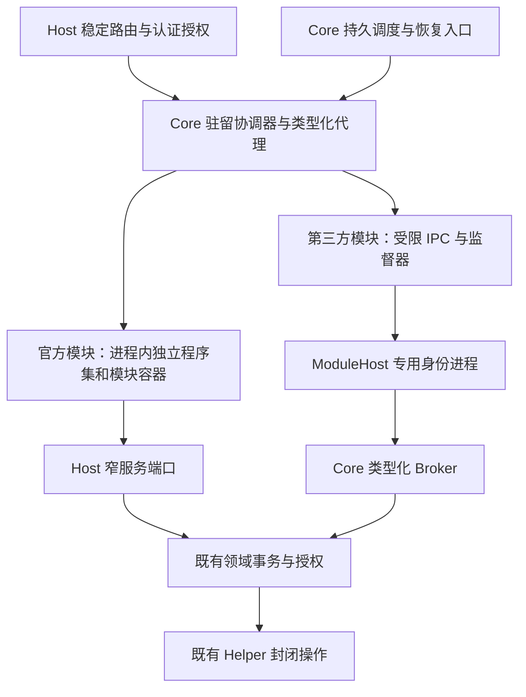

# Server 模块边界与内存回收设计

本文定义 Core 与模块的责任、依赖方向、程序集边界和迁移验收门槛。各模块现状、阻塞和证据入口由[实施进度](RelaxKonOS.ServerModuleBoundaries.Progress.md)维护。

[模块总设计](RelaxKonOS.ModulesAndExtensions.Design.md)拥有总体架构，[驻留设计](RelaxKonOS.ServerModuleResidency.Design.md)拥有状态机和租约，[分发设计](RelaxKonOS.ServerModuleDistribution.Design.md)拥有安装和版本事务，[模块管理设计](RelaxKonOS.ServerModuleManagement.Design.md)拥有跨端产品和操作协议。Android 细节由 Android 工程文档维护。

## 1. 目标与确定的决策

目标是使不使用的管理功能真正失去对业务对象、缓存、连接以及可选实现程序集的强引用，需要时按当前已安装的有效版本恢复。衡量对象是整个 Server 及其模块进程树，不能通过把内存移入另一个常驻进程声称节省。

1. 按持久职责、调用关系和资源所有权拆分，不按页面或现有文件夹机械拆分。Core 只保留必要的宿主基础设施和轻量调度；多个调用方使用同一实现不自动构成迁入 Core 的理由。
2. 官方模块继续遵循分发设计的进程内模型。实现移入独立程序集，经过对象生命周期迁移后再使用可回收加载上下文；不因本设计自动迁到第三方 ModuleHost。
3. 第三方代码继续只在 ModuleHost 执行，复用当前专用身份、IPC、代码信任和 Broker。为其增加闲时退出与按需启动，不开放第三方进程内执行。
4. 稳定路由、鉴权、模块目录、状态、调度和代理由 Host 持有；可回收实现不能直接注册进根 DI、Endpoint 或根 HostedService。
5. 安装、启停集合、更新、回退和移除继续遵循现有计划、重启和核实规则。内存唤醒固定使用当前生效版本；休眠不是版本切换或热更新入口。
6. 休眠不卸载磁盘文件、不丢失配置或操作台账，也不停止 Mihomo、sing-box、Squid、Docker、Nginx、Tailscale 等外部服务。外部资源变化仍由原领域事务与 Helper 决定。

不承诺固定节省量；不以强制 GC、裁剪工作集、缩短宽限期或中止用户工作代替边界调整。

## 2. 当前事实与结构性限制

| 当前入口 | 实际边界 | 调整要求 |
| --- | --- | --- |
| `Startup/Modules/`、`ServerModules.Catalog.cs` | Git 仓库/CLI/构建和 Firewall 的部分执行代码已拆出，Tailscale 已有对象边界。完整范围见实施进度 | 先消除根容器对重实现的持有，再独立项目 |
| `Residency/` | 协调器、依赖租约、后台工作、流所有权已存在 | 继续作为唯一准入和排空协调者，补充代码/进程释放观察 |
| `InstalledModuleStore.cs` 中的 `InstalledServerModule` | 官方包使用非 collectible ALC，启动阶段直接注册服务和路由 | 升级当前 ABI；仅打开 collectible 标志不足以回收 |
| `ModuleHostSupervisor.cs` | 已有第三方进程、信任和健康监督，生命周期随 Server | 把启动/退出接入驻留准入，保留原权限和故障隔离 |
| `ProxyModule.cs`、`ProxyRuntimeRegistration.cs` | 管理、引擎、恢复、安全、共享代理设置和运行时发布存在跨职责引用 | 为每种职责指定唯一所有者，不把整个 Proxy 搬入 Core |

对象回收、程序集卸载、磁盘占用及进程内存下降分别验收。对象释放成功只证明对象边界；调用 `AssemblyLoadContext.Unload()` 只表示请求卸载，仍需确认上下文与私有实现可回收。运行时依据见 [.NET 卸载文档](https://learn.microsoft.com/en-us/dotnet/standard/assembly/unloadability)。

## 3. 目标层次与依赖方向

图中的 Core 是职责边界，不要求立即把整个宿主基础设施移成一个新项目。项目拆分遵守以下方向：

| 层 | 放置内容 | 不得引用或持有 |
| --- | --- | --- |
| 共享 Protocol / `ServerModule.Abstractions` 及按领域的契约项目 | 稳定 DTO、租约/生命周期接口、类型化调用端口；直接演进现有抽象项目 | Server 实现、领域仓储实现、私有第三方依赖、模块实例或静态缓存 |
| Host 目录和入口 | 已安装身份、有效版本、静态路由、鉴权和合同校验、模块工厂描述 | 实现 Type、MethodInfo、已加载 Assembly、模块委托和私有 DTO 的永久缓存 |
| Core 基础设施 | 身份/会话、宿主限制、配置与秘密保护、基础存储工厂、审计、调度、Helper/Broker 通道、共享锁与通用恢复索引 | 完整订阅解析器、引擎注册表、应用级配置生成器或业务缓存 |
| 官方模块实现项目 | 每代独立容器、领域服务、配置生成器、业务缓存、任务与事件订阅 | 对其他模块实现项目或 Server 主程序集的引用；借用根容器注册自身 |
| 第三方 ModuleHost | 本模块执行器、私有依赖和工作数据 | Server 数据库/配置/Helper 秘密、其他模块数据或直接 Helper 连接 |

实现项目按 `ServerModules/RelaxKonOS.ServerModule.<Domain>/` 组织，首个 Git 执行项目及 `Shared/RelaxKonOS.ServerModule.Git.Contracts/` 已建立，其余名称在对应实施项中确定。Host 不通过对实现项目的静态引用、`typeof(Implementation)` 或启动期类型扫描加载它。发布和安装读取当前受信清单定位程序集，读取元数据不执行模块代码。共享契约只加载一次；模块包不能自带另一份契约造成类型身份分裂。

现有根服务按实际职责分配窄端口，而非把 `IServiceProvider`、`WebApplicationBuilder`、整个配置或任意 Helper 动作交给新模块。官方代码仍是受信代码；这些端口用于资源所有权和依赖控制，不被宣称为进程内安全沙箱。

## 4. Core、调度和可回收执行器

Core 保留稳定能力入口、存储和锁的基础设施；具体领域的配置格式、业务决策与执行仍属于相应模块。已发布状态、来源身份、业务配置、操作回执和恢复证明保存在原领域的持久存储，不能只存在于可休眠实例中。

Core 的轻量调度索引只存模块/实例/操作身份、工作类别、到期时间、修订、状态和恢复引用，不缓存完整订阅、证书挑战、引擎对象或领域实现委托。业务提交与调度登记须在可证明的一致性边界内完成：可共用事务时原子提交，否则使用持久 outbox 并在启动时对账；不能先返回成功再仅靠内存登记到期任务。

调度以至少一次唤醒设计，执行器用原领域 operationId、幂等键、修订和共享锁避免重复副作用，不宣称跨进程“恰好一次执行”。Core 和模块不能同时拥有同一恢复执行循环；迁移时先停止旧责任方，再以持久状态、代次和操作修订隔离确认新责任方接管。

有 TUN/系统代理承诺、证书挑战、到期授权或未完成安装/发布事务时，允许专用小型系统执行器保持保护租约。轻量化调度尚未完成前，原实现继续受保护，不能为了休眠先关闭安全职责。缺失、禁用、撤销或加载失败不能悄悄丢弃任务：保留故障和人工恢复入口，拒绝与未解决责任冲突的新操作。Core 只执行已经明确实现并授权的紧急恢复动作，不以模块不可用为理由新增通用命令或自行扩大 Helper 权限。

## 5. 各领域的目标边界

以下名称描述目标职责，不自动成为新的模块 ID、公开路由或可安装组件。ID、能力和包依赖只有随具体实施项同步更新全部调用方后才生效。

| 领域 | 常驻的最小部分 | 可休眠/可回收部分 | 阻止休眠的条件 |
| --- | --- | --- | --- |
| Git | 稳定仓库/构建端口、持久操作索引、共享文件/部署端口 | CLI 封装、仓库服务与写锁、构建执行器和内存日志 | 活动构建、CLI/镜像清理、未提交终态或待恢复操作 |
| Firewall | 固定路由、授权和 Helper 传输 | 平台查询/编辑 facade 与私有解析状态 | 请求或传输未结束；系统规则不随休眠删除 |
| Tailscale | 固定路由、身份/计划/持久回执端口 | 查询、登录与控制协调器、请求缓存 | 登录流、控制任务、未核实回执；外部 tailscaled 不受休眠控制 |
| Mihomo 管理 | 共享代理设置端口、任务/安全责任索引 | profile/订阅解析和编辑、诊断、管理缓存 | 发布/下载/订阅任务、流式诊断、安全租约 |
| Mihomo 运行与安全 | 按需的控制端口；有系统代理/TUN 承诺时受保护的安全执行器 | 引擎控制客户端、平台适配器及非必要缓存 | 运行时事务、TUN/系统代理恢复、仍依赖实例的消费者 |
| sing-box 入站管理 | 持久授权到期索引、现有安装/配置发布与恢复端口 | 入站配置生成、管理查询和编辑服务 | 发布/恢复事务、活动连接、到期执行尚未交接 |
| Squid 网关管理 | 安装/配置发布与操作索引端口 | 管理与配置生成、查询缓存 | 领域事务或待恢复操作；网关外部服务持续运行 |
| Docker 管理 | 被安装/部署使用的 Engine/出站代理窄端口、栈操作索引 | Compose 管理、代理编辑、镜像/容器等管理缓存和操作执行器 | 活动栈/构建/部署或清理、Engine 会话、未完成对账 |
| Certificate | 续期计划、挑战与操作索引、明确存续的挑战服务 | ACME 客户端、证书管理和续期执行器 | 有效挑战、签发/续期/发布或恢复尚未完成 |
| WebServer | 发布索引、稳定挑战/服务端口、恢复调度 | 网站管理、配置生成和发布执行器 | 进行中的发布、挑战引用、待恢复事务 |
| SystemPerformance | 订阅/权限入口和有界轻量状态 | 采样器、进程快照、图标解码/缓存、原生性能句柄 | 活动订阅、采样或输出未完成 |
| Terminal | 会话身份/目录、连接所有权和断线规则 | 无会话时的管理实现、平台 PTY 工厂与私有依赖 | 任一 PTY、可重连会话、Hub/输出流或未确认的子进程清理 |

### 5.1 Proxy 首先按四种职责拆开

将当前聚合 Proxy 边界拆为共享出站设置、Mihomo 管理与控制、sing-box 入站管理、Squid 网关管理；安全/恢复作为明确的专用职责，不挂在任一管理页面的生命周期上。管理与控制可在第一个切片中共用模块，前提是内部生命周期和依赖已经分离；不能把尚未拆开的代码宣称为四个可独立回收模块。

Docker 与运行时下载只依赖结构化的出站路由结果和必要的运行能力租约，不依赖订阅服务或整个 Proxy 模块。读取已保存的地址、旁路和认证引用不应唤醒管理模块；真正需要其控制客户端或持续安全承诺时才持有相应租约。不得把“代理流量正在经过外部 Mihomo”直接当作整个管理模块永久常驻的理由，也不得在未知所有权时撤下保护。

`ProxyRuntimeRegistration` 已在 Core 注册的运行时安装/发布骨干继续遵循原领域权威；后续分离时先提供契约端口，保留冻结计划、台账、锁、Helper 复核及原操作成功证明，不在驻留协调器重写安装器。遵循[受管运行时设计](../platform/RelaxKonOS.ManagedRuntimes.Design.md)，本设计不关闭 MR/CC 的宿主生命周期验收。

Core TUN 标记生成唯一操作 ID，运行时激活和恢复使用该 ID。Linux 管理路径验收比较内核实际选中的网关和管理端点路由，原网关仍存在时也要核对管理端点。受管 Helper 需要独立确认自身生效的设备、规则及 DNS 归属，并将证据绑定同一操作，才能允许受管 TUN 生效或补偿。

受管 TUN 新候选的网络范围由 Linux 宿主管理员提供。Server 规划器从 root 保护的固定文件读取范围，将范围和原管理 UID 路由冻结到原发布意图。Helper 在前置检查及副作用前独立重读并比对完整范围。已派发操作的恢复权由原归档回执、旧配置授权和原生效果归属证明确定，范围文件变更或撤下不会另立恢复 owner。打开公开准入前须验证成功提交后启停、移除和重启的网络效果所有权，以及同键 HTTP 回执和工作租约。

成功提交时，原归档实例台账以一次替换同时保存成功回执和活动 TUN 归属。归属绑定原 operationId、活动制品修订、配置摘要及冻结网络意图摘要。固定单元注册与原生检查点必须对应同一归属。实时效果漂移时，查询报告当前归属未知，历史成功回执保留。后续写操作须在同一实例锁内获得当前归属并完成具名接续，普通归档切换、配置发布及移除拒绝绕过该责任。

受管 Linux 规划冻结 Server 有效 UID 对管理端点的内核选路。特权 Helper 使用该 UID 复核，管理路径证据不能用 root 自身的选路替代。

受管 Linux 策略规则绑定原操作的专用表、优先级、协议和目标，碰到共享槽位或不完整归属证据时保留待核验。删除派发先持久化，结果未知时只能核对缺席。

受管分流 DNS 的所有者是原操作创建的非持久接口。Helper 冻结原 resolver 总线及服务身份，限制写入为本接口的分流域和 DNS 服务器，关闭默认 DNS 路由。恢复核对本接口 DNS 退出及其他 resolver 设置的原摘要。写入结果不明时只读核验。

受管 Mihomo TUN 的准入要求 Core 的原恢复标记与原生事务回执绑定同一操作身份。验收须证明原生所有者可核对安装和运行中配置的身份，并可区分该操作创建的设备、规则、路由及 DNS 状态和既有宿主状态。结果未知时按原 ID 只读核验，补偿只处理可证明属于原操作的效果。验收须在真实流量下覆盖生效后终态持久化前的中断、重启和同键请求，并在路由验证与清理结束前保留原责任。受管配置的启动凭据摘要与系统路由观察分别提供证据，启用门禁要求两者及原回执关联成立。

### 5.2 缓存、会话与存储

缓存需要有所有者、字节/条目上限、闲置释放时点和失效规则。现有性能历史与图标已有条目限制，但静态缓存不会随模块容器销毁；迁移时将可选重缓存变为每代所有，必要的小型共享缓存单独计量。权限隔离的进程快照不能为了省内存合并；授权信息不通过缓存继续授予旧权限。

Terminal 断连不等于会话结束，不能将客户端退出直接变成 PTY 关闭。若重型原生资源无法可靠从进程内回收，该模块暂时报告代码不可回收并保留原因；是否采用新的官方执行进程另立决策，不擅自改成第三方 ModuleHost 模型。

DB 工厂和存储模式可由 Host 提供，每次工作创建并及时释放上下文；模块不得长期持有 scoped DbContext、HttpContext、借用连接或别的模块裸服务。业务历史、构建日志和配置应持久化/分页读取，不能在每次唤醒时把全部历史加载到内存。

## 6. 官方模块运行 ABI 与程序集回收

### 6.1 从启动注册转为按代次激活

当前 `ConfigureServices(IServiceCollection, ...)` / `MapEndpoints(...)` 把包代码挂到根容器，不适合作为可回收实现的运行 ABI。目标是由 Host 映射其支持的固定路由，并通过共享领域契约调用每代模块运行时；模块激活只接收窄 Host 端口和本模块上下文，创建自己的服务容器。模块可以注册服务到自己的容器，但不能修改根 DI、Host 中间件或永久路由。

生命周期在现有运行时抽象上演进，覆盖创建/初始化、类型化服务解析、释放预检、后台工作排空和异步销毁。初始化恢复完成后才发布 Active；加载中不暴露半成品服务。激活后新增后台任务必须先取得代次租约；运行时主动报告待恢复职责，不能只以请求数为 0 判断安全释放。

ABI 变更时直接更新唯一当前契约、Host API 范围、官方模块实现、安装清单、签名样例、SDK、打包工具、测试与文档，重新构建受影响包；不保留旧入口桥接、双 ABI 解析或失败后退回启动注册。执行模式由明确的当前契约确定，不根据卸载失败静默切到另一种宿主。

### 6.2 强引用清理规则

Host 保存工厂元数据和共享契约代理，不保存模块实现的 Type/委托/MethodInfo。模块私有 DTO、异常对象、流、异步枚举器和反射元数据不得作为根缓存内容；错误转成有界的共享问题快照，详细日志的提供程序也不得持久保留原模块对象。序列化元数据、DI 激活缓存、事件订阅和诊断钩子必须在真实卸载测试中审计。

共享 DTO 内的实际对象也属于此边界。返回集合时使用共享数组或框架集合，并在测试中保留原 DTO 观察旧 ALC 收集。接口类型的集合表达式可能在执行程序集生成具体类型。见 [Git 构建回执实测](server-module-evidence/Git.md#mb-03-真实-buildkit-构建取消与原回执)。

每代拥有的 HttpClient/handler、计时器、CancellationTokenSource、注册回调、事件处理器、文件监视、DbContext、原生句柄及连接均有销毁清单。借用的 Host 资源只释放本代引用/租约，不被模块销毁。跨模块只保存稳定端口，调用/实例依赖通过协调器取租约；环依赖拒绝，不能通过全局 service locator 绕过。

程序集回收按“停止准入 → 排空现有租约和后台工作 → 检查/交接持久责任 → 销毁资源 → 断开所有引用 → 请求 ALC 卸载 → 观察弱引用回收”执行。请求在卸载阶段等待受限的新代次；未确认旧副作用执行者已结束时禁止创建第二代。原生库、终结器或框架缓存阻止回收时记录阻止原因，不吞掉异常后伪报成功。

对象运行时 Dormant 与代码释放结果分开：目标诊断记录释放层级（对象/程序集/进程）、请求时刻、观察时刻、代次和未完成原因；具体 DTO 由管理协议实施项统一定义，不在本文新增公共字段。ALC GC 尚未发生时可报告“对象已释放、代码回收待观察”；不能报告“DLL 已卸载”。设定有限观察预算，超时保留弱引用诊断并阻止代次无限积累，按管理流程安排受控重启，不在每次业务请求上强制 GC。

## 7. 第三方 ModuleHost 按需运行

监督器保持身份/信任/有效版本等轻量元数据，Dormant 时不保留 ModuleHost 进程和其 IPC 连接。业务调用仍先做 Host 认证、模块访问授权和能力检查，再以同一准入锁取得代次租约，并发调用共享一次启动。每次启动重新核对当前代码信任、撤销状态、有效版本、制品摘要和专用身份，建立新的 IPC 会话和服务令牌；旧代次回调不能作用于新代次。

IPC 请求、响应流、模块回调、批准中的 Broker 操作和持久后台任务全部纳入工作保护。普通业务流量不自动重放；IPC 断开时，Broker 继续按原持久 operationId 记录真实结果，模块重开查询，不以连接死亡推导安装或配置成功。常设许可仍重新核对范围、期限与撤销，不因自动唤醒而重新授信。

闲时先请求合作排空，确认无子任务、回调和待提交回执后关闭连接并等待进程/属于该模块的子进程树结束，再进入 Dormant。不能只证明父进程退出。排空超时不能默认杀进程并报告成功；进入故障/待恢复，管理员的明确终止操作遵循已有授权与后果展示。若故障需要强制隔离，只处理可证明属于本代的进程资源，领域事务继续按持久回执核实，不以强杀充当成功补偿。

未知后台工作责任、还不能提供完整租约的模块保持加载并说明原因。模块缺失、禁用、过期或未确认信任时不能被调度器自动下载、安装、启用或提权。

## 8. 实施顺序与跟踪项

按模块里程碑推进。当前状态、剩余阻塞和下一项见[实施进度](RelaxKonOS.ServerModuleBoundaries.Progress.md)。

## 9. 验收与决策门槛

### 9.1 正确性与回收

| 场景 | 必须证明 |
| --- | --- |
| 未认证/无权限、禁用、缺包或未信任请求 | 不加载代码、不启动进程、不授予新权限；状态查询不唤醒 |
| 并发首次访问、取消、唤醒超时、过载 | 单次加载、有界等待；单个调用取消不破坏其他调用；副作用不自动重放 |
| HTTP 流、枚举、Hub/PTY、后台任务和依赖 | 完成清理前租约不结束，旧代次不能取得新代次保护，未完成责任阻止释放 |
| 释放异常、未提交终态、进程/Server 中断 | 原执行者和操作身份保持；不产生第二个执行者；重开观察真实回执 |
| 真程序集卸载 | 真实独立实现与私有依赖的 ALC/对象弱引用消失；根 DI、路由、反射/序列化缓存不保留实现；不能只测合成 buffer |
| 真进程释放 | 父进程、所有自有子进程及 IPC 消失；外部受管软件继续提供原业务；新会话拒绝旧 token/回调 |
| 安全/到期/续期职责 | 管理模块休眠后，既有承诺仍执行；模拟错过唤醒、撤销、过期、恢复失败并展示可操作故障 |
| 多轮循环 | 建议至少 100 轮并包含保留完成 Task/包装流等引用的调用方；存活代次和资源不会持续累积 |

测试允许在专门的可回收验证步骤触发 GC 来排除观察时机；生产运行不得依赖强制 GC。实测报告必须区分这两种环境。

### 9.2 资源与用户体验

同一 Release、同一 .NET/RID、相同有效模块、真实业务数据及连接集合，交错重复测量冷启动、首次请求、持续访问、无租约后的宽限期、再次唤醒及长循环。先预热，再至少 3 次独立运行，保留原始时间序列与范围。记录 Server 和 ModuleHost 整个进程树的存活托管堆、GC 提交空间、private bytes、RSS/可取得的 PSS、代码/私有依赖映射、线程、句柄、CPU/IO 和唤醒请求 p50/p95；不把共享映射简单相加当作系统物理内存节省。

每个试点在实施前从 MB-01 基线写明可接受的冷启动 p95、闲时总内存目标和错误率，结果必须超过重复测量噪声；未达到目标则保留已验证的对象释放边界，重新评估程序集拆分或该模块的默认驻留策略，不宣传未测收益。本文不凭合成测试指定统一 MB 或百分比，也不修改当前 300 秒宽限期、30 秒唤醒时限。

交付报告分别写明“实例释放”“代码回收”“进程退出”“生产资源下降”的实测范围。只有相应事实已验证才显示成功；休眠故障仍保留入口与原因，客户端请求不需要先手动唤醒。

## 实施与维护

先用 Git 验证独立代码执行、工作租约与恢复，再扩大官方模块的可回收边界。Proxy 的审计可并行推进，安全执行器迁移须先验证持久调度、原恢复权威和真实工作租约。第三方 ModuleHost 的独立进程验收不改变官方模块的宿主选择。

实施项同步模块与应用文档及进度页。涉及受管软件生命周期时遵循[受管运行时设计](../platform/RelaxKonOS.ManagedRuntimes.Design.md)并同步对应追踪项。按当前接口更新仓内调用、测试和示例。唤醒固定使用当前有效制品。

## 旧章节入口

旧链接定位到对应证据页的入口。证据页目录可跳转到具体场景。

- [模块联合阶段验收与测试设施](server-module-evidence/Milestones.md)

- [MB-02/03 Git 执行边界与 BuildKit 验收](server-module-evidence/Git.md)

- [MB-04 Proxy 发布与恢复](server-module-evidence/Proxy-Publication.md)

- [MB-04 Proxy 系统代理、TUN 与授权到期](server-module-evidence/Proxy-Safety.md)

- [MB-04 Proxy 订阅队列与激活](server-module-evidence/Proxy-Subscriptions.md)

- [MB-07 SystemPerformance S1 验收](server-module-evidence/SystemPerformance.md)

- [MB-06/07 ModuleHost 与 Terminal 验收](server-module-evidence/ModuleHost-Terminal.md)

- [MB-07 Firewall 与 Tailscale 验收](server-module-evidence/Firewall-Tailscale.md)

- [MB-05 Docker Engine 与 Compose 验收](server-module-evidence/Docker.md)

- [MB-05 WebServer 发布与 Nginx 服务操作](server-module-evidence/WebServer.md)

- [MB-05 证书、ACME 与 Kestrel 验收](server-module-evidence/Certificates.md)

- [MB-05 WebServer 的 WebRoot、TLS 与续期部署](server-module-evidence/WebServer-TLS.md)

- [MB-04 Proxy 读取执行图与配对测量](server-module-evidence/Proxy-Observation.md)
