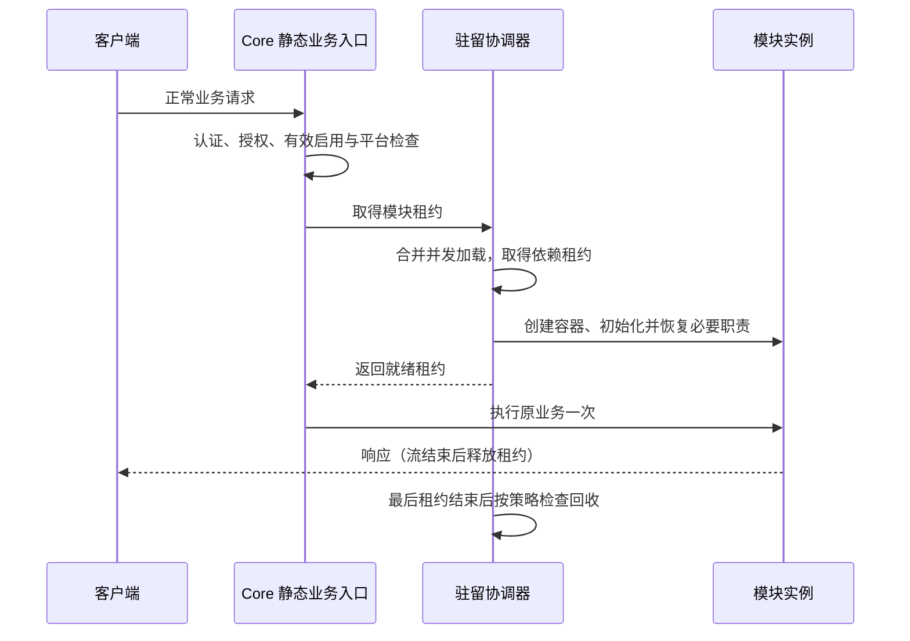

# 服务端模块管理与按需加载完整设计

> 状态：产品与协议设计及实施中，2026-10-31。当前实现边界见 §12；未列入该节的目标仍是待实施规范。独立模块安装、Docker 动态休眠及程序集卸载尚未交付。

## 1. 范围、入口与文档权威

本设计回答：由哪个内置应用管理服务端模块、怎样选择启用集合、业务请求如何唤醒、什么时候可以释放、变更失败如何恢复。

统一产品入口采用内置**组件中心 → 服务端模块**。组件中心分别呈现“宿主软件”和“服务端模块”，使用各自目录、权限、计划与台账。桌面设置 → 系统保留只读诊断摘要和“在组件中心管理”入口，不再建设另一套写入流程。无需新增独立的模块管理应用。Android 通过同一服务端协议接入；移动界面与支持边界由 [Android 文档](../../Client/RelaxKonOS.Client.Android/docs/design/ServerModules.Design.md)独立拥有。

- [模块与扩展总设计](RelaxKonOS.ModulesAndExtensions.Design.md)拥有模块边界、包、官方信任及第三方扩展路线。
- [服务端独立模块分发与 v1/v2 宿主设计](RelaxKonOS.ServerModuleDistribution.Design.md)拥有独立打包、安装、更新、回退及 v1/v2 运行模型；[模块提权 Broker 设计](RelaxKonOS.ServerModulePrivilegeBroker.Design.md)拥有第三方提权确认契约。
- [包商店来源设计](../platform/RelaxKonOS.PackageStore.Design.md)拥有模块与桌面应用的来源、目录、搜索和下载契约。
- 本文拥有跨端模块管理产品规则、操作契约与交付验收。
- [驻留设计](RelaxKonOS.ServerModuleResidency.Design.md)拥有协调器、租约、运行时释放边界及实测证据。
- [组件中心](../platform/RelaxKonOS.ComponentCenter.Design.md)拥有统一导航；[受管运行时](../platform/RelaxKonOS.ManagedRuntimes.Design.md)拥有 Docker Engine、Nginx、Mihomo 等软件生命周期。

模块管理不增加受管软件安装后端，不改变 MR 各项支持范围。模块安装、启用、唤醒不自动安装或启动其管理的软件；休眠和移除模块不自动停止外部服务或删除业务数据。

## 2. 当前实现基线

| 能力 | 当前事实 |
| --- | --- |
| 官方目录 | 编译期注册 9 个模块：Terminal、Firewall、SystemPerformance、Git、Tailscale、Docker、Certificate、WebServer、Proxy |
| 启停 | `Modules:<ConfigurationName>:Enabled` 配置，重启生效；未配置时默认全部启用；未知配置在启动时拒绝 |
| 查询 | 已认证的 `GET /server/modules` 返回启用、依赖、停用阻止项与 residency；查询不唤醒 |
| 桌面 | 设置 → 系统显示只读清单，尚未展示完整驻留字段 |
| Android | 没有服务端模块管理页 |
| 按需加载 | Git 服务通过租约代理首次业务调用加载；并发首次访问合并；对象图可释放 |
| 回收 | KeepLoaded、IdleDelayed、ReleaseOnLogout；默认宽限期 300 秒，唤醒时限 30 秒；默认值尚缺收益测量 |
| 未交付 | 模块写入管理 API、独立包安装更新、其他模块休眠、跨模块/长连接完整租约、程序集卸载与资源收益证明 |

现状依据：`RelaxKonOS.Server/Startup/ServerModules.Catalog.cs`、`Startup/Modules/DockerModule.cs`、`Residency/`、桌面 `Apps/Settings/ViewModels/SystemPageViewModel.cs`。Git 真实 HTTP 唤醒与回收的既有验证见驻留设计 §8；本文不新增执行通过声明。

## 3. 用户模型与状态

用户选择“启用哪些模块”，界面显示已安装、期望启用、本次进程有效启用和当前加载数量；不提供只有数量、无法指定成员的限制开关。Core 固定保留，不参与计数或移除。

每个模块的不同事实独立建模，禁止用一个 enabled 或 installed 字段代表全部状态：

| 维度 | 字段与含义 |
| --- | --- |
| 身份 | moduleId、名称、提供能力、平台/RID、Host API 要求、硬依赖与反向依赖 |
| 安装 | packaging（bundled/independent）、installedVersion、artifactDigest、sourceId、trustState；编译内置不能声称可独立卸载 |
| 期望 | desiredEnabled、desiredVersion、desiredRevision；持久保存的下次启动目标 |
| 生效 | effectiveEnabled、effectiveVersion、effectiveRevision、processGeneration；当前进程实际快照 |
| 驻留 | 沿用 `ServerModuleDto.residency`：state、releasable、strategy、idleGraceSeconds、activeLeases、lastUsedAt、lastWakeMilliseconds、blockedBy、failure、lastReleasedAt |
| 操作 | pendingOperationId、restartRequired、恢复状态、阻止原因、观察时间 |
| 准入 | allowedActions 与结构化拒绝原因；仅辅助界面，执行时重新授权 |

当前 `ServerModuleDto` 只具备其中一部分；扩展协议时直接更新共享 Protocol、服务端、桌面、Android、测试与示例，不保留旧字段别名、双格式解析或 fallback 路由。

安装缺失、禁用、不支持、权限不足、休眠、加载失败、待重启、待恢复和状态未知分别呈现。已启用但休眠仍提供可发现能力，业务操作到来时唤醒；休眠不导致客户端应用突然消失。加载失败保留诊断与恢复入口。

## 4. 桌面管理交互

模块列表提供名称/ID 搜索、状态筛选和当前 Server 稳定身份。默认列出完整目录，分别统计有效启用与当前加载；读取失败显示未知和重试，不将缓存当作新的事实。

详情包含安装与实际版本、期望状态、待重启差异、依赖图、驻留策略、活动租约、阻止释放原因、最近使用/释放时间、唤醒耗时和操作记录。受管软件摘要通过领域查询取得，提供独立跳转，不从模块状态猜 Docker Engine 是否存在。

动作按 allowedActions 显示：启用、停用、修改驻留策略、唤醒、尝试休眠、安装、更新、修复、回滚、移除。未支持的动作显示原因，不展示可点击的假按钮。休眠按钮标为“尝试释放内存”，有活动工作时显示阻止原因，不提供默认强制终止。

多选启停先生成一个完整集合的原子计划。依赖不会自动勾选并执行：预览明确列出额外启用项或需先停用的依赖方，由用户提交整个精确集合。启用集合配置提交原子完成，不逐项制造短暂非法集合。

预览呈现目标 Server、模块及版本、依赖变化、权限、活动连接/任务影响、文件和数据处理、重启要求、阻止项和有效期限。用户确认后提交原计划；进度页持续显示 operationId。提交后断连显示“等待重连/核实结果”，不显示已完成。重连核对 Server 身份、进程代次、有效模块集合、版本和摘要后才完成。

模块缺失的应用入口跳转到模块详情；软件缺失跳到宿主软件详情。导航只定位目标，不自动安装、授权或提交。

## 5. 正常请求自动唤醒



无需先调用 `/module/install/docker`；不设计这种安装与唤醒混合接口。触发点是可信静态 Endpoint 对模块服务取得租约，不是按 URL 字符串前缀扫描并加载程序集。不存在的 `/docker` 根路径不因模块存在就变成有效接口。

当前示例是 `GET /git/repositories`：休眠 → 加载 → 执行查询 → 最后租约释放 → 宽限期后休眠 → 再次请求创建新代次。Docker 完成专属生命周期审计后，其已定义业务接口才可使用相同机制；当前 Docker 仍常驻。

准入顺序必须保证未认证、无权限、不支持或禁用的请求不能触发加载。普通请求不下载模块、不启用模块、不安装软件、不提权。目录、能力查询、管理页轮询与健康检查不得唤醒或刷新业务闲时计时。共享加载中的单个请求取消只撤销自己的等待；加载成功后仅未取消且获准的请求执行业务。

等待队列和并行加载数有配置上限，按模块及宿主限制；超限返回稳定 503 和 Retry-After，不无限排队。加载失败、超时及宿主退出沿用现有 `module-load-failed`、`module-wake-timeout`、`module-host-stopping`；计划增加 `module-wake-overloaded`。协调器不重放有副作用请求；客户端在结果未知时查询原业务操作。

## 6. 租约、休眠与职责

三种策略沿用驻留设计：保持加载、闲时延迟释放（默认）、退出后立即尝试释放。保持加载从首次唤醒后生效；启动预热单独声明。退出策略仅检查成功退出会话使用过的模块，不以一个用户退出代表全服务器空闲；断网由租约收尾和闲时扫描处理。

请求、流式响应、Hub/WebSocket、跨模块调用、后台任务与恢复操作持有覆盖实际生命周期的租约。依赖拓扑获取、反向释放；实例持有依赖期间不能释放依赖。长任务必须拥有自己的租约，不依赖已经返回的 HTTP 请求；持久任务重启后先重建保护状态再准入回收。

释放需要同时满足：无租约、无待恢复职责、无外部长期裸引用、CanUnload 检查通过。排空和新请求准入共用同步边界；进入释放后新请求等待新代次，不调用已释放实例。失败残留未隔离前禁止启动第二个副作用执行者。

资源释放分级报告：对象/缓存/连接释放、可回收程序集卸载、独立进程退出。当前只有 Git 对象图级别；没有程序集或进程回收证据就不得显示对应级别，更不能承诺工作集即时下降。释放管理模块不停止 Mihomo、Nginx、Docker 容器等外部工作。

## 7. 管理协议（目标契约，尚未实现）

保留现有只读 `GET /server/modules`，扩展其唯一当前 DTO。以下路由统一归 Core，不随目标模块休眠或停用而消失。路由实现前须在共享 Protocol 冻结请求、响应、枚举与错误码；本文没有授权部署任何占位接口。

| 方法与路由 | 作用 |
| --- | --- |
| GET `/server/modules/{moduleId}` | 单模块事实、依赖、阻止项和动作 |
| GET `/server/module-releases?moduleId=…&sourceId=…` | 已登记来源中的可信版本目录；不接受任意 URL |
| POST `/server/module-plans` | 预览精确集合、版本或驻留动作，返回不可变 planId |
| POST `/server/module-plans/{planId}/apply` | 提交原计划，返回 operationId；不重复携带可变目标 |
| GET `/server/module-operations/{operationId}` | 跨断线/重启查询原操作 |
| GET `/server/module-operations?moduleId=…` | 有界分页操作记录，按权限过滤 |

计划动作定义为 enable、disable、setResidencyPolicy、wake、trySleep、install、update、repair、rollback、remove。wake/trySleep 只作用于已启用且支持驻留的模块；仍经统一计划权限和幂等检查。单模块可同步完成，多模块/重启操作异步查询同一操作模型。

预览输入至少绑定 serviceId、moduleId 集合、action、明确 releaseId/策略参数、expectedRevision、idempotencyKey。返回计划绑定操作者、目标、修订、制品摘要、来源/信任修订、依赖闭包、差异、重启影响、expiresAt、blockedBy。服务端在锁内复核；相同 key 相同内容返回原记录，相同 key 不同内容冲突。授权不可由客户端布尔值表示。

错误分别表达未认证、拒绝授权、对象不存在、不支持、修订冲突、计划过期、依赖阻止、恢复阻止和信任失败。使用稳定 problemCode 与结构化参数，客户端不解析 title；禁止把校验失败降级为自动启用/安装。操作记录不泄露目录中的秘密或其他用户会话细节。

## 8. 持久配置、权限与并发

首个写入阶段仍配置加重启生效，不运行中修改根 DI、HostedService 或 Endpoint 集合。界面提交 desired 状态后明确显示 pendingRestart，effective 保持原快照。

当前配置来源可能包含文件、环境变量和部署宿主覆盖。管理后端必须报告配置所有权和可写性；外部部署控制时返回只读原因，不写低优先级文件伪装成功。引入受保护的期望状态存储时，在一次明确的契约升级中确定唯一权威与部署锁定规则；禁止同一模块由两个来源竞争写入。文件外部修改导致修订冲突并要求重新预览。

读取目录沿用当前认证限制；修改全局集合、策略、包和来源分别要求明确服务器管理授权。普通用户只能按其业务授权触发唤醒，退出不能修改服务器策略。System/User Mode 与 Helper 继续校验目标所有权；模块不能通过包自授信任或提权。

生命周期操作使用服务器级集合锁与模块锁，固定加锁顺序。安装切换、待重启集合变更与运行时回收协调，避免旧版本仍有实例时删除文件。模块台账独立于受管软件台账，但预检读取领域事务和恢复状态。所有状态变化记录操作者、Server、计划/操作 ID、修订、精确版本摘要与阶段；不记录令牌、私钥和授权密码。

## 9. 安装、升级、重启与恢复

仅独立分发且 Host 声明支持的模块开放包操作。编译内置模块可启停，移除/独立更新返回“不支持，随 Server 发布”。Core、身份认证和恢复入口不允许被模块计划删除。第三方代码隔离按总设计单独验收，不复用官方进程内执行权限。

流程为可信目录选版 → 有界暂存 → 包路径/平台/兼容/签名与撤销检查 → 不可变版本目录 → 持久计划 → 原子切换期望集合 → 受控重启 → 检查实际生效集合与健康 → 持久终态。不能覆盖运行中文件，也不能把上传或重启成功当成升级成功。

更新指定不同 releaseId，修复指定同一 releaseId；回滚只允许仍可信、依赖和数据 schema 兼容的已验证版本。来源不可用不阻止对自有安装提出安全移除，但不能凭客户端缓存安装新代码。正式源、开发源、撤销和离线验证规则沿用模块总设计，开发信任不能隐式进入生产。

重启由明确支持的部署宿主执行；无法自行重启的部署保留待重启并提示外部操作。停止前检查请求排空、Hub 会话、任务及恢复责任。候选启动失败只回退仍可信且数据兼容的集合；否则进入诊断/恢复模式，禁止无依据地显示正常。

持久操作状态至少包含 Prepared、Applying、AwaitingRestart、Verifying、Succeeded、Failed、RecoveryRequired。执行前记录意图与精确目标，崩溃后对照物理文件、配置与当前进程确认结果，不能只看最后日志。客户端超时、关闭或取消等待不取消已提交切换；以原 operationId 查询。卸载默认保留配置、业务数据和外部软件；清理数据是独立明确计划。

## 10. 可观察性与验收

目录包含观测时间和有效修订；驻留指标覆盖加载次数/耗时、租约数、回收/阻止原因、代次、失败和退避。管理查询不产生业务活跃。日志按 moduleId、generation、operationId 关联，默认不公开用户标识。资源测量比较相同构建与模块集合，记录托管堆、私有内存、工作集、句柄、线程、CPU、首次延迟及循环累积；不以一次 GC 截图证明收益。

必须验证以下场景后才可宣布对应阶段完成：

| 验收面 | 必需场景 |
| --- | --- |
| 入口和状态 | 桌面/Android 同一事实；未知、禁用、休眠、无权限、待重启和待恢复均不混淆；切换服务器隔离缓存与提交 |
| 启停 | 依赖闭包、反向依赖、循环、活动任务、外部配置只读、并发修订与整集合原子提交 |
| 唤醒 | 并发一次加载、未授权不加载、查询不唤醒、单请求取消不取消共享加载、超时/过载与失败退避 |
| 回收 | 新请求与排空竞态、跨模块依赖、流式/Hub/后台任务、退出与断线、多用户多设备、长时间循环无资源累积 |
| 包与安全 | 错 RID、Host 不兼容、篡改/撤销、路径穿越、恶意包、开发信任隔离、权限撤销 |
| 事务 | 幂等重试、旧计划冲突、回执丢失、写入/切换/停机/启动故障、版本与数据兼容回退、无可信集合恢复 |
| 平台 | Windows/Linux、System/User Mode、支持的部署宿主分别验证；模拟验证不能代替原生服务与设备验收 |

## 11. 实施跟踪

所有项目初始为待实施；现有 Git 切片的验收仍以 RES 条目为准，不能据本文关闭。

| 编号 | 交付与完成门槛 | 关联 |
| --- | --- | --- |
| MM-01 | 冻结共享模块事实/计划/操作 DTO、权限、唯一配置权威和外部部署只读规则；同步全部调用者 | 模块总设计阶段 0/4 |
| MM-02 | 桌面组件中心模块只读分区、设置跳转、驻留呈现与能力归因 | RES-06、组件中心 |
| MM-03 | 配置集合预览/提交、修订锁、幂等记录、重启与结果核实；尚不开放独立包操作 | MM-01 |
| MM-04 | Android 同协议入口、身份隔离、断线/进程回收后的原操作查询；具体规则在 Android 自有设计 | MM-01/03、RES-06 |
| MM-05 | 完整租约、过载保护与跨平台资源循环测量；逐模块审计后开放休眠 | RES-01～07 |
| MM-06 | 独立官方包、可信版本目录与安装/更新/修复/回滚/移除、崩溃恢复 | 模块总设计阶段 3、开发更新路线 |
| MM-07 | Docker/Proxy/Terminal 等按职责逐项接入；每个模块独立验收，不因协调器存在批量宣称支持 | RES-05/07 |

优先交付 MM-01/02/03；Git 驻留完善可独立推进。独立包分发不阻塞只读呈现与配置启停，安装/版本切换也不作为休眠能力已完成的替代证据。

## 12. 当前实现边界与部署配置

以下是实施事实，不代替 §10 的完整验收。MM-01～07 均未关闭。

| 条目 | 当前实现与剩余门槛 |
| --- | --- |
| MM-01 | 共享事实、计划、操作与逐模块结果已接入；权限及唯一配置权威已实现，完整安全与平台验收仍待完成 |
| MM-02 | 桌面组件中心模块分区、设置跳转、驻留事实、多选预览、操作观察及能力缺失定位已实现；完整交互验收待完成 |
| MM-03 | 精确集合原子提交、修订、幂等、原计划回执恢复、外部重启、生效核实、启动失败阶段记录和受限认证恢复宿主已实现；Git 构建停用台账门禁已接入；中断执行责任的受控关闭、独立健康探测、自动回退和部署宿主验收尚未完成 |
| MM-04 | 同协议入口与计划/恢复链路已实现；界面和设备支持边界、验收要求由 [Android 文档](../../Client/RelaxKonOS.Client.Android/docs/design/ServerModules.Design.md)独立拥有 |
| MM-05 | Git 对象边界、管理唤醒/尝试释放、过载及取消保护已接入；完整租约与跨平台资源循环测量待完成 |
| MM-06 | 已实现服务端 `.rkmodule` v1 候选格式、Host 策略签名目录/归档纯校验、只读维护查询、管理员离线目录持久接纳，以及离线 `pack-package`/`install-package`/`list-installed`/`list-versions`/`list-package-operations`/`rollback-installed`/`remove-installed`、每版本 `install.json`、`package-operations.json` 启动核实、`package-startup.json` 更新回退/首次安装隔离标记、进程内独立加载器，以及在线 `upload`/`plans`/`plans/auto`/`apply`/`rollback`/`install` 路由和组件中心安装/回退按钮，见[候选包契约](RelaxKonOS.ServerModulePackage.Format.md)和[分发设计](RelaxKonOS.ServerModuleDistribution.Design.md)；尚未实现自动重启或启动后的健康探测；v1 官方包可独立打包/安装/切换版本/重启核实/加载，v2 ModuleHost 未实现 |
| MM-07 | Firewall 已审计请求与引用边界并接入对象驻留；Docker/Proxy/Terminal 等其余模块保持常驻，逐模块职责及原生验收仍待完成 |

共享 DTO 直接使用 `effectiveEnabled`，没有旧 `enabled` 别名；安装、期望、生效、进程代次、驻留、恢复、动作准入与观察时间分别表达。动作和操作状态只接受当前枚举名称，拒绝数字、数字字符串和大小写别名；关键回执字段必须显式出现。两端检查 Server/计划/操作身份及原冻结目标，拒绝目标替换或成功回执内的失败成员。Core 提供详情、冻结计划、提交和按操作者隔离的分页操作记录。`GET /server/module-plans/{planId}` 额外提供只读原计划及其回执查询，客户端恢复时不自动重发 apply。

默认 `ModuleManagement:Authority=deployment`，启停及策略由部署控制，配置管理只读。`ModuleManagement:Administrators` 是允许管理的服务器用户 UUID 数组；Controller 或业务应用权限不自动授予全局管理权。部署只读不禁止显式管理员唤醒或尝试释放已启用且支持的模块。

显式改为 `managed` 时必须移除全部 `Modules:*` 配置及部署指定的驻留策略/闲时宽限期。唯一期望状态存储为 ContentRoot 下 `data/module-management/state.json`；初次受管启动启用完整官方集合，之后读取精确集合及完整受管策略，不合并部署开关。策略仅接受 KeepLoaded、IdleDelayed、ReleaseOnLogout 和 0～604800 秒宽限期；唤醒超时与过载上限仍由部署设置。Windows 目录 ACL 限宿主身份、SYSTEM、Administrators；Linux 目录 0700、文件 0600。部署仍需保护父目录。当前状态格式不保留缺字段兼容解析。

冻结计划有效期十分钟，绑定操作者、Server、修订、精确目标和幂等键。同一键不同内容冲突，重复提交原计划返回原回执。集合、期望策略和回执在一次原子文件替换中提交，进程锁排除第二个写入宿主，外部文件修改令运行中请求返回修订冲突。历史上限 10000 个计划、状态文件上限 32 MiB；达到上限拒绝新计划而不丢弃幂等证据，目前没有自动归档。

启停和 SetResidencyPolicy 只修改期望配置，不改变当前 DI、Endpoint 或协调器。目录独立返回 `desiredResidencyPolicy` / `effectiveResidencyPolicy` 并标记差异；重复提交尚未生效的相同目标也保持待重启。部署宿主显式重启后，经过启动门禁、存储初始化、端点映射及 ApplicationStarted，核对有效集合和策略后持久化终态。状态存储成功打开后，候选在集合选择、模块配置、Host 构建、停用门禁、存储初始化、端点映射或 Host 启动阶段失败，会将当前期望修订的待重启回执记为 RecoveryRequired，问题码只记录阶段，不保存异常正文。重试成功后按原冻结集合及策略重新核实，旧目标被取代时明确失败；已核实回执不因之后的 Host 故障被改写。存储自身无法打开或写入时仍需外部诊断，不伪造持久证据。尚无自动重启、回退或独立健康探测；下述受限恢复宿主及停机维护入口不能据此宣称 §9 完成。

Wake/TrySleep 当前支持 Git 与 Firewall 的对象释放边界。Firewall 的平台服务仅通过请求租约创建，借用 Core 的特权传输，不拥有后台任务、长连接或持久恢复台账；释放不停止或修改宿主防火墙。其完整审计边界由 [Firewall 文档](../applications/RelaxKonOS.Firewall.md)维护，尚无资源收益证明。受管策略必须包含当前全部支持边界，新增边界不通过缺字段默认值兼容旧状态文件。

Core 有界后台队列先持久化 Prepared，再进入 Applying 并逐模块记录结果；HTTP 取消只取消等待。集合变更与驻留执行共用事务门禁，释放使用协调器原有租约、排空与 CanUnload 检查，不强制结束工作；部分完成保留逐模块结果，不声称集合原子回滚。模块容器继续清理独立资源，但任一 Dispose 失败会汇总抛出并保留失败对象，由协调器隔离原代次，不将其报告为休眠、不创建第二个副作用执行者，也不自动重复已经部分完成的资源释放。重启发现中断驻留意图时保留失败诊断，不自动重放。

协调器配置 `MaxWaitingPerModule=128`、`MaxWaitingTotal=512`、`MaxParallelLoads=4`，均允许 1～65536。超限返回 `module-wake-overloaded`、503 与 Retry-After。单请求取消不取消共享加载，成功但无人等待的实例仍开始闲时计时；释放失败保留原实例并阻止新代次。Git 停用通过同一只读台账预检与 apply 重检，禁用启动也拒绝未收尾、interrupted、进程清理未确认或未知状态；检查不加载模块、不改写记录，32 MiB 容量及严格字段/状态校验同时约束业务读取与门禁。没有当前执行者负责的未收尾记录和未知台账只读显示为待恢复，并阻止手动 Wake/TrySleep；正在正常执行的任务按活动工作阻止停用，不混作未知恢复。运行时依赖租约覆盖父实例的整个寿命，常驻使用方固定保护依赖，初始化、回收及关闭按拓扑协调；业务等待名额与内部依赖等待的计数规则见[驻留设计 §10](RelaxKonOS.ServerModuleResidency.Design.md#10-运行时依赖保护)。当前真实领域组合及长连接/任务矩阵仍未完成。

验证证据：Windows ServerModules 436 项、Ubuntu 26.04 x64 普通用户自包含构建 444 项检查通过，覆盖配置/策略原子提交、修订、幂等、权限、依赖/恢复阻止、原计划查询、重启核实、启动失败回执、受限恢复宿主、运行时事务、原生维护入口及真实 HTTP Git 唤醒/回收。合成依赖链及菱形图验证拓扑初始化、共享代次、实例寿命租约、部分失败回收、取消、常驻使用方保护、失败隔离、逆序关闭及同步超时不遗失租约。通用 Stream/异步序列门禁验证延迟加载、所有权转交、未结束读写保护、取消/提前退出、清理失败隔离，并通过合成模块的真实 HTTP 正常传输和客户端中断收尾；Git 构建已取得同代后台租约并验证进程取消后退出、幂等不重跑、HTTP 断连、取消清理及终态写入失败隔离；构建命令使用受控替身，不代替真实 Docker/BuildKit、Terminal/Hub 或其他持久后台任务接入。Git 目录、停用预览/apply 重检及禁用启动已共同验证未收尾/中断、清理未确认、字段缺失/重复、未知状态、超限及清理租约；检查不唤醒或改写台账。Firewall 使用各平台真实 facade 和受控 Helper 替身验证请求准入、单次调用、租约/取消、对象释放及新代次；真实模块容器的 Dispose 异常传播、隔离与不重复释放也已验证，未修改宿主防火墙。桌面编译与 `--modules-only`（含渲染、引用隔离、导航闭集、严格回执及完整集合恢复预览）通过；Android 界面编译和协议、持久恢复、策略及导航共 10 项专项实际执行通过。Linux 临时 SQLite/回环实例另外使用真实 PAM 登录，验证未授权 403、显式管理员完整集合计划/提交/原回执恢复和持续待重启。独立模块候选与离线目录接纳另有 Windows 63 / Linux 64 项检查，覆盖真实 ECDSA 签名、Host 授权、开发实例绑定、目录/策略回放、密钥退休与换绑、发布/版本内容不可变、累积撤销、摘要/ZIP/严格 JSON、RID/API 和只读维护命令文件不变性；另验证同宿主锁互斥、原子接纳/回执幂等、跨来源不可变内容与撤销、文件丢失/外改拒绝、聚合撤销容量边界。Linux 原生命令另有 6 项检查通过，覆盖普通用户拒绝、root 接纳后保留服务所有者及 0600/0700、原回执重放、过期修订拒绝和服务用户只读校验；均使用隔离临时目录，未加载候选代码或安装模块。上述隔离测试不替代安装服务的 System/User Mode、真实设备、长连接及资源循环验收，也不证明其他模块或程序集可卸载。

补充验证边界：组件选择/导航专项单独通过；扩展 Installation 全套在既有 TaskPreviewClientChecks 的观察者归档预检断言处失败，当前目录已将 Linux sing-box 定义为系统包，相关夹具未同步。本实现不把该扩展全套宣称为通过。

### 受限认证恢复宿主

部署人员停止正常宿主后，使用相同安装身份、ContentRoot、身份库、认证和监听配置，显式设置 `ModuleManagement:Mode=recovery` 启动原 Server。默认值为 `normal`；恢复只接受已经初始化的 managed 状态，不创建新的可信集合，也不绕过损坏存储、认证配置或 System/User Mode 约束。没有自动切入恢复模式或放宽部署权限。

恢复进程不注册业务模块、受管软件安装器或领域后台协调器，仅启动认证、身份库/配置注册表、安全审计和 HTTP 基础服务。开放原登录、已有设备密钥的挑战/登录、刷新、退出、当前用户、宿主类别、能力、模块目录及模块管理路由；不开放普通文件、业务、Hub、软件安装、设备注册/邀请或账号配置端点。原用户身份与 `ModuleManagement:Administrators` 仍决定访问权限，不因处于恢复进程而授予管理权。

能力清单为空，宿主能力布尔值均为 false，限制码为 `module-recovery-mode`；模块事实保留原稳定 Server 身份与期望状态，实际启用集合为空，`recoveryState=host-recovery`，未运行的领域工作明确未知。有效修订使用恢复进程代次，不伪装为期望修订。回环 `/ready` 与 `/healthz` 返回 503 和 `recovery-required`，恢复启动不能核实原候选为健康成功。

当前编译内置目录仅允许恢复完整集合：同一 Enable 冻结计划必须包含完整启用目标，禁止停用、策略/运行时操作及包动作。桌面及 Android 显示恢复提示并提供“预览恢复全部模块”；仍须显式确认原计划。提交保留期望策略及所有业务台账，产生 AwaitingRestart。部署人员清除恢复模式设置并正常重启，由正常启动流程核实集合和策略、由各领域重建原有恢复责任。恢复宿主不重放业务工作、不修复损坏台账，也不清除旧故障证据。

`Tests/ServerModules/verify-linux-recovery-host.py` 可在自包含测试程序和 Server 的发布目录运行，使用临时 SQLite/监听/审计目录及真实 PAM 登录，交互读取密码并仅保存在内存中。它验证无管理授权时 403、显式授权后完整集合计划/提交/原回执查询和持续待重启；不操作安装中的服务。

### 停机维护入口

启动门禁拒绝候选集合时，可从原 Server 程序执行只读诊断；它不启动 Web 宿主、不把待重启回执改成成功，也不写状态：

```text
dotnet RelaxKonOS.Server.dll modules diagnose --content-root "<绝对 ContentRoot 路径>"
```

输出明确标为 desired-only，仅包含期望集合、期望策略和未核实操作，不表示实际运行健康。若需要恢复被停用模块的正常收尾入口，停止该 Server，以 root 或已提升的本机 Administrator 执行：

```text
dotnet RelaxKonOS.Server.dll modules recover-enable-all --content-root "<绝对 ContentRoot 路径>" --service-id "<诊断返回的 Server ID>" --expected-revision "<诊断返回的期望修订>"
```

该动作只对已初始化且 managed 所有的存储开放，精确匹配身份和修订，并与运行中宿主争用同一个排他锁。它显式恢复完整编译官方集合，经原有计划/操作台账记录；不停用成员、不改策略、不安装或启动外部软件、不清除业务台账，结果仍为 AwaitingRestart。恢复后由部署人员重新启动 Server，让模块按原流程核实或收尾；本命令不代替业务恢复。

维护以不同管理员身份执行时保留安装服务的目录 ACL；Linux 在原子替换前通过 /bin/chown --reference 保留原状态文件属主，失败不替换。外部部署所有、状态格式损坏、身份/修订不符、宿主仍运行或权限不足均拒绝修复，不自动拼凑可信集合。Ubuntu 26.04 x64 已实测普通用户创建状态、sudo/root 恢复、原用户再次诊断：UID/GID、0600 文件和 0700 目录保持，完整集合和原策略保留，回执仍待重启；错误修订使原文件保持不变。可重复脚本为 `Tests/ServerModules/verify-linux-maintenance.sh`，需分别发布自包含测试程序及 Server 到同一目录（包括 Server 的 deps.json）。完整故障启动及部署服务验收尚未完成。
