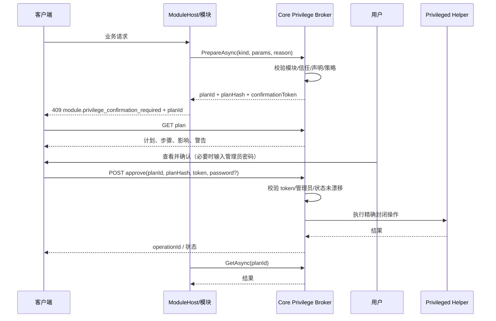

# 服务端模块提权 Broker 设计

> 状态：设计，2026-10-31。未实现。本文定义 v2 ModuleHost 的第三方模块提权边界；v1 官方模块继续使用现有 `IHostElevationSessionStore` 和 `IPrivilegedOperationTransport`。
>
> 范围：第三方模块申请宿主特权时的计划、展示、确认、执行、审计和撤销。模块包格式与安装由[服务端独立模块分发设计](RelaxKonOS.ServerModuleDistribution.Design.md)拥有；商店来源由[包商店来源设计](../platform/RelaxKonOS.PackageStore.Design.md)拥有；Helper 的底层封闭操作仍由[统一特权 Helper 架构](privileged-helper.md)拥有。通用能力类别、资源范围和软件安装/卸载的后续扩展方向见[第三方模块声明式特权能力](RelaxKonOS.ModuleDeclarativePrivileges.Direction.md)。
>
> 本文不表示 Broker、确认界面、ModuleHost 或任何提权操作已实现。

## 1. 目标与边界

### 1.1 目标

第三方模块需要安装软件包、重启服务、写受保护配置或调整防火墙时，不能直接拿到 root/LocalSystem，也不能直接调用 Helper。它只能向 Broker 提交一个**声明式请求**；Broker 解析为精确计划，用户在 Core 拥有的界面中确认，Core 再调用 Helper 执行。

### 1.2 必须保持的边界

1. 没有任意命令、shell、可执行文件路径或参数列表接口。
2. 模块不能看到管理员密码、JWT、Helper 共享密钥或其他模块的秘密。
3. 模块不能直接连接 Helper 的 Unix socket / 命名管道；ModuleHost 账户不在 socket ACL/管道 ACL 中。
4. 计划一旦生成，执行时只接受同一个 `planHash`；目标、版本、摘要或参数变化必须重新生成计划并重新确认。
5. 确认由 Core 处理；模块只收到计划 ID 和最终结果。
6. 提权确认不是模块权限的全部：模块还必须已安装、已启用、被用户信任、声明了该提权项，且操作在 Host 策略允许范围内。
7. 失败关闭：读不到信任、版本、计划或管理员验证状态时，不执行。

### 1.3 v1/v2 适用性

| 版本 | 模块位置 | 提权路径 |
| --- | --- | --- |
| v1 官方模块 | Server 进程内 | 现有 `IHostElevationSessionStore`；官方模块可信，可按现有策略自动授权 |
| v2 第三方模块 | 独立 ModuleHost | 只能走本文 Broker；默认每次确认 |

v2 发布后官方模块仍按 v1 的进程内路径运行；上表只描述“官方模块 / 第三方模块”的归属，不表示 v2 要把官方模块迁入 ModuleHost。

v1 不交付进程内第三方模块，因此不存在“进程内第三方 + Broker 确认”的安全承诺。Broker 在 v1 只作为契约预研，不作为第三方安全边界。

## 2. 当前基线

- `IHostElevationSessionStore.IsGranted` 是现有能力/资源授权入口。它对当前主机管理员或 root 会自动返回 true；在 `SessionValid` 开启时，管理员验证会按 access token 记忆。
- `PrivilegedEndpoints` 处理管理员账密验证和短期授权；密码只在本次调用中使用，不落库。
- Helper 只接受封闭 `PrivilegedOperationKind`；没有 `ExecuteCommand`/shell/任意参数接口。
- 当前自动授权逻辑见 [`HostElevationSessionStore.cs`](../../RelaxKonOS.Server/Privileged/HostElevationSessionStore.cs) 和 [`PrivilegedEndpoints.cs`](../../RelaxKonOS.Server/Endpoints/PrivilegedEndpoints.cs)。

Broker 不能直接复用 `IsGranted` 作为第三方模块的准入判断，否则管理员身份会绕过“每次确认”。它需要单独的确认门，并只把管理员验证记忆用于“免密码”，不用于“免确认”。

## 3. 核心模型

### 3.1 模块侧接口

```csharp
public interface IModulePrivilegeBroker
{
    /// <summary>校验模块、声明、策略和用户权限，生成不可变计划。</summary>
    ValueTask<ModulePrivilegePlan> PrepareAsync(
        ModulePrivilegeRequest request,
        CancellationToken cancellationToken);

    /// <summary>读取原计划或原操作结果；不重新规划，不自动重放。</summary>
    ValueTask<ModulePrivilegeStatus> GetAsync(
        Guid planId,
        CancellationToken cancellationToken);
}
```

模块身份由 ModuleHost IPC 身份或 Broker 上下文确定，不从 `ModulePrivilegeRequest` 读取。模块不能声称自己是另一个模块。

### 3.2 请求

```csharp
public sealed record ModulePrivilegeRequest(
    ModulePrivilegeKind Kind,
    JsonElement Parameters,
    string Reason,
    ModulePrivilegeConsentScope Scope);
```

`Parameters` 是强类型操作参数，不是命令行字符串。每个 `Kind` 在共享 Protocol 中有自己的 DTO、校验规则和稳定错误码。

### 3.3 操作类型

以下为目标能力类别，逐类实现和验收。首个固定服务动作切片不是永久业务白名单；下一阶段按[声明式能力方向](RelaxKonOS.ModuleDeclarativePrivileges.Direction.md)把软件包安装/卸载等操作提升为通用类别，由模块声明资源范围，Host 解析精确计划，用户确认后交 Helper 复核执行。新增 MySQL 等应用通常不应要求新增应用专用 Core 操作。

| 类型 | 用途 | 关键约束 |
| --- | --- | --- |
| `PackageInstall` | 安装固定包 | 固定包名、版本/版本区间、受信任仓库、摘要；禁止任意 apt 参数 |
| `PackageRemove` | 移除固定包 | 只允许模块声明的包；默认保留配置/数据 |
| `PackageUpdate` | 更新固定包 | 冻结候选、仓库身份、摘要；执行前复查 |
| `ServiceStart/Stop/Restart/Reload` | 控制固定服务 | 固定 unit/service 白名单；显示依赖影响 |
| `FileWrite/Delete/SetMode/SetOwner` | 修改受保护文件 | 固定根、路径规范化、内容摘要/权限差分 |
| `FirewallRule` | 增删改结构化规则 | 结构化五元组，不接受原始命令 |
| `NetworkListener/NetworkTun` | 监听/TUN 配置 | 固定接口/端口范围；显示断网影响 |
| `HostSetting` | 主机设置 | 只允许 Host 定义的设置键 |
| `ProcessExecute` | 运行模块声明的可执行文件 | 最后开放；必须签名清单、可执行文件 hash、参数 schema、固定环境/工作目录/超时 |

现有 Helper 的包操作只覆盖 Nginx、Git、Docker、Samba、Squid、sing-box、Tailscale、Mihomo 等固定组件；这不是第三方通用安装能力已经交付的证据。下一阶段新增通用软件包能力及平台适配器，以 Host 批准来源、模块声明包集合、版本约束、依赖闭包和资源所有权为边界；安装与卸载均可声明。适配器交付前明确拒绝，不把现有 `ComponentPackageInstall` 当成任意 apt 接口，也不要求永久逐应用新增专用枚举。

`ProcessExecute` 不是通用命令接口：

- 不允许把 `sh`、`bash`、`powershell`、`python`、`node`、`apt`、`dpkg`、`systemctl` 等解释器/包管理器作为通用可执行文件。
- 可执行文件必须由模块包声明，带绝对路径、SHA-256、发布者签名；安装时展示给用户。
- 参数必须按声明 schema 校验；不接受自由文本拼接、环境变量注入、stdin 秘密或任意工作目录。
- Helper 侧再次校验可执行文件 hash、参数形状和固定路径；Server 侧校验不作为唯一防线。

### 3.4 计划

```csharp
public sealed record ModulePrivilegePlan(
    Guid PlanId,
    string ModuleId,
    string ModuleVersion,
    string PublisherId,
    string TrustState,
    ModulePrivilegeKind Kind,
    IReadOnlyList<ModulePrivilegeStep> Steps,
    IReadOnlyList<string> Effects,
    IReadOnlyList<string> Warnings,
    bool RequiresAdministrator,
    bool Reversible,
    string PlanHash,
    DateTimeOffset CreatedAt,
    DateTimeOffset ExpiresAt);

public sealed record ModulePrivilegeStep(
    string Executable,
    IReadOnlyList<string> Arguments,
    string Effect,
    bool Irreversible);
```

`Steps` 用于透明展示，不是模块可执行任意命令的入口。对于 apt，必须额外展示：

- 包名、版本、架构、仓库、冻结摘要；
- 依赖包；
- 将运行的 maintainer scripts 警告；
- 可能重启的服务；
- 是否保留配置/数据；
- 失败后是否可回滚。

对于服务操作，展示 unit、当前状态、依赖服务、预计中断时间。对于文件操作，展示路径、所有者/模式变化和内容 diff 摘要。对于 `ProcessExecute`，展示绝对路径、SHA-256、argv、工作目录、环境差异和超时。

### 3.5 批准与结果

批准由 Core 处理，模块不接触密码：

```csharp
public sealed record ModulePrivilegeApproval(
    Guid PlanId,
    string PlanHash,
    string? AdministratorUsername,
    string? Password,
    string? OwnerDeviceProof);
```

返回给客户端的计划详情包含 `confirmationToken`（一次性、短时、绑定 planHash/用户/会话/模块）。提交批准时：

- 校验 token 未使用、未过期；
- 校验 `PlanHash` 与计划一致；
- 校验模块版本、摘要、信任状态仍与计划生成时一致；
- 校验管理员验证或密码；
- 只执行计划中的步骤；不重新解析、不追加步骤。

结果：

```csharp
public sealed record ModulePrivilegeStatus(
    Guid OperationId,
    Guid PlanId,
    ModulePrivilegeState State,
    string? ProblemCode,
    string? Detail,
    DateTimeOffset UpdatedAt,
    ModulePrivilegeResult? Result);
```

状态至少包含 `AwaitingConfirmation`、`Executing`、`Succeeded`、`Failed`、`Cancelled`、`Expired`、`RecoveryRequired`。

## 4. 确认策略

### 4.1 四个维度

不要把“信任模块”做成一个布尔值。建议拆成：

| 维度 | 可选值 | 默认（第三方） |
| --- | --- | --- |
| 代码信任 | 不信任 / 用户信任 / 发布者信任 | 安装时用户确认 |
| 提权提示 | 每次确认 / 仅危险操作 / 按声明放行 / 拒绝 | 每次确认 |
| 授权范围 | 一次 / 本次会话 / 直到模块更新 / 直到日期 | 一次 |
| 执行位置 | ModuleHost / Server 进程内 | ModuleHost |

### 4.2 提示策略

| 策略 | 行为 |
| --- | --- |
| `EveryTime` | 每个计划都确认；管理员验证记忆只免密码 |
| `DangerousOnly` | 只读/低风险操作可放行；包、服务、防火墙、网络、`ProcessExecute` 仍确认 |
| `AllowDeclared` | 只对安装时已展示并批准的声明操作免确认；新增权限必须重新确认 |
| `Deny` | Broker 直接拒绝，模块不能提权 |

即使选择 `AllowDeclared`，以下仍然强制确认：

- 操作不在 manifest 的 `privileges` 中；
- 目标/版本/摘要超出声明约束；
- 模块更新后摘要变化；
- 提权项扩大；
- 管理员撤销了信任；
- 计划包含不可逆步骤而策略要求确认。

### 4.3 谁能修改

- 安装/卸载/信任模块：服务器管理员，走 `ServerModulesManage` 和主机管理员认证。
- 单次提权确认：任何能通过主机管理员认证的用户；普通用户可以输入管理员账密批准一次操作。
- 常设放行/关闭确认：只能由主机管理员设置。
- 部署托管模式：`ModuleManagement:Authority=deployment` 时，安装、信任和提权策略只读。
- 普通用户不能全局关闭确认，也不能修改其他用户的授权。

### 4.4 管理员验证复用

当前 `HostElevationSessionState` 在 `SessionValid` 开启时会按 access token 记忆成功的管理员验证。Broker 需要一个只读判断：

```csharp
bool IsAdministratorVerified(ClaimsPrincipal principal);
```

它只回答“当前 token 是否已完成管理员验证”，不授予任何能力。

流程：

```text
模块请求 -> 生成计划
  -> token 已验证？ 是：显示计划 + “确认”
                    否：显示计划 + 管理员账号/密码 + “确认”
  -> 确认通过 -> 一次性 approval token -> Core 调 Helper
```

如果 `SessionValid` 关闭，则没有记忆，每次都要密码。owner device key 可以作为管理员验证的替代，但仍需手动确认。

### 4.5 信任绑定与失效

`privilegeConsent` 至少绑定：

- `moduleId`
- `publisherId`
- `version`
- `artifactDigest`
- `allowedKinds`
- `grantedBy`
- `grantedAt`
- `expiresAt`
- `revision`

模块更新后默认回到 `EveryTime`。如果发布者 key 变化、摘要变化或提权项增加，必须重新确认；不能沿用旧授权。

撤销立即生效：Broker 每次请求读取当前 state，不使用进程内永久缓存。读不到 state 按拒绝处理。

## 5. 流程

### 5.1 用户发起的操作



### 5.2 后台任务

后台任务不能弹一个没人看的确认框。规则：

- 默认禁止后台提权；
- 管理员可以为模块授予**常设提权许可**，绑定操作类型、目标、范围和过期时间；
- 模块在许可范围内可以直接执行，但仍写审计；
- 超出许可范围返回 `module.privilege_confirmation_required`，不排队等待；
- 无人值守服务器不能靠“稍后有人会点确认”来假装任务仍在进行。

### 5.3 计划过期与重放

- 计划默认 5 分钟过期；过期后必须重新 `Prepare`。
- `confirmationToken` 一次性；重放返回冲突，不重复执行。
- 相同幂等键相同内容返回原操作；相同键不同内容冲突。
- 计划生成后模块版本、摘要、信任或策略变化时，执行失败并要求重新生成。

## 6. 与 Helper 的映射

Broker 不新增“任意命令”Helper 操作。封闭边界应位于软件包、服务、文件等通用能力类别，而不是写死每个第三方应用名称；模块通过声明限定可申请的资源。每个能力类别必须映射到现有或新增的类型化 Helper 操作，Helper 按受保护策略独立校验，不能仅信任模块清单或 Server 参数：

| Broker 操作 | Helper 侧 |
| --- | --- |
| `PackageInstall/Remove/Update` | 既有固定组件操作仅作现状；后续新增通用包事务适配器，冻结来源、包、版本、依赖和移除集合 |
| `ServiceStart/Stop/Restart/Reload` | 既有 `ManagedRuntime`/`NativeServiceAction` 等固定服务操作 |
| `FileWrite/Delete/SetMode/SetOwner` | 既有受保护文件操作，限定根和路径 |
| `FirewallRule` | 既有 `FirewallUfw*`/`FirewallWindows*` |
| `NetworkListener/Tun` | 既有主机网络操作 |
| `HostSetting` | 既有 `HostTimeApply`/`HostIdentityApply`/`HostEnvironmentApply` 等 |
| `ProcessExecute` | 新增受限操作；首版可不实现 |

如果现有 Helper 没有合适的能力类别或平台适配器，先新增通用类型化操作和测试；已有类别覆盖的新模块通过声明资源接入。特殊操作可按独立的高信任扩展机制评审，不能隐式降级为通用命令代理。模块安装时的能力范围授权与执行时的具体计划确认分别校验；详见[两层授权与实施顺序](RelaxKonOS.ModuleDeclarativePrivileges.Direction.md)。

## 7. 审计与可观察性

每次计划/批准/执行记录：

- operationId、planId、planHash；
- moduleId、version、publisher、artifactDigest；
- 操作类型、目标、解析后的步骤摘要；
- 发起用户、批准用户、管理员验证方式（不记录密码）；
- 计划生成、批准、开始、结束、失败阶段；
- 结果、问题码、耗时；
- 关联的 Server 请求 ID、ModuleHost 请求 ID、Helper 请求 ID。

日志和回执不得包含密码、JWT、Helper 共享密钥、私钥、模块秘密或完整的敏感文件内容。文件 diff 只记录摘要和受影响路径。

## 8. 错误码

至少定义：

| 错误码 | 含义 |
| --- | --- |
| `module.privilege_not_declared` | 模块未在 manifest 声明该操作 |
| `module.privilege_denied` | 管理员策略拒绝 |
| `module.privilege_confirmation_required` | 需要用户确认 |
| `module.privilege_plan_expired` | 计划过期 |
| `module.privilege_plan_changed` | 版本/摘要/目标变化 |
| `module.privilege_approval_invalid` | 一次性 token 无效/已用 |
| `module.privilege_admin_required` | 需要管理员验证 |
| `module.privilege_password_invalid` | 管理员密码错误 |
| `module.privilege_target_invalid` | 目标不在声明约束内 |
| `module.privilege_unsupported` | Host/平台不支持该操作 |
| `module.privilege_helper_unavailable` | Helper 不可用 |
| `module.privilege_recovery_required` | 上一次操作待恢复 |

错误必须使用稳定 problemCode 和结构化参数；客户端不解析标题。

## 9. 安全边界

- ModuleHost 不持有 Helper transport、Server 配置、数据库连接或 JWT 密钥。
- Broker 只在 Core 内运行；ModuleHost 通过 IPC 调用，不能直接构造 Core 服务。
- 密码只在 Core 的批准请求中短暂存在；ModuleHost 永远看不到。
- `planHash` 绑定精确目标；执行前重新读取模块版本/摘要/信任状态。
- Helper 再次校验参数和调用者身份；Broker 的校验不是唯一防线。
- 计划、批准、执行、结果都持久化；崩溃后只核对原操作，不自动重放。
- 读不到信任、策略、计划或管理员状态时 fail closed。

## 10. 实施跟踪

| 编号 | 交付 | 完成门槛 |
| --- | --- | --- |
| PB-01 | 冻结 `ModulePrivilegeKind`、请求/计划/批准/结果 DTO、错误码 | 共享 Protocol、Server、ModuleHost SDK、桌面、测试同步 |
| PB-02 | Core Broker、计划存储、一次性 token、管理员验证复用 | 计划过期/重放/漂移/密码错误全部拒绝 |
| PB-03 | 客户端确认 UI（三语言、计划步骤/影响/警告） | 管理员已验证只显示确认；未验证显示账密 |
| PB-04 | ModuleHost IPC 与 Broker 调用 | ModuleHost 无法直连 Helper/Server 数据 |
| PB-05 | 首批通用类别：包安装/移除、服务动作、文件写入 | 模块声明资源；Host 冻结计划；Helper 独立复核和审计；后续按声明式方向 DC-01～DC-03 验收 |
| PB-06 | 常设提权许可、撤销、后台任务 | 未授权后台提权 fail closed |
| PB-07 | `ProcessExecute` 评估（可选，最后） | 签名清单、hash、参数 schema、真实隔离评估 |

## 11. 验收

必须覆盖：

- 模块未声明、目标越界、策略拒绝、用户拒绝；
- 管理员已验证（免密码但仍确认）、未验证（密码）、密码错误、owner device key；
- `SessionValid` 开启/关闭；撤销后立即失效；
- 计划过期、重复批准、planHash 漂移、模块更新后旧计划失效；
- Helper 不可用、Helper 重启、执行中断、待恢复；
- ModuleHost 崩溃、重启、IPC 身份伪造、越权读取 Server 数据/Helper；
- 后台任务无许可、常设许可过期/撤销；
- 并发批准、幂等键冲突、旧修订。

每个操作分别记录 Windows/Linux、System/User Mode 的实际结果；不能用单平台或 mock 代替另一平台验收。

## 12. 关联文档

- [服务端独立模块分发与 v1/v2 宿主设计](RelaxKonOS.ServerModuleDistribution.Design.md)
- [服务端模块管理设计](RelaxKonOS.ServerModuleManagement.Design.md)
- [包商店来源设计](../platform/RelaxKonOS.PackageStore.Design.md)
- [统一特权 Helper 架构](privileged-helper.md)
- [权限模型与项目重构规范](../platform/RelaxKonOS.PermissionModel.Refactor.md)
