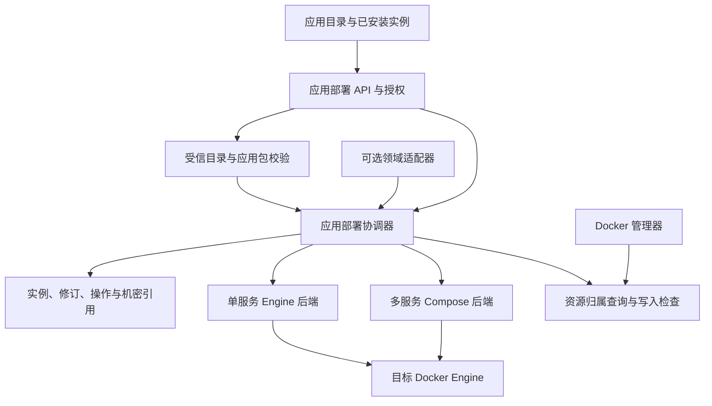

# RelaxKonOS 容器应用平台设计

状态为设计草案，2026-11-10。本文定义面向应用商店的容器应用包、受管实例、部署执行和验收方案。下文的目标契约、阶段和验收示例均为待实施内容，现有能力见第 2 节。

## 1. 产品目标

管理员从目录选软件和版本，填写参数，预览端口、数据卷、权限与变更影响，然后安装到目标 Server 的 Docker Engine。安装后从同一实例页面查看访问入口、服务健康、日志及操作回执，并执行启停、升级、修复、回退或卸载。一个应用包可以安装多个实例，一个实例可以包含多个相互依赖的服务。

在已支持的能力范围内，发布者通过增加声明式应用包上架软件，Server 和客户端共用同一套校验、参数表单与生命周期。需要在 RelaxKonOS 内管理应用特有业务时，再接入类型化领域适配器，例如 Web Server 管理器负责 Nginx 站点与证书。

首批目标为 Linux x64 Server 上的本地 Docker Engine。ARM64、远程 Engine 和集群按各自的身份、隔离与实机矩阵独立开放。

## 2. 现有基础与文档归属

| 范围 | 当前基础 | 本设计新增范围 |
| --- | --- | --- |
| 应用部署 | 代码内置用途模板及目录安装入口，单容器镜像或构建部署，不可变发布修订、机密、日志与持久操作 | 数据驱动的多版本包目录、结构化安装计划、多服务实例、统一运维入口 |
| Docker 管理器 | Engine 和 Compose 执行能力，已有项目锁、Stack 操作记录与恢复观察 | 受管应用资源归属保护，供应用部署调用的类型化执行与原操作查询接口 |
| 组件中心 | Docker Engine 等运行时的依赖预检、安装入口和运行时生命周期 | 应用安装前展示缺失依赖，链接组件中心，领域接入后关联受管实例 |
| RelaxKonOS 包商店 | 服务端模块和桌面应用包的目录与信任设计 | 容器应用包是独立包类型，沿用适用的信任原则并由应用部署拥有安装事务 |

应用部署文档拥有现有单容器行为与已验收记录。受管运行时文档拥有宿主组件安装约束。原生与 Docker 双模式规划拥有内置管理器如何选择后端。本设计拥有通用容器应用包与多服务实例的架构。 [应用部署](../applications/RelaxKonOS.ApplicationDeployment.Design.md) · [Docker 管理器](../applications/RelaxKonOS.DockerManager.md) · [受管运行时](RelaxKonOS.ManagedRuntimes.Design.md) · [包商店](RelaxKonOS.PackageStore.Design.md) · [原生与 Docker 双模式](../application-ideas/NativeAndDocker.md)

### 2.1 1Panel 源码对照

1Panel `dev-v2` 将包版本、安装实例和运维任务分别记录。安装服务解析该版本的表单与 Compose，保存实例后再由任务准备数据、按条件运行初始化步骤并启动服务。RelaxKonOS 对应使用独立的包发布、实例和持久操作，并将允许的初始化动作纳入包能力校验。 [1Panel 安装源码](https://github.com/1Panel-dev/1Panel/blob/dev-v2/agent/app/service/app.go) · [官方应用包格式](https://github.com/1Panel-dev/1Panel-appstore-skills/blob/main/references/appstore-format.md)

1Panel 的 WordPress 包可选择已有数据库服务。实例删除检查会列出关联网站和本地依赖应用，升级入口可传入备份选项。RelaxKonOS 据此将跨实例依赖、站点绑定和数据恢复点纳入目标模型，并按独立阶段开放。 [WordPress 包参数](https://github.com/1Panel-dev/appstore/blob/dev/apps/wordpress/7.1.0/data.yml) · [1Panel 实例运维源码](https://github.com/1Panel-dev/1Panel/blob/dev-v2/agent/app/service/app_install.go)

## 3. 架构与写入权威

- **应用部署协调器**拥有安装计划、实例期望状态、发布修订、应用操作终态和补偿决策。继续演进现有应用部署领域，复用认证、日志、进度、修订和机密基础设施。
- **Docker 执行层**拥有 Engine 交互、Compose 项目执行、原生命令排空及结果观察。单服务继续用现有 Engine 事务。多服务将结构化计划渲染为受管 Compose 文件，经窄端口执行。用户直接管理的 Compose 项目继续由 Docker 管理器拥有。
- **归属检查**覆盖 Docker 管理器的 Stack、容器、网络和卷变更，以及镜像删除和资源清理。对应用拥有的资源展示所属实例，由应用协调器受理写操作。Docker 执行层在实际写入边界核对归属，避免通过另一条管理路由绕过检查。外部变更标为漂移，暂停冲突写入，提供显式核验和修复。
- **领域适配器**拥有业务语义，例如生成站点配置或发布证书。应用实例仍由同一协调器执行容器生命周期。适配器通过固定类型注册，应用包只声明已支持的能力，服务端按目标验证。

容器业务随 Docker 服务运行。应用操作未完成时，后台工作租约持续到原生执行、输出清理、持久记录和必要补偿完成，或由可核验的持久恢复责任接管。宿主的恢复入口在管理客户端断线后继续工作。

## 4. 应用包与实例模型

| 对象 | 身份与内容 |
| --- | --- |
| `AppRelease` | 由来源、发布者、包 ID、发布 ID 和目标平台确定。包含包格式版本、显示信息、参数、服务拓扑、镜像摘要、健康探针、数据格式与升级限制。 |
| `AppInstance` | 稳定实例 ID，绑定目标 Server 与 Engine 身份、实例定义修订、运行期望、活动发布修订、数据归属。实例显示名可改，Compose 项目名与资源命名空间由实例 ID 派生。 |
| `AppRevision` | 不可变快照，记录包发布、编译后的定义摘要、实际平台镜像清单摘要和 Engine 镜像 ID、公开参数、受保护的秘密版本引用、探针及卷绑定。 |
| `AppOperation` | 持久操作 ID、请求指纹、实例锁及预期修订、阶段、原生执行 ID、观测结果、补偿结果。终态和需人工核验的原因可按原 ID 查询。 |
| `ResourceBinding` | 目标 Engine、资源种类、实例内逻辑键、平台分配的名称、可取得的实际资源标识及归属标签。操作时同时核对账本、标签和实际拓扑。 |
| `DependencyBinding` | 消费方实例及逻辑依赖、提供方实例或显式登记的外部连接 ID、能力与版本约束、已授权的访问与秘密引用。活动绑定随实例修订提交，运行中的变更单独登记待决引用。 |

应用包使用一个受限的结构化服务模型。每个服务声明镜像、固定容器端口、资源上限、数据卷、允许注入的参数位置、内部依赖和有界健康探针。参数支持文本、整数、布尔、枚举和秘密引用，安装表单根据元数据生成。服务依赖为有向无环图。HTTP 探针绑定声明的服务端点，内部服务可用受控的 TCP 就绪探针，整组就绪还要验证对外应用路径。TCP 就绪只证明端口可接收连接。

多服务后端从校验通过的模型生成 Compose 定义。生成器负责引用转义及路径解析，并核对 Compose 解析后的有效定义，避免变量展开或隐式配置改变已批准的拓扑。应用包不携带任意 Compose、安装脚本或命令模板。镜像内自带的入口属于受信发布制品。首版采用项目专属网络与受管命名卷，服务端禁止宿主网络、任意 bind mount、设备映射、特权模式和 Docker socket。默认回环发布，外部监听或反向代理需要独立授权和变更预览。

秘密按实例保存版本，计划和回执只引用它们。后端使用镜像支持的固定交付机制。需要文件注入时，由 Server 从保护目录生成仅该实例可用的只读秘密文件，生命周期由执行层管理。若镜像只能使用环境变量，安装计划显示 Docker 管理权限可读取该值，并从客户端响应、日志和导出中遮蔽。目录元数据只能声明允许的注入位置，不能读取宿主秘密或指定宿主路径。

### 4.1 能力与上架流程

包发布声明最低包契约及所需能力。能力按固定类型注册，由 Server 判定当前主机、后端与权限是否支持。未知或不可用的必需能力使版本可浏览、安装受阻，并显示原因。受信发布证明包来源及内容，实际准入仍由服务端策略决定。

| 能力 | 目标契约 | 首版范围 |
| --- | --- | --- |
| 端口与访问 | 每个端点声明服务、协议、容器端口、访问用途和宿主发布策略。站点绑定由 Web Server 领域管理，以实例与端点 ID 关联。 | 回环 HTTP 入口，数据库仅在项目内可达。 |
| 配置与参数 | 表单绑定受支持的类型化参数。后续可把受信包内配置或领域生成的配置投递到声明目标，按修订更新并核对实际生效。 | 参数、环境变量与受控秘密投递。 |
| 初始化与数据变更 | 用镜像既有初始化入口或注册的类型化动作。独立初始化动作声明目标资源、阶段、时限、幂等条件和完成证据，并进入同一操作账本。 | 验证随服务启动的镜像初始化。独立初始化和数据迁移动作在通过各自的中断恢复验收后开放。 |
| 健康检查 | 按服务分别记录就绪与业务验证结果。包声明探针及成功条件，执行层限制目标与时限。 | 有界 HTTP、内部 TCP 及一个真实应用读写验收。 |

上架流水线依次校验契约与能力、解析目标平台和镜像摘要、检查渲染后的有效拓扑，并运行目标包的安装及业务探针。首批包由官方目录随 Server 发布。以后可增加本地包和签名远程目录的审查入口，两者共用同一个包契约和安装准入。包内容可以从上游 Compose 提取，发布前转换为当前结构化模型并完成审查。

### 4.2 跨实例依赖

应用包可以声明实例内服务、已安装的能力提供方或显式登记的外部服务。首版开放实例内服务。后续安装表单按能力过滤可选提供方，预检核对版本、权限、网络可达性与凭据状态。计划冻结所选 ID 及提供方修订，提交前重新核验。跨实例网络连接按绑定建立，项目默认各自隔离。

消费方拥有绑定，提供方拥有服务、数据和凭据的生命周期。消费方使用按绑定授权的凭据。安装和改绑须先登记待决引用，成功后与消费方活动修订一并发布，失败按原操作核对并解除待决引用。提供方的卸载、停用、改密和不兼容升级在提交前重新检查活动与待决引用，显示受影响实例。无法证明兼容或有未决变更时保留门禁。卸载消费方只处理自身资源和绑定，提供方及外部数据由其原责任方处置。

## 5. 发布、计划与信任

首批应用包来自随 Server 发布的官方数据目录。增加包应只增加目录数据、维护说明和验收夹具，应用运行时按同一版本契约解析。独立发布目录是后续阶段，采用固定来源和信任密钥、签名目录、有效期、高水位、包摘要以及允许的镜像仓库。镜像代理只改变传输位置。每个服务按目标平台冻结不可变镜像摘要，拉取后核对实际身份。目录刷新只改变可选版本，已安装实例与当前修订继续按已提交事实展示。撤销的包或镜像禁止新装和作为回退目标。

浏览、预检、提交、操作查询和实例详情沿用应用部署入口。预检按目标 Engine 实测平台、版本、Compose 能力和可用资源，并检查权限、归属、端口及数据影响。计划冻结精确发布、目录与信任修订、计划摘要、预期实例修订和有效期。计划阶段只读。受理时重新核对条件，为同一目标上的并发安装保留端口和实例名称，再由 Engine 绑定确认实际可用。若外部进程抢占端口，原操作按失败路径收尾。

部署接口按现有 Shared Protocol 演进。服务端严格校验参数与未知字段，写操作使用幂等键并绑定调用方、目标与请求指纹。相同键和载荷取回原操作，改变载荷则拒绝。契约变化同步更新仓内调用方、示例与测试，使用唯一当前格式。

## 6. 生命周期与恢复

| 操作 | 提交条件与数据语义 |
| --- | --- |
| 首次安装 | 持久保存候选实例和操作意图后创建资源。各必需服务就绪、镜像与拓扑相符、应用探针通过后提交活动修订。失败只清理本次可证明新建的资源。 |
| 启停与重启 | 根据已提交修订执行，核对实际状态后结案。停止保留实例、机密与数据卷。 |
| 更新 | 显式选择不同的已验证发布，按实例锁核对预期修订、数据格式和可恢复条件。服务更新按停机窗口执行，整组健康确认后提交新活动修订。 |
| 修复 | 重新核验并重建同一发布的可替换资源，保留数据卷与秘密版本。记录为修复。 |
| 回退 | 以原修订、可用镜像和当前信任为依据。共享卷的数据格式须兼容，或先经该包已验证的备份恢复流程。无法证明兼容时阻止回退。 |
| 卸载 | 默认保留业务卷及重装所需秘密引用，并保存原实例的数据归属记录。删除数据单独确认，精确核对资源集合与当前挂载使用方。保留数据重装须显式选中原记录。 |

执行顺序为「受理并写入意图 → 验证并准备 → 派发 → 观察与业务探针 → 提交或补偿 → 清理及结案」。Compose `up` 可能部分成功。协调器保存旧定义、镜像、运行状态和卷引用，失败后按归属恢复原拓扑并复验。允许自动恢复旧拓扑的更新须先证明数据兼容。无法核验补偿效果时，保留原操作与实例写入门禁。

每个原生副作用阶段在派发前持久记录由应用操作 ID 和阶段生成的固定执行键。Docker 执行层按该键原子受理并提供原回执查询。跨两个账本中断时，先以原执行键找回已受理的底层操作，再核对原目标 Engine、项目、资源归属和实际结果。已有命令或清理在途时继续保护原责任。既无可证明的未派发记录，也无法确定原执行结果时，保持待核验并拒绝冲突新操作。HTTP 断线、进程退出和容器暂时缺席都不能单独作为重派依据。

### 6.1 备份与数据恢复

应用修订记录可以重建的部署定义，数据恢复点由共享备份服务持有独立备份 ID。容器应用协调器关联实例和修订，声明备份范围并协调写入暂停或应用专用一致性动作。备份服务拥有清单、对象、密钥和备份恢复操作 ID。外部数据库由原提供方负责备份，应用计划通过已授权的恢复点引用表达依赖。 [共享备份与恢复契约](../applications/RelaxKonOS.BackupRecovery.Contract.md)

升级计划明确候选版本是否改写数据、原版本能否读取候选写入的数据、所需停机窗口及可用恢复方案。首版只允许已验收数据兼容的升级。支持数据迁移后，提交前须核验适用的备份 ID、源修订、对象范围、数据格式和一致性证据，并在写入窗口内确认备份仍有效。备份或恢复能力不足时，保留原运行版本并返回阻止原因。

后续恢复优先在新实例及新卷上执行，核验真实业务数据、凭据重绑定和入口后，再单独确认切换。原实例保留至操作员确认。备份对象已校验与实际恢复已演练分别记录，容器启动和回退镜像只提供各自的运行证据。

## 7. 验证示例

下列是实施后的验收规程。测试在独立 Linux Server 与专用 Docker Engine 上执行。每次记录提交、OS/架构、Engine 和 Compose 版本、包摘要、镜像摘要、实例及操作 ID、脱敏日志，以及测试前后资源清单。默认使用回环端口，运行前确认空闲。探针读取由测试生成的随机标记，验证真实业务数据。

### 7.1 首版实机门槛

首版预览限 Linux x64、本地 Engine、官方目录和隔离环境，选一个具备两个已验证兼容发布的真实有状态应用，以及一个 Web 加数据库的双服务夹具。最低实机矩阵如下。

1. 从目录安装真实应用，通过业务接口写入并读回数据，执行一次兼容升级并确认原数据，保留数据卸载后显式重装并读回。以另一个实例的卷验证跨实例删除被拒绝。
2. 从目录安装双服务夹具，核对内部数据库未发布到宿主，并通过 Web 写入和读取数据库标记。尝试从 Docker 管理器删除受管数据库卷，验证归属门禁；用缺少管理权限的身份提交安装，验证未分配资源。
3. 在双服务底层操作已受理但应用账本尚未保存关联时强制终止 Server。重启后以原键和原操作 ID 对账，核对无第二套项目、秘密或重复派发。通过故障注入验证原结果缺失时保留待核验并阻止冲突写入。
4. 使用同一组 Server 和客户端二进制添加一个符合能力范围的目录包，验证参数表单、安装和业务探针。

预览仅开放上述已验证路径。回退、修复或永久删除数据须在各自用例通过后开放。以下 CA-V01 至 CA-V04 用于扩展实机覆盖。跨实例依赖、数据迁移和备份恢复采用独立的后续门槛。

### CA-V01 单服务有状态应用

使用 `fixture-notes` 的两个测试发布。两版提供同一 HTTP API，`GET /healthz` 返回构建版本，`PUT /notes/test` 写入标记，`GET /notes/test` 读回。应用将数据写入受管卷 `/data`，两版声明相同数据格式并固定各自的测试镜像摘要。

1. 从目录安装 `notes-a` 和 `notes-b`，分别使用回环端口 `18081` 和 `18082`，写入不同标记。核对两者的实例 ID、卷和端口各自独立。
2. 对 `notes-a` 执行真实跨版本升级，核对新版本探针、镜像摘要和原标记。再回退，核对旧版本和原标记。执行一次同版本修复，验证回执为修复且活动版本一致。
3. 保留数据卸载 `notes-a`，核对入口关闭、原卷保留。显式选择原数据记录重装并读回标记。再确认删除该实例数据，核对只删除已列出的自有资源，`notes-b` 仍能读取其标记。

### CA-V02 Web 与数据库双服务

使用 `fixture-web-db`。`web` 通过项目内服务名连接 `db`，只发布 Web 回环端口 `18083`。数据库数据放入实例命名卷，数据库密码由同一秘密版本供两端使用。夹具的 HTTP API 将测试标记写入数据库并读回，就绪端点实际访问数据库。

1. 安装并等待数据库与 Web 就绪。核对两个服务与项目网络属于同一应用实例，宿主只监听声明的 Web 端口。写入标记并读取，单独重建 Web 后再次读取，验证数据确实在数据库卷中。
2. 用夹具的故障发布让新 Web 无法就绪，数据库保持数据兼容。核对操作记录候选失败及补偿结果，原发布恢复，标记保留。以声明不兼容数据格式且缺少已验证恢复方案的发布发起更新，验证在派发前拒绝。
3. 通过 Docker 管理器对项目发起停止、对数据库卷发起删除，验证受管资源门禁。通过应用实例页停止、启动后再次读回标记，并核对普通 Compose 项目未受影响。

### CA-V03 中断、重复提交与信任门禁

沿用双服务夹具，在应用操作意图落盘后、底层已受理但关联尚未写回时、部分服务已创建后，以及健康确认后尚未提交活动修订时，分别强制终止 Server。每次重启后用原幂等键重试并按原操作 ID 查询。核对已派发阶段各自最多执行一次、无第二套项目或秘密、原数据标记可读。额外构造底层结果缺失场景，核对原操作保持待核验、同键可查且冲突新操作被拒绝。

并行提交两个争用同一宿主端口的安装计划，验证最多一个实例成功绑定。再使用错误摘要、撤销发布、越权用户、未知参数、宿主挂载和特权声明分别提交，核对拒绝路径没有启动容器或分配持久资源。

### CA-V04 仅用应用包新增目录项

使用同一 Server 和客户端二进制，在测试官方目录中增加一个包。重新加载测试目录后，在客户端看见由参数定义生成的表单，提交安装并通过真实业务探针。校验过程中检查 Server、客户端及共享协议源码无应用专属修改。此项证明包的扩展能力，远程目录发布另按信任矩阵验收。

### CA-V05 跨实例依赖与备份恢复

将两个 Web 实例绑定到同一数据库提供方的独立账号，分别写入标记。尝试卸载提供方，核对阻止项列出两个消费方。卸载其中一个 Web 实例后，另一个仍能读回原标记。轮换剩余绑定的凭据并复验访问，夹具在登记绑定与确认应用修订之间中断时按原操作对账。

用数据库适配器创建已核验备份，记录备份 ID、源修订和对象摘要。恢复到新实例和新卷，重新绑定凭据并读回业务标记。分别注入不兼容格式、对象损坏和密钥缺失，验证受影响的升级或恢复在计划阶段被阻止，原实例与数据保持可用。完整证据按共享备份契约保存。 [备份验收门槛](../applications/RelaxKonOS.BackupRecovery.Contract.md#5-验收门槛)

## 8. 实施跟踪

| 编号 | 范围 | 完成条件 |
| --- | --- | --- |
| CA-01 | 结构化官方包目录与单服务应用安装 | 采用唯一当前包契约。先完成首版真实单服务与目录新增验证，按开放功能补齐 CA-V01 和 CA-V04。 |
| CA-02 | 受管多服务项目与 Docker 归属检查 | 建立窄执行接口、资源绑定和多服务健康检查。先完成首版双服务验证，按开放功能补齐 CA-V02。 |
| CA-03 | 原操作恢复与发布门禁 | 先完成首版原 ID 对账与未知结果门禁。正式开放多服务前补齐 CA-V03，以及取消、输出排空和重复重启。 |
| CA-04 | 独立签名目录与版本分发 | 验证目录签名、过期、撤销、重放、镜像摘要漂移、离线展示和已有实例连续运行。 |
| CA-05 | 内置领域适配与平台扩展 | 每项独立交付业务能力、运行时安装路径和平台验收，按原生与 Docker 双模式规划登记。 |
| CA-06 | 跨实例依赖与数据恢复 | 分别验收提供方绑定、受管数据备份与恢复及迁移门禁，完成对应的 CA-V05 场景后开放各自能力。 |

第 7.1 节通过后开放限范围预览。CA-01 至 CA-03 的完整实机证据齐备后正式开放受管多服务安装。正式目录按实际发布包记录受支持的版本、平台、真实业务健康、持久化及各项已开放的生命周期验证结果。

### 2026-11-10 切片进度

CA-01 已将官方单服务目录改为精确版本 JSON，校验摘要和镜像身份。下一步为表单、升级及保留数据重装。CA-02 已加直接卷删除和保留名称门禁，待接入双服务执行及其他资源保护。CA-03 待接通两个账本和原 ID 对账。

Windows x64 / SDK 10.0.300 隔离构建通过。测试 DLL 的 --catalog-update-only、--deployment-definition-only、--docker-compose-code-only 均退出 0。日志见本次会话 ca-build/*-escalated.log。Linux SSH 两个地址均通过同一主机密钥，登录认证被拒。第 7.1 节未执行。

CA-01 桌面目录表单补丁已在 C 盘隔离副本编译，证据见 ca-build/catalog-client-build.log。D 盘空间为零，CA-01-client.patch 待同步；SSH 复验仍在认证阶段被拒。

CA-01 保留卸载与重装见 ca-build/CA-01-client-and-retention.patch，待同步与 Linux 验收。

`CA-01-through-upgrade.patch`
