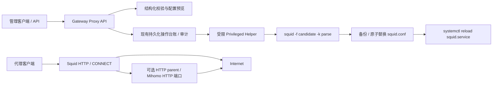

# Squid HTTP 代理网关

状态：已实现后端 API、Avalonia 内置应用与 Android 管理应用。Squid 安装和主机恢复由管理员操作；运行时生效与 Linux 实机验收仍需验证。

## 定位与架构

Squid 管理其他客户端经本机访问 HTTP/HTTPS 的入口；Mihomo 管理出站代理运行时。Squid 独立使用 `GatewayProxy` 协议和 Server 服务，不注册为 `IProxyEngine`，不改变 Mihomo 的订阅、TUN 或系统代理。



官方说明：`http_access` 按顺序匹配；parent proxy 配合 `never_direct` 禁止绕过上游直连。实现遵循 [http_access](https://www.squid-cache.org/Doc/config/http_access/)、[ACL](https://www.squid-cache.org/Doc/config/acl/) 和 [Cache Hierarchy](https://wiki.squid-cache.org/Features/CacheHierarchy)。当前配置语法面向 Squid 5–7；其他版本不承诺兼容，实际应用必须通过本机解析器。参见 [配置指令索引](https://www.squid-cache.org/Doc/config/)。

## 已实现与后续阶段

| 能力 | 当前状态 |
| --- | --- |
| 状态：平台、已安装、运行、开机启动、配置归属、配置 SHA-256、恢复标记 | 已实现 |
| 结构化配置预览和独立原生语法校验，返回有界诊断 | 已实现 |
| 监听 IP / 1024–65535 端口 / 来源 CIDR | 已实现 |
| 域名白名单、黑名单，拒绝优先；HTTPS CONNECT 仅 443 | 已实现 |
| HTTP parent，上游不可用时不降级为直连 | 已实现 |
| 应用配置、备份、reload 失败回滚、未完成事务阻断 | 已实现，Linux 实机验收待执行 |
| start / stop / restart / reload / enable / disable | 已实现，固定 squid.service |
| 操作 ID、幂等键、controller 写权限、observer 读权限、审计 | 复用现有基础设施 |
| 软件包安装 / 卸载 | 未实现；由管理员使用系统包管理器安装 |
| 编辑器读取结构化状态、desired/published 修订与磁盘漂移 | 已实现主机级持久化；尚未接入用户级 Configuration Registry，不宣称运行时 applied |
| Avalonia / Android 独立应用入口与编辑器 | 已实现配置表单、预览、校验、发布、服务控制和操作查询；Android 文档见其自有目录 |
| Basic 用户与密码哈希管理、凭据轮换 | 后续阶段 |
| access.log 解析、脱敏、保留策略、SignalR、统计 | 后续阶段；Squid 自身仍写标准 access.log |
| Firewall 来源限定规则及所有权清理 | 后续阶段；当前不会修改防火墙 |
| 从 Mihomo 当前有效配置自动发现 HTTP 端口并跟踪变更 | 后续阶段；当前手工填写 HTTP parent |
| 磁盘缓存、透明代理、SSL Bump、ICAP/eCAP、多实例、Windows Squid | 不在当前阶段；Windows 无 Squid 发行版，故不计划移植 |

运行时应用证明、安装器、Basic 认证、日志和防火墙联动尚未实现。Android 产品设计和实现进度只维护在 `Client/RelaxKonOS.Client.Android/docs/`。

## 安全与配置语义

- 默认监听 `127.0.0.1:3128`，来源为 IPv4/IPv6 loopback。非 loopback 监听必须设置 `allowRemoteClients: true`，来源集合不能为空，禁止 `/0`。这不是公网暴露授权；管理员仍需限制来源和防火墙。
- 所有 allow 都与来源 ACL 相交；配置最后总有 `http_access deny all`。没有原生文本、任意路径、shell 或任意 service 参数。
- 先拒绝 manager、80/443 以外的目标端口、443 以外的 CONNECT、loopback/link-local/组播目标，再拒绝黑名单，最后处理来源与白名单。未设置白名单时，允许来源可访问未被拒绝的域名。
- `example.org` 匹配该域名；`.example.org` 使用 Squid 的域及子域语义。拒绝 `*.example.org`、URL、文件路径、换行及其他原生语法。国际域名先转换成 ASCII/Punycode。
- HTTP parent 支持主机名、IP 与端口，不支持 SOCKS 或上游认证。同监听端口的 parent 被保守拒绝以减少自循环；跨主机/跨端口循环仍须由管理员避免。
- 不开启 TLS 解密或磁盘缓存。CONNECT 是隧道，无法提供 HTTPS 内容审计。来源 CIDR 不是用户认证；Basic 功能完成前宜用于 loopback、受信 LAN 或 VPN。
- Helper 再次验证结构化数据并重新渲染。固定 `/usr/sbin/squid`、`/usr/bin/systemctl`、`squid.service` 和 `/etc/squid`；相关配置路径必须是 root 所有、非符号链接且不可被 group/other 写入的普通文件/目录。
- Linux User Mode 的 host 操作限制覆盖 `/api/v1.0/gateway-proxy`。Windows 可查询不支持状态，不能执行 Squid 变更。
- Squid 5–7 只有类 Unix 版本，没有可维护的 Windows 移植，因此 Windows 宿主不提供网关的安装、配置与服务控制。为避免用户只能看到"应用消失了"，Server 在**每个**可判定网关契约的平台都下发 `server.gateway-proxy`（Linux User Mode 除外，那里连特权 Helper 都没有）；客户端据此**保留应用入口**，窗口内用"不支持该服务器"状态说明本机无法提供网关，所有配置与服务动作保持禁用。

## 配置接管与事务

本阶段接管完整 `/etc/squid/squid.conf`，不会自动合并原有 include、认证或缓存规则。非受管文件必须在应用请求中显式设置 `adoptExistingConfiguration: true`；后续受管配置用文件头识别。接管前先审阅预览、备份既有部署。

1. Helper 获得 `/etc/squid/relaxkonos.lock` 跨进程排他锁，检查未完成事务。
2. 在相同目录用随机名称、CreateNew 写入候选文件；执行 `squid -f <candidate> -k parse`。
3. 解析失败则删除候选文件，不写入当前配置、不 reload。可先调用独立 validate API 查看有界 stdout/stderr。
4. 解析成功后，把原配置备份到 `relaxkonos.previous.conf`（root 私有）；写入并 flush `relaxkonos.pending` 标记，然后同目录原子替换配置。
5. 原服务运行时调用 reload 并检查 systemd active；服务原本停止则只发布配置，不擅自启动。
6. reload 或随后的 active 检查失败，恢复原始字节及权限并尝试 reload 旧配置。成功返回 `squid.apply.failed_rolled_back`，操作仍为失败。
7. 恢复失败或发布期间中断，保留 pending 标记并返回/报告 `squid.recovery.required`；禁止继续 apply/start/restart/reload/enable，仍允许 stop/disable 和独立语法校验。

备份只有上一版，会在下次 apply 时覆盖，不是历史版本库。systemd active 仅证明服务状态，不证明监听端口、HTTP/CONNECT 路径或异步 reconfigure 已采用新配置；这需要后续应用证明与当前 Linux 验收。当前没有目录 fsync、断电恢复或自动启动恢复保证。

出现 pending 时，在主机上先停止 Squid，检查当前配置、备份和 pending 内容。按标记恢复上一版或删除首次发布的配置，检查文件属主/权限，执行 `squid -k parse`；确认恢复状态后才删除 pending，并按需启动服务。不要仅删除标记来跳过恢复。

## API

根路径：`/api/v1.0/gateway-proxy/squid`。使用现有登录令牌。

| 方法 / 相对路径 | 权限 | 请求与结果 |
| --- | --- | --- |
| GET `/configuration` | ProxyRead | `SquidConfigurationSnapshot`：最后提交配置、desired/published 修订、发布摘要、最近错误及实时 Helper 状态 |
| GET `/status` | ProxyRead | `SquidStatus`；Helper 不可达时 503，不伪装成停止 |
| POST `/configuration/preview` | ProxyManage | `SquidConfiguration` → `valid/configuration/errors`；校验结果均为 200，不调用 Helper |
| POST `/configuration/validate` | ProxyManage | `SquidConfiguration` → `valid/problemCode/diagnostics`；校验结果均为 200，只原生解析，不发布 |
| POST `/configuration/apply` | ProxyManage | `ApplySquidConfigurationRequest` → 202 / operationId |
| POST `/lifecycle` | ProxyManage | `{"action":"reload"}` 等 → 202 / operationId |

apply/lifecycle 必须提供 1–160 字符的 `Idempotency-Key`。同一键只提交一个操作；不同配置或动作请使用新键。台账使用 `squid:` 键命名空间、`squid.*` 操作类型；202 的 `Location` 指向现有 `/api/v1.0/proxy/operations/{id}`，轮询至终态。台账和审计不保存原生配置、诊断或密码。validate 在请求中执行，诊断最多保留两个流各 8192 字符，单个进程超时 30 秒。

本地默认配置的 preview/validate 请求体：

```json
{
  "bindAddress": "127.0.0.1",
  "port": 3128,
  "allowRemoteClients": false,
  "allowedNetworks": ["127.0.0.1/32", "::1/128"],
  "allowedDomains": [],
  "deniedDomains": [".blocked.example"],
  "upstream": null
}
```

apply 请求体在外层包装为 `{"configuration": {上述字段}, "adoptExistingConfiguration": false}`。首次接管发行版自带配置时显式改为 true。链到 Mihomo 时将 upstream 设置为 `{"host":"127.0.0.1","port":7890}`，并确认这确实是该主机的 HTTP/mixed 监听端口；不依赖硬编码默认端口自动推断。

## 客户端使用

Avalonia 应用目录中的 Squid 使用独立 `relaxkonos.squid` 应用 ID 和 `squid` 内置工厂键，在所有声明 `server.gateway-proxy` 的服务器上可见（Windows 与 Linux 系统模式；Linux 用户模式没有特权 Helper，不声明）。Windows 上打开只会看到"不支持该服务器"提示，配置与服务动作全部禁用（前提是特权 Helper 正常应答；Helper 缺失或不可达时窗口显示"不可用"，不把部署故障说成平台限制）。服务器预装发行版 Squid 后，打开应用，编辑监听地址、来源 CIDR、域名 ACL 和 HTTP parent，预览并按需原生校验，确认完整替换后应用；服务原本停止时，再点击启动。首次接管现有配置必须显式勾选接管。

桌面窗口为单页卡片布局：顶部是身份与刷新，其下按严重程度显示阻断提示（状态未知、平台不支持、未安装、需要接管、恢复中、只读、待确认操作），正文左侧为运行状态与代理入口、右侧为域名规则、HTTP 上游与配置归属，底部固定动作栏（载入已保存配置、原生校验、预览、应用）与状态栏。窗口宽度低于 900 像素时卡片改为单列，动作栏换行而不横向溢出。

桌面操作逻辑的约束：

- 服务事实（运行、开机启动、期望/发布修订、磁盘一致性）与草稿分离。刷新只更新事实，不覆盖编辑；草稿与已保存配置不一致时状态栏显示未保存标记，且只有此时才能“载入已保存配置”。
- 六种服务动作按宿主实际状态启用：运行中才提供停止、重启、重载；已停止才提供启动；单个开机启动按钮始终显示下一次点击会执行的动作。接管检查与 Helper 一致——未检测到受管 `squid.conf` 时启动、重启、重载、启用和开机启动按钮保持不可用，并提示先勾选接管并应用一次配置；停止、禁用仍可用。
- 草稿由共享 `SquidConfigurationRenderer` 即时校验，问题显示在对应卡片内（监听、来源、域名、上游），未知问题码保留原始码；“应用”在未接管且未勾选接管时不可用，从不把宿主必然拒绝的请求发出去。
- 预览与校验结果只代表当次草稿。预览后继续编辑会把动作栏标记为“预览已过期”，需要重新预览；“应用”自身重新渲染同一份草稿后再提交，因此提交内容始终等于当前草稿。
- 阻断提示与动作栏承载结果：待确认操作带上操作 ID 和继续查询按钮；成功、失败与传输错误显示在固定动作栏，宿主事实不会被一次被拒绝的写入清空。

客户端请求现有 `server.proxy.read/manage` 应用权限；观察者只读。刷新状态不会覆盖编辑；显式载入已保存配置和丢弃修改需要确认。恢复标记阻断危险变更，仍可停止、禁用和校验。六种服务操作与应用均显示操作 ID 并轮询终态；请求不确定时保留原正文、原请求键和操作 ID，禁止发起新的变更，点击继续查询。桌面端待确认信息保留在当前窗口，关闭前须保留显示的操作标识；已提交服务器操作不会因关闭而停止。切换会话禁用旧窗口并清空旧主机表单。

Android 当前行为、持久化待确认记录和验证要求见 [Android Squid](../../Client/RelaxKonOS.Client.Android/docs/features/Squid.md)。

## 编辑器状态与发布记录

Server 在受保护状态目录的 `squid-configuration.json` 保存主机级结构化配置，所有控制客户端共享。每次有效 apply 执行前持久化最后提交配置并递增 `desiredRevision`；成功后记录 `publishedRevision` 和渲染文本的 SHA-256，失败保留上次发布记录与错误码。中断后保留 `squid.publication.unconfirmed`，不自动重试。读取不会从现有原生配置反向推断表单值，尚未提交时 configuration 为 null、desiredRevision 为 0。

GET `/configuration` 返回 `state`、实时 `status` 和 `matchesPublishedConfiguration`。只有受管文件摘要匹配上次成功发布摘要且没有恢复标记时，匹配值才为 true；这不代表最近的 desired 已发布，也不证明运行时加载成功。Helper 不可用返回 503。写入使用私有文件、同目录原子替换和进程内串行化；配置读取等待当前 apply 结束。该主机级状态不使用现有用户/设备/工作区 Registry，避免把共享 Squid 配置错误绑定到某个用户。

## 部署与验收

先在独立 Linux 测试主机安装发行版 Squid 包，确认上述固定路径和 squid.service，部署同一版本的 Server 与 Helper。不要先启动不熟悉的发行版默认配置；审阅其访问规则。应用后再通过 lifecycle 启动。

开发机检查：

```powershell
dotnet build RelaxKonOS.Server/RelaxKonOS.Server.csproj --no-restore
dotnet build RelaxKonOS.PrivilegedHelper/RelaxKonOS.PrivilegedHelper.csproj --no-restore
dotnet run --project RelaxKonOS.Server.Tests/RelaxKonOS.Server.Tests.csproj --no-restore -- --squid-only
```

专项测试覆盖注入输入、空/非法集合、远程监听 opt-in、无约束 CIDR、ACL 顺序、IPv6、上游不直连、协议 round trip、服务到 Helper 的结构化边界和原生诊断传播。它不执行 Linux 原生命令。端点检查同时验证 200 结构化校验结果、必需请求键、重复提交只执行一次、操作终态及发布回读。

桌面专项检查：`dotnet run --project Tests/Client/RelaxKonOS.WindowPreviews.Tests/RelaxKonOS.WindowPreviews.Tests.csproj --no-restore -- --squid-only`，覆盖权限、编辑保留、替换确认、原键原正文重试、恢复限制、按服务状态与接管状态启用的动作、就地字段问题、预览过期标记、预览后自动滚动到渲染结果和宽/窄窗口渲染。QA 截图输出到测试目录的 `preview-qa/`（`squid.png`、`squid-compact.png`、`squid-tall.png`、`squid-notices.png`、`squid-preview-scroll.png`）。

发布前必须完成以下实机验收（尚未在真实 Squid/systemd 部署执行）：

1. observer 可读状态、不可 preview/validate/apply/lifecycle；匿名访问拒绝；Linux User Mode 拒绝网关 API。
2. validate 成功不改 squid.conf，不 reload；解析失败返回诊断，旧配置哈希不变。
3. 未显式接管时旧部署保持原样；显式接管只保留一份受保护备份。
4. 用 `curl --noproxy '' -x http://127.0.0.1:3128 http://example.com` 和 HTTPS URL 验证普通 HTTP 与 CONNECT；验证来源白名单、域名拒绝和 CONNECT 非 443 拒绝。
5. 通过 HTTP parent 工作；停止 parent 后请求失败，不能改走直连。
6. 运行/停止两种状态分别 apply；reload 故障恢复原始配置；恢复也失败时 pending 保留，后续 apply 拒绝。
7. 并发变更只能由持锁 Helper 执行；符号链接、非 root 所有、可被其他用户写入的路径被拒绝。
8. 进程在发布窗口中断后状态显示 recoveryRequired；按恢复规程恢复，再验证可重新应用。

实现入口：`Shared/RelaxKonOS.Protocol/GatewayProxy/`、`RelaxKonOS.Server/GatewayProxy/`、`RelaxKonOS.Server/Endpoints/GatewayProxyEndpoints.cs`、`RelaxKonOS.PrivilegedHelper/SquidOperations.cs`。
